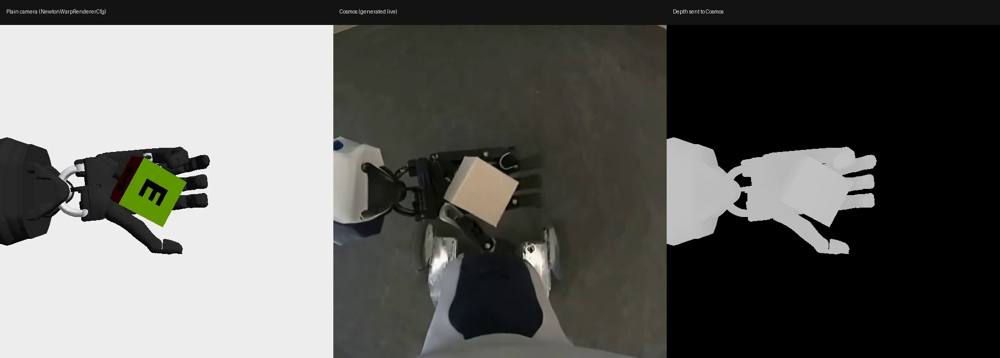

# Cosmos 3 Transfer on an Isaac Lab camera

An Isaac Lab camera renders depth; Cosmos 3 Transfer turns it into a realistic image; the task's camera publishes that
image as its `rgb`. This demo runs the standard Shadow Hand camera task that way. It needs no policy and no extra
workflow: you turn it on with `presets=cosmos`.



*Left: the plain simulator image. Middle: the image Cosmos generated from the depth on the right. Cosmos invents some
detail the simulator does not have.*

## Requirements

- Linux (x86_64 or aarch64), NVIDIA driver 580 or newer, 64 GB RAM.
- About 80 GB free disk. The installed files measured about 60 GB on ARM and 70 GB on x86: 30 to 40 GB for the checkout
  with its environments and 30 GB for the Cosmos checkpoint. Downloads and caches may need more.
- Two GPUs (or MIG slices) of about 48 GB: the simulator on one, Cosmos on the other (Cosmos needs about 45 GB).
- **Access that a person has to grant** (step 4 below): the Hugging Face token. The Cosmos
  Framework is a public repository and needs no access request.

## Quick start

Run every command from the repository root. The first install downloads about 30 GB and builds several environments, so it
takes much longer than later runs; use `tmux` (or `nohup ... > log 2>&1 &`) for steps 5 and 6. Step 5 resumes if it is
interrupted.

```bash
# 1. System packages (needs sudo)
sudo apt-get update && sudo apt-get install -y git git-lfs ffmpeg curl && git lfs install

# 2. Get the code
git clone https://github.com/temiroff/IsaacLab.git IsaacLab-demo && cd IsaacLab-demo
git checkout atemirov/cosmos-quickstart

# 3. Install uv and the Hugging Face CLI (no sudo)
./demos/cosmos3-transfer/setup.sh --bootstrap && export PATH="$HOME/.local/bin:$PATH"

# 4. Access: token, licenses, repository access (run it in a terminal where you can type)
./demos/cosmos3-transfer/setup.sh --access

# 5. Install everything
./demos/cosmos3-transfer/setup.sh --all

# 6. Run the demo
./demos/cosmos3-transfer/run.sh
```

What you should see:

| Step | Expected result |
| --- | --- |
| 3 | `uv` and `hf` installed; it prints any system package still missing |
| 4 | `All access items are in place.` (otherwise a numbered list of what is missing, each with a link) |
| 5 | A series of `==>` install steps, ending with `Setup finished.` It starts with the machine check, which ends `Check passed.` |
| 6 | `Output folder: ...`, the Cosmos settings it chose, then `Camera modifier path: PASS` |

### Step 4: the four items

`setup.sh --access` lists whatever is missing, with a link for each, and asks you about it:

| Item | What you do |
| --- | --- |
| Hugging Face token | Create a token of type **Read** at https://huggingface.co/settings/tokens and paste it when asked (input is hidden) |
| Isaac Sim license | Read the [license](https://docs.omniverse.nvidia.com/platform/latest/common/NVIDIA_Omniverse_License_Agreement.html); type `yes` only if you accept. The answer is saved in this checkout only, so a new clone asks again |

It re-checks after each item. Run it again at any time.

## What you get

`run.sh` starts Cosmos, runs 120 simulation steps with a random agent, stops everything and prints
`Camera modifier path: PASS` (or FAIL with the reason). The output folder has:

- `comparison/shadow-plain-cosmos-depth.mp4`: the three panels above, as a video;
- `metrics.md` and `result.json`: the checks, timings, GPU memory and the versions used.

Use other GPUs with `./demos/cosmos3-transfer/run.sh --sim-gpu N --cosmos-gpu M` (numbers as `nvidia-smi` lists them).

## How fast is it

Cosmos generates **slower than real time**, and the demo records every generated frame instead of running live. The saved
video plays at 60 fps.

| Measured | x86, 48 GB MIG slice | aarch64, full GB300 |
| --- | --- | --- |
| First generation (includes warm-up) | 34 s | 14 s |
| Then, per 4-frame chunk | about 1.26 s on average (about 3.2 frames per second) | about 0.17 s (about 24 frames per second) |
| The whole 2-second clip, start to finish | 106 s | 61 s |

On both, a chunk gets slower as the history window fills (30 frames): on x86 from about 0.95 s at the start (4.2 frames
per second) to about 1.56 s at the end (2.6); on aarch64 to about 22 frames per second. The two columns compare a
48 GB slice with a full GB300, so the difference is mostly the GPU, not the CPU architecture. Speed depends on the GPU;
these are single runs on one machine of each kind.

## If something fails

- **A missing token, license or repository access** is not a bug: `setup.sh --access` lists each item with its link.
- **`setup.sh --all` stops at the check:** read the `FAIL:` line (for example not enough free disk) and fix that item.
- **Setup was interrupted:** run `setup.sh --all` again; it resumes and reuses finished downloads.
- **Out of memory in Cosmos:** the Cosmos GPU needs about 45 GB free; try `./demos/cosmos3-transfer/run.sh --no-compile`.
- **A run was killed:** remove `/tmp/isaaclab-cosmos-shadow-<your uid>.sock` and stop any leftover `run_cosmos.py`
  process before running again.
- **Anything else:** the logs are `cosmos.log` and `capture.log` in the output folder.

## More

[APPENDIX.md](APPENDIX.md): how it works, options, ARM notes and known limits.
