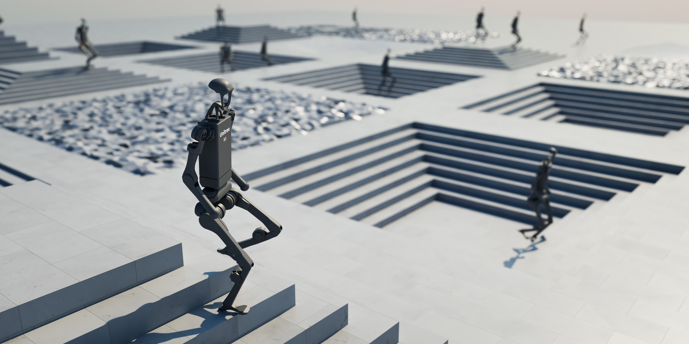
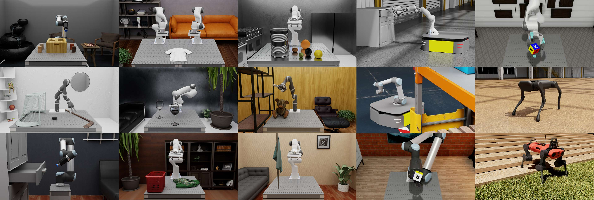

Welcome to Isaac Lab!
=====================

**Isaac Lab** is a unified and modular framework for robot learning that aims to simplify common workflows
in robotics research (such as reinforcement learning, learning from demonstrations, and motion planning). It supports
`NVIDIA Isaac Sim`_ for photo-realistic scenes and RTX rendering, and can also run standalone with the Newton physics backend
for fast and efficient simulation without requiring a full Isaac Sim installation.

Isaac Lab 3.0 introduces a :doc:`multi-backend architecture <source/concepts/backends_and_presets>`
with shared asset, sensor, and scene APIs. Task presets let you select supported physics and rendering
configurations, while visualization can be chosen independently.

The core objectives of the framework are:

- **Modularity**: Easily customize and add new environments, robots, and sensors.
- **Agility**: Adapt to the changing needs of the community.
- **Openness**: Remain open-sourced to allow the community to contribute and extend the framework.
- **Batteries-included**: Include a number of environments, sensors, and tasks that are ready to use.

Key features available in Isaac Lab include GPU-accelerated physics simulation with **PhysX** and
**Newton**, the **OvPhysX** backend, vectorized camera rendering with **Newton Warp** and
**RTX** renderers, domain randomization, and support for running in the cloud. Newton also supports
soft bodies, cloth, and experimental cables through its VBD solver, along with experimental particle
materials and coupled solvers for rigid--deformable interactions. See
:doc:`source/concepts/physics_backends` for backend features and requirements.

.. note::

   **Upgrading from Isaac Lab 2.x?** See the :ref:`migrating-to-isaaclab-3-0` guide for a full list
   of breaking changes and the new multi-backend architecture introduced in Isaac Lab 3.0.

Additionally, Isaac Lab provides a variety of environments, and we are actively working on adding more environments
to the list. These include classic control tasks, fixed-arm and dexterous manipulation tasks, legged locomotion tasks,
and navigation tasks. Browse the registered tasks and build a command in the
:doc:`environment browser <source/isaaclab/environments>`.

Isaac Lab is developed with specific robot assets that are now **Batteries-included** as part of the platform and are ready to learn! These robots include...

- **Classic** Cartpole, Humanoid, Ant
- **Fixed-Arm and Hands**: UR10, Franka, Allegro, Shadow Hand
- **Quadrupeds**: Anybotics AnymalB, AnymalC, AnymalD, Unitree A1, Unitree Go1, Unitree Go2, Boston Dynamics Spot
- **Humanoids**: Unitree H1, Unitree G1
- **Quadcopter**: Crazyflie

The platform is also designed so that you can add your own robots! Please refer to the
:ref:`how-to` section for details.

.. tip::

   Working with a coding agent? Isaac Lab ships a library of agent skills for installation, environment
   creation, RL training, migration, and more. See :doc:`source/developer-tools/agent_skills`.

For more information about the framework, please refer to the `technical report <https://arxiv.org/abs/2511.04831>`_
:cite:`mittal2025isaaclab`. For clarifications on NVIDIA Isaac ecosystem, please check out the
:ref:`isaac-lab-ecosystem` section.

License
========

The Isaac Lab framework is open-sourced under the BSD-3-Clause license,
with certain parts under Apache-2.0 license. Please refer to :ref:`license` for more details.

Citation
========

If you use Isaac Lab in your research, please cite our technical report:

.. code:: bibtex

   @article{mittal2025isaaclab,
      title={Isaac Lab: A GPU-Accelerated Simulation Framework for Multi-Modal Robot Learning},
      author={Mayank Mittal and Pascal Roth and James Tigue and Antoine Richard and Octi Zhang and Peter Du and Antonio Serrano-Muñoz and Xinjie Yao and René Zurbrügg and Nikita Rudin and Lukasz Wawrzyniak and Milad Rakhsha and Alain Denzler and Eric Heiden and Ales Borovicka and Ossama Ahmed and Iretiayo Akinola and Abrar Anwar and Mark T. Carlson and Ji Yuan Feng and Animesh Garg and Renato Gasoto and Lionel Gulich and Yijie Guo and M. Gussert and Alex Hansen and Mihir Kulkarni and Chenran Li and Wei Liu and Viktor Makoviychuk and Grzegorz Malczyk and Hammad Mazhar and Masoud Moghani and Adithyavairavan Murali and Michael Noseworthy and Alexander Poddubny and Nathan Ratliff and Welf Rehberg and Clemens Schwarke and Ritvik Singh and James Latham Smith and Bingjie Tang and Ruchik Thaker and Matthew Trepte and Karl Van Wyk and Fangzhou Yu and Alex Millane and Vikram Ramasamy and Remo Steiner and Sangeeta Subramanian and Clemens Volk and CY Chen and Neel Jawale and Ashwin Varghese Kuruttukulam and Michael A. Lin and Ajay Mandlekar and Karsten Patzwaldt and John Welsh and Huihua Zhao and Fatima Anes and Jean-Francois Lafleche and Nicolas Moënne-Loccoz and Soowan Park and Rob Stepinski and Dirk Van Gelder and Chris Amevor and Jan Carius and Jumyung Chang and Anka He Chen and Pablo de Heras Ciechomski and Gilles Daviet and Mohammad Mohajerani and Julia von Muralt and Viktor Reutskyy and Michael Sauter and Simon Schirm and Eric L. Shi and Pierre Terdiman and Kenny Vilella and Tobias Widmer and Gordon Yeoman and Tiffany Chen and Sergey Grizan and Cathy Li and Lotus Li and Connor Smith and Rafael Wiltz and Kostas Alexis and Yan Chang and David Chu and Linxi "Jim" Fan and Farbod Farshidian and Ankur Handa and Spencer Huang and Marco Hutter and Yashraj Narang and Soha Pouya and Shiwei Sheng and Yuke Zhu and Miles Macklin and Adam Moravanszky and Philipp Reist and Yunrong Guo and David Hoeller and Gavriel State},
      journal={arXiv preprint arXiv:2511.04831},
      year={2025},
      url={https://arxiv.org/abs/2511.04831}
   }

Acknowledgement
===============

Isaac Lab development initiated from the `Orbit <https://isaac-orbit.github.io/>`_ framework.
We gratefully acknowledge the authors of Orbit for their foundational contributions.

Table of Contents
=================

.. toctree::
   :maxdepth: 1
   :titlesonly:
   :caption: Isaac Lab

   source/isaaclab/ecosystem
   source/isaaclab/installation
   source/isaaclab/environments
   source/isaaclab/quickstart
   source/isaaclab/tutorial
   source/isaaclab/demos
   source/isaaclab/interactive_demos
   source/how-to/index
   source/isaaclab/migrating

.. toctree::
   :maxdepth: 1
   :titlesonly:
   :caption: Concepts

   source/concepts/task_workflows
   source/concepts/reinforcement_learning
   source/concepts/backends_and_presets
   source/concepts/physics_backends
   source/concepts/solver_differences
   source/concepts/actuators
   source/concepts/motion_generators
   source/concepts/sensors/index
   source/concepts/renderers
   source/concepts/visualization
   source/concepts/deformables
   source/concepts/coupled_solvers
   source/concepts/schema_cfgs
   source/concepts/scene_data_providers

.. toctree::
   :maxdepth: 1
   :titlesonly:
   :caption: Features

   source/features/isaac_teleop
   source/features/hydra
   source/features/multi_gpu
   source/features/population_based_training
   source/features/hpc_clusters
   source/features/cloud_deployment

.. toctree::
   :maxdepth: 1
   :titlesonly:
   :caption: Developer Tools

   source/developer-tools/editor_setup
   source/developer-tools/template_generator
   source/developer-tools/benchmarking/index
   source/developer-tools/agent_skills
   source/developer-tools/add_physics_backend
   source/developer-tools/extending_newton_solvers

.. toctree::
   :maxdepth: 1
   :titlesonly:
   :caption: Experimental Features

   source/experimental-features/bleeding-edge
   source/concepts/warp_environments
   source/experimental-features/ray
   source/experimental-features/visuo_tactile_sensor
   source/experimental-features/rlinf_vla_posttraining
   source/features/imitation-learning/index

.. toctree::
   :maxdepth: 1
   :titlesonly:
   :caption: Resources

   source/policy_deployment/index

.. toctree::
   :maxdepth: 1
   :titlesonly:
   :caption: References

   source/api/index
   source/refs/additional_resources
   source/refs/contributing
   source/refs/troubleshooting
   source/refs/issues
   source/refs/release_notes
   source/refs/changelog
   source/refs/license
   source/refs/bibliography

.. toctree::
    :hidden:
    :caption: Project Links

    GitHub <https://github.com/isaac-sim/IsaacLab>
    NVIDIA Isaac Sim <https://docs.isaacsim.omniverse.nvidia.com/latest/index.html>
    NVIDIA PhysX <https://nvidia-omniverse.github.io/PhysX/physx/5.4.1/index.html>
    NVIDIA Newton <https://github.com/newton-physics/newton>

Indices and tables
==================

* :ref:`genindex`
* :ref:`modindex`
* :ref:`search`

.. _NVIDIA Isaac Sim: https://docs.isaacsim.omniverse.nvidia.com/latest/index.html
