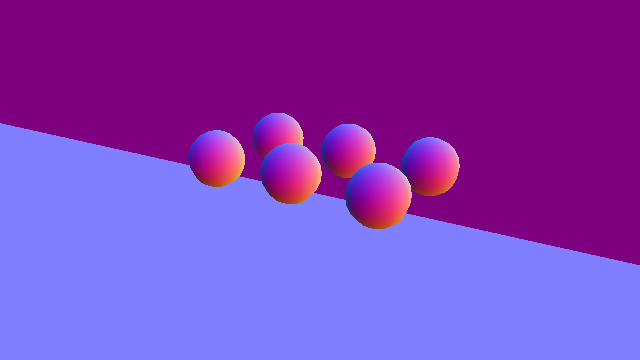

.. _concepts_sensors_camera:
.. _overview_sensors_camera:

.. currentmodule:: isaaclab

Camera
======

A :class:`~sensors.Camera` sets the pose, projection, resolution, sampling period,
and outputs to capture. The renderer produces the images, so one camera
configuration can work across supported physics and rendering backends.

Isaac Lab batches camera views from cloned environments into tiled render passes.
Each requested output is returned as one GPU buffer with a separate image per view.

For silent black or corrupted RTX camera images when scaling the workload, see
:ref:`known-issues-rtx-buffer-limit`.

Rendering model
---------------

:attr:`~sensors.CameraCfg.renderer_cfg` selects the renderer. A plain
:class:`~isaaclab.renderers.RendererCfg` requests the runtime default. Use a concrete configuration
when the renderer must be fixed:

.. list-table::
   :header-rows: 1
   :widths: 34 23 43

   * - Renderer configuration
     - Requires Isaac Sim
     - Characteristics
   * - :class:`~isaaclab_physx.renderers.IsaacRtxRendererCfg`
     - Yes
     - Replicator and RTX rendering through Isaac Sim
   * - :class:`~isaaclab_ov.renderers.OVRTXRendererCfg`
     - No
     - Kit-less RTX rendering through ``isaaclab_ov``
   * - :class:`~isaaclab_newton.renderers.NewtonWarpRendererCfg`
     - No
     - Kit-less Warp rasterization through Newton

For an environment that exposes renderer presets, select the renderer at launch instead of editing
the scene configuration. Pass ``physics=`` and ``renderer=`` together, since the renderer must match
your setup path. The command below is for the kit-less Newton path; for Isaac Sim, use
``physics=isaacsim_physx renderer=isaacsim_rtx`` with ``--extra isaacsim``. See
:doc:`/source/how-to/configure_rendering` for each pairing:

.. tab-set::
   :sync-group: os

   .. tab-item:: :icon:`fa-brands fa-linux` Linux
      :sync: linux

      .. code-block:: bash

         uv run isaaclab train --rl_library rsl_rl \
             --task Isaac-Cartpole-Camera-Direct \
             physics=newton_mjwarp renderer=newton_renderer presets=rgb

   .. tab-item:: :icon:`fa-brands fa-windows` Windows
      :sync: windows

      .. code-block:: batch

         uv run isaaclab train --rl_library rsl_rl ^
             --task Isaac-Cartpole-Camera-Direct ^
             physics=newton_mjwarp renderer=newton_renderer presets=rgb

Images are not written to disk by default. Set ``env.write_image_to_file=true`` to write
``cartpole_<data_type>.png`` in the current working directory.

See :doc:`/source/concepts/backends_and_presets` for preset discovery and
:ref:`renderer-visual-comparison` for a same-scene comparison of the renderer outputs.

With OVRTX, separate camera sensors share the scene and renderer when their renderer
configurations match, while each sensor has its own tiled render products. By default each sensor
starts with one render product, see :ref:`camera-render-products-per-sensor`. For example,
``env_0/head_camera`` and ``env_1/head_camera`` form one product, while
``env_0/wrist_camera`` and ``env_1/wrist_camera`` form another. The sensors can use different
resolutions and output types, and their poses update independently. Define all camera prims
before initializing the simulation so they are included in the scene exported to OVRTX.

.. _camera-configuration:

Configure a camera
------------------

A camera can spawn a pinhole or fisheye camera prim, or bind to a camera already on the stage.
``offset`` uses the convention declared on :class:`~sensors.CameraCfg.OffsetCfg`:

* ``world``: forward ``+X``, up ``+Z``.
* ``ros``: forward ``+Z``, up ``-Y``.
* ``opengl``: forward ``-Z``, up ``+Y``.

.. code-block:: python

   import isaaclab.sim as sim_utils
   from isaaclab.sensors import CameraCfg
   from isaaclab_newton.renderers import NewtonWarpRendererCfg

   front_camera = CameraCfg(
       prim_path="{ENV_REGEX_NS}/Robot/base/front_camera",
       update_period=0.05,
       height=240,
       width=320,
       data_types=["rgb", "depth", "normals"],
       spawn=sim_utils.PinholeCameraCfg(
           focal_length=24.0,
           horizontal_aperture=20.955,
           clipping_range=(0.1, 20.0),
       ),
       offset=CameraCfg.OffsetCfg(
           pos=(0.45, 0.0, 0.1),
           rot=(0.0, 0.0, 0.0, 1.0),
           convention="world",
       ),
       renderer_cfg=NewtonWarpRendererCfg(),
   )

A renderer instance is reused only when cameras use equal renderer configurations of the same
concrete configuration type. Different renderer settings create distinct instances. Camera
configurations, including output types and backgrounds, remain per sensor.

Read camera data
----------------

``camera.get_world_poses(convention="opengl")`` reads the current world poses without capturing images
or changing cached measurement poses. This includes motion of the camera's parent body even when
``update_latest_camera_pose=False``. It accepts the same orientation conventions as
``set_world_poses`` and returns device tensors for positions and quaternions.

:attr:`~sensors.CameraData.output` maps each requested name to a
:class:`~isaaclab.utils.warp.ProxyArray`. For ``N`` camera views, height ``H``, width ``W``, and
``C`` channels, each output has shape ``(N, H, W, C)``. Use ``torch`` for a cached zero-copy Torch
view or ``warp`` for the underlying Warp array:

.. code-block:: python

   camera_data = scene["front_camera"].data
   rgb = camera_data.output["rgb"].torch
   depth = camera_data.output["depth"].torch
   intrinsics = camera_data.intrinsic_matrices.torch

Camera pose and intrinsic buffers are also ``ProxyArray`` objects. ``pos_w`` has shape ``(N, 3)``,
``intrinsic_matrices`` has shape ``(N, 3, 3)``, and camera quaternions have shape ``(N, 4)`` in
``(x, y, z, w)`` order. Set ``update_latest_camera_pose=True`` only when current pose data is needed;
updating it adds frame-query overhead.

.. _camera-output-types:

Output types
------------

The active renderer validates ``data_types`` and allocates the channel count and data type declared
by its :class:`~isaaclab.renderers.RenderBufferSpec`.

.. list-table:: Common output contracts
   :header-rows: 1
   :widths: 34 22 44

   * - Name
     - Channels and type
     - Meaning
   * - ``rgb`` / ``rgba``
     - 3 / 4, ``uint8``
     - Low-dynamic-range color
   * - ``rgb_hdr``
     - 3, ``float32``
     - Scene-linear high-dynamic-range color
   * - ``albedo``
     - 4, ``uint8``
     - Material base color
   * - ``depth`` / ``distance_to_image_plane``
     - 1, ``float32``
     - Distance [m] along the camera optical axis
   * - ``distance_to_camera``
     - 1, ``float32``
     - Euclidean distance [m] from the optical center
   * - ``normals``
     - 3, ``float32``
     - Local surface normal ``(x, y, z)``
   * - ``motion_vectors``
     - 2, ``float32``
     - Image-space motion; positive ``x`` is left and positive ``y`` is up
   * - ``semantic_segmentation``
     - 4 ``uint8`` or 1 ``int32``
     - Semantic color or ID per pixel
   * - ``instance_segmentation``
     - 4 ``uint8`` or 1 ``int32``
     - Semantically labeled instance color or ID per pixel
   * - ``instance_id_segmentation_fast``
     - 4 ``uint8`` or 1 ``int32``
     - USD-prim instance color or ID per pixel

``depth`` is an alias of ``distance_to_image_plane``. Colorized segmentation uses RGBA ``uint8``;
non-colorized segmentation uses one ``int32`` ID channel. Label and prim-path mappings are stored in
``camera_data.info[output_name]``.

.. figure:: https://huggingface.co/datasets/nvidia/isaaclab-docs-assets/resolve/main/renderers/camera_renderer_isaac_rtx.webp
   :align: center
   :figwidth: 100%
   :alt: RGB camera output

   Isaac RTX RGB output. The animation shows the six material spheres falling onto the table.

   Isaac RTX depth output. Display colors encode optical-axis distance; the sensor returns metric
   values [m].

.. _camera-supported-annotators:

Renderer support
~~~~~~~~~~~~~~~~

Supported outputs vary by renderer. See the table below and the
:ref:`visual comparison <renderer-visual-comparison>` for examples.

.. list-table::
   :header-rows: 1
   :widths: 38 20 20 22

   * - Output
     - Isaac RTX
     - OVRTX
     - Newton Warp
   * - ``rgb``, ``rgba``, ``rgb_hdr``
     - Yes
     - Yes
     - Yes
   * - ``depth`` and both distance outputs
     - Yes
     - Yes
     - Yes
   * - ``normals``
     - Yes
     - Yes
     - Yes
   * - ``albedo``
     - Isaac Sim 6.0+
     - Yes
     - Yes
   * - ``motion_vectors``
     - Yes
     - Yes
     - No
   * - semantic and instance segmentation
     - Yes
     - Yes
     - Yes
   * - ``instance_id_segmentation_fast``
     - Yes
     - No
     - No
   * - ``simple_shading_*`` modes
     - Isaac Sim 6.0+
     - Yes
     - No

Querying an unsupported output fails during camera initialization. Renderer configuration controls
semantic filters, segmentation colorization, and depth clipping where those options are
backend-specific.

   Isaac RTX normals output. Red, green, and blue encode the surface normal X, Y, and Z components.

   Isaac RTX semantic segmentation. One color represents each class: the six spheres share one
   class, while the table and backdrop use separate classes.

   Isaac RTX instance segmentation. Each sphere receives its own color, distinguishing objects
   that share the same semantic class.

Background color
----------------

When :attr:`~sensors.CameraCfg.background_color` is ``None``, each renderer uses its default
background. Set a normalized RGB tuple to use a solid color for pixels that miss all geometry:

.. code-block:: python

   from isaaclab.utils import replace

   mask_camera = replace(front_camera, background_color=(0.0, 0.0, 0.0))

The setting is per camera. Cameras with renderer-default and solid backgrounds can coexist in one
scene.

.. _camera-render-products-per-sensor:

Render products per sensor
--------------------------

A camera sensor has one camera in every environment. By default, the renderer draws the images of
all these cameras side by side into one large image, the tiled atlas. One render product describes
this atlas.

To render the atlas, the renderer uses GPU buffers that each hold data for every pixel of the
atlas. More environments give a larger atlas, so these buffers get larger too. In the RTX path
tracer, some of them also get larger with the number of samples per pixel. One such buffer can hold
at most 4 GiB. If a buffer needs more, OVRTX 0.7 and later fail the frame. OVRTX 0.6 gives no error,
but some tiles come back black.

The renderer creates these buffers once for each render product. So you can split one camera sensor
over several render products to make each buffer smaller. The buffers stay below the limit only when
each render product is small enough, so the split needs the right value.

:attr:`~sensors.CameraCfg.max_envs_per_render_product` sets the split. With an integer ``M``, each
render product has at most ``M`` environments, so the sensor gets ``ceil(num_envs / M)`` render
products. The first one renders the first ``M`` environments, the next one the next ``M``, and so on.
Each render product has its own, smaller atlas. The outputs do not change: each data type still has
one ``(num_envs, height, width, channels)`` buffer, in the same environment order.

The field accepts these values:

* ``"auto"`` (the default): The sensor starts with one render product. If the first frame fails, the
  OVRTX renderer searches for a split.
* ``"all"``: The sensor always has one render product. The renderer never searches for a split of
  this sensor.
* An integer ``M`` of at least 1: The sensor always has ``ceil(num_envs / M)`` render products. The
  renderer never searches for a split of this sensor.

With ``"auto"``, the OVRTX renderer searches for a value by itself. It starts with one render product.
If the first frame fails, it halves the render products of one sensor and renders the frame again. It
repeats this, at most four times, until a frame renders. A warning then gives the value of ``M`` that
worked. For example, 2560 environments of 128 x 128 pixels at 16 samples per pixel give 1280.

The search runs only once, at startup. The next frame reuses most of the scene preparation of a failed
frame. To skip the search on later runs, set the logged value:

.. code-block:: python

   from isaaclab.utils import replace

   large_batch_camera = replace(camera_cfg, max_envs_per_render_product=1280)

The search has these limits:

* With several sensors, it halves one sensor per failed frame. It takes the sensor with the most atlas
  pixels times samples per pixel, because the largest renderer buffers grow with both. This is a guess.
  A wrong guess costs extra failed frames: halving a sensor lowers its rank, so the next failed frame
  can pick another sensor.
* It needs OVRTX 0.7 or later. OVRTX 0.6 does not fail the frame, so the search never starts.
* One frame tries at most four smaller layouts, counted over all camera sensors together. If the
  frame still fails, the renderer error reaches the caller. The camera then renders no more frames,
  and every later render of it raises an error at once.
* While it searches, it can need more GPU memory than the final layout. The renderer can keep the
  buffers of a failed layout for some time.

To turn the search off for a sensor, set ``"all"`` or an integer. There are two reasons to do this:

* You get a layout that does not depend on the GPU. With ``"auto"``, the layout depends on which first
  frames fail. That can change with the GPU, the driver or the OVRTX version. Path tracing and DLSS
  depend on the pixel position in the atlas, so another layout can change the color outputs a little.
* You get a clear failure instead of an automatic change. With ``"auto"``, the renderer changes the
  layout after a failed first frame and only logs a warning.

With ``"all"`` or an integer, the renderer uses the layout as given. If a frame then fails, you get the
renderer error, unless the search can halve another camera sensor with ``"auto"`` and the frame then
renders. To find a good integer by hand, start with half the number of environments. Halve it again
until the frame renders and no tile is black. Each extra render product adds a fixed cost to every
frame. So use the largest value that renders.

Only the OVRTX renderer supports an integer. The Isaac RTX and Newton Warp renderers always render a
camera sensor through one render product. They accept ``"auto"`` and ``"all"``, but reject an integer
when the camera is created.

Post-render image signal processing
-----------------------------------

:attr:`~sensors.CameraCfg.isp_cfg` optionally applies an image signal processing (ISP) pass to the
renderer's scene-linear HDR output. The shipped implementation is PPISP (Physically Plausible Image
Signal Processing), which applies responsivity, exposure, vignetting, color correction, and a camera
response function before writing ``rgb`` or ``rgba``.

The field accepts:

* ``None`` to disable post-render ISP.
* :class:`~isaaclab_ppisp.PpispCfg` for explicit coefficients or coefficients imported from a USD
  camera.
* :class:`~isaaclab.sensors.camera.CameraISPMode` to discover ``ppisp:*`` attributes on a camera prim.

.. code-block:: python

   from isaaclab.sensors.camera import CameraCfg, CameraISPMode
   from isaaclab.utils import replace
   from isaaclab_ppisp import PpispCfg

   explicit_isp = replace(front_camera, data_types=["rgb"], isp_cfg=PpispCfg(inputs={"exposureOffset": 1.5}))

   discovered_isp = replace(front_camera, data_types=["rgb"], isp_cfg=CameraISPMode.AUTO_CAMERA)

``AUTO_CAMERA`` checks the first matched camera prim. ``AUTO_ANY`` falls back to the first PPISP
camera anywhere on the stage. Discovery happens once during camera construction.

PPISP is composed by Isaac RTX, OVRTX, and Newton Warp. It requires ``rgb`` or ``rgba`` output. A
static configuration is shared by all cloned views in one camera batch; controller weights may
predict per-view exposure and color parameters, while the remaining coefficients stay shared. ISP
configuration and discovered USD attributes are fixed for the camera lifetime.

.. important::

   With Isaac RTX and OVRTX, enabling ``isp_cfg`` makes PPISP the ISP authority. The renderer
   disables RTX auto-exposure, authors neutral ``exposure:*`` values, and applies the
   ``OmniRtxCameraAutoExposureAPI_1`` and ``OmniRtxCameraExposureAPI_1`` schemas on every matched
   camera prim so RTX does not process the image a second time. Do not combine ``isp_cfg`` with
   separately authored RTX exposure or tonemapping settings. When ``isp_cfg`` is ``None``, the
   renderer leaves authored camera exposure unchanged.

Run the ``ppisp-camera`` example for a complete PPISP workflow. It supports
``--renderer newton_renderer`` (Newton Warp, the default) and ``--renderer isaac_rtx`` (Isaac RTX).
The example runs 0 warmup steps for Newton Warp and 32 for Isaac RTX before saving images; override
this with ``--warmup_steps``.

.. tab-set::
   :sync-group: os

   .. tab-item:: :icon:`fa-brands fa-linux` Linux
      :sync: linux

      .. code-block:: bash

         uv run --extra isaacsim isaaclab example ppisp-camera \
             --renderer newton_renderer --max_steps 60

         uv run --extra isaacsim isaaclab example ppisp-camera \
             --input_scene /path/to/scene.usd --renderer isaac_rtx \
             --camera_prim_path /usd/path/to/camera --max_steps 60

   .. tab-item:: :icon:`fa-brands fa-windows` Windows
      :sync: windows

      .. code-block:: batch

         uv run --extra isaacsim isaaclab example ppisp-camera ^
             --renderer newton_renderer --max_steps 60

         uv run --extra isaacsim isaaclab example ppisp-camera ^
             --input_scene C:/path/to/scene.usd --renderer isaac_rtx ^
             --camera_prim_path /usd/path/to/camera --max_steps 60

``--input_scene`` accepts a local path or URL to a USD or USDZ scene containing the Gaussian PPISP
setup. If omitted, the example uses the ``Samples/Scene_ParticleField/valiant_auto.usdz``
sample from ``ISAAC_NUCLEUS_DIR``.

``--camera_prim_path`` is an optional absolute USD prim path in the input scene; in both commands
above, replace ``/usd/path/to/camera`` with the path of a camera in your scene. The prim must exist,
have type ``Camera``, and carry ``ppisp:*`` attributes. If omitted, the example selects the first
camera with PPISP attributes. For both renderers, the input scene must have a ``defaultPrim`` and
the camera must be a descendant of it (for example, a camera at ``/World/Cameras/front_cam`` requires
``/World`` as the ``defaultPrim``).

Images are saved to ``output/ppisp_camera`` in the current working directory; use ``--output_dir``
to change it. ``--max_steps`` sets the number of steps after warmup (default: 120), and
``--save_interval`` sets the image-saving interval in steps (default: 20).
For all options, run ``uv run --extra isaacsim isaaclab example ppisp-camera --help``.

Performance and validation
--------------------------

Image memory and rendering cost scale with the number of environments, resolution, channel count,
and requested outputs. Start camera-based tasks with a small environment count, verify shapes and
renderer support, and then scale while monitoring GPU memory. Avoid requesting buffers that the task
does not consume.

Tiled rendering batches the cloned views into shared render passes, but it does not remove the memory
cost of the de-tiled outputs or downstream vision models. The camera follows the shared sensor
``update_period`` contract; choose a period that matches the observation cadence instead of rendering
at every physics step by default.

A runnable camera example is available as ``camera``:

.. code-block:: bash

   uv run --extra isaacsim isaaclab example camera

For saving output to disk, see :doc:`/source/how-to/save_camera_output`. For renderer selection
and customization, see :doc:`/source/how-to/configure_rendering`.
