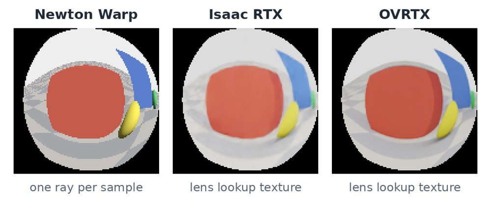
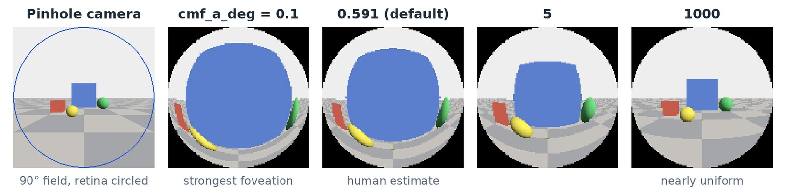

.. _concepts_sensors_foveated_camera:

.. currentmodule:: isaaclab_fovi

Foveated Camera
===============

A :class:`~sensors.FoveatedCamera` samples the scene densely where it looks and sparsely in the periphery, as a
retina does, instead of on a uniform pixel grid. It is a :class:`~isaaclab.sensors.Camera` whose rays are laid out
by the `fovi <https://nblauch.github.io/fovi>`__ library, and its gaze moves inside the field of view of the
physical camera it looks through. The camera implements the foveated rendering of
`FOVI-Dex <https://fovi-dex.github.io/>`__.

.. figure:: ../../_static/overview/sensors/foveated_camera_overview.jpg
   :target: ../../_static/overview/sensors/foveated_camera_overview.jpg
   :align: center
   :figwidth: 100%
   :alt: The retina's rays on a viewing sphere and the image the camera publishes, at two fixations.

   The demo scene through a foveated camera, fixating two objects. Left of each pair: the viewing sphere seen from
   behind the camera, textured with the physical camera's 90° pinhole image (green outline). The blue lattice is
   every 16th row and column of the 128 × 128 retina, and the blue circle its edge; grey lines fall outside the
   physical camera's image. Right: the image the camera publishes, dense at the fixation and sparse in the
   periphery.

The camera comes with the ``fovi`` extra:

.. code-block:: bash

   uv sync --extra fovi

The demo moves the gaze from object to object while the viewer shows the retina:

.. code-block:: bash

   uv run --extra fovi isaaclab demo foveated-camera

How the retina samples the scene
--------------------------------

The retina places its samples by visual angle, with a density that falls off from the fixation as the cortical
magnification function (CMF) of human vision does. At eccentricity :math:`r` from the fixation, in degrees,

.. math::

   M(r) = \frac{1}{r + a}, \qquad w(r) = \int_0^r M(t)\,dt = \log\left(1 + \frac{r}{a}\right),

where :math:`a` is :attr:`~sensors.FoveatedCameraCfg.cmf_a_deg`, :math:`M` is the cortical distance per degree of
visual angle, and :math:`w` is the cortical distance from the fixation. Samples spaced evenly in :math:`w` are dense
near the fixation and sparse far from it.

The camera lays an :math:`N \times N` lattice over this cortical
space, with :math:`N` = :attr:`~sensors.FoveatedCameraCfg.foveated_res`. Lattice point
:math:`\mathbf{c}_{ij} = (\xi_i, \xi_j)`, with :math:`\xi_i = -1 + (2i + 1)/N`, samples at angle
:math:`\theta = \operatorname{atan2}(c_y, c_x)` around the fixation and eccentricity

.. math::

   r(\rho) = a\left[\left(1 + \frac{r_{\max}}{a}\right)^{\rho} - 1\right], \qquad \rho = \lVert \mathbf{c}_{ij} \rVert_2,

so the lattice's radius is proportional to :math:`w`. :math:`r_{\max}` is half the retina's field of view. Lattice
points with :math:`\rho > 1` lie outside the circular field and publish zero. The camera casts each sample's ray

.. math::

   \mathbf{d} = (\sin r \cos\theta,\; -\sin r \sin\theta,\; \cos r)^\top

in the camera frame (:math:`x` right, :math:`y` down, :math:`z` forward), turns it by the gaze, and renders it. The
published image keeps the lattice's layout, so it is an upright :math:`N \times N` image that convolutional networks
take as is.

Configure a foveated camera
---------------------------

Add a :class:`~sensors.FoveatedCameraCfg` to a scene like any camera configuration. The renderer selects how the
retina is rendered:

.. list-table::
   :header-rows: 1
   :widths: 45 55

   * - Renderer configuration
     - Rendering
   * - :class:`~isaaclab_newton.renderers.NewtonWarpRendererCfg`
     - One ray per retinal sample.
   * - :class:`~isaaclab_physx.renderers.IsaacRtxRendererCfg`,
       :class:`~isaaclab_ov.renderers.OVRTXRendererCfg`
     - A lens lookup texture on the camera prim maps the image to the retina's rays.

The camera also accepts the Newton OptiX renderer (``optix`` extra), which receives the same rays as Newton Warp. On
the RTX renderers, :attr:`~sensors.FoveatedCameraCfg.exit_texture_size` sets the side of the inverse lens texture,
which maps rays back to samples; the default, four times the grid side and at least 128, separates neighbouring
samples.

   The demo's first fixation on each renderer. Newton Warp shades one ray per sample; the RTX renderers render
   through the lens texture with their own anti-aliasing, so their edges are softer.

.. code-block:: python

   import isaaclab.sim as sim_utils
   from isaaclab_fovi.sensors import FoveatedCameraCfg
   from isaaclab_newton.renderers import NewtonWarpRendererCfg

   eye = FoveatedCameraCfg(
       prim_path="{ENV_REGEX_NS}/Eye",
       data_types=["rgb"],
       renderer_cfg=NewtonWarpRendererCfg(),
       spawn=sim_utils.PinholeCameraCfg(),
       foveated_res=64,
   )

The camera computes its image size from the retina. It publishes an upright image of
shape ``(num_envs, foveated_res, foveated_res, channels)`` in :attr:`~isaaclab.sensors.Camera.data`, like any
camera, and any output the renderer supports.

The physical camera
~~~~~~~~~~~~~~~~~~~

The retina places its samples by visual angle inside the image of a physical camera, and its rays are cast at those
angles, so no pinhole image is resampled. Its field of view, :math:`2 r_{\max}`, is the angle the camera's image
spans across its short side. By default that camera is the one ``spawn`` creates:

* :class:`~isaaclab.sim.PinholeCameraCfg` optics give an ideal pinhole.
* An OpenCV model in ``spawn.distortion`` gives that calibrated camera. An
  :class:`~isaaclab.sim.OpenCvFisheyeDistortionCfg` with zero coefficients is an ideal equidistant fisheye.

For any other calibrated camera, or a camera prim without spawn configuration, set
:attr:`~sensors.FoveatedCameraCfg.camera_model` to the fields of a ``fovi.sensing.projection.CameraModel``:

.. code-block:: python

   camera_model = {
       "model": "pinhole",  # or "fisheye"
       "image_size": (480, 640),  # (height, width)
       "intrinsics": (550.0, 550.0, 319.5, 239.5),  # fx, fy, cx, cy [px]
   }

The same fields configure fovi's software sampler on images from a real camera: it samples the camera's image at
the pixels :math:`\Pi(R\,\mathbf{d})` the rendered rays project to, where :math:`\Pi` is the camera's projection
and :math:`R` the gaze rotation, so a policy sees the same retina in simulation and on hardware.

The projection is set in the configuration. :meth:`~sensors.FoveatedCamera.set_intrinsic_matrices` leaves a
foveated camera as configured and warns, as cameras with an OpenCV lens model do.

:attr:`~sensors.FoveatedCameraCfg.retinal_window_fraction` shrinks the retina's window to a fraction of the image's
short side, or of its long side with :attr:`~sensors.FoveatedCameraCfg.retinal_window_reference_side` set to
``"long"``. For a camera mounted rolled, :attr:`~sensors.FoveatedCameraCfg.image_rotation_deg` turns the rays back
about the optical axis (180 for an upside-down sensor), so the published image, the sensor mask and the gaze stay
upright.

Foveation strength
~~~~~~~~~~~~~~~~~~

:attr:`~sensors.FoveatedCameraCfg.cmf_a_deg` is the CMF constant :math:`a`. Smaller values concentrate more samples
at the fixation; the default, 0.591, is an estimate from human data. Neighbouring grid samples lie about

.. math::

   \Delta r \approx \frac{2}{N} \log\left(1 + \frac{r_{\max}}{a}\right) (r + a)

apart at eccentricity :math:`r`. For the demo's 128 × 128 retina over a 90° field, that is 0.04° at the fixation
and 3.1° at the edge, compared with a uniform radial angular step of about 0.7°. A value of :math:`a` much larger
than the field of view gives nearly uniform radial angular spacing on the same lattice:

.. code-block:: bash

   uv run --extra fovi isaaclab demo foveated-camera env.scene.eye.cmf_a_deg=1000

   The demo scene with the gaze on the optical axis. Left: the physical camera's pinhole image, with the retina's
   field circled. Right: the published 128 × 128 image at four values of ``cmf_a_deg``.

Move the gaze
-------------

The gaze turns the retina relative to the physical camera's optical axis:

.. code-block:: python

   # (tilt, pan) [deg] from the optical axis, shape (num_envs, 2): positive tilt looks up, positive pan looks left.
   camera.set_gaze_angles(angles)

The gaze stays relative to the camera's mount when the mount moves, and
:meth:`~sensors.FoveatedCamera.get_world_poses` reports the mount without the gaze. Set
:attr:`~sensors.FoveatedCameraCfg.mask_to_sensor_fov` to zero the samples that fall outside the physical camera's
image at the current gaze, so that the retina only sees what the camera could. A real camera cannot provide those
samples, so a policy meant for hardware should train with the mask.

.. figure:: ../../_static/overview/sensors/foveated_camera_gaze_mask.jpg
   :target: ../../_static/overview/sensors/foveated_camera_gaze_mask.jpg
   :align: center
   :figwidth: 80%
   :alt: The retina in the camera image at a gaze 38 degrees to the left, without and with the sensor mask.

   The gaze 38° left of the optical axis. Left: the retina's lattice in the physical camera's image; its grey part
   lies outside the image. Middle: without the mask, rays render beyond the camera's view. Right: with the mask, those
   samples are zero.

Gaze actions
------------

For a manager-based environment, :class:`~mdp.GazeActionCfg` adds two bounded tilt and pan increments in units of
the retinal field radius. :func:`~mdp.gaze_state` reports the resulting angles and angular velocity. The action
resets the gaze to the optical axis at the start of each episode.

Further reading
---------------

* `FOVI-Dex <https://fovi-dex.github.io/>`__: foveated rendering and active gaze for perceptive reinforcement
  learning of dexterous manipulation, with interactive demos.
* `fovi <https://nblauch.github.io/fovi>`__: the foveated sampling library, its sampling styles, and foveated vision
  networks.
