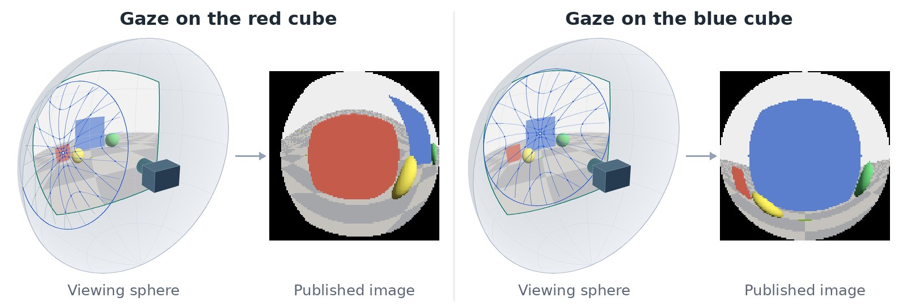
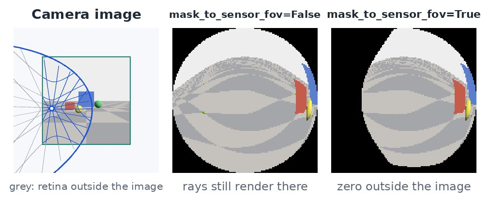
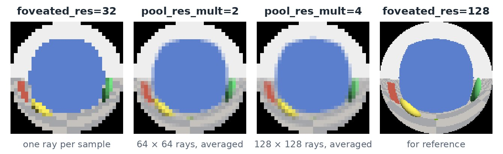
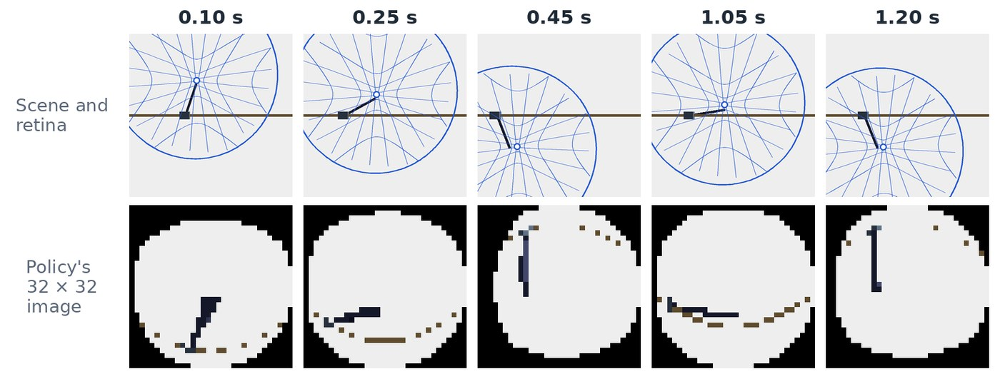
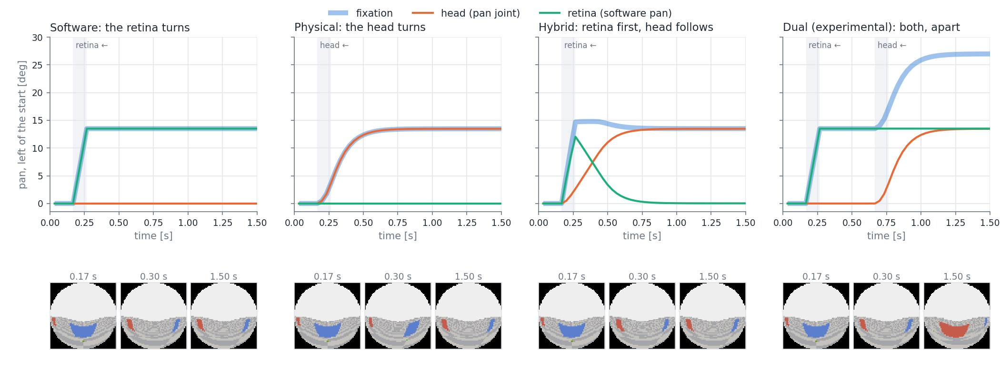

.. _concepts_sensors_foveated_camera:

.. currentmodule:: isaaclab_fovi

Foveated Camera
===============

A :class:`~sensors.FoveatedCamera` samples the scene densely where it looks and sparsely in the periphery, as a
retina does, instead of on a uniform pixel grid. It is a :class:`~isaaclab.sensors.Camera` whose rays are laid out
by the `fovi <https://nblauch.github.io/fovi>`__ library, and its gaze moves inside the field of view of the
physical camera it looks through. The camera implements the foveated rendering of
`FOVI-Dex <https://fovi-dex.github.io/>`__.

   The demo scene through a foveated camera, fixating two objects. Left of each pair: the viewing sphere seen from
   behind the camera, textured with the physical camera's 90° pinhole image (green outline). The blue lattice is
   every 16th row and column of the 128 × 128 retina, and the blue circle its edge; grey lines fall outside the
   physical camera's image. Right: the image the camera publishes, dense at the fixation and sparse in the
   periphery.

The camera comes with the ``fovi`` extra:

.. code-block:: bash

   uv sync --extra fovi

The demo moves the gaze from object to object while the viewer shows the retina:

.. code-block:: bash

   uv run --extra fovi isaaclab demo foveated-camera

How the retina samples the scene
--------------------------------

The retina places its samples by visual angle, with a density that falls off from the fixation as the cortical
magnification function (CMF) of human vision does. At eccentricity :math:`r` from the fixation, in degrees,

.. math::

   M(r) = \frac{1}{r + a}, \qquad w(r) = \int_0^r M(t)\,dt = \log\left(1 + \frac{r}{a}\right),

where :math:`a` is :attr:`~sensors.FoveatedCameraCfg.cmf_a_deg`, :math:`M` is the cortical distance per degree of
visual angle, and :math:`w` is the cortical distance from the fixation. Samples spaced evenly in :math:`w` are dense
near the fixation and sparse far from it.

The default ``foveated_style="warped_cartesian_as_grid"`` lays an :math:`N \times N` lattice over this cortical
space, with :math:`N` = :attr:`~sensors.FoveatedCameraCfg.foveated_res`. Lattice point
:math:`\mathbf{c}_{ij} = (\xi_i, \xi_j)`, with :math:`\xi_i = -1 + (2i + 1)/N`, samples at angle
:math:`\theta = \operatorname{atan2}(c_y, c_x)` around the fixation and eccentricity

.. math::

   r(\rho) = a\left[\left(1 + \frac{r_{\max}}{a}\right)^{\rho} - 1\right], \qquad \rho = \lVert \mathbf{c}_{ij} \rVert_2,

so the lattice's radius is proportional to :math:`w`. :math:`r_{\max}` is half the retina's field of view. Lattice
points with :math:`\rho > 1` lie outside the circular field and publish zero. The camera casts each sample's ray

.. math::

   \mathbf{d} = (\sin r \cos\theta,\; -\sin r \sin\theta,\; \cos r)^\top

in the camera frame (:math:`x` right, :math:`y` down, :math:`z` forward), turns it by the gaze, and renders it. The
published image keeps the lattice's layout, so it is an upright :math:`N \times N` image that convolutional networks
take as is.

The viewer below computes the same grids for two physical cameras, an ideal equidistant fisheye and an ideal pinhole,
each with its own field of view. Each panel shows the retina's rays on the viewing sphere, and where they land in the
camera's image. A fisheye keeps image distance proportional to angle, so it reaches 180° and beyond; a pinhole
stretches the periphery, so wide fields spread its outer samples far apart. Move the gaze to see which samples leave
the camera's image.

.. raw:: html

   

``foveated_style="isotropic"`` instead places rings of samples evenly in :math:`w`, with as many samples around each
ring as keep neighbours about equally far apart in every direction, as in the
`fovi <https://nblauch.github.io/fovi>`__ model. The camera uses as many rings as keep the sample count at most
:math:`N^2`, and publishes the samples as a set, of shape ``(num_envs, num_samples, 1, channels)``;
:attr:`~sensors.FoveatedCameraCfg.isotropic_plotting_type` picks the cortical layout fovi gives them (``"v1like"``,
``"schwartz"`` or ``"warp"``). Sample sets render directly on Newton and are experimental on the RTX renderers, where
crowded samples can share a lens-texture texel.

Configure a foveated camera
---------------------------

Add a :class:`~sensors.FoveatedCameraCfg` to a scene like any camera configuration. The renderer selects how the
retina is rendered:

.. list-table::
   :header-rows: 1
   :widths: 45 55

   * - Renderer configuration
     - Rendering
   * - :class:`~isaaclab_newton.renderers.NewtonWarpRendererCfg`
     - One ray per retinal sample.
   * - :class:`~isaaclab_physx.renderers.IsaacRtxRendererCfg`,
       :class:`~isaaclab_ov.renderers.OVRTXRendererCfg`
     - A lens lookup texture on the camera prim maps the image to the retina's rays.

The camera also accepts the Newton OptiX renderer (``optix`` extra), which receives the same rays as Newton Warp. On
the RTX renderers, :attr:`~sensors.FoveatedCameraCfg.exit_texture_size` sets the side of the inverse lens texture,
which maps rays back to samples; the default, four times the grid side and at least 128, separates neighbouring
samples.

.. figure:: ../../_static/overview/sensors/foveated_camera_renderers.jpg
   :target: ../../_static/overview/sensors/foveated_camera_renderers.jpg
   :align: center
   :figwidth: 80%
   :alt: The same retina and fixation rendered by Newton Warp, Isaac RTX and OVRTX.

   The demo's first fixation on each renderer. Newton Warp shades one ray per sample; the RTX renderers render
   through the lens texture with their own anti-aliasing, so their edges are softer.

.. code-block:: python

   import isaaclab.sim as sim_utils
   from isaaclab_fovi.sensors import FoveatedCameraCfg
   from isaaclab_newton.renderers import NewtonWarpRendererCfg

   eye = FoveatedCameraCfg(
       prim_path="{ENV_REGEX_NS}/Eye",
       data_types=["rgb"],
       renderer_cfg=NewtonWarpRendererCfg(),
       spawn=sim_utils.PinholeCameraCfg(),
       foveated_res=64,
   )

The camera computes its image size from the retina. With the default grid style it publishes an upright image of
shape ``(num_envs, foveated_res, foveated_res, channels)`` in :attr:`~isaaclab.sensors.Camera.data`, like any
camera, and any output the renderer supports.

The physical camera
~~~~~~~~~~~~~~~~~~~

The retina places its samples by visual angle inside the image of a physical camera, and its rays are cast at those
angles, so no pinhole image is resampled. Its field of view, :math:`2 r_{\max}`, is the angle the camera's image
spans across its short side. By default that camera is the one ``spawn`` creates:

* :class:`~isaaclab.sim.PinholeCameraCfg` optics give an ideal pinhole.
* An OpenCV model in ``spawn.distortion`` gives that calibrated camera. An
  :class:`~isaaclab.sim.OpenCvFisheyeDistortionCfg` with zero coefficients is an ideal equidistant fisheye.

For any other calibrated camera, or a camera prim without spawn configuration, set
:attr:`~sensors.FoveatedCameraCfg.camera_model` to the fields of a ``fovi.sensing.projection.CameraModel``:

.. code-block:: python

   camera_model = {
       "model": "pinhole",  # or "fisheye"
       "image_size": (480, 640),  # (height, width)
       "intrinsics": (550.0, 550.0, 319.5, 239.5),  # fx, fy, cx, cy [px]
   }

The same fields configure fovi's software sampler on images from a real camera: it samples the camera's image at
the pixels :math:`\Pi(R\,\mathbf{d})` the rendered rays project to, where :math:`\Pi` is the camera's projection
and :math:`R` the gaze rotation, so a policy sees the same retina in simulation and on hardware.

The projection is set in the configuration. :meth:`~sensors.FoveatedCamera.set_intrinsic_matrices` leaves a
foveated camera as configured and warns, as cameras with an OpenCV lens model do.

:attr:`~sensors.FoveatedCameraCfg.retinal_window_fraction` shrinks the retina's window to a fraction of the image's
short side, or of its long side with :attr:`~sensors.FoveatedCameraCfg.retinal_window_reference_side` set to
``"long"``. For a camera mounted rolled, :attr:`~sensors.FoveatedCameraCfg.image_rotation_deg` turns the rays back
about the optical axis (180 for an upside-down sensor), so the published image, the sensor mask and the gaze stay
upright.

Foveation strength
~~~~~~~~~~~~~~~~~~

:attr:`~sensors.FoveatedCameraCfg.cmf_a_deg` is the CMF constant :math:`a`. Smaller values concentrate more samples
at the fixation; the default, 0.591, is an estimate from human data. Neighbouring grid samples lie about

.. math::

   \Delta r \approx \frac{2}{N} \log\left(1 + \frac{r_{\max}}{a}\right) (r + a)

apart at eccentricity :math:`r`. For the demo's 128 × 128 retina over a 90° field, that is 0.04° at the fixation
and 3.1° at the edge, where a uniform 128 × 128 image spaces its pixels 0.7° apart. A value of :math:`a` much larger
than the field of view samples nearly uniformly, which gives a matched non-foveated baseline with the same
resolution, field of view and gaze:

.. code-block:: bash

   uv run --extra fovi isaaclab demo foveated-camera env.scene.eye.cmf_a_deg=1000

.. figure:: ../../_static/overview/sensors/foveated_camera_strength.jpg
   :target: ../../_static/overview/sensors/foveated_camera_strength.jpg
   :align: center
   :figwidth: 100%
   :alt: The physical camera's image and the 128 x 128 retina at four CMF constants.

   The demo scene with the gaze on the optical axis. Left: the physical camera's pinhole image, with the retina's
   field circled. Right: the published 128 × 128 image at four values of ``cmf_a_deg``.

Move the gaze
-------------

The gaze turns the retina relative to the physical camera's optical axis:

.. code-block:: python

   # (tilt, pan) [deg] from the optical axis, shape (num_envs, 2): positive tilt looks up, positive pan looks left.
   camera.set_gaze_angles(angles)

The gaze stays relative to the camera's mount when the mount moves, and
:meth:`~sensors.FoveatedCamera.get_world_poses` reports the mount without the gaze. Set
:attr:`~sensors.FoveatedCameraCfg.mask_to_sensor_fov` to zero the samples that fall outside the physical camera's
image at the current gaze, so that the retina only sees what the camera could. A real camera cannot provide those
samples, so a policy meant for hardware should train with the mask.

   The gaze 38° left of the optical axis. Left: the retina's lattice in the physical camera's image; its grey part
   lies outside the image. Middle: without the mask, rays render beyond the camera's view. Right: with the mask, those
   samples are zero.

Pooling
-------

A single ray per sample aliases where samples are sparse, in the periphery. With
:attr:`~sensors.FoveatedCameraCfg.pool_enabled`, the camera renders a denser photoreceptor grid with the same field
of view and CMF and pools it to the retina, as a retina's ganglion cells pool its photoreceptors.
``pool_res_mult`` sets how much denser the photoreceptor grid is: an integer for grid styles, and any value for
sample-set styles, where :math:`\sqrt{2}` doubles the number of samples. ``pool_mode`` sets how it pools: ``avg``,
``gaussian`` (with ``pool_gauss_sigma``) or ``max``, and for sample-set styles also ``sum``.

   A 32 × 32 retina in the demo scene. Pooling averages 4 or 16 photoreceptors into each sample, which smooths the
   edges of the cubes and spheres while the published image keeps its size.

Grid styles pool each sample over a square window of the photoreceptor grid, ``pool_k`` photoreceptors in all (the
window side squared; by default ``pool_res_mult`` squared), stepping by ``pool_res_mult``. Because the grid follows
the CMF, a window covers a tiny patch of the visual field at the fixation and a wide one in the periphery.
Photoreceptors outside the circular field are left out of the average. Sample-set styles such as ``isotropic`` pool
each sample over its ``pool_k`` nearest photoreceptors instead (by default the ratio of photoreceptors to samples,
about ``pool_res_mult`` squared), by distance along the cortex (``pool_sample_cortex="geodesic"``, the default),
straight-line distance on the cortex (``True``, faster to set up), or distance in the visual field (``False``).

The viewer shows which photoreceptors each sample pools, for both styles. Its isotropic neighbourhoods are the ones
fovi computes for the camera.

.. raw:: html

   

Segmentation outputs pool by modal label in their own dtype (``pool_int_mode="modal"``),
since averaging would mix labels into ones no object has. With the sensor mask, pooling leaves out the
photoreceptors the physical camera does not see, so a pooled sample at the edge of the camera's image pools only the
ones it sees, and is zero when it sees none.

Further sampling options are passed to fovi's ``SamplingCoords``, whose
`documentation <https://nblauch.github.io/fovi/docs/>`__ describes them: ``fov_type`` and ``radius_norm`` set the
region the retina covers.

Active gaze
-----------

:mod:`isaaclab_fovi.mdp` holds the manager terms for a policy that moves the gaze:

* :class:`~mdp.GazeActionCfg`: two actions that move the gaze by up to ``step_size`` field radii per step, within
  ``gaze_limit`` of the optical axis. Make it the last action term. With the default ``mount="fixed"`` the teacher
  aims from the camera's orientation when the action is created; ``mount="tracked"`` lets the camera ride a moving
  body, such as a turning head (Newton and OVRTX).
* :func:`~mdp.gaze_state`: the gaze and its velocity.
* :class:`~mdp.gaze_teacher_labels`: a teacher's gaze action toward a point fixed to an asset, and whether that point
  is a valid target. It is a training label, never a policy input.

The ``IsaacContrib-Cartpole-Camera-Fovi`` task in :mod:`isaaclab_tasks.contrib.active_gaze` puts them together. It is
the stock Cartpole camera task with the camera foveated (a 32-sample retina), two gaze actions, and a teacher that looks
at the pole's tip. Its PPO adds a loss that pulls the gaze actions toward the teacher's, and its action head keeps
the gaze actions' noise fixed:

.. code-block:: bash

   uv run --extra fovi isaaclab train --rl_library rsl_rl --task IsaacContrib-Cartpole-Camera-Fovi

The task is registered when the ``fovi`` extra is installed.

   The Cartpole task with the teacher's labels as the gaze actions. Top: the scene from the task's camera, with the
   retina's lattice and edge; the gaze follows the pole's tip. Bottom: the 32 × 32 image the policy receives, with
   the pole large at the fixation. Black samples lie outside the camera's image.

Gaze modes
~~~~~~~~~~

:attr:`~mdp.GazeActionCfg.mode` sets what the gaze actions turn:

* ``"software"`` (the default): the retina, at once, inside a camera that does not turn.
* ``"physical"``: the joints of a rig that carries the camera. Each action steps the joints' targets from their
  last targets; the retina stays on the optical axis, and the fixation follows as the joints reach their targets.
* ``"hybrid"``: the retina at once, while the rig turns the camera after it. Each step the head steps toward the
  fixation by at most :attr:`~mdp.GazeRigCfg.max_step_deg` per joint, and the software gaze is aimed back at the
  fixation it holds in the world, so as the head catches up the retina returns to the optical axis. The policy sees
  a fast gaze, and the camera ends up pointing where it looks.
* ``"dual"`` (experimental): four actions that move the rig's joints, as in physical gaze, and then the retina, as
  in software gaze, independently of each other.

Every mode but software gaze needs a :class:`~mdp.GazeRigCfg`, which names the articulation and the two joints that
turn the camera left and up, and a tracked mount, so it needs the Newton or OVRTX renderer.
:data:`~assets.PAN_TILT_CFG` is a two-joint pan-tilt mount for a camera:

.. code-block:: python

   from isaaclab_fovi.assets import PAN_TILT_CAMERA_OFFSET, PAN_TILT_CFG
   from isaaclab_fovi.mdp import GazeActionCfg, GazeRigCfg
   from isaaclab_fovi.sensors import FoveatedCameraCfg

   # In the scene: the mount, and a foveated camera on its tilting link.
   rig = PAN_TILT_CFG.replace(init_state=PAN_TILT_CFG.init_state.replace(pos=(0.0, 0.0, 0.5)))
   eye = FoveatedCameraCfg(
       prim_path="{ENV_REGEX_NS}/PanTilt/Geometry/world/pan_link/tilt_link/Eye",
       offset=PAN_TILT_CAMERA_OFFSET,
       ...,
   )

   # In the actions:
   gaze = GazeActionCfg(asset_name="eye", mode="hybrid", mount="tracked", rig=GazeRigCfg(asset_name="rig"))

With a rig, :func:`~mdp.gaze_state` reports the fixation's offset from the rig's zero pose, the joints' angles plus
the software gaze, so the observation means the same in every mode. In dual gaze the rig's actions come first and
the retina's last, so the teacher and the gaze loss of the Cartpole task's PPO steer the retina. Software gaze
alone can start an episode at a random gaze (``random_reset``); the other modes start from the rig's default joint
positions with the retina on the optical axis.

   Each mode on the pan-tilt mount, simulated with Newton's MJWarp solver at Isaac Lab's 30 Hz policy step. In the
   shaded steps the policy pans 4.5° left, three times. Below: the 64 × 64 image before, just after, and at the end.
   In hybrid gaze the fixation jumps at once and stays while the head takes over from the retina. It leads the
   command by about 1° while the head moves, since the software gaze is aimed back only once per step. In dual gaze
   the retina turns first and the head later, and their turns add.

Further reading
---------------

* `FOVI-Dex <https://fovi-dex.github.io/>`__: foveated rendering and active gaze for perceptive reinforcement
  learning of dexterous manipulation, with interactive demos.
* `fovi <https://nblauch.github.io/fovi>`__: the foveated sampling library, its sampling styles, and foveated vision
  networks.
