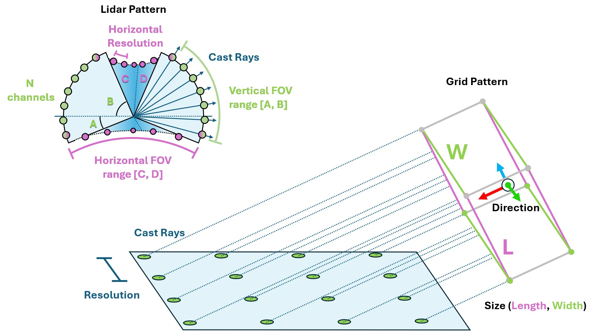
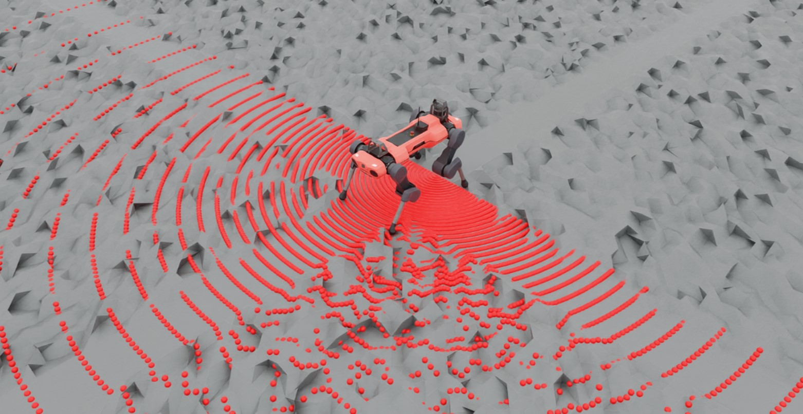

.. _concepts_sensors_ray_caster:
.. _overview_sensors_ray_caster:

.. currentmodule:: isaaclab

Ray Caster
=============

A ray caster reports the first collision along each ray in a chosen pattern. Rays
do not bounce or respond to materials and opacity. Quadruped tasks use this sensor
to measure terrain height around the robot.

The single-mesh :class:`~sensors.RayCaster` implementation depends on the physics
backend. With PhysX and OV PhysX, configured meshes are loaded into `Warp <https://nvidia.github.io/warp/>`_
when the sensor initializes and must remain static. With Newton, the sensor
queries the live scene BVH and therefore sees every collision shape in its
environment, global terrain, and dynamic bodies. Newton ignores
:attr:`~sensors.RayCasterCfg.mesh_prim_paths`; use
:class:`isaaclab_newton.sensors.NewtonRaycastSensorCfg` to make that behavior
explicit and to access Newton-specific options.

For explicitly selected moving geometry, :class:`~sensors.MultiMeshRayCaster` and
:class:`~sensors.MultiMeshRayCasterCamera` load their target meshes once and bind
each tracked mesh to its owning rigid body during initialization. They read live
body poses through the shared scene-data provider, including when several meshes
belong to the same body. Targets with ``track_mesh_transforms=False`` retain their
initial poses. The deprecated Newton multi-mesh adapters use this same path;
Newton's native ray-cast sensor continues to use its scene BVH.

Choose a ray pattern and a parent frame. The frame and sensor offset set the pose;
the pattern sets the ray origins and directions. Built-in patterns include lidar
and grids.

.. literalinclude:: ../../../../examples/sensors/raycaster_sensor.py
    :language: python
    :pyobject: RaycasterSensorSceneCfg

Pattern angles use degrees. Enable debug visualization to inspect the pattern,
then disable it when measuring performance.

Read hit positions from ``data.ray_hits_w`` during simulation:

.. code-block:: python

  def run_simulator(sim: sim_utils.SimulationContext, scene: InteractiveScene):
    .
    .
    .
    # Simulate physics
    while sim.is_running():
      .
      .
      .
      # print information from the sensors
        print("-------------------------------")
        print(scene["ray_caster"])
        print("Ray cast hit results: ", scene["ray_caster"].data.ray_hits_w)

.. code-block:: bash

    -------------------------------
    Ray-caster @ '/World/envs/env_.*/Robot/base/lidar_cage':
            view type            : <class 'isaacsim.core.experimental.prims.xform_prim.XformPrim'>
            update period (s)    : 0.016666666666666666
            number of meshes     : 1
            number of sensors    : 1
            number of rays/sensor: 18000
            total number of rays : 18000
    Ray cast hit results:  tensor([[[-0.3698,  0.0357,  0.0000],
            [-0.3698,  0.0357,  0.0000],
            [-0.3698,  0.0357,  0.0000],
            ...,
            [    inf,     inf,     inf],
            [    inf,     inf,     inf],
            [    inf,     inf,     inf]]], device='cuda:0')
    -------------------------------

Hit positions have shape ``(N, B, 3)``, where ``N`` is the number of sensors and
``B`` is the number of rays. Missed rays return ``inf``. The repeated points in
this example come from rays at the bottom pole of the hemispherical lidar
pattern: all 180 horizontal samples meet there.

Try different patterns in the example below to inspect their hit positions.

.. dropdown:: Code for raycaster_sensor.py
   :icon: code

   .. literalinclude:: ../../../../examples/sensors/raycaster_sensor.py
      :language: python
      :linenos:
