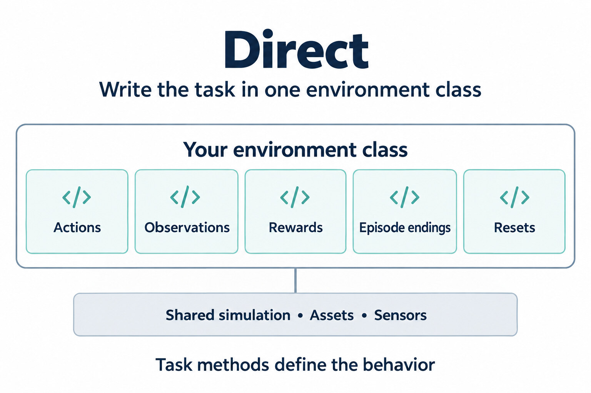
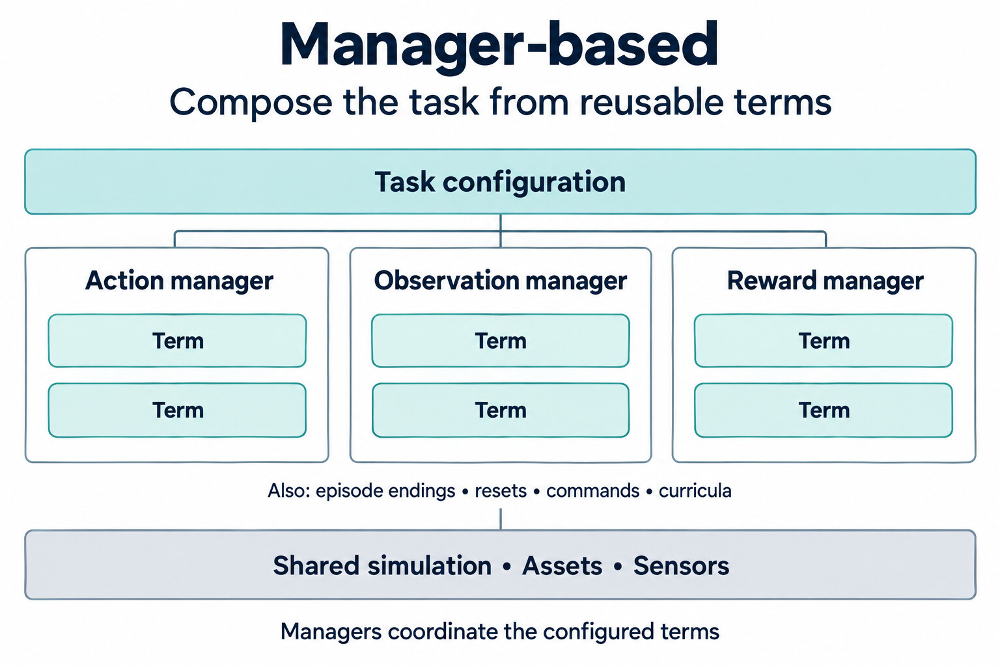

.. _feature-workflows:

Direct and Manager MDP
======================

.. currentmodule:: isaaclab

A reinforcement learning task defines a Markov decision process (MDP): the actions
an agent can take, the observations it receives, its rewards, and when an episode
ends. In Isaac Lab, you can write this logic directly in an environment class or
assemble it from terms coordinated by managers.

Both approaches use Isaac Lab's simulation, scene, assets, and sensors. The choice
is how you organize the task code; it does not select a physics backend.

Choosing an approach
--------------------

.. list-table::
    :header-rows: 1
    :widths: 22 39 39

    * -
      - Direct
      - Manager-based
    * - Task logic
      - Implement methods on an environment class.
      - Configure reusable terms; managers run them.
    * - Changing a task
      - Edit the methods and helpers that implement its behavior.
      - Add, replace, or tune terms in its configuration.
    * - A good fit
      - Closely coupled logic, custom optimization, or multi-agent tasks.
      - Tasks that share observations, rewards, actions, or reset behavior.

For a new single-agent task, manager-based environments are a useful starting point:
you can reuse existing terms and add your own where needed. Choose direct when you
prefer to keep the task logic together or need more control over its implementation.
Performance depends on the work your task does, so profile before choosing a workflow
for speed alone.

Direct environments
-------------------

Subclass :class:`envs.DirectRLEnv` and implement the methods that define the task.
The base class handles the simulation loop and calls your methods at the appropriate
point in each step.

* ``_pre_physics_step()`` processes incoming actions; ``_apply_action()`` applies them.
* ``_get_observations()`` and ``_get_rewards()`` return observations and rewards.
* ``_get_dones()`` reports terminations and timeouts; ``_reset_idx()`` resets selected environments.

Use :class:`envs.DirectRLEnvCfg` for the environment configuration. For multi-agent
tasks, use :class:`envs.DirectMARLEnv` and :class:`envs.DirectMARLEnvCfg`.

The methods can call shared helpers or optimized PyTorch or Warp code. Keeping the
task in one class does not mean every calculation must be written inline. This
structure is also familiar when porting tasks from `IsaacGymEnvs`_ or
`OmniIsaacGymEnvs`_.

.. dropdown:: Cartpole rewards: direct
    :icon: plus

    Cartpole computes its reward in ``_get_rewards()``.

    .. literalinclude:: ../../../source/isaaclab_tasks/isaaclab_tasks/core/cartpole/cartpole_direct_env.py
        :language: python
        :pyobject: CartpoleEnv._get_rewards
        :dedent: 4

    The calculation lives in a separate, TorchScript-compiled ``compute_rewards()`` function.

    .. literalinclude:: ../../../source/isaaclab_tasks/isaaclab_tasks/core/cartpole/cartpole_direct_env.py
        :language: python
        :pyobject: compute_rewards

Manager-based environments
--------------------------

Use :class:`envs.ManagerBasedRLEnv` with a :class:`envs.ManagerBasedRLEnvCfg` to
assemble a task from configured terms. A term defines a piece of behavior, such as
an observation or reward. Its configuration selects the implementation and supplies
parameters; the corresponding manager coordinates execution and combines the results.

For example, a reward manager evaluates reward terms and combines their weighted
contributions. An observation manager collects observation terms into groups.
Other managers handle actions, terminations, events such as resets, commands, and
curricula.

To change one part of the task, replace a term or adjust its parameters. The same
term can serve several tasks, and custom terms can contain whatever calculation
the task needs.

.. dropdown:: Cartpole rewards: manager-based
    :icon: plus

    Cartpole combines reward terms in ``RewardsCfg``. Each term specifies a function,
    a weight, and any parameters the function needs.

    .. literalinclude:: ../../../source/isaaclab_tasks/isaaclab_tasks/core/cartpole/cartpole_manager_env_cfg.py
        :language: python
        :pyobject: RewardsCfg

For environments that do not need RL rewards and terminations, use
:class:`envs.ManagerBasedEnv` with :class:`envs.ManagerBasedEnvCfg`.

.. Maintenance notes

   This page is the source of truth for the ``isaaclab-building-environments`` and
   ``isaaclab-planning-manipulation-tasks`` agent skills
   (`skills/user/create-environments/ <../../../skills/user/create-environments/SKILL.md>`__,
   `skills/user/plan-manipulation-tasks/ <../../../skills/user/plan-manipulation-tasks/SKILL.md>`__).
   When you change this page, update those skills so agent guidance stays in sync. See
   :doc:`/source/developer-tools/agent_skills`.

Where to go next
----------------

* Build a task with the :ref:`direct <tutorial-create-direct-rl-env>` or
  :ref:`manager-based <tutorial-create-manager-rl-env>` tutorial.
* Follow the :ref:`SO-101 vial-placement tutorial <tutorial-so101-task>` for a complete
  manager-based manipulation task, including its scene, MDP terms, reset curriculum,
  and agent configuration.
* See :doc:`reinforcement_learning` to connect a task to a training library.

.. _IsaacGymEnvs: https://github.com/isaac-sim/IsaacGymEnvs
.. _OmniIsaacGymEnvs: https://github.com/isaac-sim/OmniIsaacGymEnvs
