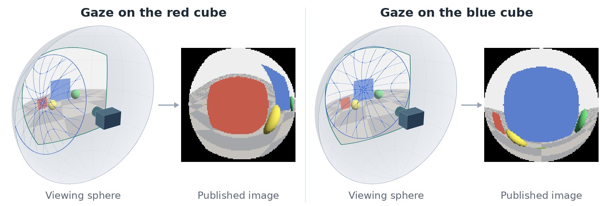
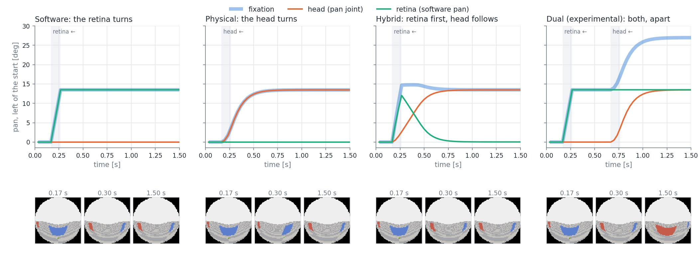
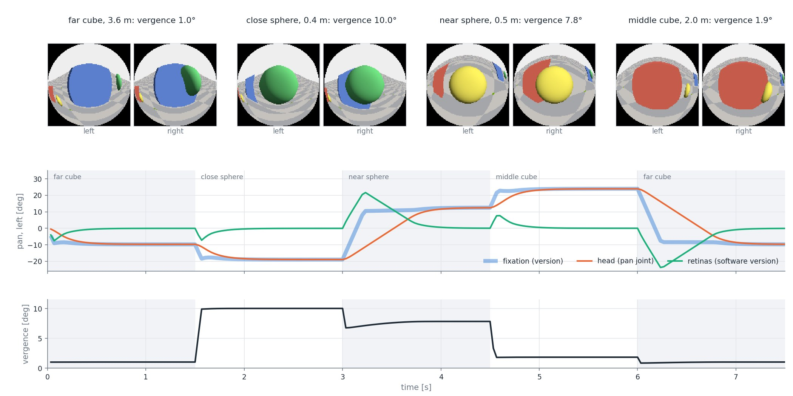

.. _concepts_sensors_foveated_camera:

.. currentmodule:: isaaclab_fovi

Foveated Camera
===============

A :class:`~sensors.FoveatedCamera` samples densely at its fixation and sparsely in the periphery.
The `fovi <https://nblauch.github.io/fovi>`__ library places the viewing rays. Moving the gaze rotates them
relative to the physical camera's mount. The ``foveated-camera`` example lets you explore the scene below by moving
the camera and steering its gaze; the bracketed options render the retina with OVRTX, whose first frame can take
several minutes with a cold shader cache:

.. code-block:: bash

   uv run --extra fovi [--extra ovrtx] isaaclab example foveated-camera [renderer=ovrtx]

The Newton viewer shows the retina. A panel shows the fisheye on a curved viewing sphere beside a magnified retina:
the green lens boundary follows the camera mount, and the blue gaze circle and sampling grid show the magnified
retina's coverage. Use WASD or the arrow keys to move and Q/E to lower or raise the camera. I/K tilt the gaze and J/L
pan it; O/U magnify the panel's retina and zoom back out; H shows or hides the viewer controls. Pass
``--target power_drill`` to start fixating the drill, or ``env.scene.eye.cmf_a_deg=1000`` for a matched, nearly
uniform retina.

   A foveated retina behind a 180° fisheye lens, path-traced with OVRTX. Each pair shows the retina's rays on the
   viewing sphere, faded outside the retina's field, and the rendered image. Fixating the drill puts part of the
   retina outside the camera's view, and those samples render black.

Sampling
--------

The retina places its samples by visual angle, with a density that falls off from the fixation as the cortical
magnification function (CMF) of human vision does. At eccentricity :math:`r` from the fixation, in degrees,

.. math::

   M(r) = \frac{1}{r + a}, \qquad w(r) = \int_0^r M(t)\,dt = \log\left(1 + \frac{r}{a}\right),

where :math:`a` is :attr:`~sensors.FoveatedCameraCfg.cmf_a_deg`, :math:`M` is the cortical distance per degree of
visual angle, and :math:`w` is the cortical distance from the fixation. Samples spaced evenly in :math:`w` are dense
near the fixation and sparse far from it.

The default ``foveated_style="warped_cartesian_as_grid"`` warps an :math:`N \times N` lattice, with :math:`N` =
:attr:`~sensors.FoveatedCameraCfg.foveated_res`, so that its radius :math:`\rho \in [0, 1]` is proportional to
:math:`w`. A lattice point at radius :math:`\rho` samples the eccentricity

.. math::

   r(\rho) = a\left[\left(1 + \frac{r_{\max}}{a}\right)^{\rho} - 1\right],

where :math:`r_{\max}` is half the retina's field of view, and the camera publishes the lattice as an upright
``(num_envs, N, N, channels)`` image.

``foveated_style="isotropic"`` instead places rings evenly in :math:`w`, and gives each ring as many samples as keep
neighbours about equally far apart in every direction:

.. math::

   n_k = \left\lceil \frac{2\pi \rho_k}{\Delta r_k} \right\rceil,

where :math:`\rho_k` is ring :math:`k`'s radius on the viewing sphere and :math:`\Delta r_k` its distance to the
neighbouring rings. The camera publishes at most :math:`N^2` samples, ``(num_envs, num_samples, 1, channels)``.
These samples lie on an isotropic manifold in 3D, the viewing sphere, rather than on a 2D image grid, so networks
process them with kNN convolution, as in `fovi <https://nblauch.github.io/fovi>`__. The isotropic mode is supported
on Newton Warp and OptiX, but not yet recommended on the RTX renderers, whose lens textures and post-processing
need a 2D grid.

The viewer shows both styles for an equidistant fisheye or a pinhole camera.

.. raw:: html

   

Camera and gaze
---------------

Declare a :class:`~sensors.FoveatedCameraCfg` directly on the scene. For example, a 32 × 32 RGB retina and a
pooled variant can share the same camera setup.

.. code-block:: python

   from isaaclab.sim import PinholeCameraCfg
   from isaaclab_fovi.sensors import FoveatedCameraCfg

   camera = FoveatedCameraCfg(
       prim_path="{ENV_REGEX_NS}/Camera",
       spawn=PinholeCameraCfg(),
       foveated_res=32,
   )
   pooled_camera = camera.replace(pool_enabled=True)

Newton Warp and OptiX render the retinal rays directly. Isaac RTX and OVRTX use lens lookup textures.

The retinal field of view defaults to the angle across the short side of the physical image. The camera
uses ideal pinhole optics or supported OpenCV distortion from ``spawn``. Supply
:attr:`~sensors.FoveatedCameraCfg.camera_model` for explicit calibration or an existing camera prim.
Use :attr:`~sensors.FoveatedCameraCfg.retinal_window_fraction` to shrink this window and
:attr:`~sensors.FoveatedCameraCfg.image_rotation_deg` to compensate for mount roll.

Call ``camera.set_gaze_angles(angles)`` with shape ``(num_envs, 2)`` in tilt, pan order and in degrees.
Positive tilt looks up and positive pan looks left. :meth:`~sensors.FoveatedCamera.get_world_poses`
reports the mount pose. Enable :attr:`~sensors.FoveatedCameraCfg.mask_to_sensor_fov` to zero rays that fall
outside the physical image as the gaze moves.

Pooling
-------

Enable :attr:`~sensors.FoveatedCameraCfg.pool_enabled` to render a denser set of rays and pool their values
into the published retina. Grid styles pool windows, while sample sets pool nearest neighbours.
The neighbour metric applies to nearest-neighbour pooling, and Gaussian sigma applies to Gaussian pooling.
The sensor mask excludes rays outside the physical image from the reduction. Segmentation selects the
modal label in its original dtype.

.. raw:: html

   

Active gaze Cartpole
--------------------

``IsaacContrib-Cartpole-Camera-Fovi`` uses a 32 × 32 retina and two bounded gaze actions. A pole-tip teacher
supervises the gaze-action means during training. The gaze dimensions use fixed exploration noise.
Select ``presets=depth`` for depth images.

.. code-block:: bash

   uv run --extra fovi --extra rsl-rl isaaclab train --rl_library rsl_rl --task IsaacContrib-Cartpole-Camera-Fovi

For other manager-based tasks, use :class:`~mdp.GazeActionCfg` to move gaze, :func:`~mdp.gaze_state` to
observe it, and :class:`~mdp.gaze_teacher_labels` for optional supervision.

Gaze modes
----------

:attr:`~mdp.GazeActionCfg.mode` sets what the gaze actions turn, two (tilt, pan) actions in every mode but dual gaze:

* ``"software"`` (the default): the retina, relative to the camera's optical axis. The camera itself may move, for
  example on a robot's head, with ``mount="tracked"``.
* ``"physical"``: the joints of a rig that carries the camera. Each action steps the joint targets.
* ``"hybrid"``: the retina at once, while the rig turns the camera after it by at most
  :attr:`~mdp.GazeRigCfg.max_step_deg` per step. The fixation holds in the world as the head takes over, so the
  camera ends up pointing where it looks.
* ``"dual"`` (experimental): four actions that move the rig's joints and then the retina independently.

The rig modes need a :class:`~mdp.GazeRigCfg`, which names the articulation and its pan and tilt joints,
``mount="tracked"``, and a camera without image roll. :data:`~assets.PAN_TILT_CFG` is a two-joint
pan-tilt mount:

.. code-block:: python

   from isaaclab.sim import PinholeCameraCfg
   from isaaclab_fovi.assets import PAN_TILT_CAMERA_OFFSET, PAN_TILT_CFG
   from isaaclab_fovi.mdp import GazeActionCfg, GazeRigCfg
   from isaaclab_fovi.sensors import FoveatedCameraCfg

   rig = PAN_TILT_CFG
   eye = FoveatedCameraCfg(
       prim_path="{ENV_REGEX_NS}/PanTilt/Geometry/world/pan_link/tilt_link/Eye",
       offset=PAN_TILT_CAMERA_OFFSET,
       spawn=PinholeCameraCfg(),
   )
   gaze = GazeActionCfg(asset_name="eye", mode="hybrid", mount="tracked", rig=GazeRigCfg(asset_name="rig"))

With a rig, :func:`~mdp.gaze_state` reports the fixation's direction from the rig's zero pose: the head's turn
composed with the software gaze.

   Each mode on the pan-tilt mount with Newton's MJWarp solver: the policy pans 4.5° left three times. In hybrid gaze
   the fixation jumps at once and holds while the head takes over from the retina.

.. _concepts_sensors_foveated_camera_binocular:

Binocular gaze
--------------

:class:`~mdp.BinocularGazeActionCfg` moves two foveated cameras on one body with three actions: the version, their
shared line of sight (tilt, pan), and the vergence, the angle between their lines of sight. Each eye turns from the
version by half the vergence toward the other, in the plane of the version and the baseline, so the lines of sight
always meet. The version moves as a single camera's gaze does in ``"software"``, ``"physical"`` or ``"hybrid"``
mode; the vergence always turns the retinas. The eyes need parallel optical axes, the same retina, and Newton or
OVRTX. :data:`~assets.PAN_TILT_STEREO_OFFSETS` places two eyes 6.5 cm apart on the pan-tilt mount:

.. code-block:: python

   from isaaclab_fovi.assets import PAN_TILT_STEREO_OFFSETS
   from isaaclab_fovi.mdp import BinocularGazeActionCfg

   link = "{ENV_REGEX_NS}/PanTilt/Geometry/world/pan_link/tilt_link"
   left_eye = eye.replace(prim_path=f"{link}/LeftEye", offset=PAN_TILT_STEREO_OFFSETS[0])
   right_eye = eye.replace(prim_path=f"{link}/RightEye", offset=PAN_TILT_STEREO_OFFSETS[1])
   gaze = BinocularGazeActionCfg(
       asset_name="left_eye", right_asset_name="right_eye", mode="hybrid", rig=GazeRigCfg(asset_name="rig")
   )

:func:`~mdp.binocular_gaze_state` observes the version, the vergence and their velocities, and
:class:`~mdp.binocular_gaze_teacher_labels` labels the actions that fixate a point with both eyes. The
``foveated-stereo`` example steps both eyes with these labels from object to object: the retinas jump to each object
while the head turns after them, and the eyes converge on near objects. The viewer shows the left eye; its camera menu
switches to the right eye or an overview. The bracketed options render with OVRTX:

.. code-block:: bash

   uv run --extra fovi [--extra ovrtx] isaaclab example foveated-stereo [renderer=ovrtx]

   The ``foveated-stereo`` example in hybrid gaze. The fixated object sits in both foveas, the version jumps to each
   object while the head turns after it, and the vergence follows the object's distance, from 1° at 3.6 m to 10° at
   0.4 m.
