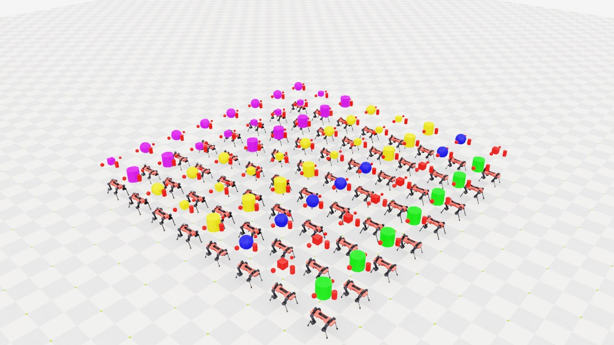

:orphan:

Spawning Multiple Assets
========================

.. currentmodule:: isaaclab

Typical spawning configurations (introduced in the :ref:`tutorial-spawn-prims` tutorial) copy one asset across all
prim paths resolved from an expression. Multi-asset workflows cover two related composition needs:

1. A rigid object collection batches several rigid objects in every environment behind one data and command API.
2. A multi-asset spawner declares several variants for one scene asset binding, allowing environments to contain
   different geometry or robot variants.

This guide demonstrates both mechanisms and explains how their execution differs between PhysX and Newton.

The packaged ``multi-asset`` example provides the reference script, ``multi_asset.py``.

.. dropdown:: Code for multi_asset.py
   :icon: code

   .. literalinclude:: ../../../examples/multi_asset.py
      :language: python
      :linenos:

With the default Newton configuration, this script creates multiple environments containing:

* a rigid object collection containing a sphere, a cube, and a cylinder
* a rigid object selected from nine geometry and material variants by the clone plan
* an articulation selected from the ANYmal-C and ANYmal-D variants by the clone plan

Rigid object collections
------------------------

Use a rigid object collection when every environment contains the same set of independently moving rigid bodies and you
want to access them as one batch. The collection exposes data with an ``(env, object, ...)`` layout and accepts
``(env_ids, obj_ids)`` selections for commands. Compared with managing each object separately, the collection uses one
batched physics view.

.. literalinclude:: ../../../examples/multi_asset.py
   :language: python
   :start-at: object_collection: RigidObjectCollectionCfg = RigidObjectCollectionCfg(
   :end-before: # articulation
   :dedent: 4

The :class:`~assets.RigidObjectCollectionCfg` configuration owns a dictionary of :class:`~assets.RigidObjectCfg`
instances. Each dictionary key is the object's stable identifier within the collection.

The example resets all collection members through the same API used by both physics backends:

.. literalinclude:: ../../../examples/multi_asset.py
   :language: python
   :start-at: default_pose_w = rigid_object_collection.data.default_body_pose.torch.clone()
   :end-at: rigid_object_collection.write_body_com_velocity_to_sim_index(body_velocities=default_vel_w)
   :dedent: 12

Spawning variants for one scene asset
-------------------------------------

Use :class:`~sim.spawners.wrappers.MultiAssetSpawnerCfg` and :class:`~sim.spawners.wrappers.MultiUsdFileCfg` to declare
the available variants for one scene asset binding. :class:`~scene.InteractiveScene` includes these variants in its clone
plan and assigns one valid prototype combination to each environment.

For configuration-based assets, assign :class:`~sim.spawners.wrappers.MultiAssetSpawnerCfg` to the
:class:`~assets.RigidObjectCfg` spawn configuration:

.. literalinclude:: ../../../examples/multi_asset.py
   :language: python
   :start-at: object: RigidObjectCfg = RigidObjectCfg(
   :end-before: # object collection
   :dedent: 4

The ``assets_cfg`` list defines the prototypes available to the clone plan. Variant assignment is controlled by
:attr:`~cloner.CloneCfg.clone_strategy`; the default :func:`~cloner.sequential` strategy assigns combinations in
round-robin order. To sample combinations randomly instead, set the strategy before constructing the scene:

.. code-block:: python

   from isaaclab import cloner

   scene_cfg.clone_cfg.clone_strategy = cloner.random

For USD assets, assign :class:`~sim.spawners.wrappers.MultiUsdFileCfg` to the
:class:`~assets.ArticulationCfg` spawn configuration:

.. literalinclude:: ../../../examples/multi_asset.py
   :language: python
   :start-at: robot: ArticulationCfg = ArticulationCfg(
   :end-before: ##
   :dedent: 4

Variant compatibility
~~~~~~~~~~~~~~~~~~~~~

All variants behind one batched asset interface must have a compatible structure. Articulation variants must have the
same links, joints, collision-body count, and names. Rigid object variants can differ in geometry and material while
retaining a compatible rigid-body layout. Model structurally different assets as separate scene bindings.

Clone planning and physics replication
~~~~~~~~~~~~~~~~~~~~~~~~~~~~~~~~~~~~~~

:class:`~scene.InteractiveScene` represents multi-asset variants as clone-plan prototypes and dispatches each
prototype only to its assigned environments. Physics assets use their declared clone contexts, including native
physics replication by default. Declare per-environment stage differences as
:attr:`~isaaclab.cloner.CloneCfg.clone_combinations` prototypes.

The example relies on physics replication. For Newton, it also narrows the standalone object and articulation to one
variant because their batched Newton views currently require a uniform body layout across worlds:

.. literalinclude:: ../../../examples/multi_asset.py
   :language: python
   :start-at: scene_cfg = MultiObjectSceneCfg(num_envs=args_cli.num_envs
   :end-at: scene_cfg.robot.spawn.usd_path = scene_cfg.robot.spawn.usd_path[0]
   :dedent: 8

For more detail on prototype assignment and replication, see :doc:`cloning`.

Reset-time selection
~~~~~~~~~~~~~~~~~~~~

The multi-asset spawner's catalog also supplies the alternatives for reset-time selection. There is no separate
static or dynamic mode: the clone plan assigns the initial variant, which stays unchanged unless the task selects
another one. For example, a rigid object's spawn configuration can list two USD assets:

.. code-block:: python

   part_cfg = RigidObjectCfg(
       prim_path="{ENV_REGEX_NS}/Part",
       spawn=sim_utils.MultiUsdFileCfg(usd_path=["small_part.usd", "large_part.usd"]),
   )

On a supported backend, clone construction prepares compatible catalog resources and native shape indices once;
model finalization binds those definitions without rediscovering the scene. A reset event calls
``scene["part"].write_mesh_variant_to_sim(variant_ids, env_ids)`` before writing the episode's initial pose and
velocity. Indices follow the spawner's list order. Sampling decisions remain with the reset event, not the spawner.

For matching fixed/movable catalogs, the task's startup and reset events select the same index on both objects.
This relationship belongs to task reset logic, not an additional clone-composition API.

Reset-time selection currently requires Newton MJWarp with external contacts and sleeping disabled. Every
alternative must have one rigid body, the same fixed/free root-joint type and kinematic flags, and compatible
ordered mesh colliders and collision filtering. Visual mesh counts may differ. Collision geometry and its
margin/gap, mass, and inertia follow the selected variant; per-environment contact-material settings are retained.
Newton GL and Viser display the selection; RTX and MuJoCo's internal collision geometry do not support switching.
The visualizers bind native Newton geometry catalogs to the bank's selection array and use the normal render
loop. Catalog instance storage scales with the choices and visible environments; limit visible worlds for large
training scenes.
Each switchable binding must own its target bodies independently. When rendering, source geometry shared with
a non-switchable binding retains its initial assignment rather than enabling selection.

Other backends and catalogs can still use their initial clone assignments without switching. Calling
``write_mesh_variant_to_sim`` raises ``NotImplementedError`` when the backend or catalog does not support selection;
static multi-asset spawning does not require the narrower reset-time compatibility contract.

Run the example
---------------

The physics backend and visualizer are selected independently. Run one of these commands from the repository root:

.. tab-set::

   .. tab-item:: PhysX with Kit

      .. code-block:: bash

         uv run --extra isaacsim isaaclab example multi-asset \
             --physics isaacsim_physx --visualizer kit --num_envs 2048

   .. tab-item:: Newton MJWarp with Kit

      .. code-block:: bash

         uv run --extra isaacsim isaaclab example multi-asset \
             --physics newton_mjwarp --visualizer kit --num_envs 2048

   .. tab-item:: Newton MJWarp with Newton GL

      .. code-block:: bash

         uv run isaaclab example multi-asset \
             --physics newton_mjwarp --visualizer newton_gl --num_envs 2048

The Newton commands exercise the same :class:`~assets.RigidObjectCollectionCfg` and ``(env_ids, obj_ids)`` APIs as the
PhysX command. They do not demonstrate per-environment object or articulation variants because of the uniform-layout
restriction described above; use the PhysX command to inspect that part of the example. See the
:doc:`installation guide </source/isaaclab/installation>` before running
the kitless command.

To stop the simulation, you can close the window, or press ``Ctrl+C`` in the terminal.
