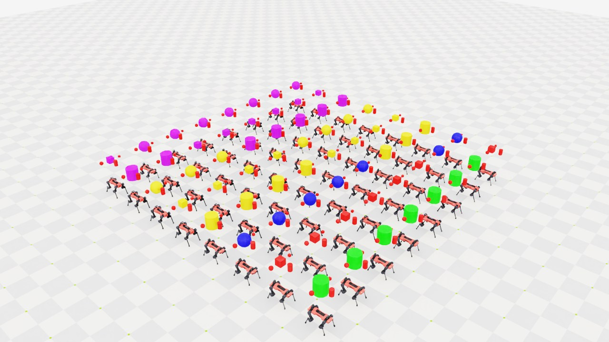

:orphan:

Spawning Multiple Assets
========================

.. currentmodule:: isaaclab

Typical spawning configurations (introduced in the :ref:`tutorial-spawn-prims` tutorial) copy one asset across all
prim paths resolved from an expression. Multi-asset workflows cover two related composition needs:

1. A rigid object collection batches several rigid objects in every environment behind one data and command API.
2. A multi-asset spawner declares several variants for one scene asset binding, allowing environments to contain
   different geometry or robot variants.

This guide demonstrates both mechanisms and explains how their execution differs between PhysX and Newton.

The packaged ``multi-asset`` example provides the reference script, ``multi_asset.py``.

.. dropdown:: Code for multi_asset.py
   :icon: code

   .. literalinclude:: ../../../examples/multi_asset.py
      :language: python
      :linenos:

With the PhysX configuration (``--physics isaacsim_physx``), this script creates multiple environments containing:

* a rigid object collection containing a sphere, a cube, and a cylinder
* a rigid object selected from nine geometry and material variants by the clone plan
* an articulation selected from the ANYmal-C and ANYmal-D variants by the clone plan

Rigid object collections
------------------------

Use a rigid object collection when every environment contains the same set of independently moving rigid bodies and you
want to access them as one batch. The collection exposes data with an ``(env, object, ...)`` layout and accepts
``(env_ids, obj_ids)`` selections for commands. Compared with managing each object separately, the collection uses one
batched physics view.

.. literalinclude:: ../../../examples/multi_asset.py
   :language: python
   :start-at: object_collection: RigidObjectCollectionCfg = RigidObjectCollectionCfg(
   :end-before: # articulation
   :dedent: 4

The :class:`~assets.RigidObjectCollectionCfg` configuration owns a dictionary of :class:`~assets.RigidObjectCfg`
instances. Each dictionary key is the object's stable identifier within the collection.

The example resets all collection members through the same API used by both physics backends:

.. literalinclude:: ../../../examples/multi_asset.py
   :language: python
   :start-at: default_pose_w = rigid_object_collection.data.default_body_pose.torch.clone()
   :end-at: rigid_object_collection.write_body_com_velocity_to_sim_index(body_velocities=default_vel_w)
   :dedent: 12

Spawning variants for one scene asset
-------------------------------------

Use :class:`~sim.spawners.wrappers.MultiAssetSpawnerCfg` and :class:`~sim.spawners.wrappers.MultiUsdFileCfg` to declare
the available variants for one scene asset binding. :class:`~scene.InteractiveScene` includes these variants in its clone
plan and assigns one valid prototype combination to each environment.

For configuration-based assets, assign :class:`~sim.spawners.wrappers.MultiAssetSpawnerCfg` to the
:class:`~assets.RigidObjectCfg` spawn configuration:

.. literalinclude:: ../../../examples/multi_asset.py
   :language: python
   :start-at: object: RigidObjectCfg = RigidObjectCfg(
   :end-before: # object collection
   :dedent: 4

The ``assets_cfg`` list defines the prototypes available to the clone plan. Variant assignment is controlled by
:attr:`~cloner.CloneCfg.clone_strategy`; the default :func:`~cloner.sequential` strategy assigns combinations in
round-robin order. To sample combinations randomly instead, set the strategy before constructing the scene:

.. code-block:: python

   from isaaclab import cloner

   scene_cfg.clone_cfg.clone_strategy = cloner.random

For USD assets, assign :class:`~sim.spawners.wrappers.MultiUsdFileCfg` to the
:class:`~assets.ArticulationCfg` spawn configuration:

.. literalinclude:: ../../../examples/multi_asset.py
   :language: python
   :start-at: robot: ArticulationCfg = ArticulationCfg(
   :end-before: ##
   :dedent: 4

To spawn SimReady props found by a search, assign :class:`~sim.spawners.wrappers.SimReadyUsdFileCfg`, a
:class:`~sim.spawners.wrappers.MultiUsdFileCfg` whose USD paths come from
:func:`~utils.assets.search_simready_usd_paths`. The search result is cached in a JSON file, and each prop's
rigid body is moved onto the spawned prim so that all props share one rigid-body layout. The ``simready``
object preset of the lift environments uses it, for example in the Kuka-Allegro lift environment:

.. literalinclude:: ../../../source/isaaclab_tasks/isaaclab_tasks/core/lift/lift_env_cfg.py
   :language: python
   :start-at: simready = sim_utils.SimReadyUsdFileCfg(
   :end-before: default = shapes
   :dedent: 4

Variant compatibility
~~~~~~~~~~~~~~~~~~~~~

All variants behind one batched asset interface must have a compatible structure. Articulation variants must have the
same links, joints, collision-body count, and names. Rigid object variants can differ in geometry and material while
retaining a compatible rigid-body layout. Model structurally different assets as separate scene bindings.

Clone planning and physics replication
~~~~~~~~~~~~~~~~~~~~~~~~~~~~~~~~~~~~~~

:class:`~scene.InteractiveScene` represents multi-asset variants as clone-plan prototypes and dispatches each
prototype only to its assigned environments. Physics assets use their declared clone contexts, including native
physics replication by default. Declare per-environment stage differences as
:attr:`~isaaclab.cloner.CloneCfg.clone_combinations` prototypes.

The example relies on physics replication. For Newton, it also narrows the standalone object and articulation to one
variant because their batched Newton views currently require a uniform body layout across worlds:

.. literalinclude:: ../../../examples/multi_asset.py
   :language: python
   :start-at: scene_cfg = MultiObjectSceneCfg(num_envs=args_cli.num_envs
   :end-at: scene_cfg.robot.spawn.usd_path = scene_cfg.robot.spawn.usd_path[0]
   :dedent: 8

To sample categories before assets, use the same semantic tags with ``sample_by``:

.. code-block:: python

   InclusionSet(assets=["object_0", "object_1", "object_2"], sample_by="category")

Each slot first chooses a category uniformly, then chooses a variant uniformly within that category.
The categories are independent between slots; unlike ``match_tags=["category"]``, they need not be equal.
A category with 900 assets gets the same probability as one with 25. No category combinations are
listed or expanded. Every candidate must carry the requested tag. Multiple values give an asset
membership in multiple categories, so use one value per asset for disjoint sampling categories.
``sample_by`` can be combined with ``match_tags``: compatibility is resolved first, then sampling
chooses among the remaining categories and assets. Both decisions use the scene's clone strategy
and random state. Unclaimed assets keep their independent behavior.

With ``match_tags=[]`` and ``sample_by=None`` (the defaults), the existing independent Cartesian
product and assignment behavior are preserved. Inclusion interpretation stays in scene planning. ``ReplicateSession`` forwards the
resolved definitions without applying tag matching or task-specific rules.

The tabletop example in ``contrib/heterogeneous_tasks`` samples arbitrary object combinations with a
bounded count. It samples the count uniformly, then a category independently for each occupied slot,
then an asset uniformly within each chosen category. The catalog distinguishes food, bottles, cans, tools,
utensils, miscellaneous objects, plates, trays and containers. Ordinary inclusion matching represents
count groups without expanding their products; ``sample_by="category"`` balances the category selection.
Objects carry semantic category tags; task families become available only when distinct
instances have the required categories and compatible sizes. Task binding and geometric reset stay
local to the example, outside replication execution.

For example:

.. code-block:: python

   cfg = VLAHeterogeneousEnvCfg(
       scene=TabletopSceneCfg(num_envs=128, env_spacing=10.0, objects=OBJECTS_CFG.copy()),
   )
   cfg.events.place_objects.params["workspace"] = ROBOT_WORKSPACE
   cfg.events.place_objects.params["table_variants"] = TABLE_VARIANTS

``OBJECT_COUNT = (2, 8)`` sets the bounds in the scene definition. ``OBJECTS_CFG`` is a complete
``RigidObjectCollectionCfg`` declaration; the scene references it directly. Customize or compose
collection members using ``.copy()`` and ``.replace()`` before constructing the environment. Likewise,
``CAMERA_CFG`` supplies the camera defaults and each view replaces its path and offset; the exterior view
looks over the robot's left shoulder, as in the DROID setup, and the wrist view also replaces the lens. No
config factory or ``__post_init__`` hook generates scene fields or rewrites the event configuration.

``ASSET_CATALOG`` contains 100 NVIDIA-hosted SimReady movable assets: food, cans, bottles, bowls,
small tools, utensils, trays, a small plate and a notebook. It declares relative USD paths, sampling
categories and maximum world counts directly in the scene config. Assets wider than 25 cm are limited
to two-object worlds; assets wider than 15 cm to at most four; smaller assets allow up to eight.
These measured limits restrict candidates through ``object_count`` tags before category and asset sampling;
they do not guarantee that every composition fits every table. The known failing large plastic plate is
excluded. Triangle collisions preserve receiver cavities; SimReady PhysX certification alone does not
validate contact behavior under Newton. Assets are downloaded through the normal cache at scene construction,
not when importing the configuration. The tables and robot stand still use the pinned HeteroTask dataset.

``ROBOT_WORKSPACE`` defines an axis-aligned placement volume by hand in the environment frame. Reset intersects it with
the selected table's declared, measured support outline, preserving its boundaries and any ``surface_holes``.
The intersection is a polygon region, not a bounding rectangle.
Horizontal tables with arbitrary yaw are supported. Every object's full conservative collision
footprint must be covered by that region; its height must also remain inside the workspace bounds.
Larger objects are placed first, with random yaw, a mixture of boundary and interior position proposals,
and clearance from earlier convex footprints, so round plates can be packed without reserving empty
bounding-box corners. Newton's narrow-phase collision detection rejects penetrating
placements, including robot intersections, without stepping physics. Placement retries are bounded;
a workspace that cannot hold the selected objects raises a clear error instead of accepting overlaps.
``TableCfg`` extends a rigid-object declaration with ``surface_outline``, ``surface_height`` and optional
``surface_holes``. ``TABLE_VARIANTS`` contains all nine table assets in the dataset: Eastrural,
Desperes, oak, black, maple, bamboo, Jennings, the end table and the sofa table. They retain their real
geometry and collisions, with individually measured usable support regions. Their roots place the feet
on the common floor, preserving the different tabletop heights. Desperes uses its fixed
central panel, and Jennings uses one contiguous leaf rather than spanning the separated panels.
The scene declares them with ``MultiAssetSpawnerCfg(static=False)`` and includes ``work_table`` alongside
``objects`` in its inclusion set, so initial table choices also vary across worlds. Reset jointly samples
another table and collision-free object placement. It rejects candidates whose measured surface/workspace
intersection has insufficient area, then checks full footprints and actual contacts. A small table cannot
invalidate a composition that fits on another variant. Accepted resets always change the table; placement
retries remain bounded and fail clearly when no other table can fit the selected world.
Partial resets preserve tables in untouched worlds. Add tables by composing complete ``TableCfg``
values and using the same ordered tuple for the spawner and reset term. Measured dimensions are plain
config values; reset does not parse table meshes or infer a surface.

``CAMERA_CFG.renderer_cfg`` declares the Newton renderer's ambient and directional light colors.
These control the camera image directly; USD dome and sphere lights do not currently control this renderer.
The scene preserves the original task's robot home pose, arm impedance and disabled self-collisions.
The Robotiq base hull overlaps its internal knuckles, so enabling self-contact deforms the open linkage.
External contacts remain enabled.

The workspace is hand-defined; this example does not compute inverse-kinematics reachability.

Movable-object combinations are sampled once when the scene is built; reset changes the table and
randomizes object poses. The table and robot do
not count toward ``OBJECT_COUNT``. The example retains a rectangular object collection using hidden inactive
bodies and Newton mesh variants; inactive bodies are parked away from the workspace. Any combination
may be selected, including repeated instances and worlds without a usable target. There is no
conditioning on the presence of a plate or container and no list of authored benchmark layouts.

After reset, ``env.tabletop.available_tasks[world]`` lists the evaluable instruction bindings.
``put_on_plate`` requires a plate and a distinct movable object that fits its inset footprint;
``put_in_container`` similarly requires a container, and ``put_on_tray`` requires a tray. The current fit
check uses conservative collision bounds with an inset for walls; it is not a grasp or motion planner.
The object to move also has to suit the gripper: ``graspable_size`` of the reset term excludes objects with
an extent below 2 cm, which the gripper cannot pinch, and objects whose narrower side exceeds the 85 mm
opening of the Robotiq 2F-85. Such props still appear in the scenes, as receivers or as distractors.
Instructions name objects in plain words, without the asset codes of the catalog labels (``Ketchup_A02`` reads
"ketchup"), and a binding is offered only when its object and its target are the only objects of their name in
the world, so that the instruction singles them out. Reset selects an available binding
and publishes ``env.tabletop.instructions``. To request another binding on the next reset, use
``env.tabletop.set_task([world], [binding_index])``. A world with no binding keeps its sampled objects,
has an empty instruction and does not report task success. Success requires the selected object to stay
placed for half a second: released, with the center of its bounds inside the target footprint, touching the
target, and the target upright; containment also requires its bottom below the rim. Corners may overhang, and
a rim may rise above the surface that carries the object. Fixed per-benchmark poses, instructions and Gym IDs
are replaced by these task families.

For more detail on prototype assignment and replication, see :doc:`cloning`.

Reset-time selection
~~~~~~~~~~~~~~~~~~~~

A rigid object's multi-asset spawner defines the variants and their IDs in list order. Clone composition chooses
the initial variant for each world, using those same IDs. A reset event can change it before writing the
episode's pose and velocity:

.. code-block:: python

   part_cfg = RigidObjectCfg(
       prim_path="{ENV_REGEX_NS}/Part",
       spawn=sim_utils.MultiUsdFileCfg(usd_path=["small_part.usd", "large_part.usd"], static=False),
   )

Call ``scene["part"].write_mesh_variant_to_sim(variant_ids, env_ids)`` to select variants. A task with matching
fixed and movable objects selects the same ID on both. Newton owns the selected IDs, geometry, and mass properties.

Multi-asset spawning keeps its initial choice unless ``static=False`` is set. Reset-time selection uses Newton
body variants with XPBD or MJWarp with external contacts and sleeping disabled, and at least two alternatives. Every
alternative must contain one rigid body with the same fixed/free root-joint type and kinematic flags. Newton permits
different shape types and counts, but shapes sharing a row need compatible collision groups. Select before
randomizing contact materials because Newton restores the variant's materials. Initial world selections are applied
after solver construction so MuJoCo compiles a shared layout even when alternatives differ in shape type or count.
MJWarp with MuJoCo contacts rejects
body variants when the solver initializes. Other physics backends keep the initial choice.

With supported Newton physics, ``static=False`` authors every alternative under ``/World/IsaacLabPrototypes`` and
clones the chosen source into each world. The source parent is hidden after cloning. The default ``static=True``
authors each alternative at its first assigned world and uses the same source-to-destination clone pass.

Run the example
---------------

The physics backend and visualizer are selected independently. Run one of these commands from the repository root:

.. tab-set::

   .. tab-item:: PhysX with Kit

      .. code-block:: bash

         uv run --extra isaacsim isaaclab example multi-asset \
             --physics isaacsim_physx --visualizer kit --num_envs 2048

   .. tab-item:: Newton MJWarp with Kit

      .. code-block:: bash

         uv run --extra isaacsim isaaclab example multi-asset \
             --physics newton_mjwarp --visualizer kit --num_envs 2048

   .. tab-item:: Newton MJWarp with Newton

      .. code-block:: bash

         uv run isaaclab example multi-asset \
             --physics newton_mjwarp --visualizer newton_gl --num_envs 2048

The Newton commands exercise the same :class:`~assets.RigidObjectCollectionCfg` and ``(env_ids, obj_ids)`` APIs as the
PhysX command. They do not demonstrate per-environment object or articulation variants because of the uniform-layout
restriction described above; use the PhysX command to inspect that part of the example. See the
:doc:`installation guide </source/isaaclab/installation>` before running
the kitless command.

To stop the simulation, you can close the window, or press ``Ctrl+C`` in the terminal.
