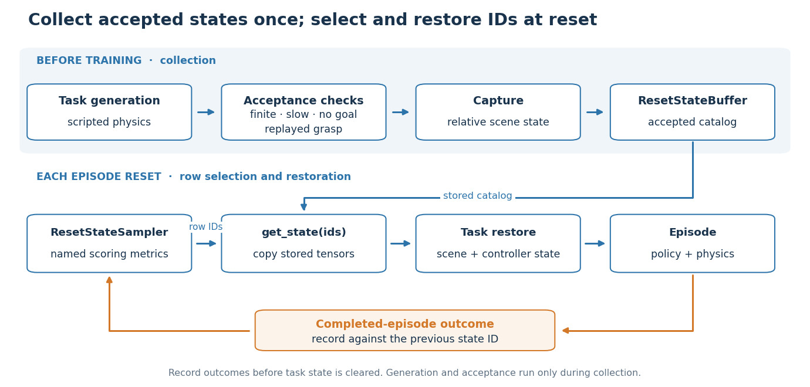
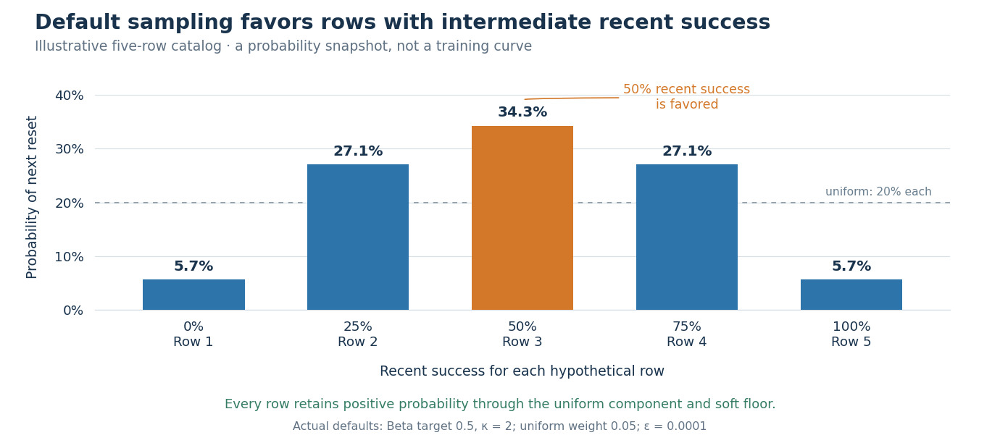

:orphan:

Native reset-state buffers
==========================

A reset bank separates prepared starting states from the policy that selects them.
The shared API lives in :mod:`isaaclab.envs.reset`: :class:`~isaaclab.envs.reset.ResetStateBuffer`
owns Warp snapshots, and :class:`~isaaclab.envs.reset.ResetStateSampler` records outcomes
and selects entries. Tasks own generation, physical validity, and restoration through
public asset writers. The existing core Lift task demonstrates this as a reset event.

Prepare storage
---------------

Construct a buffer from a nested dictionary of Warp arrays. Every leaf has the same
leading state count and device. :class:`~isaaclab.utils.warp.ProxyArray` and same-device
Torch inputs are accepted at the boundary; storage and runtime operations use Warp.
Construction copies the inputs.

.. code-block:: python

   import warp as wp
   from isaaclab.envs.reset import ResetStateBuffer

   empty = ResetStateBuffer({})
   assert empty.num_states == 0

   # A single, task-validated default row can populate the whole bank.
   defaults = {"joint_pos": robot.data.default_joint_pos.warp[:1]}
   buffer = ResetStateBuffer(defaults, num_states=1024)

An empty dictionary has no schema and contains zero states. A tree of zero-row arrays
also represents an empty buffer, retaining its schema. Nonempty reads and sampling
require prepared entries. An empty schema cannot allocate populated states without
being given their fields.

The ``states`` property returns copied ``ProxyArray`` snapshots for inspection or
persistence. Compatible saved tensors can also initialize a bank:

.. code-block:: python

   import torch

   saved_states = torch.load("reset_states.pt", map_location=device, weights_only=True)
   buffer = ResetStateBuffer(saved_states)

The task must establish asset, backend, field, unit, and controller compatibility.
Store positions relative to environment origins when sharing starts across worlds.
Storage does not perform collision checks or manage a disk cache.

Select and restore with masks
------------------------------

The native interface uses full-environment arrays and a Boolean mask. Allocate output
storage before capture, then reuse it:

.. code-block:: python

   from isaaclab.envs.reset import ResetStateSampler, ResetStateSamplerCfg

   sampler = ResetStateSampler(ResetStateSamplerCfg(seed=42), num_envs, buffer.num_states, device)
   mask = wp.ones(num_envs, dtype=wp.bool, device=device)
   restored = {"joint_pos": wp.empty((num_envs, robot.num_joints), dtype=float, device=device)}

   # Record the episodes that ended before assigning their replacement starts.
   sampler.reset(mask, success=episode_success, valid=completed_episode)
   buffer.get_state(sampler.indices, out=restored, mask=mask)
   robot.write_joint_position_to_sim_mask(position=restored["joint_pos"], env_mask=mask)

Only masked environments receive new assignments, random draws, or restored values.
Omit outcomes on the initial draw, and exclude manual or zero-step resets with
``valid``. Record the previous episode before clearing its success flag. Simultaneous
outcomes for the same entry are recorded in environment-index order; each entry
retains its latest ``history_length`` outcomes.

Pass a full-environment ``state_ids`` array to ``sampler.reset`` for explicit starts.
Optional constructor ``state_ids`` gives entries stable integer labels, such as
procedural recipe seeds. ``sampler.indices`` gives dense storage positions for
``buffer.get_state`` and ``sampler.state_ids`` gives the corresponding labels.
Catalog labels reserve ``-1`` for an unassigned environment. Assignments, rates, counts, and probabilities
are borrowed ``ProxyArray`` outputs: treat them as read-only and use explicit requests
to change assignments. Invalid requested IDs are reported in ``invalid_requests``
on the device, so inspection can happen outside capture.

For catalogs partitioned by asset combination, use ``group_ids`` and ``num_groups``.
Partitions contain equal contiguous ranges; each environment draws within its group.
The buffer itself has no group metadata. Legacy manager terms can pass ``env_ids=``
to the sampler; that shim populates a preallocated mask.

   Generation and validation run during initialization. Runtime uses fixed storage and masks.

Capture the runtime
-------------------

Warm the configured path before capture. The sampler and ``get_state(..., out=...)``
can run in a CUDA graph. Lift's ``newton_mjwarp`` preset supports capturing both
operations and the asset writes together. With OvPhysX or Kit-based PhysX, run Lift's
asset writes outside capture.

Update the contents of the bound arrays in place between graph replays. The choice to
provide outcomes or explicit IDs is fixed at capture time.

.. code-block:: python

   def reset_selected():
       sampler.reset(mask, success=episode_success, valid=completed_episode)
       buffer.get_state(sampler.indices, out=restored, mask=mask)
       robot.write_joint_position_to_sim_mask(position=restored["joint_pos"], env_mask=mask)

   reset_selected()
   with wp.ScopedCapture(device=device) as capture:
       reset_selected()
   wp.capture_launch(capture.graph)

Run prefill, rejection loops, loading, inspection, and logging outside capture. Use
``get_state(ids)`` to allocate a snapshot for inspection. The example captures only
the reset operations.

Set ``ResetStateSamplerCfg.seed`` to initialize the sampler's per-environment random streams.
Use ``sampler.reseed(seed)`` between rollouts to restart those streams while retaining
history and assignments. A captured graph observes the new streams.

A framework that owns its random streams passes them instead: ``sampler.reset(mask, rng=seeds)``
takes one int32 seed per environment, draws ``wp.randf(wp.rand_init(seeds[env], 0))``, and leaves
the internal streams untouched. The caller advances its seeds between resets, as MDP2 does.

To replace stored states while running, such as states recorded during training, write them with
``buffer.set_state(indices, values, mask=mask)``, the inverse of ``get_state``, and clear their outcomes
with ``sampler.forget(indices, mask, success_rate=prior)``. A forgotten entry keeps ``prior`` as its
success rate until its next outcome. Both can be captured. In ``sampler.reset(..., state_ids=ids)``, a
request of -1 draws from the scores for that environment, so a captured reset can replay some
environments and sample the others.

Configure useful practice
--------------------------

The default adds uniform weight to a Beta kernel score that peaks at 50 percent recent
success. This favors starts of intermediate difficulty while giving every entry a
chance to be drawn. Concentration narrows the score's peak while keeping its height
fixed at one.
When all success rates are zero, the default draws uniformly. Include valid starts
the policy can solve early so that the scores can begin to distinguish entries.

.. code-block:: python

   from isaaclab.envs.reset import BetaSamplingScoreCfg

   adaptive = ResetStateSamplerCfg(
       history_length=50,
       scores=[BetaSamplingScoreCfg(target=0.5, kappa=2.0, weight=0.25)],
       uniform_weight=0.0501,
   )
   uniform = ResetStateSamplerCfg(scores=[])

   Example probabilities for five states with different success rates. The sampler
   adds ``0.0501`` to each score, then normalizes the weights within each asset group.

.. image:: ../_static/how-to/reset_states/sgs-method-dark.gif
   :class: only-dark
   :width: 100%
   :alt: An animation shows the policy training loop and the Beta score peaking at 50 percent success.

The animation illustrates how rollouts and training change which starts are most useful.
As the policy revisits starts, their estimated success rates shift along the Beta
score curve. The curve shows the score before adding uniform weight.
Animation courtesy of Octi Zhang.

Custom configurations derive from :class:`~isaaclab.envs.reset.SamplingScoreCfg`.
Their scorer implements ``score(metrics, out)`` with Warp operations on preallocated
storage. Borrow additional per-entry metric arrays through ``metrics=`` at sampler
construction and update them in place. The sampler supplies ``success_rate`` and
``episode_counts`` so a score can account for both difficulty and how much evidence
it has. Tasks can supply other signals, such as learning progress or staleness.

The sampler uses a fixed catalog and weighted draws with replacement. Tasks that
generate new entries during training or require scheduled coverage, such as visiting
each row once per cycle, own that scheduling policy.
The assignment must match the state actually played. When restoring a snapshot from
outside the catalog, exclude the resulting episode from catalog outcome tracking.

Use the existing Lift reset event
---------------------------------

``Isaac-Lift-Franka`` already uses ``core/lift/mdp/events.py::conditional_reset``.
Its ordinary reset terms generate candidate starts, its criteria reject invalid
states, and its optional diversity descriptor spreads the retained starts. Prefill
runs once per asset-combination group before replay begins. The event now uses the
shared buffer and sampler; no additional task or environment subclass is required.

Configure its existing ``events.conditional_reset.params`` entries:

* ``buffer_size_per_group`` controls retained starts per asset combination.
* ``valid_criteria`` and ``max_prefill_iters`` control acceptance and the attempt budget.
* ``diversity_feature`` optionally spreads starts over a task-defined descriptor.
* ``reset_sampler`` configures history, scores, and independent random streams;
  ``None`` selects uniformly without recording outcomes.

After ordinary initialization, the event's ``reset_mask(mask, state_ids=ids)`` method
replays explicit starts. With adaptive sampling enabled, supply
``completed=natural_episode_mask`` to record outcomes for completed natural episodes
that took at least one step. The event credits the existing success reward's sticky
flag before the reward manager clears it and restores root-link poses, COM velocities,
joints, and controller targets through public mask writers.

Use the MDP2 reset event
------------------------

MDP2 tasks use ``isaaclab_experimental.mdp2.mdp.reset_from_bank``. It composes the same three parts:
a fill builds a :class:`~isaaclab.envs.reset.ResetStateBuffer` once at startup, a
:class:`~isaaclab.envs.reset.ResetStateSampler` credits each ended episode and draws the next start
from the use's random stream, and the event gathers the drawn states into its ``outputs``, which
MDP2 commits. The outputs are the state: any writable scene fields.

.. code-block:: python

   from isaaclab_experimental import mdp2
   from isaaclab_experimental.mdp2 import mdp

   "reset": mdp2.Event(
       mdp.reset_from_bank,
       inputs={"succeeded": mdp2.quantities.success},
       outputs={"joint_pos": robot.joint_pos, "object_pose_w": target.root_link_pose_w},
       params={
           "fill": mdp.FillFromCandidates(CANDIDATES, bank_size=16),
           "sampler": ResetStateSamplerCfg(scores=[BetaSamplingScoreCfg(target=0.5)]),
       },
   )

* ``fill`` returns the states. :class:`~isaaclab_experimental.mdp2.mdp.reset_states.FillFromCandidates` rolls the reset
  events of a ``candidates`` task, keeps the states its terminations accept, and, given a ``descriptor``
  observation group, keeps the most spread of an oversampled harvest.
  :class:`~isaaclab_experimental.mdp2.mdp.reset_states.FillFromStates` takes given states, such as demonstrations,
  and :class:`~isaaclab_experimental.mdp2.mdp.reset_states.FillFromFile` loads a saved bank.
* ``sampler`` weighs states by recent success; ``None`` draws uniformly. Binding ``succeeded``
  credits each ended episode to the state it started from.
* ``shared`` selects one bank for every world instead of one bank per world. Bind
  ``env_origins`` so poses are stored relative to each world's origin. Share a bank only between
  worlds whose states fit each other, such as worlds that spawn the same object.
* ``nominal_probability`` is the fraction of resets that keep what the earlier reset events wrote,
  fresh draws from the nominal distribution. Those episodes are not credited to any state.
* ``record`` banks states that the worlds visit during training, see below.

Place the event after the other reset events: it overwrites the outputs they wrote. An event whose
outputs include a command runs after the commands resample, so that a restored goal stands. The
init hook warms every kernel, so the event is captured with the rest of the step.
``Isaac-Lift-KukaAllegro-MDP2`` uses a bank per world with the core Lift sampler settings.

Record states along the horizon
^^^^^^^^^^^^^^^^^^^^^^^^^^^^^^^

States that the policy reaches on its way to success make useful starts. With ``record``, the
event's update hook runs once per step after the rewards and records each world's outputs into
its own bank:

.. code-block:: python

   "reset": mdp2.Event(
       mdp.reset_from_bank,
       inputs={
           "succeeded": mdp2.quantities.success,
           "terminated": mdp2.terminated,  # states that end the episode are not recorded
           "record_when": mdp2.quantities.lifted,  # optional: record only where above 0.5
       },
       outputs={**robot_state, **object_state},
       params={
           "fill": mdp.FillFromCandidates(CANDIDATES, bank_size=16),
           "sampler": ResetStateSamplerCfg(scores=[BetaSamplingScoreCfg(target=0.5)]),
           "record": mdp.RecordStates(slots=16, probability=0.01),
       },
   )

Each step, a world that did not terminate records with ``probability`` into the oldest of its
``slots`` recorded slots, which start as copies of the filled states. A recorded slot forgets the
outcomes of the state it replaces and starts at the success rate the first score targets, so new
states are tried before their outcomes are known. An episode whose start is recorded over is not
credited. Include velocities, and commands for goal-conditioned tasks, in the outputs, so that a
restored state continues as it was recorded. Recording needs a bank per world.

Inspect, replay, and save the bank
^^^^^^^^^^^^^^^^^^^^^^^^^^^^^^^^^^

:func:`~isaaclab_experimental.mdp2.mdp.reset_states.reset_bank` returns the
:class:`~isaaclab_experimental.mdp2.mdp.reset_states.ResetBank` of a use. Slots are numbered within each
world's bank.

.. code-block:: python

   bank = mdp.reset_bank(env.state)  # the "events.reset" use
   bank.states["joint_pos"]  # (num_worlds, size, num_joints)
   bank.success_rate, bank.episode_counts, bank.probabilities  # (num_worlds, size)
   bank.slots  # the slot each world's episode started from, -1 for a nominal start

   bank.replay(torch.full((env.num_envs,), 3))  # restart every world from its slot 3 at its next reset
   bank.replay(None)  # draw again
   bank.save("bank.pt")  # fill a later run with mdp.FillFromFile("bank.pt")

Replay requests hold until replaced and run inside the captured step, so they can sweep the
bank during evaluation. To collect states separately from training, for example a larger
candidates fill, run ``scripts/tools/collect_reset_states.py``, which builds the task and saves its
bank:

.. code-block:: bash

   ./isaaclab.sh -p scripts/tools/collect_reset_states.py --task Isaac-Lift-KukaAllegro-MDP2 \
       --num_envs 4096 --bank_size 64 --out kuka_lift_bank.pt physics=newton_mjwarp

A bank per world fits only runs with the same number of worlds and object assignment; a shared
bank fits any.

Migrating existing reset configurations
---------------------------------------

Lift's ``success_monitor`` event parameter is replaced by ``reset_sampler``.
NIST's ``sampling`` parameter takes ``ResetStateSamplerCfg`` with core score
configurations. Its separate ``success_monitor_cfg`` still configures outcome
history. Set ``metric="monitor_success_rate"`` on a score to use those rates.
