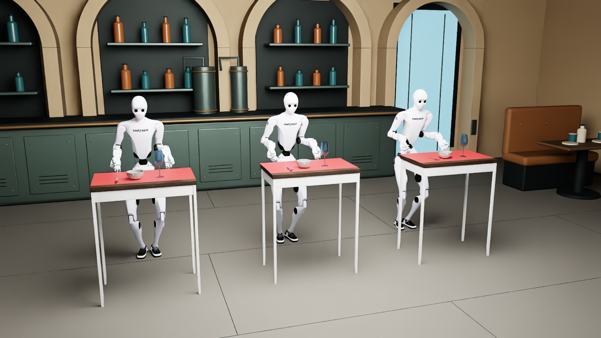

:orphan:

.. _run-scripted-state-machines:

Run Scripted State Machines
===========================

Isaac Lab includes hand-written state-machine examples for inspecting an
environment's observations and action interface without training a policy. The
state transitions run in parallel across environments as Warp kernels, which
keeps the examples efficient at larger environment counts.

Run these commands from the Isaac Lab repository root. Use ``--viz`` to select
a visualizer. The task scripts accept ``--num_envs`` to change the number of
parallel environments.

Pick and lift a rigid cube
--------------------------

This example approaches a cube, closes the gripper, and lifts the cube to its
goal pose:

.. code-block:: bash

   uv run python scripts/environments/state_machine/lift_cube_sm.py \
      --num_envs 32 --viz kit

Lift a deformable object
------------------------

This example uses the Newton backend to grasp and lift a soft object. Pass
``--viz newton_gl`` to open the Newton visualizer:

.. code-block:: bash

   uv run --extra tetrahedralization python scripts/environments/state_machine/lift_franka_soft.py \
      --num_envs 1 --viz newton_gl

Open a cabinet drawer
---------------------

This example approaches the drawer handle, grasps it, pulls the drawer open,
and releases it:

.. code-block:: bash

   uv run python scripts/environments/state_machine/open_cabinet_sm.py \
      --num_envs 32 --viz kit

.. _tablecloth-example:

Compare five humanoid tablecloth pulls
--------------------------------------

This standalone example builds five side-by-side H2 Plus / SHARPA trials with
:class:`~isaaclab.scene.InteractiveScene`, the default Isaac Lab ground plane,
wooden dining tables, and SimReady kitchenware. Newton VBD simulates the robot
articulations, cloth, and tableware together. Newton IK and the Warp state machine
run on the GPU inside the physics CUDA graph. This is a scripted manipulation
example, not an RL task.

   Contact-only pulls at peak speeds of 4.0, 2.0, 1.5, 0.75, and 0.5 m/s,
   from left to right, rendered with Kit.

.. code-block:: bash

   uv run isaaclab example tablecloth --device cuda:0

The example downloads and caches the manufacturer's articulated `H2 Plus USD with SHARPA hands
<https://github.com/unitreerobotics/unitree_model/tree/b6a8942b0803b6c137e58cef12beb4b03e4a2fa7/H2_Plus>`__,
then starts with the hands clear of the cloth and a fixed 20-degree forward waist
bend. After the free hem settles, the hands approach, slide their native index
fingertips underneath, and close the thumbs before lifting and pulling. The grasp
uses physical contact with the native fingertip surfaces, without cloth
attachments or added rubber pads.

Use ``--speeds 2.0`` for one robot, ``--viz none`` for a headless run, or
``--viz kit`` for Kit rendering. The default run completes the slowest pull and a
final hold. Only the peak pull speed differs between lanes: the fastest pull
leaves the arrangement nearly unchanged, while the two slowest carry the tableware
off the table. The 0.48 × 0.84 m dining-table visuals use simple box collision
proxies. Kit smooths the cloth with Catmull-Clark subdivision without refining
the physics mesh.

The pelvis is fixed with the feet at ground level; this does not demonstrate
humanoid balance or general-purpose grasp planning. The 64 physics ticks per
60 Hz control frame favor contact accuracy over real-time playback. Position
drives are simulation settings: direct VBD with compliant-ALM rigid dynamics does
not enforce the asset's hardware torque limits or armature. Changes to the assets,
cloth, or contact settings require revalidating the grasp. The example checks
cloth material-point retention after a complete run and reports grasp failures;
successful IK tracking alone does not establish a grasp.
