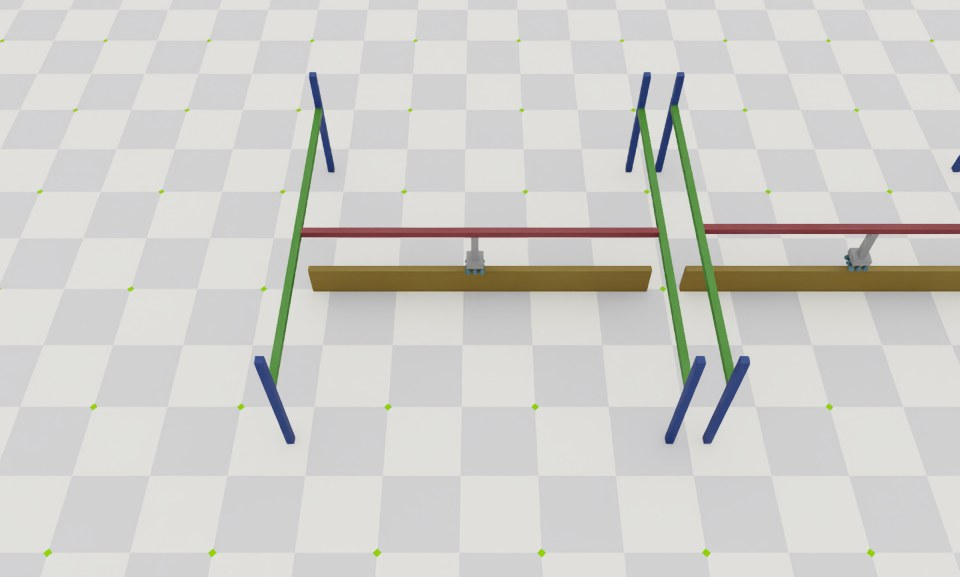

:orphan:

.. _tutorial-interact-surface-gripper:

Interacting with a surface gripper
==================================

.. currentmodule:: isaaclab

Isaac Lab can operate Newton suction tools and authored PhysX grippers. Both implementations use the
same command and measured-state convention.

Scene-owned grippers
~~~~~~~~~~~~~~~~~~~~

Declare :class:`~isaaclab.assets.SurfaceGripperCfg` alongside the tool and payloads in an
:class:`~isaaclab.scene.InteractiveSceneCfg`. The simulation backend determines which gripper
implementation the scene creates.

.. tab-set::

   .. tab-item:: Newton MJWarp

      Select a rigid tool body with ``prim_path`` and eligible payloads with ``target_prim_path``.
      For acquisition, a payload must have one box collision shape. The tool's local +Z axis points
      toward the payload, and ``tool_offset`` locates the pads relative to the tool body in meters.

      .. code-block:: python

         from isaaclab.assets import SurfaceGripperCfg
         from isaaclab.scene import InteractiveSceneCfg
         from isaaclab.utils import configclass

         @configclass
         class SortingSceneCfg(InteractiveSceneCfg):
             suction = SurfaceGripperCfg(
                 prim_path="{ENV_REGEX_NS}/Robot/.*/panda_hand",
                 target_prim_path="{ENV_REGEX_NS}/Parcel.*",
                 tool_offset=(0.0, 0.0, 0.105),
                 pad_radius=0.012,
                 pad_spacing=0.014,
             )

      The example models four suction pads. Contact must be within 6 mm to acquire and
      breaks at 25 mm. Each pad has a maximum force of 4 N.

   .. tab-item:: PhysX

      Select the authored Isaac Sim surface-gripper prim with ``prim_path`` and run on CPU.
      Leave Newton-only target and pad options at their defaults. Use
      :class:`~isaaclab_isaacsim.assets.SurfaceGripperCfg` to set PhysX-specific limits.

Access the configured gripper with ``scene["suction"]``. Commands above 0.3 close the gripper,
commands below -0.3 open it, and commands in between leave the enabled vacuum state as it is.
Measured state is -1 for open, 0 for closing, or 1 for sealed. The staged ``command`` and measured
``state`` are Warp arrays.

Stage commands with ``set_grippers_command_index()`` or ``set_grippers_command_mask()``, then apply
them with ``scene.write_data_to_sim()`` before stepping the simulation. Call ``scene.update(dt)``
after stepping. The scene also handles selected-environment resets. Manager-based tasks can
use :class:`~isaaclab.envs.mdp.actions.SurfaceGripperBinaryActionCfg`, where negative policy
actions close the gripper and nonnegative actions open it.

For a runnable Newton MJWarp example, see :ref:`tutorial-conveyor-suction`.

Managed environments close the scene grippers automatically. In a standalone scene, call
``scene.close()`` before destroying the simulation. If the scene is inside an enclosing CUDA graph,
discard the graph before closing it. Custom ``SurfaceGripperCfg.class_type`` constructors continue
to receive the configuration argument. The scene passes its simulation context to the built-in factory.

PhysX pick-and-place tutorial
~~~~~~~~~~~~~~~~~~~~~~~~~~~~~

The rest of this guide walks through the PhysX gantry example. It builds on
:ref:`tutorial-interact-articulation` and uses an authored surface gripper on each end effector.
Use ``--device cpu`` to run it.

The code
--------

The tutorial corresponds to the ``run_surface_gripper.py`` script in the ``scripts/tutorials/01_assets``
directory.

.. dropdown:: Code for run_surface_gripper.py
   :icon: code

   .. literalinclude:: ../../../scripts/tutorials/01_assets/run_surface_gripper.py
      :language: python
      :emphasize-lines: 58-82, 126-127, 130-144, 149-152
      :linenos:

Designing the scene
-------------------

Similarly to the previous tutorial, we populate the scene with a ground plane and a distant light. Then, we spawn
an articulation from its USD file. This time a pick-and-place robot is spawned. The pick-and-place robot is a simple
robot with 3 driven axes, its gantry allows it to move along the x and y axes, as well as up and down along the z-axis.
Furthermore, the robot end-effector is outfitted with a surface gripper.
The USD file for the pick-and-place robot contains the robot's geometry, joints, and other physical properties
as well as the surface gripper. Before implementing a similar gripper on your own robot, we recommend to
check out the USD file for the gripper found on Isaaclab's Nucleus.

For the pick-and-place robot, we use its pre-defined configuration object, you can find out more about it in the
:ref:`how-to-write-articulation-config` tutorial. For the surface gripper, we also need to create a configuration
object. Instantiate :class:`~isaaclab_isaacsim.assets.SurfaceGripperCfg` and pass it the relevant parameters.

The available parameters are:

- ``max_grip_distance``: The maximum distance at which the gripper can grasp an object.
- ``shear_force_limit``: The maximum force the gripper can exert in the direction perpendicular to the gripper's axis.
- ``coaxial_force_limit``: The maximum force the gripper can exert in the direction of the gripper's axis.
- ``retry_interval``: The time the gripper will stay in a grasping state.

As seen in the previous tutorial, we can spawn the articulation into the scene in a similar fashion by creating
an instance of the :class:`assets.Articulation` class by passing the configuration object to its constructor. The same
principle applies to the surface gripper. Passing its configuration to
:class:`~isaaclab_isaacsim.assets.SurfaceGripper` creates the surface gripper so it can be added to the scene.
In practice, the object is initialized when the play button is pressed.

.. literalinclude:: ../../../scripts/tutorials/01_assets/run_surface_gripper.py
   :language: python
   :start-at: # Create separate groups called "Origin1", "Origin2"
   :end-at: surface_gripper = SurfaceGripper(cfg=surface_gripper_cfg)

Running the simulation loop
---------------------------

Continuing from the previous tutorial, we reset the simulation at regular intervals, set commands to the articulation,
step the simulation, and update the articulation's internal buffers.

Resetting the simulation
""""""""""""""""""""""""

Call :meth:`~isaaclab_isaacsim.assets.SurfaceGripper.reset` to reset its internal buffers and caches.

.. literalinclude:: ../../../scripts/tutorials/01_assets/run_surface_gripper.py
   :language: python
   :start-at: # Opens the gripper and makes sure the gripper is in the open state
   :end-at: surface_gripper.reset()

Stepping the simulation
"""""""""""""""""""""""

Applying commands to the surface gripper involves two steps:

1. *Setting the desired commands*: This sets the desired gripper commands (Open, Close, or Idle).
2. *Writing the data to the simulation*: Based on the surface gripper's configuration, this step handles writes the
   converted values to the PhysX buffer.

At every step, we randomly sample commands and set them to the gripper by calling the
:meth:`~isaaclab_isaacsim.assets.SurfaceGripper.set_grippers_command` method. After setting the commands, we call the
:meth:`~isaaclab_isaacsim.assets.SurfaceGripper.write_data_to_sim` method to write the data to the PhysX buffer.
Finally, we step the simulation.

.. literalinclude:: ../../../scripts/tutorials/01_assets/run_surface_gripper.py
   :language: python
   :start-at: # Sample a random command between -1 and 1.
   :end-at: surface_gripper.write_data_to_sim()

Updating the state
""""""""""""""""""

Query :attr:`~isaaclab_isaacsim.assets.SurfaceGripper.state` to read the current gripper state.
This property returns one measured state per environment and is refreshed by
:meth:`~isaaclab_isaacsim.assets.SurfaceGripper.update`.

.. literalinclude:: ../../../scripts/tutorials/01_assets/run_surface_gripper.py
   :language: python
   :start-at: # Read the gripper state from the simulation
   :end-at: surface_gripper_state = surface_gripper.state

Running the tutorial
--------------------

To run the code and see the results, let's run the script from the terminal:

.. tab-set::

   .. tab-item:: uv (Recommended)

      .. code-block:: bash

         uv run --extra isaacsim python scripts/tutorials/01_assets/run_surface_gripper.py --device cpu --viz kit

This command should open a stage with a ground plane, lights, and two pick-and-place robots.
In the terminal, you should see the gripper state and the command being printed.
To stop the simulation, you can either close the window, or press ``Ctrl+C`` in the terminal.

In this tutorial, we learned how to create and interact with a surface gripper. We saw how to set commands and
query the gripper state. We also saw how to update its buffers to read the latest state from the simulation.

In addition to this tutorial, we also provide a few other scripts that spawn different robots. These are included
through the packaged demo command. You can run it as:

.. tab-set::

   .. tab-item:: uv (Recommended)

      .. code-block:: bash

         # Spawn many pick-and-place robots and perform a pick-and-place task
         uv run --extra isaacsim isaaclab demo pick-and-place --viz kit
