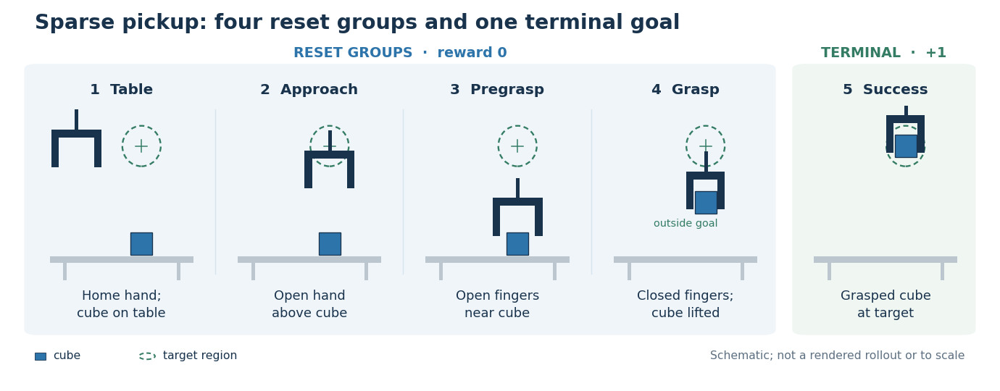
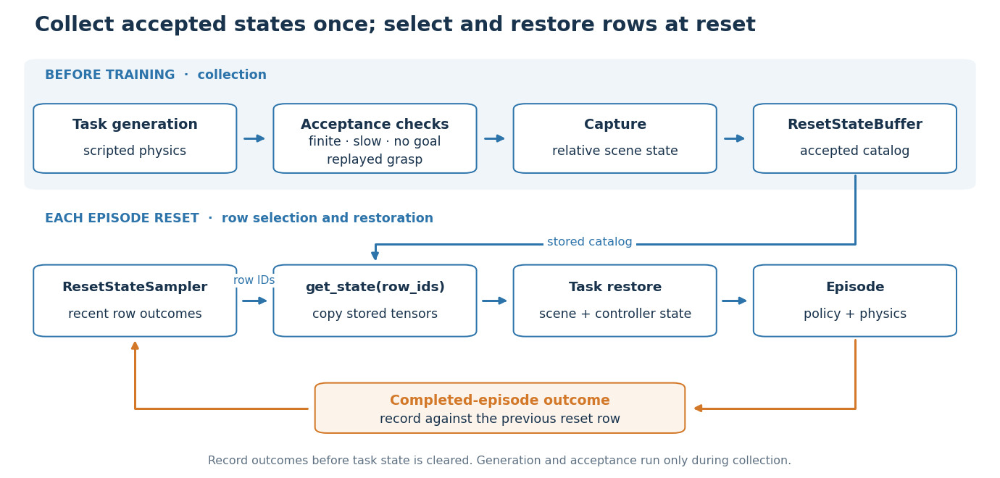
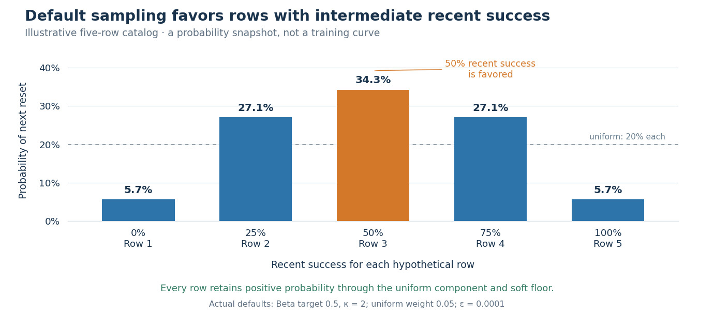

:orphan:

.. _how-to-sparse-cube-pickup:

Learning sparse cube pickup from reset states
=============================================

The ``IsaacContrib-Cube-Pickup-Franka`` example uses generated reset states to
make a sparse manipulation reward easier to discover. A Franka must carry a
grasped 40 mm cube to a fixed point. Starting every attempt with the hand at home
requires an initially random policy to discover reaching, closing, and lifting
before it receives any reward. Intermediate physical starts shorten that search:
an established grasp lets the policy first explore motions that can reach the goal.

This walkthrough follows the task's collection, replay, training, and evaluation
workflow. It currently supports Newton MJWarp. For the reusable buffer API and
integration with other tasks, see :doc:`reset_state_buffers`.

The task lives in ``source/isaaclab_tasks/isaaclab_tasks/contrib/cube_pickup/``:
``cube_pickup_env_cfg.py`` defines configuration, ``cube_pickup_env.py`` owns
collection and replay, and ``mdp.py`` defines success. The command-line probe is
``scripts/environments/cube_pickup.py``.

What earns a reward?
--------------------

The only reward is a terminal ``+1`` when the grasped cube reaches
``(0.5, 0.0, 0.15)`` m in the robot root frame. The cube center must be strictly
less than ``0.04`` m from that point and ``0.035`` m from the hand's grasp center;
both finger joint positions must lie strictly between ``0.01`` and ``0.025`` m.
Success ends the episode immediately, with no holding interval. Other transitions
receive zero reward: there are no reaching, grasping, or progress terms. Attempts
also end after 12 seconds or when the cube leaves the workspace.

The action contains six relative Cartesian pose increments and a binary gripper
command: values above ``0.5`` open the gripper, and other values close it. State
observations include the joints, cube, hand, commanded goal, and previous action.
The policy receives neither reset-row identities nor scripted actions. Reset
states change where reinforcement learning starts; they add no demonstration loss.

   The first four panels are reset groups with ``R = 0``. The fifth illustrates
   terminal success with ``R = +1`` and is excluded from the bank. This is a
   schematic of possible starts and the objective, not a recorded policy rollout.

Collect and inspect a small bank
--------------------------------

Run these commands from the repository root in the configured uv environment:

.. code-block:: bash

   uv run python scripts/environments/cube_pickup.py --mode generate \
       --num_envs 32 --bank_size 128 --seed 0 \
       --bank_output outputs/pickup/reset_states.pt \
       --output outputs/pickup/generation.json

In ``cube_pickup_env.py``, ``_collect_reset_states`` connects ``_generate``
callbacks and ``_capture`` to the buffer. It collects four balanced groups:

* ``table``: the arm at home, with a randomized cube on the table.
* ``approach``: open-hand targets interpolated from home toward 0.10 m above the cube.
* ``pregrasp``: open-hand targets between the cube and 0.10 m above it.
* ``grasp``: fingers physically close around the cube, followed by a commanded
  hand lift of 0.025–0.098 m.

The generator drives the same action and physics path used by the task. It never
inserts a cube into a closed hand. ``_candidate_valid`` rejects non-finite state,
excessive velocities, cubes outside the collection workspace, and starts already
satisfying the success predicate. Approach and pregrasp candidates must reach their
targets. Grasp candidates must stay near the hand and above the table, including
after snapshot restoration and another second of simulated holding.

The capture callback stores scene tensors in environment-relative coordinates,
including physical velocities. Collection has a finite batch budget and reports
accepted and rejected candidates. The script then exercises partial replay,
checks that untouched environments retain their state, rejects initial success,
and checks finite observations and rewards through five environment steps.
``_restore_reset_state`` preserves physical velocities while clearing desired
joint velocities for the position-controlled arm.

Inspect ``generation.json`` for the collection and replay results.
``reset_states.pt`` contains the bank, group metadata, and collection report;
``reset_states.json`` is its report sidecar. This probe does not install a bank
for subsequent training: each training run generates its own fresh bank.

   The one-time collection phase may advance many physics steps. Episode resets
   replay the frozen bank. Training feedback changes row probabilities and leaves
   the stored physical starts unchanged.

Before training, check that scripted control can complete ordinary table starts:

.. code-block:: bash

   uv run python scripts/environments/cube_pickup.py --mode scripted \
       --num_envs 32 --episodes 64 --seed 10000 \
       --output outputs/pickup/scripted.json

This checks the task and control path; it does not measure a learned policy.
Append ``--viz newton_gl`` to watch the scripted controller.

Train and compare reset distributions
-------------------------------------

Start with one GPU using the registered RSL-RL configuration:

.. code-block:: bash

   uv run isaaclab train --rl_library rsl_rl --task IsaacContrib-Cube-Pickup-Franka \
       --num_envs 1024 --max_iterations 3000 --seed 0

The default bank has 1024 states. Training saves ``reset_states.pt`` and its JSON
report in the run directory. Set ``env.reset_buffer.size`` and
``env.reset_buffer.seed`` to control its size and generation seed. Append one of
these overrides to compare starting distributions under the same sparse reward:

.. list-table::
   :header-rows: 1
   :widths: 27 73

   * - Override
     - Episode starts
   * - ``env.reset_mode=adaptive``
     - Generated bank, with probabilities updated from per-row success history; default.
   * - ``env.reset_mode=uniform``
     - Generated bank, with fixed equal probability for every row.
   * - ``env.reset_mode=table``
     - Home arm and randomized table cube, without collecting a bank.

Compare adaptive and uniform sampling with the same environment-step budget,
bank size, and bank seed.

Before clearing an episode, ``_reset_idx`` attributes its outcome to the row that
started it. Initial and zero-step/manual resets are masked out. The sampler keeps
up to 50 outcomes per row and favors rows near 50% recent success while retaining
coverage of every row. This is a per-row practice target, not a requirement that
overall training success stay at 50%.

   Default scores are ``p(1-p) + 0.05 + 0.0001``, normalized across rows. These
   five hypothetical rows illustrate the sampler; they are not a measured learning
   curve. Rows near 50% success receive more practice, with nonzero coverage at
   both extremes.

For four GPUs, use the same configuration with ``train_multigpu --num_gpus 4``
in place of ``train``. ``--num_envs`` then counts environments per GPU, and each
rank saves its generated bank with a rank-specific filename.

Evaluate complete pickup attempts
---------------------------------

Success on the training mixture can come from starts that already hold the cube.
Evaluate a checkpoint separately from full home/table starts:

.. code-block:: bash

   for seed in 10000 20000; do
       uv run python scripts/environments/cube_pickup.py --mode evaluate \
           --checkpoint /path/to/model.pt --num_envs 64 --episodes 512 --seed "$seed" \
           --output "outputs/pickup/evaluation-${seed}.json"
   done

Evaluation always uses ``table`` mode with freshly randomized cube positions and
no bank. Use held-out seeds and repeat across multiple seeds before claiming
generalization. The report records completed attempts, binary successes, their
ratio, and finite observation/reward status. ``--steps`` bounds vector environment
steps; increase it if the requested episodes cannot finish. Report these full-task
results separately from adaptive-mixture training metrics.
