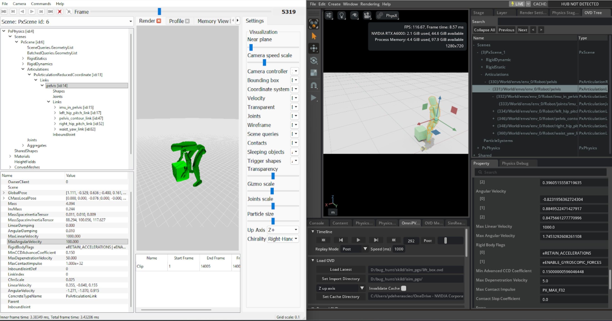

.. _migrating-to-isaaclab-3-0:

Migrating To 3.0
================

.. currentmodule:: isaaclab

Choose the path that matches the code you are starting from. The Isaac Lab 2.x path is organized in
the order most projects should migrate: install the new release, configure a backend, update task APIs,
then move training and visualization workflows.

**Choose your starting point:**

* :ref:`Migration from Isaac Lab 2.x to 3.0 <migrating-from-isaaclab-2-x>` -- update an existing
  Isaac Lab project for the new installation, APIs, and multi-backend architecture.
* :ref:`Migration from Isaac Gym and IsaacGymEnvs <migrating-from-isaacgymenvs>` -- port an Isaac Gym
  task, simulation configuration, or training workflow to Isaac Lab.
* :ref:`Migration of deformables <migrating-deformables>` -- move from the old soft-body API to
  surface and volume deformables.

.. contents:: On this page
   :local:
   :depth: 1
   :backlinks: top

.. _migrating-from-isaaclab-2-x:

.. rubric:: Migration from Isaac Lab 2.x to 3.0

Isaac Lab 3.0 separates backend-specific simulation code from the core API and introduces unified
commands for common workflows. Work through the following sections in order; skip a section only when
your project does not use that feature.

.. Maintenance notes

   This part of the page is the source of truth for the ``isaaclab-migrating-2x-to-3x`` agent skill
   (`skills/user/migrate-2x-to-3x/ <../../../skills/user/migrate-2x-to-3x/SKILL.md>`__).
   When you change it, update the skill so agent guidance stays in sync. See
   :doc:`/source/developer-tools/agent_skills`.

Installation
------------

Start from a fresh Isaac Lab 3.0 checkout. uv is the only supported installation method;
create a new environment instead of upgrading an existing 2.x environment.

Isaac Lab 3.0 removes ``isaaclab.sh``, ``isaaclab.bat``, and the CLI installation and
environment-creation options (``--install``, ``--conda``, and ``--uv``, including their short forms).
Replace installation commands with ``uv sync`` and launcher commands with ``uv run isaaclab``.

.. code-block:: bash

   uv sync --extra isaacsim
   uv run --extra isaacsim isaaclab train \
      --rl_library rsl_rl --task Isaac-Cartpole physics=isaacsim_physx

Use ``uv run isaaclab ...`` for Newton-only workflows, ``--extra ovphysx`` for OV PhysX, and
``--extra isaacsim`` for full Isaac Sim support. See :ref:`installation-method-uv` for platform-specific
setup, the complete extras list, and manually managed environment options.

Multi-Backend Architecture and Presets
--------------------------------------

Understand the new package boundaries first, then make environment configuration backend-selectable.

.. grid:: 2
   :gutter: 2

   .. grid-item-card:: Isaac Lab 2.x

      Physics-specific configuration and implementations were exposed through the core package, and
      environments typically configured one PhysX backend directly.

      .. code-block:: python

         import isaaclab.sim as sim_utils

         self.sim.physics = sim_utils.PhysxCfg(...)

   .. grid-item-card:: Isaac Lab 3.0

      Core assets dispatch to the selected backend. Import backend-owned configuration explicitly and
      use a preset when an environment supports multiple backends.

      .. code-block:: python

         from isaaclab.utils import configclass
         from isaaclab_physx.physics import PhysxCfg
         from isaaclab_tasks.utils import PresetCfg

         @configclass
         class PhysicsPresets(PresetCfg):
             isaacsim_physx: PhysxCfg = PhysxCfg(...)
             default: PhysxCfg = isaacsim_physx

         self.sim.physics = PhysicsPresets()

.. rubric:: Multi-Backend Architecture

Isaac Lab 3.0 introduces a **factory-based multi-backend architecture** that allows asset classes
to be backed by different physics engines — currently **PhysX** and **Newton**.

When you instantiate an asset class from the ``isaaclab`` package (e.g., ``Articulation``,
``RigidObject``), a factory automatically resolves and loads the correct backend implementation:

.. code-block:: python

   from isaaclab.assets import Articulation, ArticulationCfg

   # The factory pattern creates the appropriate backend implementation.
   # No import changes are needed — the same isaaclab imports work regardless of backend.
   robot = Articulation(cfg=ArticulationCfg(...))

The factory works by convention: for a class defined in ``isaaclab.assets.articulation``, it
imports the matching class from the active backend package. The ``isaaclab_physx``,
``isaaclab_newton``, and ``isaaclab_ov`` packages mirror the ``isaaclab`` module structure.

The concrete default remains task-specific so launching without an override stays predictable.
Tasks can expose alternatives such as ``physics=physx``, ``physics=ovphysx``, or
``physics=newton_mjwarp`` without changing their asset import paths.

For a comprehensive overview of the factory pattern and backend selection,
see :ref:`backend-architecture`. To add a new backend, see
:doc:`/source/developer-tools/add_physics_backend`.

.. rubric:: New ``isaaclab_physx`` and ``isaaclab_newton`` Extensions

Two new backend extensions have been introduced:

- **``isaaclab_physx``** — PhysX-specific implementations of asset and sensor classes.
- **``isaaclab_newton``** — Newton-specific implementations of supported asset classes, including
  articulations, rigid objects, and deformable objects.

The following classes have been moved to ``isaaclab_physx``:

.. list-table::
   :header-rows: 1
   :widths: 50 50

   * - Isaac Lab 2.x
     - Isaac Lab 3.0
   * - ``from isaaclab.assets import SurfaceGripper``
     - ``from isaaclab_physx.assets import SurfaceGripper``
   * - ``from isaaclab.assets import SurfaceGripperCfg``
     - ``from isaaclab_physx.assets import SurfaceGripperCfg``

.. note::

   Deformable object public APIs remain in the backend-neutral ``isaaclab``
   package. Continue importing :class:`~isaaclab.assets.DeformableObject`,
   :class:`~isaaclab.assets.DeformableObjectCfg`, and
   :class:`~isaaclab.assets.DeformableObjectData` from ``isaaclab.assets``.

.. note::

   The ``isaaclab_physx`` extension is installed automatically with Isaac Lab. No additional
   installation steps are required.

.. rubric:: Backend-Neutral Imports

The following asset classes remain in the ``isaaclab`` package and can still be imported as before:

- :class:`~isaaclab.assets.Articulation`, :class:`~isaaclab.assets.ArticulationCfg`, :class:`~isaaclab.assets.ArticulationData`
- :class:`~isaaclab.assets.RigidObject`, :class:`~isaaclab.assets.RigidObjectCfg`, :class:`~isaaclab.assets.RigidObjectData`
- :class:`~isaaclab.assets.RigidObjectCollection`, :class:`~isaaclab.assets.RigidObjectCollectionCfg`, :class:`~isaaclab.assets.RigidObjectCollectionData`

These classes now inherit from new abstract base classes but maintain full backward compatibility.

The following sensor classes also remain in the ``isaaclab`` package with unchanged imports:

- :class:`~isaaclab.sensors.ContactSensor`, :class:`~isaaclab.sensors.ContactSensorCfg`, :class:`~isaaclab.sensors.ContactSensorData`
- :class:`~isaaclab.sensors.Imu`, :class:`~isaaclab.sensors.ImuCfg`, :class:`~isaaclab.sensors.ImuData`
- :class:`~isaaclab.sensors.Pva`, :class:`~isaaclab.sensors.PvaCfg`, :class:`~isaaclab.sensors.PvaData`
- :class:`~isaaclab.sensors.FrameTransformer`, :class:`~isaaclab.sensors.FrameTransformerCfg`, :class:`~isaaclab.sensors.FrameTransformerData`
- :class:`~isaaclab.sensors.JointWrenchSensor`, :class:`~isaaclab.sensors.JointWrenchSensorCfg`,
  :class:`~isaaclab.sensors.JointWrenchSensorData`

These sensor classes now use factory patterns that automatically instantiate the appropriate backend
implementation (PhysX by default), maintaining full backward compatibility.

.. note::

   The ``Imu`` sensor in Isaac Lab 3.0 is **not** the same as the ``Imu`` sensor in 2.x.
   The old ``Imu`` (full state sensor) has been renamed to :class:`~isaaclab.sensors.Pva`.
   The new :class:`~isaaclab.sensors.Imu` is a lightweight sensor that only provides angular velocity
   and linear acceleration. See :ref:`imu-to-pva-migration` below for details.

If you need to import the PhysX sensor implementations directly (e.g., for type hints or subclassing),
you can import from ``isaaclab_physx.sensors``:

.. code-block:: python

   # Direct PhysX implementation imports
   from isaaclab_physx.sensors import ContactSensor, ContactSensorData
   from isaaclab_physx.sensors import Imu, ImuData
   from isaaclab_physx.sensors import Pva, PvaData
   from isaaclab_physx.sensors import FrameTransformer, FrameTransformerData
   from isaaclab_physx.sensors import JointWrenchSensor, JointWrenchSensorData

.. rubric:: Newton Backend Implementations

A new extension ``isaaclab_newton`` provides Newton physics backend implementations for:

- :class:`~isaaclab_newton.assets.Articulation` and :class:`~isaaclab_newton.assets.ArticulationData`
- :class:`~isaaclab_newton.assets.RigidObject` and :class:`~isaaclab_newton.assets.RigidObjectData`
- :class:`~isaaclab_newton.sensors.JointWrenchSensor` and
  :class:`~isaaclab_newton.sensors.JointWrenchSensorData`

These classes implement the same base interfaces as their PhysX counterparts
(:class:`~isaaclab.assets.BaseArticulation`, :class:`~isaaclab.assets.BaseRigidObject`),
ensuring a consistent API across backends. They use the same warp-based data conventions
(``wp.array`` with structured types, ``_index`` / ``_mask`` write methods).

.. note::

   The ``isaaclab_newton`` extension requires the ``newton`` package and its dependencies
   (``mujoco``, ``mujoco-warp``). These are installed automatically when installing the
   ``isaaclab_newton`` package.

If you need to import Newton implementations directly (e.g., for type hints or subclassing):

.. code-block:: python

   from isaaclab_newton.assets import Articulation as NewtonArticulation
   from isaaclab_newton.assets import RigidObject as NewtonRigidObject

.. _schemas-cfg-refactor:

.. rubric:: Schema Configuration Class Refactor

In Isaac Lab 3.0, the spawner schema cfg classes are split into solver-common
**base classes** (in ``isaaclab.sim.schemas``) and **backend-specific subclasses**
in ``isaaclab_physx.sim.schemas`` and ``isaaclab_newton.sim.schemas``. This makes
the same asset cfg portable across PhysX and Newton backends, and adds slots
for backend-specific asset-level knobs (e.g., MuJoCo gravity compensation).

For the full design, see :ref:`schema-cfgs`.

**Class moves and renames**

.. important::

   The ``*BaseCfg`` / ``*PropertiesCfg`` classes in this subsection are themselves
   now deprecated in favor of schema fragments, and will be removed in 3.2. Read
   this subsection to understand where a 2.x name went, then migrate to the
   fragments as described in :ref:`schema fragments <schema-fragments-migration>`. The code samples
   below show the intermediate step, not the recommended end state.

The following 2.x class names are kept as deprecated aliases. They forward to
the new location and will be removed in 3.2.

.. list-table::
   :header-rows: 1
   :widths: 40 60

   * - Isaac Lab 2.x
     - Isaac Lab 3.0
   * - ``RigidBodyPropertiesCfg``
     - :class:`~isaaclab.sim.schemas.RigidBodyBaseCfg` (solver-common fields) +
       :class:`~isaaclab_physx.sim.schemas.PhysxRigidBodyPropertiesCfg` (PhysX-specific)
   * - ``JointDrivePropertiesCfg``
     - :class:`~isaaclab.sim.schemas.JointDriveBaseCfg` +
       :class:`~isaaclab_physx.sim.schemas.PhysxJointDrivePropertiesCfg`
   * - ``CollisionPropertiesCfg``
     - :class:`~isaaclab.sim.schemas.CollisionBaseCfg` +
       :class:`~isaaclab_physx.sim.schemas.PhysxCollisionPropertiesCfg`
   * - ``ArticulationRootPropertiesCfg``
     - :class:`~isaaclab.sim.schemas.ArticulationRootBaseCfg` +
       :class:`~isaaclab_physx.sim.schemas.PhysxArticulationRootPropertiesCfg`
   * - ``RigidBodyMaterialCfg``
     - :class:`~isaaclab.sim.spawners.materials.RigidBodyMaterialBaseCfg` +
       :class:`~isaaclab_physx.sim.spawners.materials.PhysxRigidBodyMaterialCfg`
   * - ``MeshCollisionPropertiesCfg`` family (``ConvexHullPropertiesCfg``,
       ``ConvexDecompositionPropertiesCfg``, ``TriangleMeshPropertiesCfg``,
       ``TriangleMeshSimplificationPropertiesCfg``, ``SDFMeshPropertiesCfg``)
     - :class:`~isaaclab.sim.schemas.MeshCollisionBaseCfg` +
       ``Physx*PropertiesCfg`` family in :mod:`isaaclab_physx.sim.schemas`
   * - ``FixedTendonPropertiesCfg``, ``SpatialTendonPropertiesCfg``
     - :class:`~isaaclab_physx.sim.schemas.PhysxFixedTendonPropertiesCfg`,
       :class:`~isaaclab_physx.sim.schemas.PhysxSpatialTendonPropertiesCfg`

**Code migration**

Existing 2.x code continues to work via the deprecation aliases (with a
``DeprecationWarning``; removed in 3.2):

.. code-block:: python

   # Isaac Lab 2.x
   import isaaclab.sim as sim_utils
   rigid_props = sim_utils.RigidBodyPropertiesCfg(disable_gravity=True, linear_damping=0.1)

Recommended 3.0 pattern when targeting PhysX:

.. code-block:: python

   # Isaac Lab 3.0 — PhysX backend
   from isaaclab_physx.sim.schemas import PhysxRigidBodyPropertiesCfg
   rigid_props = PhysxRigidBodyPropertiesCfg(disable_gravity=True, linear_damping=0.1)

Backend-portable 3.0 pattern (universal-physics fields only):

.. code-block:: python

   # Isaac Lab 3.0 — backend-portable
   from isaaclab.sim.schemas import RigidBodyBaseCfg
   rigid_props = RigidBodyBaseCfg(rigid_body_enabled=True, disable_gravity=True)

**Field renames on** ``JointDriveBaseCfg``

Two cfg fields were renamed so their snake_case names map identity-style to the
USD camelCase attribute names. The old names remain as deprecated dataclass
fields on :class:`~isaaclab.sim.schemas.JointDriveBaseCfg` (so
``dataclasses.fields()`` still sees them) and are forwarded to the new fields
in ``__post_init__`` with a ``DeprecationWarning``. Setting **both** the old
and new field on the same instance is silent — the canonical (new) field
wins; the old field's value is discarded after the warning. Both aliases are
scheduled for removal in 4.0.

.. list-table::
   :header-rows: 1
   :widths: 35 35 30

   * - Isaac Lab 2.x
     - Isaac Lab 3.0
     - USD attribute (unchanged)
   * - :attr:`~isaaclab.sim.schemas.JointDriveBaseCfg.max_velocity`
     - :attr:`~isaaclab.sim.schemas.JointDriveBaseCfg.max_joint_velocity`
     - ``physxJoint:maxJointVelocity``
   * - :attr:`~isaaclab.sim.schemas.JointDriveBaseCfg.max_effort`
     - :attr:`~isaaclab.sim.schemas.JointDriveBaseCfg.max_force`
     - ``drive:<axis>:physics:maxForce``

Isaac Lab 2.x style still works (emits ``DeprecationWarning``; removed in 3.2):

.. code-block:: python

   import isaaclab.sim as sim_utils
   sim_utils.JointDrivePropertiesCfg(max_effort=80.0, max_velocity=5.0)

Recommended 3.0 pattern, backend-portable:

.. code-block:: python

   from isaaclab.sim.schemas import JointDriveBaseCfg
   JointDriveBaseCfg(max_force=80.0, max_joint_velocity=5.0)

Recommended 3.0 pattern, PhysX-targeted:

.. code-block:: python

   from isaaclab_physx.sim.schemas import PhysxJointDrivePropertiesCfg
   PhysxJointDrivePropertiesCfg(max_force=80.0, max_joint_velocity=5.0)

**New Newton and MuJoCo cfg classes**

For the Newton backend (and Newton's MuJoCo solver), new cfg classes are
available under :mod:`isaaclab_newton.sim.schemas`:

.. list-table::
   :header-rows: 1
   :widths: 50 50

   * - Class
     - Use case
   * - :class:`~isaaclab_newton.sim.schemas.NewtonCollisionPropertiesCfg`
     - ``newton:contactMargin`` / ``newton:contactGap`` via ``NewtonCollisionAPI``
   * - :class:`~isaaclab_newton.sim.schemas.NewtonMeshCollisionPropertiesCfg`
     - ``newton:maxHullVertices`` via ``NewtonMeshCollisionAPI``
   * - :class:`~isaaclab_newton.sim.schemas.NewtonMaterialPropertiesCfg`
     - ``newton:torsionalFriction`` / ``newton:rollingFriction`` via ``NewtonMaterialAPI``
   * - :class:`~isaaclab_newton.sim.schemas.NewtonArticulationRootPropertiesCfg`
     - ``newton:selfCollisionEnabled`` via ``NewtonArticulationRootAPI``
   * - :class:`~isaaclab_newton.sim.schemas.MujocoRigidBodyPropertiesCfg`
     - ``mjc:gravcomp`` (body-level gravity compensation, MuJoCo solver only)
   * - :class:`~isaaclab_newton.sim.schemas.MujocoJointDrivePropertiesCfg`
     - ``mjc:actuatorgravcomp`` via ``MjcJointAPI`` (joint-level routing)

The MuJoCo cfgs subclass their Newton parent because MuJoCo is one of Newton's
solver options.

.. _schema-fragments-migration:

**Schema fragments supersede the whole** ``*PropertiesCfg`` / ``*BaseCfg`` **layer**

The split above kept the inheritance-based shape of the 2.x cfgs: one class per
backend, each carrying fields from several USD namespaces. Isaac Lab now
replaces that layer with **schema fragments** — one ``@configclass`` per USD
applied schema, each writing exactly one attribute namespace. A spawner slot
takes a *list* of fragments, so you compose the namespaces you actually want
instead of picking a class that bundles them.

Every class in the table below is deprecated: instantiating one emits a
``DeprecationWarning`` naming its replacement, and the class will be removed in
3.2. Nothing is removed in 3.0 — both APIs work side by side.

The replacement column lists **every** fragment needed to cover the deprecated
class's fields, including the fields it inherits from a legacy base. A legacy
class usually bundles more than one USD namespace, so replacing it with only the
backend-specific fragment silently drops the inherited properties.

.. list-table::
   :header-rows: 1
   :widths: 40 60

   * - Deprecated class
     - Fragment replacement (complete set)
   * - ``MassPropertiesCfg``
     - :class:`~isaaclab.sim.schemas.MassCfg`
   * - ``RigidBodyBaseCfg``, ``PhysxRigidBodyPropertiesCfg``,
       ``RigidBodyPropertiesCfg``, ``NewtonRigidBodyPropertiesCfg``
     - :class:`~isaaclab.sim.schemas.UsdPhysicsRigidBodyCfg` +
       :class:`~isaaclab_physx.sim.schemas.PhysxRigidBodyCfg`
   * - ``MujocoRigidBodyPropertiesCfg``
     - :class:`~isaaclab.sim.schemas.UsdPhysicsRigidBodyCfg` +
       :class:`~isaaclab_physx.sim.schemas.PhysxRigidBodyCfg` +
       :class:`~isaaclab_newton.sim.schemas.MujocoRigidBodyCfg`
   * - ``CollisionBaseCfg``, ``PhysxCollisionPropertiesCfg``,
       ``CollisionPropertiesCfg``
     - :class:`~isaaclab.sim.schemas.UsdPhysicsCollisionCfg` +
       :class:`~isaaclab_physx.sim.schemas.PhysxCollisionCfg`
   * - ``JointDriveBaseCfg``, ``PhysxJointDrivePropertiesCfg``,
       ``JointDrivePropertiesCfg``, ``NewtonJointDrivePropertiesCfg``
     - :class:`~isaaclab.sim.schemas.UsdPhysicsDriveCfg` +
       :class:`~isaaclab_physx.sim.schemas.PhysxJointCfg`
   * - ``MujocoJointDrivePropertiesCfg``
     - :class:`~isaaclab.sim.schemas.UsdPhysicsDriveCfg` +
       :class:`~isaaclab_physx.sim.schemas.PhysxJointCfg` +
       :class:`~isaaclab_newton.sim.schemas.MujocoJointCfg`
   * - ``ArticulationRootBaseCfg``, ``PhysxArticulationRootPropertiesCfg``,
       ``ArticulationRootPropertiesCfg``
     - :class:`~isaaclab_physx.sim.schemas.PhysxArticulationCfg`
   * - ``NewtonArticulationRootPropertiesCfg``
     - :class:`~isaaclab_physx.sim.schemas.PhysxArticulationCfg` +
       :class:`~isaaclab_newton.sim.schemas.NewtonArticulationCfg`
   * - ``MeshCollisionBaseCfg``, ``MeshCollisionPropertiesCfg``,
       ``BoundingCubePropertiesCfg``, ``BoundingSpherePropertiesCfg``
     - :class:`~isaaclab.sim.schemas.UsdPhysicsMeshCollisionCfg`, in the spawner's
       ``mesh_collision_props`` slot
   * - ``Physx*MeshPropertiesCfg`` cooking family (``PhysxConvexHullPropertiesCfg``,
       ``PhysxConvexDecompositionPropertiesCfg``, ``PhysxTriangleMeshPropertiesCfg``,
       ``PhysxTriangleMeshSimplificationPropertiesCfg``, ``PhysxSDFMeshPropertiesCfg``)
     - ``Physx*Cfg`` cooking fragments (:class:`~isaaclab_physx.sim.schemas.PhysxConvexHullCfg`,
       :class:`~isaaclab_physx.sim.schemas.PhysxConvexDecompositionCfg`,
       :class:`~isaaclab_physx.sim.schemas.PhysxTriangleMeshCfg`,
       :class:`~isaaclab_physx.sim.schemas.PhysxTriangleMeshSimplificationCfg`,
       :class:`~isaaclab_physx.sim.schemas.PhysxSDFMeshCfg`), in the spawner's
       ``mesh_collision_props`` slot
   * - ``NewtonCollisionPropertiesCfg``
     - :class:`~isaaclab.sim.schemas.UsdPhysicsCollisionCfg` +
       :class:`~isaaclab_physx.sim.schemas.PhysxCollisionCfg` +
       :class:`~isaaclab_newton.sim.schemas.NewtonCollisionCfg`
   * - ``NewtonMeshCollisionPropertiesCfg``
     - ``collision_props``: :class:`~isaaclab.sim.schemas.UsdPhysicsCollisionCfg` +
       :class:`~isaaclab_physx.sim.schemas.PhysxCollisionCfg` +
       :class:`~isaaclab_newton.sim.schemas.NewtonCollisionCfg`;
       ``mesh_collision_props``: :class:`~isaaclab.sim.schemas.UsdPhysicsMeshCollisionCfg` +
       :class:`~isaaclab_newton.sim.schemas.NewtonMeshCollisionCfg`
   * - ``NewtonSDFCollisionPropertiesCfg``
     - ``collision_props``: :class:`~isaaclab.sim.schemas.UsdPhysicsCollisionCfg` +
       :class:`~isaaclab_physx.sim.schemas.PhysxCollisionCfg` +
       :class:`~isaaclab_newton.sim.schemas.NewtonCollisionCfg`;
       ``mesh_collision_props``: :class:`~isaaclab_newton.sim.schemas.NewtonSDFCollisionCfg`
       (authors no ``physics:approximation`` token, like the deprecated class)
   * - ``DeformableBodyPropertiesBaseCfg``
     - None: the class has no fields. Pass
       :class:`~isaaclab.sim.schemas.DeformableBodyFragment` subclasses in a deformable slot, and
       subclass :class:`~isaaclab.sim.schemas.DeformableBodyFragment` for a custom cfg
   * - ``OmniPhysicsDeformableBodyPropertiesCfg``
     - :class:`~isaaclab.sim.schemas.OmniPhysicsDeformableBodyCfg`
   * - ``PhysXDeformableBodyPropertiesCfg``
     - :class:`~isaaclab_physx.sim.schemas.PhysxDeformableBodyCfg` +
       :class:`~isaaclab_physx.sim.schemas.PhysxSurfaceDeformableBodyCfg` (surface only)
   * - ``PhysxDeformableBodyPropertiesCfg``, ``DeformableBodyPropertiesCfg``
     - :class:`~isaaclab.sim.schemas.OmniPhysicsDeformableBodyCfg` +
       :class:`~isaaclab_physx.sim.schemas.PhysxDeformableBodyCfg` +
       :class:`~isaaclab_physx.sim.schemas.PhysxSurfaceDeformableBodyCfg` (surface only)
   * - ``NewtonDeformableBodyPropertiesCfg``
     - None: the class has no fields. Set the matching deformable slot to an empty list,
       for example ``volume_deformable_props=[]``

.. note::

   PhysX fragments appear in the Newton rows because several universally honored
   properties have no other USD home today: ``disable_gravity`` is only
   ``physxRigidBody:disableGravity``, ``max_joint_velocity`` only
   ``physxJoint:maxJointVelocity``, ``contact_offset`` / ``rest_offset`` only
   ``physxCollision:*``, and ``articulation_enabled`` only
   ``physxArticulation:articulationEnabled``. Newton's USD importer reads those
   attributes, so the fragment that writes them is the PhysX one regardless of
   which backend consumes it.

**Deformable bodies: pick the slot**

The slot now selects the deformable type. Replace ``deformable_props`` with
``surface_deformable_props`` when its physics material is a surface deformable material;
otherwise use ``volume_deformable_props``. An empty slot creates a body with backend defaults,
including on Newton. Add only the fragments whose values you need to set. The active backend
chooses the deformable schemas, whereas the legacy cfg type chose them previously.

PhysX properties split into :class:`~isaaclab.sim.schemas.OmniPhysicsDeformableBodyCfg`
for ``omniphysics:*``, :class:`~isaaclab_physx.sim.schemas.PhysxDeformableBodyCfg` for
solver properties, and :class:`~isaaclab_physx.sim.schemas.PhysxSurfaceDeformableBodyCfg`
for surface-only properties. Legacy PhysX cfgs explicitly authored
``kinematic_enabled=False`` and ``solver_position_iteration_count=16``; the fragment API
uses the same schema defaults without authoring them. Set those values explicitly only
when preserving authored USD on a pre-authored asset matters.

.. code-block:: python

   import isaaclab.sim as sim_utils
   from isaaclab_physx.sim.schemas import PhysxCollisionCfg, PhysxDeformableBodyCfg
   from isaaclab_physx.sim.spawners.materials import PhysxSurfaceDeformableBodyMaterialCfg

   cloth = sim_utils.MeshRectangleCfg(
       size=(0.2, 0.2),
       surface_deformable_props=PhysxDeformableBodyCfg(self_collision=True),
       collision_props=[PhysxCollisionCfg(rest_offset=0.002, contact_offset=0.01)],
       physics_material=PhysxSurfaceDeformableBodyMaterialCfg(),
   )

**Code migration**

.. code-block:: python

   # Deprecated: one class bundling the physics:* and physxRigidBody:* namespaces
   import isaaclab.sim as sim_utils
   rigid_props = sim_utils.RigidBodyPropertiesCfg(kinematic_enabled=False, linear_damping=0.1)

.. code-block:: python

   # Recommended: one fragment per USD namespace, composed in the spawner slot
   from isaaclab.sim.schemas import UsdPhysicsRigidBodyCfg
   from isaaclab_physx.sim.schemas import PhysxRigidBodyCfg

   rigid_props = [
       UsdPhysicsRigidBodyCfg(kinematic_enabled=False),
       PhysxRigidBodyCfg(linear_damping=0.1),
   ]

A slot also accepts a mapping from a prim-path pattern to a fragment list, which
lets one spawner cfg target different prims with different properties:

.. code-block:: python

   rigid_props = {"/.*": [UsdPhysicsRigidBodyCfg(kinematic_enabled=False)]}

Three legacy fields are not USD attributes and therefore have no fragment. They
move to the spawner cfg instead — no fragment covers them, so a migration that
only swaps cfg classes drops them:

.. list-table::
   :header-rows: 1
   :widths: 50 50

   * - Deprecated cfg field
     - Fragment-API replacement
   * - ``ArticulationRootBaseCfg.fix_root_link``
     - ``fix_root_link`` on the spawner cfg, forwarded as the ``fix_root_link``
       argument of
       :func:`~isaaclab.sim.schemas.apply_articulation_root_properties`
   * - ``JointDriveBaseCfg.ensure_drives_exist``
     - ``ensure_drives_exist`` on the spawner cfg, forwarded as the
       ``ensure_drives_exist`` argument of
       :func:`~isaaclab.sim.schemas.apply_joint_drive_properties`
   * - ``CollisionBaseCfg.mesh_collision_property``
     - the spawner's ``mesh_collision_props`` slot, which takes the
       mesh-collision fragments directly. Every rigid-object spawner has it (USD, URDF,
       MJCF, mesh-file, shape, and mesh spawners); like the nested field, it reaches every
       collider under a USD asset and the geometry prim of a shape or mesh spawner

The renamed joint-drive fields keep working on the fragments as well:
``max_effort`` is a deprecated alias of
:attr:`~isaaclab.sim.schemas.UsdPhysicsDriveCfg.max_force`, and ``max_velocity``
of :attr:`~isaaclab_physx.sim.schemas.PhysxJointCfg.max_joint_velocity`.

**Schema writers**

The ``define_*`` and ``modify_*`` writers are deprecated alongside the cfgs and
will be removed in 3.2. Each has an ``apply_*`` counterpart that takes a
prim-path *expression* (a regular expression over whole prim paths) and a list
of fragments, so one call can author a whole subtree:

.. list-table::
   :header-rows: 1
   :widths: 55 45

   * - Deprecated writer
     - Replacement
   * - ``define_rigid_body_properties``, ``modify_rigid_body_properties``
     - :func:`~isaaclab.sim.schemas.apply_rigid_body_properties`
   * - ``define_collision_properties``, ``modify_collision_properties``
     - :func:`~isaaclab.sim.schemas.apply_collision_properties`
   * - ``define_mass_properties``, ``modify_mass_properties``
     - :func:`~isaaclab.sim.schemas.apply_mass_properties`
   * - ``define_articulation_root_properties``, ``modify_articulation_root_properties``
     - :func:`~isaaclab.sim.schemas.apply_articulation_root_properties`
   * - ``modify_joint_drive_properties``
     - :func:`~isaaclab.sim.schemas.apply_joint_drive_properties`
   * - ``define_mesh_collision_properties``, ``modify_mesh_collision_properties``
     - :func:`~isaaclab.sim.schemas.apply_mesh_collision_properties` (takes a single collider
       prim path rather than an expression)
   * - ``modify_fixed_tendon_properties``, ``modify_spatial_tendon_properties``
     - :func:`~isaaclab.sim.schemas.apply_fixed_tendon_properties`,
       :func:`~isaaclab.sim.schemas.apply_spatial_tendon_properties`
   * - ``define_deformable_body_properties``, ``modify_deformable_body_properties``
     - :func:`~isaaclab.sim.schemas.apply_volume_deformable_properties` or
       :func:`~isaaclab.sim.schemas.apply_surface_deformable_properties`, matching the
       deformable type; pass ``create_if_missing=True`` to replace ``define_*``

.. code-block:: python

   # Deprecated: authors one prim, takes a single bundled cfg
   sim_utils.modify_rigid_body_properties("/World/Robot/base", RigidBodyPropertiesCfg(linear_damping=0.1))

   # Recommended: authors every matching prim, takes a fragment list
   sim_utils.apply_rigid_body_properties("/World/Robot/.*", [PhysxRigidBodyCfg(linear_damping=0.1)])

``define_deformable_curve_properties`` is not deprecated: there is no curve
fragment family to replace it.

**Silencing the warnings while you migrate**

The warnings are standard ``DeprecationWarning``\ s. Filter them by *message*
while a migration is in progress:

.. code-block:: python

   import warnings

   # Silence one legacy symbol.
   warnings.filterwarnings("ignore", category=DeprecationWarning, message=r"RigidBodyPropertiesCfg is deprecated")

   # Silence every legacy schema cfg and writer at once.
   warnings.filterwarnings("ignore", category=DeprecationWarning, message=r"\w+ is deprecated\. Use ")

   # Silence the renamed joint-drive field aliases (``max_effort``, ``max_velocity``).
   warnings.filterwarnings("ignore", category=DeprecationWarning, message=r"'\w+' is deprecated; use ")

.. warning::

   Do not filter these with ``module="isaaclab.sim.schemas.*"``. ``module`` is
   matched against the ``__name__`` of the frame selected by the warning's
   ``stacklevel``, and these warnings deliberately point at *your* call site, so
   they are attributed to the module that constructed the cfg or called the
   writer — never ``isaaclab.sim.schemas``. A ``module=`` filter silences
   nothing here.

.. note::

   Spawners auto-enable body-level gravity compensation when joint-level
   ``actuatorgravcomp=True`` is requested but no Mujoco rigid-body cfg is
   provided — without ``gravcomp`` on the bodies, ``actuatorgravcomp`` is a
   no-op (no forces to route). To override, pass an explicit
   ``MujocoRigidBodyPropertiesCfg`` in ``rigid_props``. See
   :ref:`schema-cfgs-gravcomp` for details.

For complete tables of which fields live on which class and where each lands in
USD, see :ref:`schema-cfgs`.

.. rubric:: Multi-Backend Support: PresetCfg Pattern

Isaac Lab 3.0 introduces a **PresetCfg pattern** for writing environment configurations
that work with both the PhysX and Newton backends. Instead of hard-coding a single
physics config, environments declare named configuration variants. The active variant
is selected at launch via a Hydra CLI override.

**What is PresetCfg?**

:class:`~isaaclab_tasks.utils.PresetCfg` is a base ``@configclass`` whose typed fields
represent named variants of a configuration section. The field named ``default`` is used
when no CLI override is given. Other fields are named presets selectable with
``presets=<name>`` on the command line:

.. code-block:: python

   from isaaclab.physics import PhysxAutoCfg
   from isaaclab.utils import configclass
   from isaaclab_ov.physics import OvPhysxCfg
   from isaaclab_tasks.utils import PresetCfg

   @configclass
   class MyPhysicsCfg(PresetCfg):
       isaacsim_physx: PhysxCfg = PhysxCfg(...)
       ovphysx: OvPhysxCfg = OvPhysxCfg()
       physx: PhysxAutoCfg = PhysxAutoCfg(isaacsim_physx=isaacsim_physx, ovphysx=ovphysx)
       default: PhysxCfg = isaacsim_physx  # used when no override is given
       newton_mjwarp:  NewtonCfg = NewtonCfg(...)  # selected by physics=newton_mjwarp

**Selecting a preset at launch**

Pass ``physics=newton_mjwarp`` on the CLI to swap the entire config section.
Use ``physics=physx`` to opt into automatic PhysX-family selection. The legacy
``presets=NAME`` form still works for the same values.

.. code-block:: bash

   # Run with Newton backend
   uv run --extra isaacsim isaaclab train --rl_library rsl_rl \
       --task Isaac-Open-Drawer-Franka-Direct physics=newton_mjwarp

   # Run with default (concrete Isaac Sim PhysX) backend
   uv run --extra isaacsim isaaclab train --rl_library rsl_rl \
       --task Isaac-Open-Drawer-Franka-Direct

**Adding Multi-Backend Support to an Environment**

**Step 1 — Physics config**

Replace a plain ``PhysxCfg(...)`` assignment in ``__post_init__`` with a ``PresetCfg``
subclass that carries both a PhysX and a Newton variant.

*Before:*

.. code-block:: python

   def __post_init__(self):
       self.sim.dt = 1 / 60
       self.sim.physics = PhysxCfg(bounce_threshold_velocity=0.2)

.. important::

   The ``After`` example below mirrors the current Reach task, which intentionally
   uses Newton/MJWarp as its default. The ``Before`` snippet only illustrates the
   older single-backend form, so the default differs between the two snippets.
   When migrating a task that should retain PhysX by default, use
   ``default: PhysxCfg = isaacsim_physx`` instead. Adding backend variants should
   not silently change a task's established default.

*After:*

.. code-block:: python

   from isaaclab.physics import PhysxAutoCfg
   from isaaclab_newton.physics import MJWarpSolverCfg, NewtonCfg
   from isaaclab_ov.physics import OvPhysxCfg
   from isaaclab_physx.physics import PhysxCfg
   from isaaclab_tasks.utils import PresetCfg

   @configclass
   class ReachPhysicsCfg(PresetCfg):
       isaacsim_physx: PhysxCfg = PhysxCfg(bounce_threshold_velocity=0.2)
       ovphysx: OvPhysxCfg = OvPhysxCfg()
       physx: PhysxAutoCfg = PhysxAutoCfg(isaacsim_physx=isaacsim_physx, ovphysx=ovphysx)
       newton_mjwarp:  NewtonCfg = NewtonCfg(
           solver_cfg=MJWarpSolverCfg(
               njmax=20, nconmax=20, ls_iterations=20,
               cone="pyramidal", integrator="implicitfast",
               impratio=1,
           ),
           num_substeps=1,
           debug_mode=False,
       )
       default: NewtonCfg = newton_mjwarp

   # In the env cfg __post_init__:
   def __post_init__(self):
       self.sim.dt = 1 / 60
       self.sim.physics = ReachPhysicsCfg()

Key Newton solver parameters:

.. list-table::
   :header-rows: 1
   :widths: 25 75

   * - Parameter
     - Effect
   * - ``njmax``
     - Max constraint rows; set ≥ expected contact count per env
   * - ``nconmax``
     - Max contacts per env
   * - ``ls_iterations``
     - Iterative line search cap; stops early when convergence is reached.
       Tune alongside outer solver iterations for runtime and convergence.
   * - ``cone``
     - ``"pyramidal"`` (fast) or ``"elliptic"`` (more accurate)
   * - ``integrator``
     - ``"implicitfast"`` (recommended) or ``"euler"``
   * - ``impratio``
     - Impedance ratio; >1 improves soft contact stability
   * - ``num_substeps``
     - Physics substeps per environment step

**Step 2 — Differentiating Newton and PhysX Configs**

Not all configurations may be the same between Newton and PhysX simulations.
We can provide a Newton-specific config such as:

.. code-block:: python

   @configclass
   class EventCfg:
       """Full event config (PhysX-compatible)."""
       robot_physics_material = EventTerm(
           func=mdp.randomize_rigid_body_material,
           mode="startup",
           params={...},
       )
       reset_all = EventTerm(func=mdp.reset_scene_to_default, mode="reset")
       reset_robot_joints = EventTerm(
           func=mdp.reset_joints_by_offset, mode="reset", params={...}
       )

   @configclass
   class _EnvNewtonEventCfg:
       """Newton-compatible events."""
       reset_all = EventTerm(func=mdp.reset_scene_to_default, mode="reset")
       reset_robot_joints = EventTerm(
           func=mdp.reset_joints_by_offset, mode="reset", params={...}
       )

   @configclass
   class EnvEventCfg(PresetCfg):
       default: EventCfg = EventCfg()
       physx:   EventCfg = EventCfg()
       newton_mjwarp:  _EnvNewtonEventCfg = _EnvNewtonEventCfg()

Then change the ``events`` field in your env cfg from ``EventCfg`` to ``EnvEventCfg``:

.. code-block:: python

   @configclass
   class MyEnvCfg(ManagerBasedRLEnvCfg):
       events: EnvEventCfg = EnvEventCfg()  # was: EventCfg = EventCfg()

.. rubric:: Isaac Sim API Compatibility

In Isaac Sim 6.0, the legacy ``isaacsim.core.*``, ``isaacsim.sensors.*``, and
``isaacsim.robot.wheeled_robots`` Python module paths are **deprecated** in favor of their
``isaacsim.core.experimental.*`` (and ``*.experimental.*``) equivalents. Isaac Lab 3.0 has
been migrated off the deprecated paths so that Isaac Lab continues to load and run when
those modules are removed in a future Isaac Sim release.

This is mostly a transparent change for users — Isaac Lab's own public Python API
(:mod:`isaaclab`, :mod:`isaaclab_physx`, :mod:`isaaclab_tasks`, :mod:`isaaclab_teleop`,
:mod:`isaaclab_mimic`) is unchanged. The migration is only user-visible if you:

1. Import Isaac Sim symbols **directly** in your project, or
2. Maintain a custom Kit experience (``.kit`` file) that lists Isaac Sim extension
   dependencies, or
3. Imported ``SimulationManager`` from ``isaacsim.core.simulation_manager`` in your own
   PhysX-backed code.

**Python module renames**

Update direct imports in your own code as follows. **Where Isaac Lab provides an in-tree
replacement, prefer the Isaac Lab API** over the ``isaacsim.core.experimental.*`` fallback:

.. list-table::
   :header-rows: 1
   :widths: 45 55

   * - Deprecated Isaac Sim path
     - Recommended replacement
   * - ``isaacsim.core.utils.stage``
     - :mod:`isaaclab.sim.utils.stage` (e.g. ``get_current_stage``,
       ``create_new_stage``, ``open_stage``, ``save_stage``, ``close_stage``,
       ``clear_stage``, ``use_stage``)
   * - ``isaacsim.core.utils.prims``
     - :mod:`isaaclab.sim.utils.prims` (e.g. ``create_prim``, ``delete_prim``,
       ``change_prim_property``, ``bind_visual_material``,
       ``bind_physics_material``, ``add_usd_reference``)
   * - ``isaacsim.core.utils.queries``
     - :mod:`isaaclab.sim.utils.queries` (e.g. ``find_matching_prims``,
       ``find_matching_prim_paths``, ``get_first_matching_child_prim``)
   * - ``isaacsim.core.utils.transforms``
     - :mod:`isaaclab.sim.utils.transforms`
   * - ``isaacsim.core.utils.semantics``
     - :mod:`isaaclab.sim.utils.semantics`
   * - ``isaacsim.core.utils.extensions.enable_extension``
     - :func:`isaaclab.sim.utils.enable_extension`
   * - ``isaacsim.core.utils.viewports.set_camera_view``
     - ``isaacsim.core.rendering_manager.ViewportManager.set_camera_view`` (or
       ``omni.kit.viewport.utility.camera_state.ViewportCameraState`` for lower-level control)
   * - ``isaacsim.core.prims.XFormPrim`` / ``XFormPrimView``
     - :class:`~isaaclab.sim.views.FrameView` (Isaac Lab in-tree view; see
       :ref:`migrating-to-isaaclab-3-0` ``Renaming of XformPrimView to FrameView`` above).
       For ``Articulation`` / ``RigidPrim`` use ``isaacsim.core.experimental.prims``.
   * - ``isaacsim.core.simulation_manager.SimulationManager``
     - :class:`isaaclab_physx.physics.PhysxManager` (PhysX backend) or
       ``isaaclab_newton.physics.NewtonManager`` (Newton backend); see local-alias
       pattern below.
   * - ``isaacsim.core.cloner``
     - :mod:`isaaclab.cloner` (Isaac Lab in-tree cloner)
   * - ``isaacsim.replicator.mobility_gen``
     - ``isaacsim.replicator.experimental.mobility_gen``
   * - ``isaacsim.sensors.<name>``
     - ``isaacsim.sensors.experimental.<name>``
   * - ``isaacsim.robot.wheeled_robots``
     - ``isaacsim.robot.experimental.wheeled_robots`` (and
       ``isaacsim.robot.wheeled_robots.nodes`` for OmniGraph nodes)

To keep call-site code symmetric across backends when migrating off
``isaacsim.core.simulation_manager.SimulationManager``, use the local-alias pattern:

.. code-block:: python

   from isaaclab_physx.physics import PhysxManager as SimulationManager
   # or, for the Newton backend
   from isaaclab_newton.physics import NewtonManager as SimulationManager

**Isaac Sim extension modules must be explicitly enabled before direct import**

Isaac Lab 3.0 no longer automatically initializes Isaac Sim extensions only to
make their Python modules importable. Stock Isaac Lab Kit experiences now load a
smaller set of extensions so unused Isaac Sim packages do not pull in
unnecessary dependencies or deprecated aliases.

If your project imports an Isaac Sim extension module directly, enable the
extension after the Kit application has started and before importing from that
module:

.. code-block:: python

   from isaaclab.sim.utils import enable_extension

   enable_extension("isaacsim.core.experimental.prims")
   from isaacsim.core.experimental.prims import XformPrim

This is especially important for migration replacements such as
``isaacsim.core.experimental.*`` and ``isaacsim.sensors.experimental.*``. Do not
import ``enable_extension`` from ``isaacsim.core.experimental.utils.app`` unless
that extension is already enabled; use :func:`isaaclab.sim.utils.enable_extension`
from Isaac Lab instead. The helper requires a running Kit application and raises
``RuntimeError`` if called from plain Python before Kit is launched.

**Kit experience (``.kit``) updates**

If you maintain a custom Kit experience derived from one of the Isaac Lab apps under
``apps/``:

* **Stop registering deprecated extension search paths.** The ``extsDeprecated`` search
  path entry has been removed from all stock Isaac Lab Kit experiences (headless,
  rendering, XR variants). Mirror that change in your own experience.
* **Switch explicit Isaac Sim extension dependencies** to the non-deprecated equivalents
  listed above (``isaacsim.core.experimental.*``, ``isaacsim.sensors.experimental.*``,
  ``isaacsim.robot.experimental.wheeled_robots``).
* **Do not rely on stock Isaac Lab apps to preload Isaac Sim extensions** that your
  project imports directly. Either add those extensions to your custom ``.kit`` file
  or enable them with :func:`isaaclab.sim.utils.enable_extension` before importing
  their Python modules.
* **Remove unused Isaac Sim extensions that pull in** ``isaacsim.core.api`` — Isaac Lab
  no longer depends on those, and keeping them resurrects the deprecated stack.

**``SimulationManager`` is no longer re-exported**

Earlier internal previews of this migration briefly exposed
``isaaclab_physx.physics.SimulationManager`` as a public alias of
:class:`~isaaclab_physx.physics.PhysxManager`. **That alias has been removed**; use
:class:`~isaaclab_physx.physics.PhysxManager` directly (with ``as SimulationManager`` at
the import site if you want backend-agnostic call-site code, as shown above).

**Retired standalone reproducers**

A handful of legacy reproducers under ``source/isaaclab/test/deps/isaacsim`` that
depended on the deprecated Isaac Sim core extensions have been retired:
``check_camera.py``, ``check_floating_base_made_fixed.py``,
``check_legged_robot_clone.py``, ``check_rep_texture_randomizer.py``, and
``check_ref_count.py``. Use :mod:`isaaclab.sim` together with the new
``isaacsim.core.experimental.*`` APIs for the same debugging workflows.

.. rubric:: PhysX Tensors API Module Path

Recent Isaac Sim releases removed the internal ``impl`` submodule of
``omni.physics.tensors`` and now expose the PhysX Tensor API types
(``ArticulationView``, ``RigidBodyView``, ``SimulationView``, etc.) directly
under ``omni.physics.tensors.api``. Importing from the old path raises
``ModuleNotFoundError: No module named 'omni.physics.tensors.impl'`` at import
time.

Isaac Lab has been updated to import from the new path. Downstream code
(custom assets, sensors, or scripts) that imported from the old path must be
updated:

.. code-block:: python

   # Before (Isaac Lab 2.x / older Isaac Sim)
   import omni.physics.tensors.impl.api as physx

   # After (Isaac Lab 3.x / current Isaac Sim)
   import omni.physics.tensors.api as physx

The class identities are unchanged — only the module path moved. Type hints
referencing the old path (``omni.physics.tensors.impl.api.ArticulationView``)
should be similarly updated to ``omni.physics.tensors.api.ArticulationView``.

Assets, Actuators, and Sensors
------------------------------

Update asset-facing APIs after the backend configuration is in place. This includes renamed views, actuator ownership, and sensor replacements.

.. grid:: 2
   :gutter: 2

   .. grid-item-card:: Isaac Lab 2.x

      .. code-block:: python

         from isaaclab.sim.views import XformPrimView
         from isaaclab.sensors import ImuCfg

         view = XformPrimView(...)
         wrench = robot.data.body_incoming_joint_wrench_b

   .. grid-item-card:: Isaac Lab 3.0

      .. code-block:: python

         from isaaclab.sim.views import FrameView
         from isaaclab.sensors import JointWrenchSensorCfg, PvaCfg

         view = FrameView(...)
         wrench = env.scene.sensors["joint_wrench"].data.force.torch

.. rubric:: Renaming of ``XformPrimView`` to ``FrameView``

Isaac Lab's ``XformPrimView`` and related classes have been renamed to ``FrameView`` to
better reflect their purpose and avoid confusion with Isaac Sim's ``XFormPrim`` class
hierarchy. The old ``XformPrimView`` name is kept as a deprecated alias.

The rename applies across all backends:

.. list-table::
   :header-rows: 1
   :widths: 50 50

   * - Isaac Lab 2.x
     - Isaac Lab 3.0
   * - ``BaseXformPrimView``
     - :class:`~isaaclab.sim.views.BaseFrameView`
   * - ``UsdXformPrimView``
     - :class:`~isaaclab.sim.views.UsdFrameView`
   * - ``XformPrimView``
     - :class:`~isaaclab.sim.views.FrameView`
   * - ``FabricXformPrimView``
     - :class:`~isaaclab_physx.sim.views.FabricFrameView`
   * - ``NewtonSiteXformPrimView``
     - :class:`~isaaclab_newton.sim.views.NewtonSiteFrameView`

For most users, the only change needed is updating imports:

.. code-block:: python

   # Before
   from isaaclab.sim.views import XformPrimView

   # After
   from isaaclab.sim.views import FrameView

The :class:`~isaaclab.sim.views.FrameView` factory automatically dispatches to the correct
backend (:class:`~isaaclab_physx.sim.views.FabricFrameView` for PhysX,
:class:`~isaaclab_newton.sim.views.NewtonSiteFrameView` for Newton) based on the active
physics backend. The deprecated ``XformPrimView`` alias continues to work but will be
removed in a future release.

.. _actuators-solver-limit-migration:

.. rubric:: Actuator effort and joint-limit names

Actuator configurations now use joint-qualified names for solver limits. Update active
configurations to the canonical fields below. The former names remain accepted with a
``DeprecationWarning`` and will be removed in 3.1.

.. list-table:: Actuator limit migration
   :header-rows: 1
   :widths: 38 38 24

   * - Deprecated configuration field
     - Canonical configuration field
     - Runtime owner
   * - ``effort_limit``
     - ``actuator_effort_limit``
     - Actuator model (rated limit)
   * - ``effort_limit_sim``
     - ``joint_effort_limit``
     - :attr:`~isaaclab.assets.ArticulationData.joint_effort_limits`
   * - ``velocity_limit_sim``
     - ``joint_velocity_limit``
     - :attr:`~isaaclab.assets.ArticulationData.joint_vel_limits`

``actuator_effort_limit`` clips explicit actuator-model output. ``joint_effort_limit`` and
``joint_velocity_limit`` are construction-time joint-property overrides selected by an actuator
group's joint expression. The deprecated aliases ``effort_limit``, ``velocity_limit``,
``effort_limit_sim``, and ``velocity_limit_sim`` remain accepted until 3.1. ``effort_limit``
resolves to the rated ``actuator_effort_limit`` for every actuator type. For an implicit group
without a separately configured solver clamp, the rated value also populates
``joint_effort_limit`` for backward compatibility; configure both fields to author distinct
rated and solver limits. The runtime ``effort_limit`` and ``velocity_limit`` group properties
follow the same mapping and are also deprecated.
``actuator_velocity_limit`` describes rated speed or an implicit soft-limit snapshot.
``joint_velocity_limit`` only requests solver enforcement, which is backend-dependent. See
:ref:`actuators-joint-property-ownership` for the full ownership model.

**Behavior change — explicit groups keep the solver effort limit.** Isaac Lab previously raised the
solver effort limit to ``1.0e9`` on joints driven by an explicit actuator so that only the model
clipped the effort. The solver now keeps the authored or configured ``joint_effort_limit``, so
effort submitted by an explicit model is clipped a second time by the solver. If your asset authors
a tight joint effort limit and your policy relies on the model limit alone, set
``joint_effort_limit`` at least as large as ``actuator_effort_limit`` in the actuator
configuration.

The runtime group properties listed below were removed. Read their live values from articulation
data and use the corresponding indexed articulation writer:

.. list-table:: Removed group-property migration
   :header-rows: 1
   :widths: 26 38 36

   * - Removed runtime group property
     - Read
     - Write
   * - ``effort_limit_sim``
     - :attr:`~isaaclab.assets.ArticulationData.joint_effort_limits`
     - :meth:`~isaaclab.assets.Articulation.write_joint_effort_limit_to_sim_index`
   * - ``velocity_limit_sim``
     - :attr:`~isaaclab.assets.ArticulationData.joint_vel_limits`
     - :meth:`~isaaclab.assets.Articulation.write_joint_velocity_limit_to_sim_index`
   * - ``armature``
     - :attr:`~isaaclab.assets.ArticulationData.joint_armature`
     - :meth:`~isaaclab.assets.Articulation.write_joint_armature_to_sim_index`
   * - ``friction``
     - :attr:`~isaaclab.assets.ArticulationData.joint_friction_coeff`
     - :meth:`~isaaclab.assets.Articulation.write_joint_friction_coefficient_to_sim_index`
   * - ``dynamic_friction``
     - ``data.joint_dynamic_friction_coeff`` (PhysX and OVPhysX)
     - ``write_joint_dynamic_friction_coefficient_to_sim_index`` (PhysX and OVPhysX)
   * - ``viscous_friction``
     - ``data.joint_viscous_friction_coeff``
     - ``write_joint_viscous_friction_coefficient_to_sim_index``

The dynamic-friction view and writer are backend-specific; Newton has no corresponding joint
property.

**Custom actuator models.** The protected helper ``ActuatorBase._parse_joint_parameter`` was
removed together with the constructor rework. Custom actuator subclasses that parsed configuration
fields with it should call :func:`~isaaclab.actuators.resolve_joint_parameter`, which applies the
same resolution semantics as a standalone function:

.. code-block:: python

   from isaaclab.actuators import ActuatorBase, resolve_joint_parameter

   class MyActuator(ActuatorBase):
       def __init__(self, cfg, joint_names, joint_ids, num_envs, device, **kwargs):
           super().__init__(cfg, joint_names, joint_ids, num_envs, device, **kwargs)
           # before: self.my_gain = self._parse_joint_parameter(cfg.my_gain, 0.0)
           self.my_gain = resolve_joint_parameter(cfg.my_gain, 0.0, joint_names, num_envs, device)

The backend articulation methods ``write_actuator_stiffness_to_sim`` and
``write_actuator_damping_to_sim`` are deprecated. Use
:func:`~isaaclab.envs.mdp.events.randomize_actuator_gains` for managed gain randomization; it
updates actuator-owned gains, implicit solver drives, or native drive parameters as
appropriate. For direct writes to a Newton-executed group's drive, use
:func:`~isaaclab.actuators.newton.write_group_parameter` with the ``"drive"`` component. It was renamed
from ``"controller"`` to follow the Newton 1.6 drive API. ``"controller"`` remains a deprecated alias that
warns and will be removed in 3.2.

Named regular-expression groups retain their configuration behavior. If both a deprecated name and
its canonical replacement are present in the same group, use only the canonical name; equivalent
values warn and select the canonical value, whereas conflicting values raise :class:`ValueError`.

.. rubric:: Actuator API Moves to ``ActuatorCollection``

In Isaac Lab 3.x, actuator ownership moves from :class:`~isaaclab.assets.Articulation` to a
backend-neutral :class:`~isaaclab.actuators.ActuatorCollection`, available as
:attr:`~isaaclab.assets.Articulation.actuators`. Actuator command setters and per-joint actuator
telemetry now live on the collection, so the same code path drives every physics backend. The
collection setters are keyword-only.

**Method Relocations**

The following methods on :class:`~isaaclab.assets.Articulation` move to the actuator collection.
The old methods are deprecated and will be removed in a future release:

+-------------------------------------------------------------+------------------------------------------------------+
| Deprecated                                                  | New                                                  |
+=============================================================+======================================================+
| ``set_joint_position_target``                               | ``actuators.target_command.set_position_index``      |
+-------------------------------------------------------------+------------------------------------------------------+
| ``set_joint_velocity_target``                               | ``actuators.target_command.set_velocity_index``      |
+-------------------------------------------------------------+------------------------------------------------------+
| ``set_joint_effort_target``                                 | ``actuators.target_command.set_effort_index``        |
+-------------------------------------------------------------+------------------------------------------------------+
| ``set_joint_{position,velocity,effort}_target_index/_mask`` | ``actuators.target_command.set_{position,velocity,`` |
|                                                             | ``effort}_index/_mask``                              |
+-------------------------------------------------------------+------------------------------------------------------+

**Property Relocations (Data Class)**

The following properties on :class:`~isaaclab.assets.ArticulationData` move to the actuator
collection under the command view. The old properties are deprecated and will be removed in a
future release:

+------------------------------+---------------------------------------+
| Deprecated                   | New                                   |
+==============================+=======================================+
| ``data.joint_pos_target``    | ``actuators.target_command.position`` |
+------------------------------+---------------------------------------+
| ``data.joint_vel_target``    | ``actuators.target_command.velocity`` |
+------------------------------+---------------------------------------+
| ``data.joint_effort_target`` | ``actuators.target_command.effort``   |
+------------------------------+---------------------------------------+
| ``data.computed_torque``     | ``actuators.computed_effort``         |
+------------------------------+---------------------------------------+
| ``data.applied_torque``      | ``actuators.applied_effort``          |
+------------------------------+---------------------------------------+

.. note::

   All deprecated methods and properties are forwarders that emit a :class:`DeprecationWarning`
   when used. Your existing code will continue to work, but you should migrate to the new API to
   avoid issues in future releases.

   :attr:`~isaaclab.assets.ArticulationData.soft_joint_vel_limits` remains on
   :class:`~isaaclab.assets.ArticulationData`; do not migrate it to the actuator collection.
   ``ArticulationData.gear_ratio`` was removed: it was legacy :class:`~isaaclab.actuators.DCMotor`
   telemetry that was no longer updated and always read one. Gear ratios are an actuator
   configuration input, not simulation output; read them from your actuator configuration.

.. important::

   LEAPP-exported action terms are a temporary exception. The collection command setters do not
   yet carry LEAPP output annotations, so exportable terms must continue to call the deprecated,
   annotated ``Articulation.set_joint_*_target_index`` or ``*_mask`` methods until collection
   setters are supported by the exporter. Runtime code that is not exported should use the
   collection API.

Actuator group topology is configuration-time state. Add or remove a group on
:attr:`~isaaclab.assets.ArticulationCfg.actuators` before creating the articulation:

.. code-block:: python

   robot_cfg.actuators["gripper"] = ImplicitActuatorCfg(...)
   robot = Articulation(robot_cfg)

At runtime, assignment to or deletion from ``robot.actuators`` raises :class:`TypeError`. Group
membership, joint coverage, native binding, execution slices, and cached launches are
construction-time invariants. Continue to use the public named groups and collection views; private
execution and compatibility-projection details are not migration targets.

**Migration Example**

Here's a complete example showing how to update your code:

**Before (Isaac Lab 2.x):**

.. code-block:: python

   # Setting joint targets on the articulation (deprecated)
   robot = scene["robot"]
   robot.set_joint_effort_target(efforts, joint_ids=joint_ids)

   # Reading actuator telemetry from the data class (deprecated)
   applied = robot.data.applied_torque
   pos_target = robot.data.joint_pos_target

**After (Isaac Lab 3.0):**

.. code-block:: python

   # Sending actuator commands expressed in joint-side coordinates (keyword-only)
   robot = scene["robot"]
   robot.actuators.target_command.set_effort_index(value=efforts, joint_ids=joint_ids)

   # Reading actuator telemetry from the collection
   applied = robot.actuators.applied_effort.torch
   position_command = robot.actuators.target_command.position.torch

For the full runtime API of the actuator collection -- command setters and telemetry buffers --
see :ref:`actuators-runtime-api`.

.. rubric:: RigidObjectCollection API Renaming

The :class:`~isaaclab_physx.assets.RigidObjectCollection` and
:class:`~isaaclab_physx.assets.RigidObjectCollectionData` classes have undergone an API rename
to provide consistency with other asset classes. The ``object_*`` naming convention has been
deprecated in favor of ``body_*``.

**Method Renames**

The following methods have been renamed. The old methods are deprecated and will be removed in a
future release:

+------------------------------------------+------------------------------------------+
| Deprecated (2.x)                         | New (3.0)                                |
+==========================================+==========================================+
| ``write_object_state_to_sim()``          | ``write_body_state_to_sim()``            |
+------------------------------------------+------------------------------------------+
| ``write_object_link_state_to_sim()``     | ``write_body_link_state_to_sim()``       |
+------------------------------------------+------------------------------------------+
| ``write_object_pose_to_sim()``           | ``write_body_pose_to_sim()``             |
+------------------------------------------+------------------------------------------+
| ``write_object_link_pose_to_sim()``      | ``write_body_link_pose_to_sim()``        |
+------------------------------------------+------------------------------------------+
| ``write_object_com_pose_to_sim()``       | ``write_body_com_pose_to_sim()``         |
+------------------------------------------+------------------------------------------+
| ``write_object_velocity_to_sim()``       | ``write_body_com_velocity_to_sim()``     |
+------------------------------------------+------------------------------------------+
| ``write_object_com_velocity_to_sim()``   | ``write_body_com_velocity_to_sim()``     |
+------------------------------------------+------------------------------------------+
| ``write_object_link_velocity_to_sim()``  | ``write_body_link_velocity_to_sim()``    |
+------------------------------------------+------------------------------------------+
| ``find_objects()``                       | ``find_bodies()``                        |
+------------------------------------------+------------------------------------------+

**Property Renames (Data Class)**

The following properties on :class:`~isaaclab_physx.assets.RigidObjectCollectionData` have been
renamed. The old properties are deprecated and will be removed in a future release:

+------------------------------------------+------------------------------------------+
| Deprecated (2.x)                         | New (3.0)                                |
+==========================================+==========================================+
| ``default_object_state``                 | ``default_body_state``                   |
+------------------------------------------+------------------------------------------+
| ``object_names``                         | ``body_names``                           |
+------------------------------------------+------------------------------------------+
| ``object_link_pose_w``                   | ``body_link_pose_w``                     |
+------------------------------------------+------------------------------------------+
| ``object_link_vel_w``                    | ``body_link_vel_w``                      |
+------------------------------------------+------------------------------------------+
| ``object_com_pose_w``                    | ``body_com_pose_w``                      |
+------------------------------------------+------------------------------------------+
| ``object_com_vel_w``                     | ``body_com_vel_w``                       |
+------------------------------------------+------------------------------------------+
| ``object_state_w``                       | ``body_state_w``                         |
+------------------------------------------+------------------------------------------+
| ``object_link_state_w``                  | ``body_link_state_w``                    |
+------------------------------------------+------------------------------------------+
| ``object_com_state_w``                   | ``body_com_state_w``                     |
+------------------------------------------+------------------------------------------+
| ``object_com_acc_w``                     | ``body_com_acc_w``                       |
+------------------------------------------+------------------------------------------+
| ``object_com_pose_b``                    | ``body_com_pose_b``                      |
+------------------------------------------+------------------------------------------+
| ``object_link_pos_w``                    | ``body_link_pos_w``                      |
+------------------------------------------+------------------------------------------+
| ``object_link_quat_w``                   | ``body_link_quat_w``                     |
+------------------------------------------+------------------------------------------+
| ``object_link_lin_vel_w``                | ``body_link_lin_vel_w``                  |
+------------------------------------------+------------------------------------------+
| ``object_link_ang_vel_w``                | ``body_link_ang_vel_w``                  |
+------------------------------------------+------------------------------------------+
| ``object_com_pos_w``                     | ``body_com_pos_w``                       |
+------------------------------------------+------------------------------------------+
| ``object_com_quat_w``                    | ``body_com_quat_w``                      |
+------------------------------------------+------------------------------------------+
| ``object_com_lin_vel_w``                 | ``body_com_lin_vel_w``                   |
+------------------------------------------+------------------------------------------+
| ``object_com_ang_vel_w``                 | ``body_com_ang_vel_w``                   |
+------------------------------------------+------------------------------------------+
| ``object_com_lin_acc_w``                 | ``body_com_lin_acc_w``                   |
+------------------------------------------+------------------------------------------+
| ``object_com_ang_acc_w``                 | ``body_com_ang_acc_w``                   |
+------------------------------------------+------------------------------------------+
| ``object_com_pos_b``                     | ``body_com_pos_b``                       |
+------------------------------------------+------------------------------------------+
| ``object_com_quat_b``                    | ``body_com_quat_b``                      |
+------------------------------------------+------------------------------------------+
| ``object_link_lin_vel_b``                | ``body_link_lin_vel_b``                  |
+------------------------------------------+------------------------------------------+
| ``object_link_ang_vel_b``                | ``body_link_ang_vel_b``                  |
+------------------------------------------+------------------------------------------+
| ``object_com_lin_vel_b``                 | ``body_com_lin_vel_b``                   |
+------------------------------------------+------------------------------------------+
| ``object_com_ang_vel_b``                 | ``body_com_ang_vel_b``                   |
+------------------------------------------+------------------------------------------+
| ``object_pose_w``                        | ``body_pose_w``                          |
+------------------------------------------+------------------------------------------+
| ``object_pos_w``                         | ``body_pos_w``                           |
+------------------------------------------+------------------------------------------+
| ``object_quat_w``                        | ``body_quat_w``                          |
+------------------------------------------+------------------------------------------+
| ``object_vel_w``                         | ``body_vel_w``                           |
+------------------------------------------+------------------------------------------+
| ``object_lin_vel_w``                     | ``body_lin_vel_w``                       |
+------------------------------------------+------------------------------------------+
| ``object_ang_vel_w``                     | ``body_ang_vel_w``                       |
+------------------------------------------+------------------------------------------+
| ``object_lin_vel_b``                     | ``body_lin_vel_b``                       |
+------------------------------------------+------------------------------------------+
| ``object_ang_vel_b``                     | ``body_ang_vel_b``                       |
+------------------------------------------+------------------------------------------+
| ``object_acc_w``                         | ``body_acc_w``                           |
+------------------------------------------+------------------------------------------+
| ``object_lin_acc_w``                     | ``body_lin_acc_w``                       |
+------------------------------------------+------------------------------------------+
| ``object_ang_acc_w``                     | ``body_ang_acc_w``                       |
+------------------------------------------+------------------------------------------+

.. note::

   All deprecated methods and properties will issue a deprecation warning when used. Your existing
   code will continue to work, but you should migrate to the new API to avoid issues in future releases.

**Migration Example**

Here's a complete example showing how to update your code:

**Before (Isaac Lab 2.x):**

.. code-block:: python

   from isaaclab.assets import DeformableObject, DeformableObjectCfg
   from isaaclab.assets import SurfaceGripper, SurfaceGripperCfg
   from isaaclab.assets import RigidObjectCollection

   # Using deprecated root_physx_view
   robot = scene["robot"]
   material_properties = robot.root_physx_view.get_material_properties()

   # Using deprecated object_* API
   collection = scene["object_collection"]
   poses = collection.data.object_pose_w
   collection.write_object_state_to_sim(state, env_ids=env_ids, object_ids=object_ids)

**After (Isaac Lab 3.0):**

.. code-block:: python

   from isaaclab.assets import DeformableObject, DeformableObjectCfg
   from isaaclab_physx.assets import SurfaceGripper, SurfaceGripperCfg
   from isaaclab.assets import RigidObjectCollection  # unchanged

   # Using the new backend-specific root_view property (PhysX shown)
   robot = scene["robot"]
   material_properties = robot.root_view.get_material_properties()

   # Using new body_* API
   collection = scene["object_collection"]
   poses = collection.data.body_pose_w
   collection.write_body_state_to_sim(state, env_ids=env_ids, body_ids=object_ids)

The concrete ``root_view`` type is backend-specific. The
``get_material_properties()`` call above reads each rigid shape's static friction,
dynamic friction, and restitution through the PhysX Tensor API; Newton selections
and OvPhysX bindings use different access methods. Read the
:ref:`PhysX <physx-native-access>`, :ref:`Newton <newton-native-access>`,
and :ref:`OvPhysX <ovphysx-native-access>` native-access guides before using
``root_view`` in backend-portable code.

.. rubric:: Deformable Object API Changes

The deformable body API is split by backend and follows the new Omni Physics volume and surface
deformable model. See :ref:`migrating-deformables`.

.. _imu-to-pva-migration:

.. rubric:: IMU Sensor Renamed to PVA; New Lightweight IMU Sensor

The old ``Imu`` sensor has been renamed to **PVA** (Pose Velocity Acceleration) because it provided
full pose, velocity, and acceleration data — far more than a real inertial measurement unit measures.
A new lightweight **IMU** sensor has been introduced that only provides the two physical quantities
a real IMU measures: angular velocity (gyroscope) and linear acceleration (accelerometer).

If you were using the old ``Imu`` sensor, you need to decide which new sensor to use:

- Use :class:`~isaaclab.sensors.Pva` / :class:`~isaaclab.sensors.PvaCfg` if you need full state
  data (pose, linear velocity, angular velocity, linear and angular acceleration, projected gravity).
- Use :class:`~isaaclab.sensors.Imu` / :class:`~isaaclab.sensors.ImuCfg` if you only need angular
  velocity and linear acceleration (as a real IMU provides).

For configuration and data access examples, see the :ref:`overview_sensors_pva`.

**Import changes:**

.. code-block:: python

   # Before (Isaac Lab 2.x) — the old IMU provided full state
   from isaaclab.sensors import Imu, ImuCfg, ImuData

   # After (Isaac Lab 3.x) — use PVA for the same full-state sensor
   from isaaclab.sensors import Pva, PvaCfg, PvaData

   # Or use the new lightweight IMU for angular velocity + linear acceleration only
   from isaaclab.sensors import Imu, ImuCfg, ImuData

**Configuration changes:**

The ``gravity_bias`` configuration parameter has been removed from both sensors:

- **PVA** reports raw kinematic acceleration (no gravity contribution), as the acceleration
  is derived from finite differencing of velocities which do not include gravity.
- **IMU** unconditionally includes gravity in its accelerometer readings, matching the behavior
  of a real accelerometer. The gravity vector is automatically queried from the simulation.

.. code-block:: python

   # Before (Isaac Lab 2.x)
   imu_cfg = ImuCfg(
       prim_path="{ENV_REGEX_NS}/Robot/base",
       gravity_bias=(0.0, 0.0, 9.81),  # had to be configured manually
   )

   # After (Isaac Lab 3.x) — PVA (no gravity in acceleration)
   pva_cfg = PvaCfg(prim_path="{ENV_REGEX_NS}/Robot/base")

   # After (Isaac Lab 3.x) — IMU (gravity always included automatically)
   imu_cfg = ImuCfg(prim_path="{ENV_REGEX_NS}/Robot/base")

**Observation function changes:**

.. code-block:: python

   # Before (Isaac Lab 2.x)
   from isaaclab.envs.mdp import imu_orientation, imu_projected_gravity

   # After (Isaac Lab 3.x)
   from isaaclab.envs.mdp import pva_orientation, pva_projected_gravity

**Data property changes:**

The new ``ImuData`` only provides ``ang_vel_b`` and ``lin_acc_b``. If you were accessing other
properties (``pos_w``, ``quat_w``, ``lin_vel_b``, ``ang_acc_b``, ``projected_gravity_b``), switch
to :class:`~isaaclab.sensors.PvaData` which provides all of them.

.. rubric:: Sensor Pose Properties Deprecation

The ``pose_w``, ``pos_w``, and ``quat_w`` properties on :class:`~isaaclab.sensors.ContactSensorData`
are deprecated and will be removed in a future release.

If you need to track sensor poses in world frame, please use a dedicated sensor such as
:class:`~isaaclab.sensors.FrameTransformer` instead.

**Before (deprecated):**

.. code-block:: python

   # Using pose properties directly on sensor data
   sensor_pos = contact_sensor.data.pos_w
   sensor_quat = contact_sensor.data.quat_w

**After (recommended):**

.. code-block:: python

   # Use FrameTransformer to track sensor pose
   frame_transformer = FrameTransformer(FrameTransformerCfg(
       prim_path="{ENV_REGEX_NS}/Robot/base",
       target_frames=[
           FrameTransformerCfg.FrameCfg(prim_path="{ENV_REGEX_NS}/Robot/sensor_link"),
       ],
   ))
   sensor_pos = frame_transformer.data.target_pos_w
   sensor_quat = frame_transformer.data.target_quat_w

.. rubric:: Contact force property names

Contact sensor force properties now state whether they contain aggregate or filtered normal and
friction forces. ``net_forces_w`` is the total contact force (normal + friction). Newton, OVPhysX,
and Isaac Sim PhysX 6.2 or later report this quantity even when ``track_friction_forces=False``.
Isaac Sim PhysX 6.1 returns the corresponding normal-force quantity and warns.
``friction_forces_w`` is the aggregate friction force. Newton, OVPhysX, and Isaac Sim PhysX 6.2 or
later report it as ``net_friction_forces_w``; Isaac Sim PhysX 6.1 only provides filtered friction,
so it returns ``friction_force_matrix_w`` and warns.

.. list-table::
   :header-rows: 1

   * - Property
     - Meaning
     - Isaac Sim PhysX 6.1
     - Newton / OVPhysX / Isaac Sim PhysX 6.2+
   * - ``net_forces_w``
     - Total contact force
     - Returns ``net_normal_forces_w`` with a warning
     - Total force (``normal + friction``)
   * - ``net_forces_w_history``
     - Total contact-force history
     - Returns ``net_normal_forces_w_history``
     - Total-force history
   * - ``force_matrix_w``
     - Total filtered force matrix
     - Returns ``normal_force_matrix_w``
     - Total filtered matrix
   * - ``force_matrix_w_history``
     - Total filtered force history
     - Returns ``normal_force_matrix_w_history``
     - Total filtered-matrix history
   * - ``friction_forces_w``
     - Aggregate friction force
     - Returns ``friction_force_matrix_w`` (filtered friction only)
     - Aggregate friction (``net_friction_forces_w``)

Prefer the explicit names ``net_normal_forces_w``, ``net_friction_forces_w``,
``normal_force_matrix_w``, and ``friction_force_matrix_w`` (and their ``*_history`` variants)
when the normal / friction split matters. Newton, OVPhysX, and Isaac Sim PhysX 6.2 or later also
expose ``net_friction_forces_w_history`` and ``friction_force_matrix_w_history``. Isaac Sim PhysX 6.1
does not expose aggregate friction and raises ``NotImplementedError`` when
``net_friction_forces_w`` or ``net_friction_forces_w_history`` is accessed; use the filtered
friction matrix instead.

On OVPhysX and Isaac Sim PhysX 6.2 or later, ``track_friction_forces=True`` enables separate
friction buffers and histories without requiring contact filters. Force matrices still require
filters. Aggregate and filtered forces do not depend on ``max_contact_data_count_per_prim``; a
positive capacity is required only when ``track_contact_points=True``. Total-force buffers always
include friction, whether or not its separate buffers are enabled.

.. rubric:: Articulation Joint Wrench Data Moved to ``JointWrenchSensor``

The ``ArticulationData.body_incoming_joint_wrench_b`` property has been removed. In
Isaac Lab 3.0, incoming joint reaction wrenches are exposed through
:class:`~isaaclab.sensors.JointWrenchSensor`, which has PhysX and Newton backend
implementations and returns separate force [N] and torque [N·m] buffers.
The sensor reports wrenches in the child-side incoming joint frame, with torque
referenced at the child-side joint anchor.

For configuration and data access examples, see the :ref:`overview_sensors_joint_wrench`.

**Before (Isaac Lab 2.x):**

.. code-block:: python

   wrench_b = robot.data.body_incoming_joint_wrench_b.torch[:, body_ids]

**After (Isaac Lab 3.x):**

.. code-block:: python

   import torch
   from isaaclab.scene import InteractiveSceneCfg
   from isaaclab.sensors import JointWrenchSensorCfg
   from isaaclab.utils import replace

   class MySceneCfg(InteractiveSceneCfg):
       robot = replace(ROBOT_CFG, prim_path="{ENV_REGEX_NS}/Robot")
       joint_wrench = JointWrenchSensorCfg(prim_path="{ENV_REGEX_NS}/Robot")

   sensor = env.scene.sensors["joint_wrench"]
   data = sensor.data
   wrench_j = torch.cat(
       (
           data.force.torch[:, body_ids],
           data.torque.torch[:, body_ids],
       ),
       dim=-1,
   )

Use :attr:`~isaaclab.sensors.BaseJointWrenchSensor.body_names` or
:meth:`~isaaclab.sensors.BaseJointWrenchSensor.find_bodies` to map sensor entries to
articulation body names. PhysX reports one entry for every link, including the articulation
root link. Newton reports the child bodies of reportable incoming joints.

For manager-based environments, update observations that used the articulation data property to
depend on the joint-wrench sensor instead:

.. code-block:: python

   import isaaclab.envs.mdp as mdp
   from isaaclab.managers import SceneEntityCfg
   from isaaclab.managers import ObservationTermCfg as ObsTerm
   from isaaclab.scene import InteractiveSceneCfg
   from isaaclab.sensors import JointWrenchSensorCfg
   from isaaclab.utils import replace

   class MySceneCfg(InteractiveSceneCfg):
       robot = replace(ROBOT_CFG, prim_path="{ENV_REGEX_NS}/Robot")
       joint_wrench = JointWrenchSensorCfg(prim_path="{ENV_REGEX_NS}/Robot")

   feet_body_forces = ObsTerm(
       func=mdp.body_incoming_wrench,
       params={
           "sensor_cfg": SceneEntityCfg(
               "joint_wrench",
               body_names=["left_foot", "right_foot"],
           )
       },
   )

.. rubric:: Ray Caster Warp Backend

The :class:`~isaaclab.sensors.RayCaster`, :class:`~isaaclab.sensors.RayCasterCamera`,
:class:`~isaaclab.sensors.MultiMeshRayCaster`, and
:class:`~isaaclab.sensors.MultiMeshRayCasterCamera` sensors have been transitioned from a
PyTorch/USD-based backend to a native Warp kernel pipeline. This improves performance by
eliminating per-step tensor allocations and torch-to-warp conversions, but introduces several
breaking changes.

**RayCasterData Return Types**

The :attr:`~isaaclab.sensors.RayCasterData.pos_w`,
:attr:`~isaaclab.sensors.RayCasterData.quat_w`, and
:attr:`~isaaclab.sensors.RayCasterData.ray_hits_w` properties now return
:class:`~isaaclab.utils.warp.ProxyArray` instead of ``torch.Tensor``. This follows the same
pattern as the general ProxyArray backend migration described above.

.. code-block:: python

   # Before (Isaac Lab 2.x)
   ray_hits = ray_caster.data.ray_hits_w        # torch.Tensor
   sensor_pos = ray_caster.data.pos_w            # torch.Tensor

   # After (Isaac Lab 3.x)
   ray_hits = ray_caster.data.ray_hits_w         # ProxyArray
   sensor_pos = ray_caster.data.pos_w            # ProxyArray

   # To use with torch operations, access .torch
   ray_hits_torch = ray_caster.data.ray_hits_w.torch
   sensor_pos_torch = ray_caster.data.pos_w.torch

**Ray Alignment Configuration**

The ``attach_yaw_only`` boolean parameter on :class:`~isaaclab.sensors.RayCasterCfg` has been
removed in favor of the new ``ray_alignment`` parameter, which accepts one of three string
values:

.. list-table::
   :header-rows: 1
   :widths: 30 30 40

   * - Old (2.x)
     - New (3.0)
     - Behavior
   * - ``attach_yaw_only=False``
     - ``ray_alignment="base"``
     - Rays follow the full sensor orientation.
   * - ``attach_yaw_only=True``
     - ``ray_alignment="yaw"``
     - Rays follow only the yaw component of the sensor orientation.
   * - *(not available)*
     - ``ray_alignment="world"``
     - Rays are always cast in the world frame (no rotation applied).

.. code-block:: python

   # Before (Isaac Lab 2.x)
   cfg = RayCasterCfg(attach_yaw_only=True, ...)

   # After (Isaac Lab 3.x)
   cfg = RayCasterCfg(ray_alignment="yaw", ...)

**Raycasting Kernel Signature Change**

The :func:`~isaaclab.utils.warp.kernels.raycast_dynamic_meshes_kernel` Warp kernel now requires
an ``env_mask`` parameter as its first argument. This is a ``wp.array(dtype=wp.bool)`` that
controls which environments are updated. The public Python wrapper
:func:`~isaaclab.utils.warp.ops.raycast_dynamic_meshes` has been updated to inject an all-True
mask automatically, so code using the wrapper is unaffected.

If you call the kernel directly, update your launch call:

.. code-block:: python

   import warp as wp

   # Before (Isaac Lab 2.x)
   wp.launch(
       raycast_dynamic_meshes_kernel,
       dim=(num_meshes, num_envs, num_rays),
       inputs=[ray_starts, ray_directions, mesh_ids, ...],
   )

   # After (Isaac Lab 3.x) -- env_mask is now the first input
   env_mask = wp.ones(num_envs, dtype=wp.bool, device=device)
   wp.launch(
       raycast_dynamic_meshes_kernel,
       dim=(num_meshes, num_envs, num_rays),
       inputs=[env_mask, ray_starts, ray_directions, mesh_ids, ...],
   )

**RayCaster.meshes Cache Key**

The :attr:`~isaaclab.sensors.RayCaster.meshes` class variable, which caches warp meshes across
all :class:`~isaaclab.sensors.RayCaster` instances, is now keyed by ``(prim_path, device)`` tuples
instead of by ``prim_path`` alone. This prevents a mesh that was built on one device (e.g. CPU)
from being reused by a sensor running on a different device (e.g. CUDA), which caused illegal
memory accesses on systems without unified memory.

Code that reads or writes this cache directly must update both the type annotation and the key:

.. code-block:: python

   # Before (Isaac Lab 2.x)
   meshes: ClassVar[dict[str, wp.Mesh]] = {}
   wp_mesh = RayCaster.meshes[prim_path]

   # After (Isaac Lab 3.x)
   meshes: ClassVar[dict[tuple[str, str], wp.Mesh]] = {}
   wp_mesh = RayCaster.meshes[(prim_path, device)]

Data Access and Math
--------------------

Migrate tensor access, indexed writes, buffers, and quaternion conventions before validating task behavior.

.. grid:: 2
   :gutter: 2

   .. grid-item-card:: Isaac Lab 2.x

      Data properties behaved like Torch tensors, quaternions used WXYZ order, and one write method
      accepted either indices or masks.

      .. code-block:: python

         identity = (1.0, 0.0, 0.0, 0.0)
         root_pos = robot.data.root_pos_w
         robot.write_root_pose_to_sim(pose, env_ids)

   .. grid-item-card:: Isaac Lab 3.0

      Data properties use ``ProxyArray``, quaternions use XYZW order, and writes distinguish index and
      mask selection explicitly.

      .. code-block:: python

         identity = (0.0, 0.0, 0.0, 1.0)
         root_pos = robot.data.root_pos_w.torch
         robot.write_root_pose_to_sim_index(root_pose=pose, env_ids=env_ids)

.. rubric:: Quaternion Format

**The quaternion format changed from WXYZ to XYZW.**

+------------------+----------------------------------+----------------------------------+
| Component        | Old Format (WXYZ)                | New Format (XYZW)                |
+==================+==================================+==================================+
| Order            | ``(w, x, y, z)``                 | ``(x, y, z, w)``                 |
+------------------+----------------------------------+----------------------------------+
| Identity         | ``(1.0, 0.0, 0.0, 0.0)``         | ``(0.0, 0.0, 0.0, 1.0)``         |
+------------------+----------------------------------+----------------------------------+

**Why This Change?**

The new XYZW format aligns with:

- **Warp**: NVIDIA's spatial computing framework
- **PhysX**: PhysX physics engine
- **Newton**: Newton multi-solver framework

This alignment removes the need for internal quaternion conversions, making the code simpler,
faster, and less error-prone.

**What You Need to Update**

Any hard-coded quaternion values in your code need to be converted from WXYZ to XYZW.
This includes:

1. **Configuration files** - ``rot`` parameters in asset configs
2. **Task definitions** - Goal poses, initial states
3. **Controller parameters** - Target orientations
4. **Documentation** - Code examples with quaternions

Also, if you were relying on the :func:`~isaaclab.utils.math.convert_quat` function to convert quaternions, this should
no longer be needed. (This would happen if you were pulling values from the views directly.)

**Example: Updating Asset Configuration**

**Before (WXYZ):**

.. code-block:: python

   from isaaclab.assets import AssetBaseCfg

   cfg = AssetBaseCfg(
       init_state=AssetBaseCfg.InitialStateCfg(
           pos=(0.0, 0.0, 0.5),
           rot=(1.0, 0.0, 0.0, 0.0),  # OLD: w, x, y, z
       ),
   )

**After (XYZW):**

.. code-block:: python

   from isaaclab.assets import AssetBaseCfg

   cfg = AssetBaseCfg(
       init_state=AssetBaseCfg.InitialStateCfg(
           pos=(0.0, 0.0, 0.5),
           rot=(0.0, 0.0, 0.0, 1.0),  # NEW: x, y, z, w
       ),
   )

.. rubric:: Using the Quaternion Finder Tool

We provide a tool to help you find and fix quaternions in your codebase automatically. This is not a bulletproof tool,
but it should help you find most of the quaternions that need to be updated. You *should* review the results manually.

.. warning::
  Do not run the tool on the whole codebase! If you run the tool on our own packages (isaaclab, or isaaclab_tasks for
  instance) it will find all the quaternions that we already converted. This tool is only meant to be used on your own
  codebase with no overlap with our own packages.

**Finding Quaternions**

Run the tool to scan your code for potential quaternions:

.. code-block:: bash

   # Scan the 'source' directory (default)
   python scripts/tools/find_quaternions.py

   # Scan a specific path
   python scripts/tools/find_quaternions.py --path my_project/

   # Compare against a different branch
   python scripts/tools/find_quaternions.py --base develop

.. tip::
  We recommend always running the tool with a custom base branch *and* a specific path.

The tool will show you:

- Quaternions that haven't been updated (marked as ``UNCHANGED``)
- Whether each looks like a WXYZ identity quaternion (``WXYZ_IDENTITY``)
- Whether the format is likely WXYZ (``LIKELY_WXYZ``)

**Understanding the Output**

.. code-block:: text

   my_project/robot_cfg.py:42:8 ⚠ UNCHANGED [WXYZ_IDENTITY]
     Values: [1.0, 0.0, 0.0, 0.0]
     Source: rot=(1.0, 0.0, 0.0, 0.0),

This tells you:

- **File and line**: ``my_project/robot_cfg.py:42``
- **Status**: ``UNCHANGED`` means this line hasn't been modified yet
- **Flag**: ``WXYZ_IDENTITY`` means it's the identity quaternion in old WXYZ format
- **Values**: The actual quaternion values found
- **Source**: The line of code for context

**Filtering Results**

Focus on specific types of quaternions:

.. code-block:: bash

   # Only show identity quaternions [1, 0, 0, 0]
   python scripts/tools/find_quaternions.py --check-identity

   # Only show quaternions likely in WXYZ format
   python scripts/tools/find_quaternions.py --likely-wxyz

   # Show ALL potential quaternions (ignore format heuristics)
   python scripts/tools/find_quaternions.py --all-quats

**Fixing Quaternions Automatically**

The tool can automatically convert quaternions from WXYZ to XYZW:

.. code-block:: bash

   # Interactive mode: prompts before each fix
   python scripts/tools/find_quaternions.py --fix

   # Only fix identity quaternions (safest option)
   python scripts/tools/find_quaternions.py --fix-identity-only

   # Preview changes without applying them
   python scripts/tools/find_quaternions.py --fix --dry-run

   # Apply all fixes without prompting
   python scripts/tools/find_quaternions.py --fix --force

**Interactive Fix Example**

When running with ``--fix``, you'll see something like:

.. code-block:: text

   ────────────────────────────────────────────────────────────────────────────────
   📍 my_project/robot_cfg.py:42 [WXYZ_IDENTITY]
   ────────────────────────────────────────────────────────────────────────────────
        40 |     init_state=AssetBaseCfg.InitialStateCfg(
        41 |         pos=(0.0, 0.0, 0.5),
   >>>  42 |         rot=(1.0, 0.0, 0.0, 0.0),
        43 |     ),
        44 | )
   ────────────────────────────────────────────────────────────────────────────────
     Change: [1.0, 0.0, 0.0, 0.0] → [0.0, 0.0, 0.0, 1.0]
     Result: rot=(0.0, 0.0, 0.0, 1.0),
   Apply this fix? [Y/n/a/q]:

Options:

- **Y** (yes): Apply this fix
- **n** (no): Skip this one
- **a** (all): Apply all remaining fixes without asking
- **q** (quit): Stop fixing

**How the Tool Works**

The tool uses several techniques to find quaternions:

1. **Python files**: Parses the code using AST (Abstract Syntax Tree) to find
   4-element tuples and lists with numeric values.

2. **JSON files**: Uses regex to find 4-element arrays.

3. **RST documentation**: Searches for quaternion-like patterns in docs.

To identify if something is a quaternion, the tool checks:

- Is it exactly 4 numeric values?
- Does the sum of squares ≈ 1? (unit quaternion property)
- Does it match known patterns like identity quaternions?

To determine if it's in WXYZ format:

- Is the first value 1.0 and rest are 0? (WXYZ identity)
- Is the first value a common cos(θ/2) value like 0.707, 0.866, etc.?
- Is the pattern consistent with first-element being the scalar part?

.. rubric:: Using the Runtime Quaternion Access Detector

The quaternion finder tool above covers hard-coded values in source files,
but it cannot see quaternions that are *read* from asset/sensor data at
runtime. For those, Isaac Lab ships a
runtime detector hook on :class:`~isaaclab.utils.warp.ProxyArray` that flags
every ``.torch`` access on a ``wp.quatf``-typed property and points at the
exact call site. Use it after the source-level migration to catch the cases
the finder tool can't reach.

Enable it by setting an environment variable before launching your script:

.. tab-set::

   .. tab-item:: uv (Recommended)

      .. code-block:: bash

         export WARN_ON_TORCH_QUATF_ACCESS=1
         uv run python my_script.py

Every read of ``.torch`` on a ``ProxyArray`` whose underlying ``wp.array`` has
dtype ``wp.quatf`` then emits a :class:`UserWarning` with the message:

.. code-block:: text

   Reading .torch on a wp.quatf-typed ProxyArray. The Isaac Lab quaternion
   convention changed from (w, x, y, z) in 2.x to (x, y, z, w) in 3.x. If
   your code assumes the old order, this is likely the source of incorrect
   rotations. Unset WARN_ON_TORCH_QUATF_ACCESS to silence this warning.

The warning's traceback points at the exact line that performed the access
(via ``stacklevel=2``), so you can walk through the matches in your code and
confirm each one uses the new ``(x, y, z, w)`` order.

Typical workflow:

1. Run a representative scene or task with the env var set.
2. Triage every warning location — check whether the call site assumes
   ``(w, x, y, z)`` (Lab 2.x) or ``(x, y, z, w)`` (Lab 3.x).
3. Migrate the call sites that still expect the old order.
4. Re-run with the env var still set; the warnings should be gone (or only
   come from intentionally-handled call sites).
5. Unset the env var for production runs — the detector adds an
   ``os.environ`` lookup per ``.torch`` access, which is cheap but not free.

The detector covers only ``ProxyArray.torch`` reads. Direct accesses on the
underlying ``wp.array`` (via ``ProxyArray.warp``) are not flagged, because
warp uses ``(x, y, z, w)`` natively and so a warp-side read is unaffected
by the convention change.

.. rubric:: Quaternion Utility API Changes

**The convert_quat function is no longer needed**

IsaacLab provides a utility function to convert between quaternion formats:

.. code-block:: python

   # OLD - No longer needed
   from isaaclab.utils.math import convert_quat
   quat_xyzw = convert_quat(quat_wxyz, "xyzw")

Since everything now uses XYZW natively, this function is no longer needed for Isaac Lab data.
If you were using it, simply remove the conversion calls. Keep it only to convert external
data that still uses WXYZ order.

**Math utility functions now expect XYZW**

All quaternion functions in :mod:`isaaclab.utils.math` now expect and return
quaternions in XYZW format:

- :func:`~isaaclab.utils.math.quat_mul`
- :func:`~isaaclab.utils.math.quat_apply`
- :func:`~isaaclab.utils.math.quat_from_euler_xyz`
- :func:`~isaaclab.utils.math.euler_xyz_from_quat`
- :func:`~isaaclab.utils.math.quat_from_matrix`
- :func:`~isaaclab.utils.math.matrix_from_quat`
- And all other quaternion utilities

.. rubric:: Quaternion Migration Checklist

1. **Start with a clean git state** - Commit your work before running fixes.

2. **Run the tool first without ``--fix``** - Review what will be changed.

3. **Fix identity quaternions first** - They're the most common and safest:

   .. code-block:: bash

      python scripts/tools/find_quaternions.py --fix-identity-only

4. **Review non-identity quaternions manually** - Some 4-element lists might
   not be quaternions (e.g., RGBA colors, bounding boxes).

5. **Test your code** - Run your simulations to verify everything works correctly.

6. **Check documentation** - Update any docs or comments that mention quaternion format.

.. rubric:: ProxyArray Backend for Asset and Sensor Data

All ``.data.*`` properties on asset and sensor classes now return
:class:`~isaaclab.utils.warp.ProxyArray` instead of ``torch.Tensor``. ``ProxyArray`` wraps
the underlying ``wp.array`` and exposes explicit ``.torch`` and ``.warp`` accessors. This
change applies to all asset classes (:class:`~isaaclab.assets.Articulation`,
:class:`~isaaclab.assets.RigidObject`, :class:`~isaaclab.assets.RigidObjectCollection`,
:class:`~isaaclab.assets.DeformableObject`) and all sensor classes
(:class:`~isaaclab_physx.sensors.ContactSensor`, :class:`~isaaclab_physx.sensors.Imu`,
:class:`~isaaclab_physx.sensors.Pva`, :class:`~isaaclab_physx.sensors.FrameTransformer`).

To use a data property as a ``torch.Tensor``, append ``.torch``:

.. code-block:: python

   # Before (Isaac Lab 2.x)
   root_pos = robot.data.root_pos_w             # torch.Tensor
   joint_pos = robot.data.joint_pos              # torch.Tensor
   contact_forces = sensor.data.net_forces_w     # torch.Tensor

   # After (Isaac Lab 3.x)
   root_pos = robot.data.root_pos_w              # ProxyArray
   joint_pos = robot.data.joint_pos              # ProxyArray
   contact_forces = sensor.data.net_normal_forces_w     # ProxyArray

   # To use with torch operations, access .torch
   root_pos_torch = robot.data.root_pos_w.torch        # torch.Tensor
   joint_pos_torch = robot.data.joint_pos.torch        # torch.Tensor
   contact_torch = sensor.data.net_normal_forces_w.torch      # torch.Tensor

Common patterns that need updating:

.. code-block:: python

   # Cloning data
   # Before:
   pos = robot.data.root_pos_w.clone()
   # After:
   pos = robot.data.root_pos_w.torch.clone()

   # Creating zero tensors with matching shape
   # Before:
   zeros = torch.zeros_like(robot.data.root_pos_w)
   # After:
   zeros = torch.zeros_like(robot.data.root_pos_w.torch)

   # Assertions in tests
   # Before:
   torch.testing.assert_close(robot.data.root_pos_w, expected)
   # After:
   torch.testing.assert_close(robot.data.root_pos_w.torch, expected)

.. list-table:: Affected classes
   :header-rows: 1
   :widths: 40 60

   * - Class
     - Package
   * - :class:`~isaaclab.assets.Articulation`
     - ``isaaclab`` / ``isaaclab_physx``
   * - :class:`~isaaclab.assets.RigidObject`
     - ``isaaclab`` / ``isaaclab_physx``
   * - :class:`~isaaclab.assets.RigidObjectCollection`
     - ``isaaclab`` / ``isaaclab_physx``
   * - :class:`~isaaclab.assets.DeformableObject`
     - ``isaaclab`` / ``isaaclab_physx`` / ``isaaclab_newton``
   * - :class:`~isaaclab_physx.sensors.ContactSensor`
     - ``isaaclab_physx``
   * - :class:`~isaaclab_physx.sensors.Imu`
     - ``isaaclab_physx``
   * - :class:`~isaaclab_physx.sensors.Pva`
     - ``isaaclab_physx``
   * - :class:`~isaaclab_physx.sensors.FrameTransformer`
     - ``isaaclab_physx``
   * - :class:`~isaaclab.sensors.RayCaster`
     - ``isaaclab``
   * - :class:`~isaaclab.sensors.RayCasterCamera`
     - ``isaaclab``
   * - :class:`~isaaclab.sensors.MultiMeshRayCaster`
     - ``isaaclab``
   * - :class:`~isaaclab.sensors.MultiMeshRayCasterCamera`
     - ``isaaclab``

.. note::

   ``wp.to_torch(proxy_array)`` is temporarily supported by a compatibility shim. It returns
   the same zero-copy tensor as ``proxy_array.torch`` and emits a one-time
   ``DeprecationWarning``. This shim exists for older migration code and will be removed in a
   future release; prefer ``.torch`` in new code.

.. _torcharray-migration:

.. rubric:: ProxyArray Interop and Temporary Compatibility

Asset and sensor data class properties return :class:`~isaaclab.utils.warp.ProxyArray`, a
lightweight wrapper with explicit ``.torch`` and ``.warp`` accessors:

.. code-block:: python

   # BEFORE (2.x) — properties returned torch.Tensor directly
   joint_pos = robot.data.joint_pos          # torch.Tensor
   root_pos = robot.data.root_pos_w          # torch.Tensor

   # AFTER (3.0) — properties return ProxyArray, use .torch for the tensor
   joint_pos = robot.data.joint_pos.torch    # cached zero-copy torch.Tensor
   root_pos = robot.data.root_pos_w.torch    # cached zero-copy torch.Tensor
   joint_pos_warp = robot.data.joint_pos.warp  # the underlying warp.array

**Automatic interop — in many cases, no changes are needed:**

- **Warp kernels:** ``ProxyArray`` implements ``__cuda_array_interface__``, so it can be passed
  directly to ``wp.launch()`` without calling ``.warp``:

  .. code-block:: python

     # Just works — no .warp needed
     wp.launch(my_kernel, inputs=[robot.data.joint_pos], ...)

- **Torch functions:** ``ProxyArray`` implements ``__torch_function__``, so ``torch.*`` operations
  accept it directly. During the deprecation period this emits a one-time warning, but works:

  .. code-block:: python

     # Works (emits DeprecationWarning once, then silent)
     mean_pos = torch.mean(robot.data.joint_pos, dim=1)
     clipped = torch.clamp(robot.data.joint_pos, -3.14, 3.14)

**What to change:**

1. Append ``.torch`` where you need an explicit ``torch.Tensor`` (e.g., for indexing, slicing,
   or passing to non-torch libraries).
2. Warp kernel calls need no changes — ``ProxyArray`` works transparently.
3. If you need the underlying ``warp.array`` (e.g., for ``ptr``, ``strides``), use ``.warp``.
4. Replace legacy ``wp.to_torch(proxy_array)`` calls with ``proxy_array.torch``.

.. note::

   The ``__torch_function__`` bridge and the temporary ``wp.to_torch(proxy_array)`` shim will
   be removed in a future release. We recommend migrating to explicit ``.torch`` access now.

For a complete guide, see :doc:`/source/how-to/proxy_array`.

.. rubric:: Write Method Index/Mask Split

All asset write methods have been split into two explicit variants:

- ``write_*_to_sim_index(data, env_ids)`` — accepts partial data for a sparse set of
  environment indices. The ``data`` tensor has shape ``(len(env_ids), ...)``.
- ``write_*_to_sim_mask(data, env_mask)`` — accepts full data for all environments with a
  boolean mask selecting which environments to update. The ``data`` tensor has shape
  ``(num_envs, ...)``.

The previous ``write_*_to_sim(data, env_ids)`` methods are deprecated and forward to the
``_index`` variants.

.. code-block:: python

   # Before (Isaac Lab 2.x)
   robot.write_root_pose_to_sim(pose_data, env_ids)

   # After (Isaac Lab 3.x) — indexed variant (partial data)
   robot.write_root_pose_to_sim_index(root_pose=pose_data, env_ids=env_ids)

   # After (Isaac Lab 3.x) — mask variant (full data, boolean mask)
   robot.write_root_pose_to_sim_mask(root_pose=pose_data, env_mask=env_mask)

.. list-table:: Affected write methods (RigidObject / Articulation)
   :header-rows: 1
   :widths: 50 50

   * - Old method
     - New methods
   * - ``write_root_pose_to_sim``
     - ``write_root_pose_to_sim_index`` / ``write_root_pose_to_sim_mask``
   * - ``write_root_link_pose_to_sim``
     - ``write_root_link_pose_to_sim_index`` / ``write_root_link_pose_to_sim_mask``
   * - ``write_root_com_pose_to_sim``
     - ``write_root_com_pose_to_sim_index`` / ``write_root_com_pose_to_sim_mask``
   * - ``write_root_velocity_to_sim``
     - ``write_root_velocity_to_sim_index`` / ``write_root_velocity_to_sim_mask``
   * - ``write_root_com_velocity_to_sim``
     - ``write_root_com_velocity_to_sim_index`` / ``write_root_com_velocity_to_sim_mask``
   * - ``write_root_link_velocity_to_sim``
     - ``write_root_link_velocity_to_sim_index`` / ``write_root_link_velocity_to_sim_mask``

.. list-table:: Additional Articulation-specific write methods
   :header-rows: 1
   :widths: 50 50

   * - Old method
     - New methods
   * - ``write_joint_position_to_sim``
     - ``write_joint_position_to_sim_index`` / ``write_joint_position_to_sim_mask``
   * - ``write_joint_velocity_to_sim``
     - ``write_joint_velocity_to_sim_index`` / ``write_joint_velocity_to_sim_mask``
   * - ``write_joint_stiffness_to_sim``
     - ``write_joint_stiffness_to_sim_index`` / ``write_joint_stiffness_to_sim_mask``
   * - ``write_joint_damping_to_sim``
     - ``write_joint_damping_to_sim_index`` / ``write_joint_damping_to_sim_mask``
   * - ``write_joint_position_limit_to_sim``
     - ``write_joint_position_limit_to_sim_index`` / ``write_joint_position_limit_to_sim_mask``
   * - ``write_joint_velocity_limit_to_sim``
     - ``write_joint_velocity_limit_to_sim_index`` / ``write_joint_velocity_limit_to_sim_mask``
   * - ``write_joint_effort_limit_to_sim``
     - ``write_joint_effort_limit_to_sim_index`` / ``write_joint_effort_limit_to_sim_mask``
   * - ``write_joint_armature_to_sim``
     - ``write_joint_armature_to_sim_index`` / ``write_joint_armature_to_sim_mask``
   * - ``write_joint_friction_coefficient_to_sim``
     - ``write_joint_friction_coefficient_to_sim_index`` / ``write_joint_friction_coefficient_to_sim_mask``

.. list-table:: RigidObjectCollection write methods
   :header-rows: 1
   :widths: 50 50

   * - Old method
     - New methods
   * - ``write_body_pose_to_sim``
     - ``write_body_pose_to_sim_index`` / ``write_body_pose_to_sim_mask``
   * - ``write_body_link_pose_to_sim``
     - ``write_body_link_pose_to_sim_index`` / ``write_body_link_pose_to_sim_mask``
   * - ``write_body_com_pose_to_sim``
     - ``write_body_com_pose_to_sim_index`` / ``write_body_com_pose_to_sim_mask``
   * - ``write_body_velocity_to_sim``
     - ``write_body_velocity_to_sim_index`` / ``write_body_velocity_to_sim_mask``
   * - ``write_body_com_velocity_to_sim``
     - ``write_body_com_velocity_to_sim_index`` / ``write_body_com_velocity_to_sim_mask``
   * - ``write_body_link_velocity_to_sim``
     - ``write_body_link_velocity_to_sim_index`` / ``write_body_link_velocity_to_sim_mask``

.. rubric:: Timestamped buffers

Custom asset and sensor data classes use :class:`~isaaclab.utils.buffers.TimestampedBuffer`
with explicitly allocated Torch or Warp storage. The separate ``TimestampedBufferWarp``
allocator was removed; replace it with ``TimestampedBuffer(wp.zeros(...))``.

.. code-block:: python

   import warp as wp
   from isaaclab.utils.buffers import TimestampedBuffer

   # Before (Isaac Lab 2.x)
   self._data.root_pos_w = TimestampedBuffer(torch.zeros(num_envs, 3, device=device))

   # After (Isaac Lab 3.x)
   self._data.root_pos_w = TimestampedBuffer(wp.zeros(num_envs, dtype=wp.vec3f, device=device))

Reinforcement Learning
----------------------

Move training and inference workflows to the unified entrypoints after the environment imports and steps correctly.

.. grid:: 2
   :gutter: 2

   .. grid-item-card:: Isaac Lab 2.x

      Launch a framework-specific script and use framework-specific resume arguments.

      .. code-block:: bash

         ./isaaclab.sh -p scripts/reinforcement_learning/rsl_rl/train.py \
            --task Isaac-Cartpole --resume --load_run RUN

   .. grid-item-card:: Isaac Lab 3.0

      Select the framework through the unified command and use ``--checkpoint`` consistently.

      .. code-block:: bash

         uv run isaaclab train --rl_library rsl_rl \
            --task Isaac-Cartpole --checkpoint RUN/model.pt

.. rubric:: Reinforcement Learning CLI Entrypoints

Isaac Lab 3.0 provides unified reinforcement learning entrypoints for training
and play. Instead of launching library-specific scripts under
``scripts/reinforcement_learning/<library>/``, select the library with
``--rl_library``.

.. tab-set::

   .. tab-item:: uv (Recommended)

      .. code-block:: bash

         # Isaac Lab 3.0
         uv run isaaclab train --rl_library rsl_rl --task Isaac-Cartpole

The same pattern applies to the play workflow:

.. tab-set::

   .. tab-item:: uv (Recommended)

      .. code-block:: bash

         uv run isaaclab play --rl_library rsl_rl --task Isaac-Cartpole --checkpoint /PATH/TO/model.pt

Supported reinforcement learning libraries are ``rsl_rl``, ``rl_games``, ``skrl``,
``sb3``, and ``rlinf``. Backend-local ``train.py`` and ``play.py`` scripts were removed; use these
unified commands instead.

For distributed launchers that execute a Python script directly, use the unified
script path and pass ``--rl_library`` to it:

.. code-block:: bash

   python -m torch.distributed.run --nproc_per_node=2 scripts/reinforcement_learning/train.py \
      --rl_library rsl_rl --task Isaac-Cartpole --distributed

.. rubric:: Unified Checkpoint and Iteration Arguments

RL entrypoints now use ``--checkpoint`` consistently to select a checkpoint
for training, resuming, or play. Update scripts that use the removed arguments
as follows:

.. list-table:: RL command migration
   :header-rows: 1
   :widths: 28 32 40

   * - Previous command
     - Isaac Lab 3.0 command
     - Notes
   * - RSL-RL ``--resume --load_run <run>``
     - ``--checkpoint <path>``, ``--checkpoint latest``, or ``--checkpoint best``
     - Pass a checkpoint path or select one from a compatible recorded run.
   * - ``--use_pretrained_checkpoint``
     - ``--checkpoint pretrained``
     - Use this for play with RL-Games, RSL-RL, skrl, or Stable-Baselines3.
   * - RLinf ``--rl_model_path <checkpoint-dir>`` or ``--resume_dir <checkpoint-dir>``
     - ``--checkpoint <checkpoint-dir>``
     - The directory must contain the RLinf ``full_weights.pt`` checkpoint.
   * - RLinf ``--max_epochs <N>``
     - ``--max_iterations <N>``
     - This is the common training-iteration argument used by the unified API.

For RLinf, ``--model_path`` now identifies the pretrained base VLA model, not
the RL-finetuned weights. Supply both arguments when evaluating a finetuned
policy:

.. code-block:: bash

   uv run --extra rlinf isaaclab play --rl_library rlinf \
      --config_name isaaclab_ppo_gr00t_assemble_trocar \
      --model_path /path/to/base_model \
      --checkpoint /path/to/rlinf_checkpoint

``latest`` and ``best`` select checkpoints from the newest compatible run for
RL-Games, RSL-RL, skrl, Stable-Baselines3, and RLinf. ``pretrained`` selects a
published policy where one is available; RLinf does not support this selector.

Visualizers, Cameras, and Recording
-----------------------------------

Update interactive viewing, headless rendering, camera configuration, and video capture together because they now share the visualizer abstraction.

.. grid:: 2
   :gutter: 2

   .. grid-item-card:: Isaac Lab 2.x

      ``--headless`` controlled viewer creation, viewport pose lived on ``env_cfg.viewer``, and video
      wrapped the environment with Gymnasium's recorder.

      .. code-block:: python

         env_cfg.viewer.eye = (7.5, 7.5, 7.5)
         env = gym.wrappers.RecordVideo(env, "videos")

   .. grid-item-card:: Isaac Lab 3.0

      ``--viz`` selects visualizers independently of headless rendering. Configure the default viewer
      and recorders through ``SimulationCfg`` and the environment config.

      .. code-block:: python

         sim.default_visualizer_cfg.eye = (7.5, 7.5, 7.5)
         env_cfg.video_recorders = [VideoRecorderCfg(...)]

.. rubric:: Visualizer CLI and Headless Behavior

In Isaac Lab 3.0, use ``--visualizer`` / ``--viz`` to determine whether viewer apps are launched
with an Isaac Lab command. Without a visualizer, commands run headless by default.

Visualizers are lightweight viewer apps for monitoring, debugging, and recording workflows
(see :doc:`/source/concepts/visualization`).

The details below describe how CLI visualizer arguments resolve together with
``SimulationCfg.visualizer_cfgs``.

- ``--viz`` accepts **comma-separated** values (for example ``--viz kit,newton_gl``).
  ``"newton"`` is a deprecated alias for ``"newton_gl"``; prefer ``"newton_gl"`` or ``"newton_rtx"``.
- ``SimulationCfg.visualizer_cfgs`` defaults to an empty list. Concrete visualizer configs run as
  declared; ``--viz`` selects which configured types run and supplies defaults for missing types.
- Task commands accept ``visualizer=NAME`` as an alias of ``--viz NAME``. Custom alternatives belong
  in ``isaaclab_tasks.utils.presets.MultiBackendVisualizerCfg``; pass configured instances instead
  of subclassing it. ``resolve_task_config`` selects these alternatives before launch. Standalone
  scripts using task presets must call ``isaaclab_tasks.utils.resolve_presets`` first.

``launch_simulation`` now owns the runtime decisions previously exposed through ``scan`` and ``Scan``.
Read physics, renderer, and visualizer choices directly from the config inside the launch context.
Pass the same ``SimulationCfg`` (or enclosing environment config) to launch and simulation construction.
Bare physics launches no longer transfer viewer names through global settings.

For the full behavior of visualizer resolution with the visualizer CLI argument and visualizer configs,
see :ref:`visualization-common-modes`.

**Breaking change — ``--headless`` is removed.**

In Isaac Lab 2.x, passing ``--headless`` disabled all visualizers regardless of ``--viz``.
In Isaac Lab 3.0 the flag is removed: a run opens windows for the visualizers selected by CLI or config,
with no visualizers selected by default. To keep a selected visualizer windowless, e.g. on a
machine without a display, set ``HEADLESS=1``: ``--viz kit`` then renders through the Replicator offscreen
renderer and ``--viz newton_gl`` through pyglet's EGL backend.

.. list-table:: Headless visualizer requirements
   :header-rows: 1
   :widths: 20 25 55

   * - Visualizer
     - Headless mechanism
     - Extra requirement
   * - ``kit``
     - Replicator offscreen renderer (no display)
     - Must also pass ``--enable_cameras``; without it, ``render_rgb_array()`` returns
       black frames. ``--video`` sets this automatically.
   * - ``newton_gl``
     - pyglet EGL backend (no display)
     - None — ``NewtonGLVisualizer`` auto-detects a missing ``$DISPLAY`` and selects EGL.
   * - ``newton_rtx``
     - Not supported headlessly
     - ``render_rgb_array()`` returns ``None``; frame capture requires a display.

**Headless video recording (``--video`` without ``--viz``).**

In Isaac Lab 2.x, ``--video`` alone would use the Kit Replicator pipeline implicitly.
In Isaac Lab 3.0, ``--video`` alone records from a headless Newton GL visualizer. The equivalent of the
2.x behavior records from a headless Kit visualizer, configured by the Kit visualizer of the task config
if it lists one:

.. code-block:: bash

   uv run isaaclab train --rl_library rsl_rl --task Isaac-Cartpole-Direct --video viz:kit

See :ref:`the --video sources <record_video_cli>`.

.. rubric:: Viewport Camera Configuration (``ViewerCfg`` deprecated)

The ``viewer`` field (type :class:`~isaaclab.envs.common.ViewerCfg`) is deprecated on
:class:`~isaaclab.envs.DirectRLEnvCfg`, :class:`~isaaclab.envs.ManagerBasedEnvCfg`, and
:class:`~isaaclab.envs.DirectMARLEnvCfg`.  A backward-compatibility shim re-routes
``viewer.*`` assignments for one release, but the field will be removed in a future version.
Configure the viewport camera through :attr:`~isaaclab.sim.SimulationCfg.default_visualizer_cfg`
on the sim config instead.

Similarly, :class:`~isaaclab.envs.ui.ViewportCameraController` is deprecated.  A shim class
remains so existing imports do not break, but it raises a :class:`DeprecationWarning` at
construction.  Camera tracking is now handled directly by
:class:`~isaaclab_visualizers.kit.KitVisualizer` via ``origin_type`` and
``origin_track_path`` on :class:`~isaaclab_visualizers.kit.KitVisualizerCfg`.

.. code-block:: python

   # Before (Isaac Lab 2.x)
   env_cfg.viewer.eye = (4.5, 0.0, 6.0)
   env_cfg.viewer.lookat = (0.0, 0.0, 2.0)

   # After (Isaac Lab 3.x)
   from isaaclab.visualizers import VisualizerCfg
   env_cfg.sim.default_visualizer_cfg = VisualizerCfg(eye=(4.5, 0.0, 6.0), lookat=(0.0, 0.0, 2.0))

For asset-body tracking (previously ``origin_type="asset_root"`` / ``"asset_body"``), use
:class:`~isaaclab_visualizers.kit.KitVisualizerCfg` with ``origin_type="asset"`` and
``origin_track_path``:

.. code-block:: python

   # Before (Isaac Lab 2.x)
   env_cfg.viewer.origin_type = "asset_root"
   env_cfg.viewer.asset_name = "robot"

   # After (Isaac Lab 3.x)
   from isaaclab_visualizers.kit import KitVisualizerCfg
   env_cfg.sim.visualizer_cfgs = [KitVisualizerCfg(origin_type="asset", origin_track_path="robot")]  # --viz kit

The :class:`~isaaclab.envs.ui.ViewportCameraController` class is also deprecated; camera
tracking is handled directly by :class:`~isaaclab_visualizers.kit.KitVisualizer`.

Custom visualizers receive their owning ``sim`` and bound ``cameras`` in ``initialize()``.
Forward these to ``super().initialize(sim, cameras=cameras)`` and use ``self._sim`` to access
the stage, scene data provider, and backend registry. ``SimulationContext`` binds scene-camera
references before initialization. Code that initializes a visualizer directly must supply ordered
``PerspectiveCameraCfg`` objects and existing ``Camera`` sensors through ``cameras``.
Call ``super().close()`` after releasing native viewer resources to drop borrowed scene references.
GL and RTX image capture both require an initialized visualizer; capture after ``sim.reset()``.
Downstream ``OvstageBackend.populate(stage, plan)`` calls must supply the declared ``ClonePlan``.
Standalone scenes can obtain it with ``sim.get_clone_plan()`` after entering ``ReplicateSession``.
The base ``initialize()`` also selects visible environments once. Pass ``get_visualized_env_ids()``
to the viewer instead of calling ``newton_adapter.resolve_visible_env_indices`` or
``apply_viewer_visible_worlds``; both helpers have been removed. The returned selection already
applies bounds, duplicate removal, the visibility cap, and optional sampling.

.. rubric:: Streaming Camera View (``tiled_cam_*`` fields removed)

The ``tiled_cam_*`` configuration fields on visualizer configs (e.g. ``tiled_cam_view``,
``tiled_cam_num``, ``tiled_cam_prim_path``) have been removed and replaced by the unified
``streaming_*`` API and shared ``cameras`` source list. The deprecated forwarding shim has also
been removed; update old field names using the table below.
Renderer selection now takes a configuration directly, without a nickname compatibility path.

.. list-table:: Field rename reference
   :header-rows: 1
   :widths: 40 40 20

   * - Old field (removed)
     - New field
     - Notes
   * - ``tiled_cam_view``
     - ``streaming_view``
     - Default is now ``False`` (opt-in)
   * - ``tiled_cam_num``
     - ``streaming_envs``
     - Accepts ``int`` or ``list[int]``
   * - ``tiled_cam_prim_path``
     - ``streaming_sensor_prim_path``
     - Scene-declared sensor path
   * - ``tiled_cam_eye``
     - ``CameraCfg.offset``
     - Scene camera pose
   * - ``tiled_cam_renderer``
     - ``CameraCfg.renderer_cfg``
     - Renderer configuration on the scene camera

Streaming cameras must now be declared in the scene before cloning. Move
``streaming_cam_renderer_cfg`` to the scene camera's ``CameraCfg.renderer_cfg``, and replace
``streaming_cam_eye`` / ``streaming_cam_target_prim_path`` with its ``offset`` and parent prim path.
The corresponding ``tiled_cam_eye`` and ``tiled_cam_target_prim_path`` aliases are also removed.
Visualizers only display the selected sensor's output; they no longer create a renderer or
camera, force a capture, or remove camera prims on close. See :ref:`visualization-streaming-camera-view`.

.. code-block:: python

   # Before (Isaac Lab 2.x)
   from isaaclab_visualizers.newton import NewtonVisualizerCfg
   cfg = NewtonVisualizerCfg(
       tiled_cam_view=True,
       tiled_cam_num=16,
       tiled_cam_prim_path="/World/envs/env_.*/Camera",
   )

   # After (Isaac Lab 3.x)
   from isaaclab_visualizers.newton import NewtonGLVisualizerCfg
   cfg = NewtonGLVisualizerCfg(
       streaming_view=True,
       streaming_envs=16,
       streaming_sensor_prim_path="/World/envs/env_.*/Camera",
   )

.. note::
   :class:`~isaaclab_visualizers.newton.NewtonVisualizerCfg` is deprecated in this release.
   Use :class:`~isaaclab_visualizers.newton.NewtonGLVisualizerCfg` (OpenGL rasterizer) or
   :class:`~isaaclab_visualizers.newton.NewtonRTXVisualizerCfg` (OVRTX path tracer) instead.

.. rubric:: Newton Visualizer Type Split (``newton`` → ``newton_gl`` / ``newton_rtx``)

The single ``NewtonVisualizerCfg`` (``visualizer_type="newton"``) has been split into two
dedicated configs with separate type identifiers:

.. list-table::
   :header-rows: 1
   :widths: 30 30 40

   * - Old (removed / deprecated)
     - New
     - Notes
   * - ``NewtonVisualizerCfg`` (``visualizer_type="newton"``)
     - :class:`~isaaclab_visualizers.newton.NewtonGLVisualizerCfg` (``visualizer_type="newton_gl"``)
     - OpenGL rasterizer; default Newton visualizer
   * - —
     - :class:`~isaaclab_visualizers.newton.NewtonRTXVisualizerCfg` (``visualizer_type="newton_rtx"``)
     - OVRTX path tracer (experimental)

The ``--viz newton`` CLI argument remains as a **deprecated alias** for ``--viz newton_gl``.
Update scripts and config files to use the explicit form:

.. code-block:: bash

   # Before (Isaac Lab 2.x)
   uv run isaaclab train --rl_library rsl_rl --task Isaac-Cartpole --viz newton

   # After (Isaac Lab 3.x)
   uv run isaaclab train --rl_library rsl_rl --task Isaac-Cartpole --viz newton_gl

Similarly, when importing the config class directly:

.. code-block:: python

   # Before (Isaac Lab 2.x)
   from isaaclab_visualizers.newton import NewtonVisualizerCfg
   cfg = NewtonVisualizerCfg()

   # After (Isaac Lab 3.x)
   from isaaclab_visualizers.newton import NewtonGLVisualizerCfg  # or NewtonRTXVisualizerCfg
   cfg = NewtonGLVisualizerCfg()

The ``newton`` type in a :class:`~isaaclab.envs.utils.video_recorder_cfg.VideoRecorderCfg` source (e.g.
``source="visualizer:newton"``) continues to work as a deprecated alias for ``newton_gl``; use
``"viz:newton_gl"`` or ``"viz:newton_rtx"``.

.. rubric:: Window settings and RTX scene ownership

Move Newton's ``window_width`` and ``window_height`` into ``WindowCfg.size``. Replace
``update_frequency`` with ``WindowCfg.fps``:

.. code-block:: python

   # Before
   viewer = NewtonGLVisualizerCfg(window_width=1920, window_height=1080, update_frequency=2)

   # After
   from isaaclab.visualizers import WindowCfg
   from isaaclab_visualizers.newton import NewtonGLVisualizerCfg

   viewer = NewtonGLVisualizerCfg(window=WindowCfg(size=(1920, 1080), fps=30.0))

``fps`` limits presentation by elapsed wall-clock time, rather than rendering every N simulation
steps. Choose the desired display rate; there is no fixed conversion from ``update_frequency``
when simulation speed varies. Headless recording captures on demand independently of this limit.

Newton RTX now uses authored scene lighting and environment placement. Remove ``rtx_environment``
and RTX ``world_spacing`` settings; author lights and transforms in the scene instead. An unlit
scene stays unlit. ``background_color=None`` preserves the scene background; an explicit color
changes only the visible background. Use Newton GL for model overlays, live plots, and rigid-body
dragging; RTX retains visualization markers and camera controls.

Newton RTX perspective declarations now become ordinary ``CameraCfg`` entries during
``launch_simulation(env_cfg, ...)``, before scene construction. Pass the configuration containing
both ``sim`` and ``scene`` to the launcher. Scripts without ``SceneCfg`` declare assets through
``ReplicateSession``, call ``instantiate(camera_cfg)``, and select its prim path with ``SceneCameraCfg``;
the visualizer no longer creates cameras or render products. See the standalone example in
:doc:`/source/how-to/visualizer_streaming_camera_view`.
Per-camera RTX product attributes can be declared in ``CameraCfg.render_settings``.

Newton RTX no longer automatically offers scene sensors or reads ``streaming_sensor_prim_path``.
Select them explicitly with ``cameras=[SceneCameraCfg(prim_path=...)]`` or
``view=ImageViewCfg(source="scene_sensor_name")``; otherwise it declares one perspective camera.
Set its initial pose and window size on the visualizer configuration, rather than deprecated ``env_cfg.viewer``.

Sensor image dimensions remain configured on ``CameraCfg``. Newton RTX perspective resolution
uses the initial ``WindowCfg.size`` and scales for later window resizes. Newton GL perspective
resolution follows its framebuffer. For windows and recorders sharing one image selection, use
``ImageViewCfg`` as described in :doc:`/source/how-to/visualizer_streaming_camera_view`; existing CLI
recording source strings remain supported. Pass the shared declaration as ``VideoRecorderCfg(source=view)``.
Set ``VisualizerCfg.view`` beside ``VisualizerCfg.window``;
window settings control presentation independently of image selection. Invalid recording sources or
channel selections now raise an error during recorder construction instead of disabling recording.

Visualizer imports and :func:`~isaaclab.utils.string.string_to_callable` now propagate the original
``ModuleNotFoundError`` for missing modules or dependencies. Catch ``ModuleNotFoundError`` instead of
the previous ``ValueError`` wrapper if your application handles these failures.

.. rubric:: Video Recording (``gym.wrappers.RecordVideo`` replaced)

The ``gym.wrappers.RecordVideo`` pattern is no longer supported.  Video recording is now driven
internally by :class:`~isaaclab.envs.utils.video_recorder_cfg.VideoRecorderCfg` entries on the
environment config, sourcing frames from the active visualizer or a scene sensor.

.. code-block:: python

   # Before (Isaac Lab 2.x)
   env = gym.make(task, cfg=env_cfg, render_mode="rgb_array")
   env = gym.wrappers.RecordVideo(env, video_folder="videos/", step_trigger=lambda s: s == 0)

   # After (Isaac Lab 3.x)
   from isaaclab.envs.utils.video_recorder_cfg import VideoRecorderCfg
   env_cfg.video_recorders = [
       VideoRecorderCfg(source="viz", output_dir="videos/", video_length=200)
   ]
   env = gym.make(task, cfg=env_cfg)

Available sources: ``"viz"`` (auto-pick), ``"viz:kit"``, ``"viz:newton_gl"``, ``"viz:newton_rtx"``,
``"viz:<type>:streaming_view"``, ``"sensor:<name>[:<channel>]"``. ``visualizer`` is accepted as the long
form of ``viz``; the ``newton`` type remains a deprecated alias of ``newton_gl``.
The ``eye`` and ``lookat`` fields have been removed from ``VideoRecorderCfg``; position the
camera via ``sim.default_visualizer_cfg`` instead.

The ``isaaclab.envs.utils.recording_hooks`` module has been removed.  Physics-backend recording
hooks are now registered via :meth:`~isaaclab.sim.SimulationContext.add_render_callback`.

Tools and Integrations
----------------------

Finish by updating importers, benchmarks, and optional integrations used around the migrated task.

.. grid:: 2
   :gutter: 2

   .. grid-item-card:: Isaac Lab 2.x

      .. code-block:: bash

         ./isaaclab.sh -p scripts/benchmarks/benchmark_rsl_rl.py \
            --task Isaac-Cartpole

   .. grid-item-card:: Isaac Lab 3.0

      .. code-block:: bash

         uv run isaaclab benchmark training --rl_library rsl_rl \
            --task Isaac-Cartpole physics=physx

.. rubric:: URDF Importer

The URDF importer in Isaac Sim was rewritten to version 3.0, using the ``urdf-usd-converter``
library and the ``isaacsim.asset.transformer.rules`` extension to produce structured USD output.
The old C++ binding-based API (using Kit commands ``URDFParseFile``/``URDFImportRobot`` and the
``_urdf`` interface from ``acquire_urdf_interface()``) has been replaced with a new Python-based
pipeline.

The IsaacLab :class:`~sim.converters.UrdfConverter` has been updated to replicate the new
``URDFImporter.import_urdf()`` pipeline, inserting IsaacLab-specific post-processing (fix base,
joint drives, link density) on the intermediate USD stage before the asset transformer
restructures the output.

.. important::

   The previous version-pinning mechanism that locked the URDF importer extension to
   ``isaacsim.asset.importer.urdf-2.4.31`` has been removed. The converter now uses whichever
   version of the extension is available in your Isaac Sim installation.

**Deprecated Settings**

The following :class:`~sim.converters.UrdfConverterCfg` settings are **deprecated** because
the new URDF importer 3.0 no longer supports them. They are kept for backward compatibility
but will log warnings if enabled:

+-----------------------------------------------------------+-----------------------------------------------------+
| Setting                                                   | Notes                                               |
+===========================================================+=====================================================+
| ``convert_mimic_joints_to_normal_joints``                 | No longer supported by the importer.                |
+-----------------------------------------------------------+-----------------------------------------------------+
| ``replace_cylinders_with_capsules``                       | No longer supported by the importer.                |
+-----------------------------------------------------------+-----------------------------------------------------+
| ``root_link_name``                                        | No longer supported by the importer.                |
+-----------------------------------------------------------+-----------------------------------------------------+

.. note::

   The ``merge_fixed_joints`` setting is **still supported**. It is now implemented as a URDF XML
   pre-processing step that runs before the USD conversion. Fixed joints are removed and child
   link elements (visual, collision, inertial) are merged into the parent link with correct
   transform composition.

Additionally, the :class:`~sim.converters.UrdfConverterCfg.JointDriveCfg.NaturalFrequencyGainsCfg`
gains mode is **deprecated**. The ``compute_natural_stiffness`` function that it depended on has
been removed from the importer. If ``NaturalFrequencyGainsCfg`` is used, a
:exc:`DeprecationWarning` is emitted and joint drive gains are left at the values produced by the
URDF importer. Use :class:`~sim.converters.UrdfConverterCfg.JointDriveCfg.PDGainsCfg` instead.

The :attr:`~sim.converters.AssetConverterBaseCfg.make_instanceable` setting from the base class
is also no longer supported and will be ignored. Assets will be made instanceable by default.

**Updated CLI Tool**

The ``convert_urdf.py`` script has been updated. The ``usd_file_name`` is now determined
automatically by the importer based on the robot name and cannot be overridden.

**Before (Isaac Lab 2.x):**

.. tab-set::

   .. tab-item:: uv (Recommended)

      .. code-block:: bash

         uv run --extra importers python scripts/tools/convert_urdf.py \
           robot.urdf \
           /output/dir/robot.usd \
           --fix-base \
           --merge-joints

**After (Isaac Lab 3.0):**

.. tab-set::

   .. tab-item:: uv (Recommended)

      .. code-block:: bash

         uv run --extra importers python scripts/tools/convert_urdf.py \
           robot.urdf \
           /output/dir \
           --fix-base \
           --joint-stiffness 100.0 \
           --joint-damping 1.0 \
           --viz kit

.. note::

   The ``--merge-joints`` flag is still accepted and correctly triggers the pre-processing
   step to merge fixed joints.

**Updated Python API**

If you use :class:`~sim.converters.UrdfConverter` or :class:`~sim.converters.UrdfConverterCfg`
directly in your code, note the following changes:

1. The ``usd_file_name`` is now set automatically by the converter based on the URDF file name.
   The importer generates output at ``{usd_dir}/{robot_name}/{robot_name}.usda``.

2. The ``make_instanceable`` setting is no longer supported. Assets will be made instanceable
   by default.

3. The ``merge_fixed_joints`` parameter is now implemented as a pre-processing step.

**Before (Isaac Lab 2.x):**

.. code-block:: python

   from isaaclab.sim.converters import UrdfConverter, UrdfConverterCfg

   cfg = UrdfConverterCfg(
       asset_path="robot.urdf",
       usd_dir="/output/dir",
       usd_file_name="robot.usd",
       fix_base=True,
       merge_fixed_joints=True,
       make_instanceable=True,
       joint_drive=UrdfConverterCfg.JointDriveCfg(
           gains=UrdfConverterCfg.JointDriveCfg.PDGainsCfg(
               stiffness=None,  # use URDF values
               damping=None,
           ),
       ),
   )

**After (Isaac Lab 3.0):**

.. code-block:: python

   from isaaclab.sim.converters import UrdfConverter, UrdfConverterCfg

   cfg = UrdfConverterCfg(
       asset_path="robot.urdf",
       usd_dir="/output/dir",
       # usd_file_name is determined automatically from the robot name
       fix_base=True,
       merge_fixed_joints=True,  # supported via pre-processing
       joint_drive=UrdfConverterCfg.JointDriveCfg(
           gains=UrdfConverterCfg.JointDriveCfg.PDGainsCfg(
               stiffness=None,  # use URDF values
               damping=None,
           ),
       ),
   )

.. rubric:: MJCF Importer

The MJCF importer in Isaac Sim was rewritten to use the ``mujoco-usd-converter`` library.
The old C++ binding-based API (using Kit commands ``MJCFCreateAsset``/``MJCFCreateImportConfig``
and the ``ImportConfig`` class) has been replaced with a new pure-Python ``MJCFImporter`` class
and ``MJCFImporterConfig`` dataclass.

.. important::

   The new MJCF importer produces USD assets with **nested rigid bodies** (i.e., ``RigidBodyAPI``
   is applied to each link prim individually) instead of a single articulation root with rigid
   body applied only at the top level. This matches how MuJoCo represents bodies and is
   physically more accurate, but it may affect code that assumes a flat rigid body hierarchy.
   If you have downstream logic that traverses the USD structure of MJCF-imported assets,
   verify that it handles nested rigid body prims correctly.

**Removed Settings**

The following :class:`~sim.converters.MjcfConverterCfg` settings have been **removed** because
the new converter handles them automatically based on the MJCF file content:

- ``import_inertia_tensor`` — inertia tensors are always imported.
- ``import_sites`` — sites are always imported.

The :attr:`~sim.converters.AssetConverterBaseCfg.make_instanceable` setting from the base class
is also no longer supported and will be ignored.

**New Settings**

The following new settings were added to :class:`~sim.converters.MjcfConverterCfg`:

+-----------------------------------------------------------------+------------------------------------------------------+
| Setting                                                         | Description                                          |
+=================================================================+======================================================+
| :attr:`~sim.converters.MjcfConverterCfg.merge_mesh`             | Merge meshes where possible to optimize the model.   |
+-----------------------------------------------------------------+------------------------------------------------------+
| :attr:`~sim.converters.MjcfConverterCfg.collision_from_visuals` | Generate collision geometry from visuals.            |
+-----------------------------------------------------------------+------------------------------------------------------+
| :attr:`~sim.converters.MjcfConverterCfg.collision_type`         | Type of collision geometry (e.g. ``"Convex Hull"``,  |
|                                                                 | ``"Convex Decomposition"``, ``"Bounding Cube"``).    |
+-----------------------------------------------------------------+------------------------------------------------------+

**Renamed Settings**

+------------------------------------------+------------------------------------------+
| Old (2.x)                                | New (3.0)                                |
+==========================================+==========================================+
| ``self_collision``                       | ``self_collision`` (unchanged)           |
+------------------------------------------+------------------------------------------+

.. note::

   The underlying Isaac Sim API renamed ``self_collision`` to ``allow_self_collision``.
   The IsaacLab :class:`~sim.converters.MjcfConverterCfg` keeps using ``self_collision``
   for backward compatibility and maps it to the new name internally.

**Updated CLI Tool**

The ``convert_mjcf.py`` script has been updated to match the new importer settings.
Old command-line flags (``--fix-base``, ``--make-instanceable``, ``--import-sites``)
are no longer available.

**Before (Isaac Lab 2.x):**

.. tab-set::

   .. tab-item:: uv (Recommended)

      .. code-block:: bash

         uv run --extra importers python scripts/tools/convert_mjcf.py \
           ../mujoco_menagerie/unitree_h1/h1.xml \
           source/isaaclab_assets/data/Robots/Unitree/h1.usd \
           --import-sites \
           --make-instanceable

**After (Isaac Lab 3.0):**

.. tab-set::

   .. tab-item:: uv (Recommended)

      .. code-block:: bash

         uv run --extra importers python scripts/tools/convert_mjcf.py \
           ../mujoco_menagerie/unitree_h1/h1.xml \
           source/isaaclab_assets/data/Robots/Unitree/h1.usd \
           --merge-mesh \
           --self-collision \
           --viz kit

New flags: ``--merge-mesh``, ``--collision-from-visuals``, ``--collision-type``, ``--self-collision``.

**Updated Python API**

If you use :class:`~sim.converters.MjcfConverter` or :class:`~sim.converters.MjcfConverterCfg`
directly in your code, update your configuration:

**Before (Isaac Lab 2.x):**

.. code-block:: python

   from isaaclab.sim.converters import MjcfConverter, MjcfConverterCfg

   cfg = MjcfConverterCfg(
       asset_path="robot.xml",
       usd_dir="/output/dir",
       fix_base=True,
       import_sites=True,
       make_instanceable=True,
   )

**After (Isaac Lab 3.0):**

.. code-block:: python

   from isaaclab.sim.converters import MjcfConverter, MjcfConverterCfg

   cfg = MjcfConverterCfg(
       asset_path="robot.xml",
       usd_dir="/output/dir",
       merge_mesh=True,
       collision_from_visuals=False,
       self_collision=False,
   )

.. rubric:: Benchmark Workflows

Isaac Lab 3.0 consolidates the per-backend environment benchmark entry points and their
wrapper shell runners into library-owned, backend-agnostic workflows. Select the physics
configuration at launch with ``physics=NAME`` — the same preset mechanism used by environments —
rather than choosing a backend-specific script.

**What Changed**

The environment benchmark entry points are now exposed through ``isaaclab benchmark`` and
the typed :mod:`isaaclab.benchmark` Python API:

* ``isaaclab benchmark runtime`` — steps an environment with random actions (no policy) and emits a
  ``RuntimeBundle``.
* ``isaaclab benchmark training`` — dispatches a real training run for the RL library selected with
  ``--rl_library`` and emits a ``TrainingBundle``.
* ``isaaclab benchmark startup`` — profiles the five startup phases (``app_launch``, ``python_imports``,
  ``task_config``, ``env_creation``, ``first_step``) with ``cProfile`` and emits a
  ``StartupBundle``.
* ``isaaclab benchmark play`` — **new in 3.0** — loads a trained checkpoint and benchmarks policy inference
  for the RL library selected with ``--rl_library``, emitting a ``PlayBundle`` (inference
  throughput plus the policy's reward, episode length, and success rate). It consumes the
  checkpoints produced by the training workflow; 2.x had no per-backend play benchmark.

The wrapper shell runners that drove these benchmarks — ``run_non_rl_benchmarks.sh`` and
``run_training_benchmarks.sh`` — were removed as well; their behavior is now expressed
directly through command arguments and ``presets=`` tokens.

The benchmark framework itself moved from :mod:`isaaclab.test.benchmark` to
:mod:`isaaclab.benchmark`. The old namespace and the transitional runtime, startup,
training, and play scripts were removed; update imports and invocations to the public
module and unified command.

.. note::

   This consolidation affects only the *environment* benchmark suite. The PhysX
   micro-benchmarks under ``source/isaaclab_physx/benchmark/`` (``benchmark_articulation.py``,
   ``benchmark_rigid_object.py``, and friends) are unchanged — only the
   ``run_physx_benchmarks.sh`` wrapper that invoked them was removed, so run those scripts
   directly. The other standalone benchmark scripts under ``scripts/benchmarks/`` —
   ``benchmark_load_robot.py``, ``benchmark_view_comparison.py``,
   ``benchmark_xform_prim_view.py``, ``benchmark_lazy_export.py``, and
   ``benchmark_hydra_resolve.py`` — are independent of the unified suite and likewise
   unaffected.

**Script and Command Mapping**

Map each old invocation to its replacement:

.. list-table::
   :header-rows: 1
   :widths: 45 55

   * - Isaac Lab 2.x
     - Isaac Lab 3.0
   * - ``benchmark_non_rl.py``
     - ``isaaclab benchmark runtime`` (no ``--rl_library`` dispatch)
   * - ``benchmark_startup.py``
     - ``isaaclab benchmark startup``
   * - ``benchmark_rsl_rl.py``
     - ``isaaclab benchmark training --rl_library rsl_rl``
   * - ``benchmark_rlgames.py``
     - ``isaaclab benchmark training --rl_library rl_games``
   * - *(newly supported)*
     - ``isaaclab benchmark training --rl_library skrl``
   * - *(newly supported)*
     - ``isaaclab benchmark training --rl_library sb3``
   * - *(newly supported)*
     - ``isaaclab benchmark play --rl_library {rsl_rl,rl_games,skrl,sb3}``

SKRL and Stable-Baselines3 had no dedicated benchmark script in 2.x; both are now supported
through the same ``--rl_library`` dispatch on ``isaaclab benchmark training``. ``isaaclab benchmark play`` is likewise new in
3.0: it benchmarks inference of a checkpoint trained by the training workflow for any of the four
RL libraries.

**Running Benchmarks**

Physics and rendering use task presets, as in training: ``physics=newton_mjwarp`` and
``renderer=newton_renderer``. The equivalent flags are ``--physics newton_mjwarp`` and
``--renderer newton_renderer``; there is no ``--render`` flag.

**Before (Isaac Lab 2.x):**

.. tab-set::

   .. tab-item:: Isaac Lab launcher

      .. code-block:: bash

         # Non-RL (random-action) runtime benchmark
         ./isaaclab.sh -p scripts/benchmarks/benchmark_non_rl.py --task Isaac-Cartpole-Direct

         # Training benchmark (RSL-RL)
         ./isaaclab.sh -p scripts/benchmarks/benchmark_rsl_rl.py --task Isaac-Cartpole-Direct

         # Wrapper shell runners
         ./scripts/benchmarks/run_non_rl_benchmarks.sh
         ./scripts/benchmarks/run_training_benchmarks.sh

**After (Isaac Lab 3.0):**

.. code-block:: bash

   # Non-RL (random-action) runtime benchmark — PhysX (default)
   uv run isaaclab benchmark runtime --task Isaac-Cartpole-Direct

   # Same benchmark on Newton/MJWarp — select the backend via presets=
   uv run isaaclab benchmark runtime --task Isaac-Cartpole-Direct presets=newton_mjwarp

   # Training benchmark — choose the RL library with --rl_library
   uv run isaaclab benchmark training --task Isaac-Cartpole-Direct --rl_library rsl_rl
   uv run --extra skrl isaaclab benchmark training --task Isaac-Cartpole-Direct --rl_library skrl presets=newton_mjwarp

   # Play (inference) benchmark — loads a checkpoint produced by training
   uv run isaaclab benchmark play --task Isaac-Cartpole-Direct --rl_library rsl_rl --checkpoint /path/to/model.pt

   # Startup profiling
   uv run isaaclab benchmark startup --task Isaac-Cartpole-Direct presets=newton_mjwarp

**Output Format**

The output format is controlled by ``--benchmark_formatter``, which is independent of the
physics backend. It defaults to ``schema`` (the typed benchmark bundle) and accepts a
comma-separated list to emit several formats at once. Supported values are ``schema``,
``omniperf``, ``osmo``, ``json``, and ``summary`` (legacy long-form aliases such as
``OmniPerfKPIFile`` are still accepted).

.. code-block:: bash

   # Emit the typed schema bundle and an OmniPerf KPI file in one run
   uv run isaaclab benchmark runtime --task Isaac-Cartpole-Direct \
       --benchmark_formatter schema,omniperf

**Migration Steps**

If you have custom benchmark scripts or CI based on Isaac Lab 2.x:

1. **Replace the old entry points** — swap ``benchmark_non_rl.py`` for ``isaaclab benchmark runtime``,
   ``benchmark_startup.py`` for ``isaaclab benchmark startup``, and the per-library training scripts for
   ``isaaclab benchmark training --rl_library <lib>``.

2. **Update benchmark imports** — replace ``isaaclab.test.benchmark`` with
   ``isaaclab.benchmark``. The old namespace is no longer available.

3. **Drop the wrapper runners** — ``run_non_rl_benchmarks.sh`` and
   ``run_training_benchmarks.sh`` no longer exist; express their behavior with script
   arguments and ``presets=`` tokens. ``run_physx_benchmarks.sh`` is also gone — invoke the
   PhysX micro-benchmarks under ``source/isaaclab_physx/benchmark/`` directly instead.

4. **Select the backend with** ``presets=`` — replace any per-backend script choice with a
   ``presets=`` (and, if needed, rendering) token on a single unified script. Update custom
   benchmark configs to the ``PresetCfg`` pattern.

5. **Pick the output format with** ``--benchmark_formatter`` — default ``schema``; pass a
   comma-separated list for multiple formats.

6. **Test both backends** — verify your benchmarks pass with ``presets=physx`` (default) and
   ``presets=newton_mjwarp``.

For a complete guide to multi-backend support, see the "Multi-Backend Support: PresetCfg
Pattern" section above.

.. rubric:: XR Teleoperation: Isaac Capture Integration

The native XR teleoperation stack in ``isaaclab.devices.openxr`` has been deprecated and replaced
by `Isaac Capture <https://github.com/NVIDIA/IsaacCapture>`_, integrated via the ``isaaclab_teleop``
extension. The ``isaac-teleop-device-plugins`` repository has also been deprecated; all device
plugin support is now in Isaac Capture.

For full documentation on the new stack, see :ref:`isaac-teleop-feature`.

**Installation Requirement**

Isaac Capture must now be installed in your Isaac Lab environment. It ships with the ``teleop``
extra:

.. code-block:: bash

   uv sync --extra teleop --extra isaacsim

See :ref:`install-isaac-teleop` for complete installation instructions.

**Import Changes**

.. list-table::
   :header-rows: 1
   :widths: 50 50

   * - Deprecated (2.x)
     - New (3.0)
   * - ``from isaaclab.devices.openxr import OpenXRDevice``
     - ``from isaaclab_teleop import IsaacTeleopDevice``
   * - ``from isaaclab.devices.openxr import OpenXRDeviceCfg``
     - ``from isaaclab_teleop import IsaacTeleopCfg``
   * - ``from isaaclab.devices.openxr import XrCfg``
     - ``from isaaclab_teleop import XrCfg``
   * - ``from isaaclab.devices.openxr import ManusVive``
     - ``from isaaclab_teleop import IsaacTeleopDevice`` (with Manus plugin configured)
   * - ``from isaaclab.devices import RetargeterBase``
     - Use Isaac Capture ``BaseRetargeter`` and pipeline builder pattern
   * - ``from isaaclab.devices.openxr.retargeters import Se3AbsRetargeter``
     - ``from isaacteleop.retargeters import Se3AbsRetargeter``

**Environment Configuration Changes**

The ``teleop_devices`` field with ``OpenXRDeviceCfg`` has been replaced by the ``isaac_teleop``
field with ``IsaacTeleopCfg`` and a pipeline builder callable.

**Before (Isaac Lab 2.x):**

.. code-block:: python

   from isaaclab.devices import DevicesCfg, OpenXRDeviceCfg
   from isaaclab.devices.openxr import XrCfg
   from isaaclab.devices.openxr.retargeters import Se3AbsRetargeterCfg, GripperRetargeterCfg

   @configclass
   class MyEnvCfg(ManagerBasedRLEnvCfg):

       xr: XrCfg = XrCfg(anchor_pos=[0.0, 0.0, 0.0])

       teleop_devices: DevicesCfg = field(default_factory=lambda: DevicesCfg(
           handtracking=OpenXRDeviceCfg(
               xr_cfg=None,
               retargeters=[
                   Se3AbsRetargeterCfg(bound_hand=0, zero_out_xy_rotation=True),
                   GripperRetargeterCfg(bound_hand=0),
               ]
           ),
       ))

**After (Isaac Lab 3.0):**

.. code-block:: python

   from isaaclab_teleop import IsaacTeleopCfg, XrCfg

   def _build_pipeline():
       from isaacteleop.retargeting_engine.deviceio_source_nodes import ControllersSource, HandsSource
       from isaacteleop.retargeting_engine.interface import OutputCombiner, ValueInput
       from isaacteleop.retargeters import (
           GripperRetargeter, GripperRetargeterConfig,
           Se3AbsRetargeter, Se3RetargeterConfig, TensorReorderer,
       )
       from isaacteleop.retargeting_engine.tensor_types import TransformMatrix

       controllers = ControllersSource(name="controllers")
       hands = HandsSource(name="hands")
       transform = ValueInput("world_T_anchor", TransformMatrix())
       t_controllers = controllers.transformed(transform.output(ValueInput.VALUE))

       se3 = Se3AbsRetargeter(Se3RetargeterConfig(input_device=ControllersSource.RIGHT), name="ee")
       c_se3 = se3.connect({ControllersSource.RIGHT: t_controllers.output(ControllersSource.RIGHT)})

       grip = GripperRetargeter(GripperRetargeterConfig(hand_side="right"), name="grip")
       c_grip = grip.connect({
           ControllersSource.RIGHT: t_controllers.output(ControllersSource.RIGHT),
           HandsSource.RIGHT: hands.output(HandsSource.RIGHT),
       })

       reorder = TensorReorderer(
           input_config={"ee": ["pos_x","pos_y","pos_z","quat_x","quat_y","quat_z","quat_w"],
                         "grip": ["gripper_value"]},
           output_order=["pos_x","pos_y","pos_z","quat_x","quat_y","quat_z","quat_w","gripper_value"],
           name="reorder", input_types={"ee": "array", "grip": "scalar"},
       )
       c_reorder = reorder.connect({"ee": c_se3.output("ee_pose"), "grip": c_grip.output("gripper_command")})
       return OutputCombiner({"action": c_reorder.output("output")})

   @configclass
   class MyEnvCfg(ManagerBasedRLEnvCfg):

       xr: XrCfg = XrCfg(anchor_pos=(0.0, 0.0, 0.0))

       def __post_init__(self):
           super().__post_init__()
           self.isaac_teleop = IsaacTeleopCfg(
               pipeline_builder=_build_pipeline,
               sim_device=self.sim.device,
               xr_cfg=self.xr,
           )

**Backward Compatibility**

The old classes still exist and will issue ``DeprecationWarning`` when used:

* ``isaaclab.devices.openxr.OpenXRDevice`` and ``OpenXRDeviceCfg``
* ``isaaclab.devices.openxr.ManusVive`` and ``ManusViveCfg``
* All retargeters under ``isaaclab.devices.openxr.retargeters``

Deprecated retargeters have been moved to ``isaaclab_teleop.deprecated.openxr.retargeters`` for
compatibility. These will be removed in a future release.

Getting Help
------------

Use these resources when a migration issue remains after the relevant comparison and validation steps above.

.. rubric:: Support Resources

If you encounter issues during migration:

1. Check the `IsaacLab GitHub Issues <https://github.com/isaac-sim/IsaacLab/issues>`_
2. Review the `CHANGELOG <https://github.com/isaac-sim/IsaacLab/blob/main/source/isaaclab/docs/CHANGELOG.rst>`_
3. Join the community on `Discord <https://discord.gg/nvidiaomniverse>`_

.. _migrating-from-isaacgymenvs:

Migration from Isaac Gym and IsaacGymEnvs
------------------------------------------

.. currentmodule:: isaaclab

.. Maintenance notes

   This section is the source of truth for the ``isaaclab-migrating-from-isaac-gym`` agent skill
   (`skills/user/migrate-from-isaac-gym/ <../../../skills/user/migrate-from-isaac-gym/SKILL.md>`__).
   When you change this section, update the skill so agent guidance stays in sync. See
   :doc:`/source/developer-tools/agent_skills`.

`IsaacGymEnvs`_ was a reinforcement learning framework designed for the `Isaac Gym Preview Release`_.
As both IsaacGymEnvs and the Isaac Gym Preview Release are now deprecated, the following guide walks through
the key differences between IsaacGymEnvs and the current Isaac Lab APIs, as well as differences between Isaac Gym
Preview Release and Isaac Sim. The maintained
:isaaclab-source:`Cartpole direct environment <source/isaaclab_tasks/isaaclab_tasks/core/cartpole>` is the canonical
complete example for the patterns used in this guide.

For the smoothest migration, work through this section in order:

1. Translate the task and simulation configuration to Python config classes.
2. Recreate the scene and actors in a direct-workflow environment.
3. Map simulation state access, paying particular attention to quaternion and joint ordering.
4. Port actions, resets, observations, rewards, and termination logic.
5. Smoke-test the environment before moving the training and inference commands.

Use :ref:`migrating-from-isaacgymenvs-comparing-simulation` when the migrated task runs but its
behavior does not match Isaac Gym.

.. rubric:: Task Config Setup

In IsaacGymEnvs, task config files were defined in ``.yaml`` format. With Isaac Lab, configs are now specified using
a specialized Python class :class:`~isaaclab.utils.configclass`. The :class:`~isaaclab.utils.configclass`
module provides a wrapper on top of Python's ``dataclasses`` module. Each environment should specify its own config
class annotated by ``@configclass`` that inherits from :class:`~envs.DirectRLEnvCfg`, which can include simulation
parameters, environment scene parameters, robot parameters, and task-specific parameters.

Below is an example skeleton of a task config class:

.. code-block:: python

   from isaaclab.assets import ArticulationCfg
   from isaaclab.envs import DirectRLEnvCfg
   from isaaclab.scene import InteractiveSceneCfg
   from isaaclab.sim import SimulationCfg
   from isaaclab.utils import configclass
   from isaaclab_assets.robots.cartpole import CARTPOLE_CFG

   @configclass
   class MySceneCfg(InteractiveSceneCfg):
      robot: ArticulationCfg = CARTPOLE_CFG.replace(prim_path="{ENV_REGEX_NS}/Robot")

   @configclass
   class MyEnvCfg(DirectRLEnvCfg):
      # simulation
      sim: SimulationCfg = SimulationCfg()
      # scene
      scene: MySceneCfg = MySceneCfg(num_envs=4096, env_spacing=4.0)
      # env
      decimation = 2
      episode_length_s = 5.0
      action_space = 1
      observation_space = 4
      state_space = 0
      # task-specific parameters
      ...

**Simulation Config**

Simulation related parameters are defined as part of the :class:`~isaaclab.sim.SimulationCfg` class,
which is a :class:`~isaaclab.utils.configclass` module that holds simulation parameters such as ``dt``,
``device``, and ``gravity``. Each task config must have a variable named ``sim`` defined that holds the type
:class:`~isaaclab.sim.SimulationCfg`.

In Isaac Lab, the use of ``substeps`` has been replaced
by a combination of the simulation ``dt`` and the ``decimation`` parameters. For example, in IsaacGymEnvs, having
``dt=1/60`` and ``substeps=2`` is equivalent to taking 2 simulation steps with ``dt=1/120``, but running the task step
at ``1/60`` seconds. The ``decimation`` parameter is a task parameter that controls the number of simulation steps to
take for each task (or RL) step, replacing the ``controlFrequencyInv`` parameter in IsaacGymEnvs.
Thus, the same setup in Isaac Lab will become ``dt=1/120`` and ``decimation=2``.

In Isaac Lab, actor-specific PhysX parameters such as solver iteration counts, ``contact_offset``, ``rest_offset``,
and ``max_depenetration_velocity`` belong to the articulation or rigid-body schema configuration. Scene-wide settings,
including ``bounce_threshold_velocity``, solver-iteration clamps, and GPU buffer sizes, remain on
:class:`~isaaclab_physx.physics.PhysxCfg`.

When running simulation on the GPU, buffers in PhysX require pre-allocation for computing and storing
information such as contacts, collisions and aggregate pairs. These buffers may need to be adjusted
depending on the complexity of the environment, the number of expected contacts and collisions,
and the number of actors in the environment. The :class:`~isaaclab_physx.physics.PhysxCfg` class provides access for
setting the GPU buffer dimensions. Use :class:`~isaaclab_physx.physics.PhysxCfg` directly for a PhysX-only parity
port. For an environment that supports more than one backend, place the backend configurations in a
:class:`~isaaclab_tasks.utils.PresetCfg` and assign that preset to ``SimulationCfg.physics``.

+--------------------------------------------------------------+-------------------------------------------------------------------+
|                                                              |                                                                   |
|.. code-block:: yaml                                          |.. code-block:: python                                             |
|                                                              |                                                                   |
|  # IsaacGymEnvs                                              | # Isaac Lab                                                       |
|  sim:                                                        | sim: SimulationCfg = SimulationCfg(                               |
|                                                              |    device = "cuda:0" # can be "cpu", "cuda", "cuda:<device_id>"   |
|    dt: 0.0166 # 1/60 s                                       |    dt=1 / 120,                                                    |
|    substeps: 2                                               |    # decimation will be set in the task config                    |
|    up_axis: "z"                                              |    # up axis will always be Z in isaac sim                        |
|    use_gpu_pipeline: ${eq:${...pipeline},"gpu"}              |    # use_gpu_pipeline is deduced from the device                  |
|    gravity: [0.0, 0.0, -9.81]                                |    gravity=(0.0, 0.0, -9.81),                                     |
|    physx:                                                    |    physics=PhysxCfg(                                              |
|      num_threads: ${....num_threads}                         |        # num_threads is no longer needed                          |
|      solver_type: ${....solver_type}                         |        solver_type=1,                                             |
|      use_gpu: ${contains:"cuda",${....sim_device}}           |        # use_gpu is deduced from the device                       |
|      num_position_iterations: 4                              |        max_position_iteration_count=4,                            |
|      num_velocity_iterations: 0                              |        max_velocity_iteration_count=0,                            |
|      contact_offset: 0.02                                    |        # moved to actor config                                    |
|      rest_offset: 0.001                                      |        # moved to actor config                                    |
|      bounce_threshold_velocity: 0.2                          |        bounce_threshold_velocity=0.2,                             |
|      max_depenetration_velocity: 100.0                       |        # moved to actor config                                    |
|      default_buffer_size_multiplier: 2.0                     |        # default_buffer_size_multiplier is no longer needed       |
|      max_gpu_contact_pairs: 1048576 # 1024*1024              |        gpu_max_rigid_contact_count=2**23                          |
|      num_subscenes: ${....num_subscenes}                     |        # num_subscenes is no longer needed                        |
|      contact_collection: 0                                   |        # contact_collection is no longer needed                   |
|                                                              | ))                                                                |
+--------------------------------------------------------------+-------------------------------------------------------------------+

The maintained Cartpole configuration demonstrates the current multi-backend preset pattern. The PhysX variants
preserve the natural first migration target from Isaac Gym, while the Newton variants can be selected after the task
has been validated for those solvers:

.. code-block:: python

   from isaaclab.physics import PhysxAutoCfg
   from isaaclab_newton.physics import MJWarpSolverCfg, NewtonCfg
   from isaaclab_ov.physics import OvPhysxCfg
   from isaaclab_physx.physics import PhysxCfg
   from isaaclab_tasks.utils import PresetCfg

   @configclass
   class CartpolePhysicsCfg(PresetCfg):
       isaacsim_physx: PhysxCfg = PhysxCfg()
       ovphysx: OvPhysxCfg = OvPhysxCfg()
       physx: PhysxAutoCfg = PhysxAutoCfg(isaacsim_physx=isaacsim_physx, ovphysx=ovphysx)
       newton_mjwarp: NewtonCfg = NewtonCfg(
           solver_cfg=MJWarpSolverCfg(njmax=5, nconmax=3),
       )
       default = newton_mjwarp

   sim: SimulationCfg = SimulationCfg(dt=1 / 120, physics=CartpolePhysicsCfg())

Select a validated physics preset when launching the task, for example ``physics=physx`` or
``physics=newton_mjwarp``. A preset name is available only when the environment defines it.

**Scene Config**

The :class:`~isaaclab.scene.InteractiveSceneCfg` class can be used to specify parameters related to the scene,
such as the number of environments and the spacing between environments. Each task config must have a variable named
``scene`` defined that holds the type :class:`~isaaclab.scene.InteractiveSceneCfg`.

+--------------------------------------------------------------+-------------------------------------------------------------------+
|                                                              |                                                                   |
|.. code-block:: yaml                                          |.. code-block:: python                                             |
|                                                              |                                                                   |
|  # IsaacGymEnvs                                              | # Isaac Lab                                                       |
|  env:                                                        | scene: InteractiveSceneCfg = InteractiveSceneCfg(                 |
|    numEnvs: ${resolve_default:512,${...num_envs}}            |    num_envs=512,                                                  |
|    envSpacing: 4.0                                           |    env_spacing=4.0)                                               |
+--------------------------------------------------------------+-------------------------------------------------------------------+

**Task Config**

Each environment should specify its own config class that holds task specific parameters, such as the dimensions of the
observation and action buffers. Reward term scaling parameters can also be specified in the config class.

The following parameters must be set for each environment config:

.. code-block:: python

   decimation = 2
   episode_length_s = 5.0
   action_space = 1
   observation_space = 4
   state_space = 0

Note that the maximum episode length parameter (now ``episode_length_s``) is in seconds instead of steps as it was
in IsaacGymEnvs. To convert between step count to seconds, use the equation:
``episode_length_s = dt * decimation * num_steps``

.. rubric:: RL Config Setup

RL config files for the rl_games library can continue to be defined in ``.yaml`` files in Isaac Lab.
Most of the content of the config file can be copied directly from IsaacGymEnvs.
Note that in Isaac Lab, we do not use hydra to resolve relative paths in config files.
Please replace any relative paths such as ``${....device}`` with the actual values of the parameters.

Additionally, the observation and action clip ranges have been moved to the RL config file.
For any ``clipObservations`` and ``clipActions`` parameters that were defined in the IsaacGymEnvs task config file,
they should be moved to the RL config file in Isaac Lab.

+--------------------------+----------------------------+
|                          |                            |
| IsaacGymEnvs Task Config | Isaac Lab RL Config        |
+--------------------------+----------------------------+
|.. code-block:: yaml      |.. code-block:: yaml        |
|                          |                            |
|  # IsaacGymEnvs          | # Isaac Lab                |
|  env:                    | params:                    |
|    clipObservations: 5.0 |   env:                     |
|    clipActions: 1.0      |     clip_observations: 5.0 |
|                          |     clip_actions: 1.0      |
+--------------------------+----------------------------+

.. rubric:: Environment Creation

In IsaacGymEnvs, environment creation generally included four components: creating the sim object with ``create_sim()``,
creating the ground plane, importing the assets from MJCF or URDF files, and finally creating the environments
by looping through each environment and adding actors into the environments.

Isaac Lab no longer requires calling the ``create_sim()`` method to retrieve the sim object. Instead, the simulation
context is retrieved automatically by the framework. It is also no longer required to use the ``sim`` as an
argument for the simulation APIs.

Instead of implementing ``create_sim()``, declare every scene entity on the direct environment's scene config.
The environment constructs one :class:`~isaaclab.scene.InteractiveScene`, which builds those configs inside
one clone-plan lifecycle. Task code accesses the constructed entities through ``self.scene`` and does not need
to implement ``_setup_scene()``.

.. code-block:: python

   import isaaclab.sim as sim_utils
   from isaaclab.assets import AssetBaseCfg

   @configclass
   class CartpoleSceneCfg(InteractiveSceneCfg):
       cartpole = CARTPOLE_CFG.replace(prim_path="{ENV_REGEX_NS}/Robot")
       ground = AssetBaseCfg(prim_path="/World/ground", spawn=sim_utils.GroundPlaneCfg())
       light = AssetBaseCfg(
           prim_path="/World/Light",
           spawn=sim_utils.DomeLightCfg(intensity=2000.0),
       )

   @configclass
   class CartpoleEnvCfg(DirectRLEnvCfg):
       scene: CartpoleSceneCfg = CartpoleSceneCfg(num_envs=4096, env_spacing=4.0)

**Ground Plane**

For a simple plane, declare the ground on the scene config:

.. code-block:: python

   from isaaclab.assets import AssetBaseCfg
   from isaaclab.sim.spawners.from_files import GroundPlaneCfg

   ground = AssetBaseCfg(prim_path="/World/ground", spawn=GroundPlaneCfg())

Use :class:`~terrains.TerrainImporterCfg` instead when the task needs generated or imported terrain rather than a
single plane.

**Actors**

Isaac Lab and Isaac Sim both use the `USD (Universal Scene Description) <https://github.com/PixarAnimationStudios/OpenUSD>`_
library for describing the scene. Assets defined in MJCF and URDF formats can be imported to USD using importer
tools described in the `Importing a New Asset <../how-to/import_new_asset.html>`_ tutorial.

Each Articulation and Rigid Body actor can also have its own config class. The
:class:`~isaaclab.assets.ArticulationCfg` class can be used to define parameters for articulation actors,
including file path, simulation parameters, actuator properties, and initial states.

.. code-block:: python

   from isaaclab.assets import ArticulationCfg
   from isaaclab_assets.robots.cartpole import CARTPOLE_CFG

   robot: ArticulationCfg = CARTPOLE_CFG.replace(prim_path="{ENV_REGEX_NS}/Robot")

Within the :class:`~assets.ArticulationCfg`, the ``spawn`` attribute can be used to add the robot to the scene by
specifying the path to the robot file. Reuse an existing asset configuration when one is available, as shown above.
For a custom asset, use backend-portable schema base classes from :mod:`isaaclab.sim.schemas` for common properties
and backend-specific schema classes from :mod:`isaaclab_physx.sim.schemas` or
:mod:`isaaclab_newton.sim.schemas` only for solver-specific settings. See :ref:`schema-cfgs` for the current class
mapping. Joint properties are specified in the ``actuators`` dictionary, for example with
:class:`~actuators.ImplicitActuatorCfg`. Joints with the same properties can be grouped using regular expressions.

Actors are declared as :class:`~assets.ArticulationCfg` fields on the scene config. The
:class:`~scene.InteractiveScene` constructs and registers them; task code accesses the resulting object by its
declared name, for example ``self.scene["robot"]``.

**Simulation Parameters for Actors**

Some simulation parameters related to Rigid Bodies and Articulations may have different
default values between Isaac Gym Preview Release and Isaac Sim.
It may be helpful to double check the USD assets to ensure that the default values are
applicable for the asset.

For instance, the following parameters in the ``RigidBodyAPI`` could be different
between Isaac Gym Preview Release and Isaac Sim:

.. list-table::
   :widths: 50 50 50
   :header-rows: 1

   * - RigidBodyAPI Parameter
     - Default Value in Isaac Sim
     - Default Value in Isaac Gym Preview Release
   * - Linear Damping
     - 0.00
     - 0.00
   * - Angular Damping
     - 0.05
     - 0.0
   * - Max Linear Velocity
     - inf
     - 1000
   * - Max Angular Velocity
     - 5729.58008 (degree/s)
     - 64.0 (rad/s)
   * - Max Contact Impulse
     - inf
     - 1e32

Articulation parameters for the ``JointAPI`` and ``DriveAPI`` could be altered as well. Note
that the Isaac Sim UI assumes the unit of angle to be degrees. It is particularly
worth noting that the ``Damping`` and ``Stiffness`` parameters in the ``DriveAPI`` have the unit
of ``1/deg`` in the Isaac Sim UI but ``1/rad`` in Isaac Gym Preview Release.

.. list-table::
   :widths: 50 50 50
   :header-rows: 1

   * - Joint Parameter
     - Default Value in Isaac Sim
     - Default Value in Isaac Gym Preview Releases
   * - Maximum Joint Velocity
     - 1000000.0 (deg)
     - 100.0 (rad)

For more details on performing thorough simulation comparisons between Isaac Gym and Isaac Lab,
please refer to the :ref:`migrating-from-isaacgymenvs-comparing-simulation` section.

**Cloner**

Isaac Lab provides :mod:`isaaclab.cloner` for replication during the scene creation process.
In IsaacGymEnvs, scenes had to be created by looping through the number of environments.
Within each iteration, actors were added to each environment and their handles had to be cached.
Isaac Lab eliminates the loop by building one source environment and applying a clone plan.
:class:`~scene.InteractiveScene` owns this lifecycle for both Direct and Manager-based environments:
declare assets and sensors on the scene config, then let the scene construct, clone, register, and filter them.
The lower-level plan API remains available for standalone tools and tests; see :doc:`/source/how-to/cloning`.

.. rubric:: Accessing States from Simulation

APIs for accessing physics states in Isaac Lab require the creation of an :class:`~assets.Articulation` or :class:`~assets.RigidObject`
object. Multiple objects can be initialized for different articulations or rigid bodies in the scene by defining
corresponding :class:`~assets.ArticulationCfg` or :class:`~assets.RigidObjectCfg` config  as outlined in the section above.
This approach eliminates the need of retrieving body handles to slice states for specific bodies in the scene.

.. code-block:: python

   self._robot = self.scene["robot"]
   self._cabinet = self.scene["cabinet"]
   self._object = self.scene["object"]

Isaac Lab removes the ``acquire`` and ``refresh`` calls. Physics states are read from asset data objects and written
through APIs on the articulation or rigid object. Tensor-valued data fields are
:class:`~isaaclab.utils.warp.ProxyArray` objects; select the framework view explicitly with ``.torch`` or ``.warp``.

APIs provided in Isaac Lab no longer require explicit wrapping and un-wrapping of underlying buffers.
APIs can now work with tensors directly for reading and writing data.

+------------------------------------------------------------------+-----------------------------------------------------------------+
| IsaacGymEnvs                                                     | Isaac Lab                                                       |
+------------------------------------------------------------------+-----------------------------------------------------------------+
|.. code-block:: python                                            |.. code-block:: python                                           |
|                                                                  |                                                                 |
|   dof_state_tensor = self.gym.acquire_dof_state_tensor(self.sim) |   self.joint_pos = self._robot.data.joint_pos.torch             |
|   self.dof_state = gymtorch.wrap_tensor(dof_state_tensor)        |   self.joint_vel = self._robot.data.joint_vel.torch             |
|   self.gym.refresh_dof_state_tensor(self.sim)                    |                                                                 |
+------------------------------------------------------------------+-----------------------------------------------------------------+

Note some naming differences between APIs in Isaac Gym Preview Release and Isaac Lab. Most ``dof`` related APIs have been
named to ``joint`` in Isaac Lab.
Write and target APIs make selection explicit. Use an ``_index`` method with ``env_ids`` and optional ``joint_ids``
for integer selection, or the corresponding ``_mask`` method for boolean selection. The leading dimension of the
value buffer must match the selected environments. Position and velocity writes can be issued independently, which
avoids reading or rewriting state components that did not change.

+---------------------------------------------------------------------------+---------------------------------------------------------------+
| IsaacGymEnvs                                                              | Isaac Lab                                                     |
+---------------------------------------------------------------------------+---------------------------------------------------------------+
|.. code-block:: python                                                     |.. code-block:: python                                         |
|                                                                           |                                                               |
|   env_ids_int32 = env_ids.to(dtype=torch.int32)                           |   self._robot.write_joint_position_to_sim_index(              |
|   self.gym.set_dof_state_tensor_indexed(self.sim,                         |       position=joint_pos, env_ids=env_ids)                    |
|       gymtorch.unwrap_tensor(self.dof_state),                             |   self._robot.write_joint_velocity_to_sim_index(              |
|       gymtorch.unwrap_tensor(env_ids_int32), len(env_ids_int32))          |       velocity=joint_vel, env_ids=env_ids)                    |
+---------------------------------------------------------------------------+---------------------------------------------------------------+

**Quaternion Convention**

.. warning::

  Double-check quaternion order during migration. IsaacGymEnvs and Isaac Gym Preview Release tensor APIs commonly used
  ``xyzw`` ordering, while older Isaac Lab examples and some Isaac Sim or USD APIs may use ``wxyz`` ordering. Current
  Isaac Lab task configs, task tensors, and :mod:`isaaclab.utils.math` utilities use ``xyzw`` ordering.

  This is easy to miss because both conventions have the same shape and both can contain normalized unit quaternions.
  A copied quaternion may therefore pass shape checks while representing a different orientation.

Use the following identities as a quick sanity check:

* ``xyzw`` identity: ``(0.0, 0.0, 0.0, 1.0)``
* ``wxyz`` identity: ``(1.0, 0.0, 0.0, 0.0)``

When moving data across a boundary that uses a different convention, reorder the components explicitly:

.. code-block:: python

   # wxyz -> xyzw, for Isaac Lab task configs and math utilities
   quat_xyzw = quat_wxyz[..., [1, 2, 3, 0]]

   # xyzw -> wxyz, for APIs that explicitly require wxyz
   quat_wxyz = quat_xyzw[..., [3, 0, 1, 2]]

Audit every migrated rotation in initial states, root-state resets, goal or command orientations, observations,
policy inputs, datasets, reward helpers, camera poses, and sensor offsets. Do not copy quaternion literals from
IsaacGymEnvs, older Isaac Lab snippets, or USD examples without first confirming the expected convention at the API
boundary.

**Articulation Joint Order**

Physics simulation in Isaac Sim and Isaac Lab assumes a breadth-first
ordering for the joints in a given kinematic tree.
However, Isaac Gym Preview Release assumed a depth-first ordering for joints in the kinematic tree.
This means that indexing joints based on their ordering may be different in IsaacGymEnvs and Isaac Lab.

In Isaac Lab, retrieve the ordered names from ``Articulation.joint_names`` and resolve task joints by name with
:meth:`~assets.Articulation.find_joints`. Do not carry positional joint indices over from IsaacGymEnvs.

.. rubric:: Creating a New Environment

Each environment in Isaac Lab should be in its own directory following this structure:

.. code-block:: none

    my_environment/
        - agents/
            - __init__.py
            - rl_games_ppo_cfg.yaml
        - __init__.py
        - my_env.py
        - my_env_cfg.py

* ``my_environment`` is the root directory of the task.
* ``my_environment/agents`` is the directory containing all RL config files for the task. Isaac Lab supports multiple RL libraries that can each have its own individual config file.
* ``my_environment/__init__.py`` registers the environment with Gymnasium so training and inference commands can
  find the task by name. Register the environment and configuration by module path so importing the package does not
  eagerly import the implementation:

.. code-block:: python

   import gymnasium as gym

   from . import agents
   gym.register(
       id="Isaac-My-Task-Direct",
       entry_point=f"{__name__}.my_env:MyEnv",
       disable_env_checker=True,
       kwargs={
           "env_cfg_entry_point": f"{__name__}.my_env_cfg:MyEnvCfg",
           "rl_games_cfg_entry_point": f"{agents.__name__}:rl_games_ppo_cfg.yaml",
           "default_agent": "rl_games",
       },
   )

* ``my_environment/my_env.py`` implements the environment logic.
* ``my_environment/my_env_cfg.py`` defines the environment, simulation preset, scene, and asset configurations.

.. rubric:: Task Logic

In Isaac Lab, the ``post_physics_step`` function has been moved to the framework in the base class.
Tasks are not required to implement this method, but can choose to override it if a different workflow is desired.

By default, Isaac Lab follows the following flow in logic:

+----------------------------------+----------------------------------+
| IsaacGymEnvs                     | Isaac Lab                        |
+----------------------------------+----------------------------------+
|.. code-block:: none              |.. code-block:: none              |
|                                  |                                  |
|   pre_physics_step               |   pre_physics_step               |
|     |-- apply_action             |     |-- _pre_physics_step(action)|
|                                  |     |-- _apply_action()          |
|                                  |                                  |
|   post_physics_step              |   post_physics_step              |
|     |-- reset_idx()              |     |-- _get_dones()             |
|     |-- compute_observation()    |     |-- _get_rewards()           |
|     |-- compute_reward()         |     |-- _reset_idx()             |
|                                  |     |-- _get_observations()      |
+----------------------------------+----------------------------------+

In Isaac Lab, ``_pre_physics_step()`` processes actions from the policy and ``_apply_action()`` writes targets into
the simulation. This provides more flexibility in controlling
when actions should be written to simulation when ``decimation`` is used.
``_pre_physics_step()`` is called once per environment step.
``_apply_action()`` is called ``decimation`` times for each environment step, once before each simulation step.

With this approach, resets are performed based on actions from the current step instead of the previous step.
Observations will also be computed with the correct states after resets.

We have also performed some renamings of APIs:

* ``create_sim(self)`` --> declarative :attr:`~envs.DirectRLEnvCfg.scene`
* ``pre_physics_step(self, actions)`` --> ``_pre_physics_step(self, actions)`` and ``_apply_action(self)``
* ``reset_idx(self, env_ids)`` --> ``_reset_idx(self, env_ids)``
* ``compute_observations(self)`` --> ``_get_observations(self)`` - ``_get_observations()`` should now return a dictionary ``{"policy": obs}``
* ``compute_reward(self)`` --> ``_get_rewards(self)`` - ``_get_rewards()`` should now return the reward buffer
* ``post_physics_step(self)`` --> moved to the base class
* In addition, Isaac Lab requires ``_get_dones(self)``, which returns the ``terminated`` and ``time_out`` buffers.

.. rubric:: Putting It All Together

The following sections compare the IsaacGymEnvs Cartpole with the current Isaac Lab implementation. For the complete,
executable source, use the maintained
:isaaclab-source:`Cartpole environment configuration <source/isaaclab_tasks/isaaclab_tasks/core/cartpole/cartpole_direct_env_cfg.py>`
and :isaaclab-source:`Cartpole environment <source/isaaclab_tasks/isaaclab_tasks/core/cartpole/cartpole_direct_env.py>`.

**Task Config**

+--------------------------------------------------------+---------------------------------------------------------------------+
| IsaacGymEnvs                                           | Isaac Lab                                                           |
+--------------------------------------------------------+---------------------------------------------------------------------+
|.. code-block:: yaml                                    |.. code-block:: python                                               |
|                                                        |                                                                     |
| # used to create the object                            | @configclass                                                        |
| name: Cartpole                                         | class CartpoleSceneCfg(InteractiveSceneCfg):                        |
|                                                        |     cartpole = CARTPOLE_CFG.replace(                                |
| physics_engine: ${..physics_engine}                    |         prim_path="{ENV_REGEX_NS}/Robot")                           |
|                                                        |                                                                     |
| # if given, will override the device setting in gym.   | @configclass                                                        |
| env:                                                   | class CartpoleEnvCfg(DirectRLEnvCfg):                               |
|   numEnvs: ${resolve_default:512,${...num_envs}}       |     sim: SimulationCfg = SimulationCfg(                             |
|   envSpacing: 4.0                                      |         dt=1 / 120, physics=CartpolePhysicsCfg())                   |
|   resetDist: 3.0                                       |     cart_dof_name = "slider_to_cart"                                |
|   maxEffort: 400.0                                     |     pole_dof_name = "cart_to_pole"                                  |
|                                                        |     scene: CartpoleSceneCfg = CartpoleSceneCfg(                     |
|   clipObservations: 5.0                                |         num_envs=4096, env_spacing=4.0)                             |
|   clipActions: 1.0                                     |     # env                                                           |
|                                                        |     decimation = 2                                                  |
|   asset:                                               |     episode_length_s = 5.0                                          |
|     assetRoot: "../../assets"                          |     action_scale = 100.0  # [N]                                     |
|     assetFileName: "urdf/cartpole.urdf"                |     action_space = 1                                                |
|                                                        |     observation_space = 4                                           |
|   enableCameraSensors: False                           |     state_space = 0                                                 |
|                                                        |     # reset                                                         |
| sim:                                                   |     max_cart_pos = 3.0                                              |
|   dt: 0.0166 # 1/60 s                                  |     initial_cart_position_range = (-1.0, 1.0)  # [m]                |
|   substeps: 2                                          |     initial_cart_velocity_range = (-0.5, 0.5)  # [m/s]              |
|   up_axis: "z"                                         |     rew_scale_alive = 1.0                                           |
|   use_gpu_pipeline: ${eq:${...pipeline},"gpu"}         |     rew_scale_terminated = -2.0                                     |
|   gravity: [0.0, 0.0, -9.81]                           |     rew_scale_pole_pos = -1.0                                       |
|   physx:                                               |     rew_scale_cart_vel = -0.01                                      |
|     num_threads: ${....num_threads}                    |     rew_scale_pole_vel = -0.005                                     |
|     solver_type: ${....solver_type}                    |     initial_pole_angle_range = (                                    |
|     use_gpu: ${contains:"cuda",${....sim_device}}      |         -0.25 * math.pi, 0.25 * math.pi)  # [rad]                   |
|     num_position_iterations: 4                         |                                                                     |
|     num_velocity_iterations: 0                         |     initial_pole_velocity_range = (                                 |
|     contact_offset: 0.02                               |                                                                     |
|     rest_offset: 0.001                                 |         -0.25 * math.pi, 0.25 * math.pi)  # [rad/s]                 |
|     bounce_threshold_velocity: 0.2                     |                                                                     |
|     max_depenetration_velocity: 100.0                  |                                                                     |
|     default_buffer_size_multiplier: 2.0                |                                                                     |
|     max_gpu_contact_pairs: 1048576 # 1024*1024         |                                                                     |
|     num_subscenes: ${....num_subscenes}                |                                                                     |
|     contact_collection: 0                              |                                                                     |
+--------------------------------------------------------+---------------------------------------------------------------------+

**Task Setup**

Isaac Lab no longer requires pre-initialization of buffers through the ``acquire_*`` APIs that were used in IsaacGymEnvs.
It is also no longer necessary to ``wrap`` and ``unwrap`` tensors.

+-------------------------------------------------------------------------+-------------------------------------------------------------+
| IsaacGymEnvs                                                            | Isaac Lab                                                   |
+-------------------------------------------------------------------------+-------------------------------------------------------------+
|.. code-block:: python                                                   |.. code-block:: python                                       |
|                                                                         |                                                             |
|   class Cartpole(VecTask):                                              |   class CartpoleEnv(DirectRLEnv):                           |
|                                                                         |     cfg: CartpoleEnvCfg                                     |
|     def __init__(self, cfg, rl_device, sim_device, graphics_device_id,  |     def __init__(self, cfg: CartpoleEnvCfg,                 |
|      headless, virtual_screen_capture, force_render):                   |             render_mode: str | None = None, **kwargs):      |
|         self.cfg = cfg                                                  |                                                             |
|                                                                         |         super().__init__(cfg, render_mode, **kwargs)        |
|         self.reset_dist = self.cfg["env"]["resetDist"]                  |                                                             |
|                                                                         |         self._cart_dof_idx, _ = self.cartpole.find_joints(  |
|         self.max_push_effort = self.cfg["env"]["maxEffort"]             |             self.cfg.cart_dof_name)                         |
|         self.max_episode_length = 500                                   |         self._pole_dof_idx, _ = self.cartpole.find_joints(  |
|                                                                         |             self.cfg.pole_dof_name)                         |
|         self.cfg["env"]["numObservations"] = 4                          |         self.action_scale = self.cfg.action_scale           |
|         self.cfg["env"]["numActions"] = 1                               |                                                             |
|                                                                         |         self.joint_pos = self.cartpole.data.joint_pos.torch |
|         super().__init__(config=self.cfg,                               |         self.joint_vel = self.cartpole.data.joint_vel.torch |
|            rl_device=rl_device, sim_device=sim_device,                  |                                                             |
|            graphics_device_id=graphics_device_id, headless=headless,    |                                                             |
|            virtual_screen_capture=virtual_screen_capture,               |                                                             |
|            force_render=force_render)                                   |                                                             |
|                                                                         |                                                             |
|         dof_state_tensor = self.gym.acquire_dof_state_tensor(self.sim)  |                                                             |
|         self.dof_state = gymtorch.wrap_tensor(dof_state_tensor)         |                                                             |
|         self.dof_pos = self.dof_state.view(                             |                                                             |
|             self.num_envs, self.num_dof, 2)[..., 0]                     |                                                             |
|         self.dof_vel = self.dof_state.view(                             |                                                             |
|             self.num_envs, self.num_dof, 2)[..., 1]                     |                                                             |
+-------------------------------------------------------------------------+-------------------------------------------------------------+

**Scene Setup**

Scene setup is declared as actor attributes on an :class:`~isaaclab.scene.InteractiveSceneCfg`.
The direct environment constructs that scene automatically; the scene owns spawning and cloning as one
lifecycle. Task code neither loops over environments nor manages actor construction itself.

.. list-table::
   :header-rows: 1
   :widths: 1 1

   * - IsaacGymEnvs
     - Isaac Lab
   * - .. code-block:: python

          def create_sim(self):
              self.sim = super().create_sim(...)
              self._create_ground_plane()
              self._create_envs(...)

          def _create_envs(self, num_envs, ...):
              asset = self.gym.load_asset(...)
              for i in range(num_envs):
                  env = self.gym.create_env(...)
                  actor = self.gym.create_actor(env, asset, ...)
                  self.envs.append(env)
                  self.cartpole_handles.append(actor)
     - .. code-block:: python

          @configclass
          class CartpoleSceneCfg(InteractiveSceneCfg):
              ground = AssetBaseCfg(
                  prim_path="/World/ground",
                  spawn=sim_utils.GroundPlaneCfg(),
              )
              cartpole = CARTPOLE_CFG.replace(
                  prim_path="{ENV_REGEX_NS}/Robot",
              )
              light = AssetBaseCfg(
                  prim_path="/World/Light",
                  spawn=sim_utils.DistantLightCfg(),
              )

          @configclass
          class CartpoleEnvCfg(DirectRLEnvCfg):
              scene: CartpoleSceneCfg = CartpoleSceneCfg(
                  num_envs=4096,
                  env_spacing=4.0,
              )

**Pre and Post Physics Step**

In IsaacGymEnvs, due to limitations of the GPU APIs, observations had stale data when environments had to perform resets.
This restriction has been eliminated in Isaac Lab, and thus, tasks follow the correct workflow of applying actions, stepping simulation,
collecting states, computing dones, calculating rewards, performing resets, and finally computing observations.
This workflow is done automatically by the framework such that a ``post_physics_step`` API is not required in the task.
However, individual tasks can override the ``step()`` API to control the workflow.

+------------------------------------------------------------------+-------------------------------------------------------------+
| IsaacGymEnvs                                                     | Isaac Lab                                                   |
+------------------------------------------------------------------+-------------------------------------------------------------+
|.. code-block:: python                                            |.. code-block:: python                                       |
|                                                                  |                                                             |
| def pre_physics_step(self, actions):                             | def _pre_physics_step(self, actions: torch.Tensor) -> None: |
|     actions_tensor = torch.zeros(                                |     self.actions = self.action_scale * actions.clone()      |
|         self.num_envs * self.num_dof,                            |                                                             |
|         device=self.device, dtype=torch.float)                   | def _apply_action(self) -> None:                            |
|     actions_tensor[::self.num_dof] = actions.to(                 |     self.cartpole.set_joint_effort_target_index(            |
|         self.device).squeeze() * self.max_push_effort            |         target=self.actions, joint_ids=self._cart_dof_idx)  |
|     forces = gymtorch.unwrap_tensor(actions_tensor)              |                                                             |
|     self.gym.set_dof_actuation_force_tensor(                     |                                                             |
|         self.sim, forces)                                        |                                                             |
|                                                                  |                                                             |
| def post_physics_step(self):                                     |                                                             |
|     self.progress_buf += 1                                       |                                                             |
|                                                                  |                                                             |
|     env_ids = self.reset_buf.nonzero(                            |                                                             |
|         as_tuple=False).squeeze(-1)                              |                                                             |
|     if len(env_ids) > 0:                                         |                                                             |
|         self.reset_idx(env_ids)                                  |                                                             |
|                                                                  |                                                             |
|     self.compute_observations()                                  |                                                             |
|     self.compute_reward()                                        |                                                             |
+------------------------------------------------------------------+-------------------------------------------------------------+

**Dones and Resets**

In Isaac Lab, ``dones`` are computed in the ``_get_dones()`` method and should return two variables: ``resets`` and ``time_out``.
Tracking of the ``progress_buf`` has been moved to the base class and is now automatically incremented and reset by the framework.
The ``progress_buf`` variable has also been renamed to ``episode_length_buf``.

+-----------------------------------------------------------------------+---------------------------------------------------------------------------+
| IsaacGymEnvs                                                          | Isaac Lab                                                                 |
+-----------------------------------------------------------------------+---------------------------------------------------------------------------+
|.. code-block:: python                                                 |.. code-block:: python                                                     |
|                                                                       |                                                                           |
| def reset_idx(self, env_ids):                                         | def _get_dones(self) -> tuple[torch.Tensor, torch.Tensor]:                |
|     positions = 0.2 * (torch.rand((len(env_ids), self.num_dof),       |     self.joint_pos = self.cartpole.data.joint_pos.torch                   |
|         device=self.device) - 0.5)                                    |     self.joint_vel = self.cartpole.data.joint_vel.torch                   |
|     velocities = 0.5 * (torch.rand((len(env_ids), self.num_dof),      |                                                                           |
|         device=self.device) - 0.5)                                    |     time_out = self.episode_length_buf >= self.max_episode_length         |
|                                                                       |     out_of_bounds = torch.any(torch.abs(                                  |
|     self.dof_pos[env_ids, :] = positions[:]                           |         self.joint_pos[:, self._cart_dof_idx]) > self.cfg.max_cart_pos,   |
|     self.dof_vel[env_ids, :] = velocities[:]                          |         dim=1)                                                            |
|                                                                       |                                                                           |
|     env_ids_int32 = env_ids.to(dtype=torch.int32)                     |                                                                           |
|     self.gym.set_dof_state_tensor_indexed(self.sim,                   |                                                                           |
|         gymtorch.unwrap_tensor(self.dof_state),                       |     return out_of_bounds, time_out                                        |
|         gymtorch.unwrap_tensor(env_ids_int32), len(env_ids_int32))    |                                                                           |
|     self.reset_buf[env_ids] = 0                                       | def _reset_idx(self, env_ids: Sequence[int] | None):                      |
|     self.progress_buf[env_ids] = 0                                    |     if env_ids is None:                                                   |
|                                                                       |         env_ids = self.cartpole._ALL_INDICES                              |
|                                                                       |     super()._reset_idx(env_ids)                                           |
|                                                                       |                                                                           |
|                                                                       |     joint_pos = self.cartpole.data.default_joint_pos.torch[               |
|                                                                       |         env_ids].clone()                                                  |
|                                                                       |     joint_pos[:, self._pole_dof_idx] += sample_uniform(                   |
|                                                                       |         self.cfg.initial_pole_angle_range[0],                             |
|                                                                       |         self.cfg.initial_pole_angle_range[1],                             |
|                                                                       |         joint_pos[:, self._pole_dof_idx].shape,                           |
|                                                                       |         joint_pos.device,                                                 |
|                                                                       |     )                                                                     |
|                                                                       |     joint_vel = self.cartpole.data.default_joint_vel.torch[               |
|                                                                       |         env_ids].clone()                                                  |
|                                                                       |                                                                           |
|                                                                       |     default_root_pose = self.cartpole.data.default_root_pose.torch[       |
|                                                                       |         env_ids].clone()                                                  |
|                                                                       |     default_root_pose[:, :3] += self.scene.env_origins[env_ids]           |
|                                                                       |     default_root_vel = self.cartpole.data.default_root_vel.torch[         |
|                                                                       |         env_ids].clone()                                                  |
|                                                                       |                                                                           |
|                                                                       |     self.joint_pos[env_ids] = joint_pos                                   |
|                                                                       |                                                                           |
|                                                                       |     self.cartpole.write_root_pose_to_sim_index(                           |
|                                                                       |         root_pose=default_root_pose, env_ids=env_ids)                     |
|                                                                       |     self.cartpole.write_root_velocity_to_sim_index(                       |
|                                                                       |         root_velocity=default_root_vel, env_ids=env_ids)                  |
|                                                                       |     self.cartpole.write_joint_position_to_sim_index(                      |
|                                                                       |         position=joint_pos, env_ids=env_ids)                              |
|                                                                       |     self.cartpole.write_joint_velocity_to_sim_index(                      |
|                                                                       |         velocity=joint_vel, env_ids=env_ids)                              |
+-----------------------------------------------------------------------+---------------------------------------------------------------------------+

**Observations**

In Isaac Lab, the ``_get_observations()`` API should now return a dictionary containing the ``policy`` key with the observation
buffer as the value.
For asymmetric policies, the dictionary should also include a ``critic`` key that holds the state buffer.

+--------------------------------------------------------------------------+---------------------------------------------------------------------------------------+
| IsaacGymEnvs                                                             | Isaac Lab                                                                             |
+--------------------------------------------------------------------------+---------------------------------------------------------------------------------------+
|.. code-block:: python                                                    |.. code-block:: python                                                                 |
|                                                                          |                                                                                       |
| def compute_observations(self, env_ids=None):                            | def _get_observations(self) -> dict:                                                  |
|     if env_ids is None:                                                  |     joint_pos_rel = self.joint_pos - (                                                |
|         env_ids = np.arange(self.num_envs)                               |         self.cartpole.data.default_joint_pos.torch)                                   |
|                                                                          |     joint_vel_rel = self.joint_vel - (                                                |
|     self.gym.refresh_dof_state_tensor(self.sim)                          |         self.cartpole.data.default_joint_vel.torch)                                   |
|                                                                          |     obs = torch.cat(                                                                  |
|     self.obs_buf[env_ids, 0] = self.dof_pos[env_ids, 0]                  |         (                                                                             |
|     self.obs_buf[env_ids, 1] = self.dof_vel[env_ids, 0]                  |             joint_pos_rel[:, self._cart_dof_idx[0]].unsqueeze(1),                     |
|     self.obs_buf[env_ids, 2] = self.dof_pos[env_ids, 1]                  |             joint_pos_rel[:, self._pole_dof_idx[0]].unsqueeze(1),                     |
|     self.obs_buf[env_ids, 3] = self.dof_vel[env_ids, 1]                  |             joint_vel_rel[:, self._cart_dof_idx[0]].unsqueeze(1),                     |
|                                                                          |             joint_vel_rel[:, self._pole_dof_idx[0]].unsqueeze(1),                     |
|                                                                          |         ), dim=-1)                                                                    |
|                                                                          |     observations = {"policy": obs}                                                    |
|     return self.obs_buf                                                  |     return observations                                                               |
+--------------------------------------------------------------------------+---------------------------------------------------------------------------------------+

**Rewards**

In Isaac Lab, the reward method ``_get_rewards`` should return the reward buffer as a return value.
Similar to IsaacGymEnvs, computations in the reward function can also be performed using pytorch jit
by adding the ``@torch.jit.script`` annotation.

+--------------------------------------------------------------------------+----------------------------------------------------------------------------------------+
| IsaacGymEnvs                                                             | Isaac Lab                                                                              |
+--------------------------------------------------------------------------+----------------------------------------------------------------------------------------+
|.. code-block:: python                                                    |.. code-block:: python                                                                  |
|                                                                          |                                                                                        |
| def compute_reward(self):                                                | def _get_rewards(self) -> torch.Tensor:                                                |
|     # retrieve environment observations from buffer                      |     total_reward = compute_rewards(                                                    |
|     pole_angle = self.obs_buf[:, 2]                                      |         self.cfg.rew_scale_alive,                                                      |
|     pole_vel = self.obs_buf[:, 3]                                        |         self.cfg.rew_scale_terminated,                                                 |
|     cart_vel = self.obs_buf[:, 1]                                        |         self.cfg.rew_scale_pole_pos,                                                   |
|     cart_pos = self.obs_buf[:, 0]                                        |         self.cfg.rew_scale_cart_vel,                                                   |
|                                                                          |         self.cfg.rew_scale_pole_vel,                                                   |
|     self.rew_buf[:], self.reset_buf[:] = compute_cartpole_reward(        |         self.joint_pos[:, self._pole_dof_idx[0]],                                      |
|         pole_angle, pole_vel, cart_vel, cart_pos,                        |         self.joint_vel[:, self._pole_dof_idx[0]],                                      |
|         self.reset_dist, self.reset_buf,                                 |         self.joint_vel[:, self._cart_dof_idx[0]],                                      |
|         self.progress_buf, self.max_episode_length                       |         self.reset_terminated,                                                         |
|     )                                                                    |         self.step_dt,                                                                  |
|                                                                          |     )                                                                                  |
| @torch.jit.script                                                        |     return total_reward                                                                |
| def compute_cartpole_reward(pole_angle, pole_vel,                        |                                                                                        |
|                             cart_vel, cart_pos,                          | @torch.jit.script                                                                      |
|                             reset_dist, reset_buf,                       | def compute_rewards(                                                                   |
|                             progress_buf, max_episode_length):           |     rew_scale_alive: float,                                                            |
|                                                                          |     rew_scale_terminated: float,                                                       |
|     reward = (1.0 - pole_angle * pole_angle -                            |     rew_scale_pole_pos: float,                                                         |
|         0.01 * torch.abs(cart_vel) -                                     |     rew_scale_cart_vel: float,                                                         |
|         0.005 * torch.abs(pole_vel))                                     |     rew_scale_pole_vel: float,                                                         |
|                                                                          |     pole_pos: torch.Tensor,                                                            |
|     # adjust reward for reset agents                                     |     pole_vel: torch.Tensor,                                                            |
|     reward = torch.where(torch.abs(cart_pos) > reset_dist,               |     cart_vel: torch.Tensor,                                                            |
|         torch.ones_like(reward) * -2.0, reward)                          |     reset_terminated: torch.Tensor,                                                    |
|     reward = torch.where(torch.abs(pole_angle) > np.pi / 2,              |     step_dt: float,                                                                    |
|         torch.ones_like(reward) * -2.0, reward)                          | ):                                                                                     |
|                                                                          |     pole_pos = wrap_to_pi(pole_pos)                                                    |
|                                                                          |     rew_alive = rew_scale_alive * (1.0 - reset_terminated.float())                     |
|     reset = torch.where(torch.abs(cart_pos) > reset_dist,                |     rew_termination = rew_scale_terminated * reset_terminated.float()                  |
|         torch.ones_like(reset_buf), reset_buf)                           |     rew_pole_pos = rew_scale_pole_pos * torch.sum(                                     |
|     reset = torch.where(torch.abs(pole_angle) > np.pi / 2,               |         torch.square(pole_pos).unsqueeze(dim=1), dim=-1)                               |
|         torch.ones_like(reset_buf), reset_buf)                           |     rew_cart_vel = rew_scale_cart_vel * torch.sum(                                     |
|     reset = torch.where(progress_buf >= max_episode_length - 1,          |         torch.abs(cart_vel).unsqueeze(dim=1), dim=-1)                                  |
|         torch.ones_like(reset_buf), reset)                               |     rew_pole_vel = rew_scale_pole_vel * torch.sum(                                     |
|                                                                          |         torch.abs(pole_vel).unsqueeze(dim=1), dim=-1)                                  |
|                                                                          |     total_reward = (rew_alive + rew_termination                                        |
|                                                                          |                      + rew_pole_pos + rew_cart_vel + rew_pole_vel) * step_dt           |
|                                                                          |     return total_reward                                                                |
+--------------------------------------------------------------------------+----------------------------------------------------------------------------------------+

.. rubric:: Launching Training

To launch a training in Isaac Lab, use the command:

.. tab-set::

   .. tab-item:: uv (Recommended)

      .. code-block:: bash

         uv run --extra rl-games isaaclab train --rl_library rl_games --task=Isaac-Cartpole-Direct physics=physx

.. rubric:: Running Inference

To run a trained policy in Isaac Lab, use the command:

.. tab-set::

   .. tab-item:: uv (Recommended)

      .. code-block:: bash

         uv run --extra rl-games isaaclab play --rl_library rl_games --task=Isaac-Cartpole-Direct --num_envs=25 \
             --checkpoint=<path/to/checkpoint> physics=physx

.. _IsaacGymEnvs: https://github.com/isaac-sim/IsaacGymEnvs
.. _Isaac Gym Preview Release: https://developer.nvidia.com/isaac-gym
.. _release notes: https://github.com/isaac-sim/IsaacLab/releases

.. _migrating-from-isaacgymenvs-comparing-simulation:

.. rubric:: Comparing Simulations Between Isaac Gym and Isaac Lab

When migrating simulations from Isaac Gym to Isaac Lab, it is sometimes helpful to compare
the simulation configurations in Isaac Gym and Isaac Lab to identify differences between the two setups.
There may be differences in how default values are interpreted, how the importer treats certain
hierarchies of bodies, and how values are scaled. The only way to be certain that two simulations
are equivalent in the eyes of PhysX is to record a simulation trace of both setups and compare
them by inspecting them side-by-side. This approach works because PhysX is the same underlying
engine for both Isaac Gym and Isaac Lab, albeit with different versions.

.. important::

   This comparison is specific to the Isaac Sim PhysX backend. Newton and OvPhysX do not use
   the Isaac Sim OmniPVD recording workflow described on this page.

**Recording to PXD2 in Isaac Gym Preview Release**

Simulation traces in Isaac Gym can be recorded using the built-in PhysX Visual Debugger (PVD)
file output feature. Set the operating system environment variable ``GYM_PVD_FILE`` to the
desired output file path; the ``.pxd2`` file extension will be appended automatically.

For detailed instructions, refer to the tuning documentation included with Isaac Gym:

.. code-block:: text

    isaacgym/docs/_sources/programming/tuning.rst.txt

.. note::

    This file reference is provided because Isaac Gym does not have its documentation available online.

**Recording to OVD in Isaac Lab**

To record an OVD simulation trace file in Isaac Lab, you must set the appropriate Isaac Sim Kit
arguments. It is important that the ``omniPvdOvdRecordingDirectory`` variable is set **before**
``omniPvdOutputEnabled`` is set to ``true``.

.. code-block:: bash

    uv run --extra isaacsim isaaclab benchmark runtime --task <task_name> \
        --visualizer kit physics=isaacsim_physx \
        --kit_args="--/persistent/physics/omniPvdOvdRecordingDirectory=/tmp/myovds/ \
        --/physics/omniPvdOutputEnabled=true"

This example outputs a series of OVD files to the ``/tmp/myovds/`` directory.

Do not edit Isaac Sim's installed ``SimulationApp`` sources to set these values. Pass them through
``--kit_args`` so the command remains reproducible across Isaac Sim installations.

**Inspecting PXD2 and OVD Files**

By opening the PXD2 file in a PVD viewer and the OVD file in OmniPVD (a Kit extension), you can
manually compare the two simulation runs and their respective parameters.

**PhysX Visual Debugger (PVD) for PXD2 Files**

Download the PVD viewer from the NVIDIA Developer Tools page:

    `<https://developer.nvidia.com/tools-downloads#?search=PVD>`_

Both version 2 and version 3 of the PVD viewer are compatible with PXD2 files.

**OmniPVD for OVD Files**

To view OVD files, enable the OmniPVD extension in the Isaac Sim application. For detailed
instructions, refer to the OmniPVD developer guide:

    https://docs.omniverse.nvidia.com/kit/docs/omni_physics/latest/extensions/ux/source/omni.physx.pvd/docs/dev_guide/physx_visual_debugger.html

**Inspecting Contact Gizmos in OmniPVD**

To inspect contact points between objects, enable the contact gizmos in OmniPVD. Ensure that the
simulation frame is set to **PRE** (pre-simulation frames of each simulation step) in the OmniPVD
timeline, or set the replay mode to **PRE**. This allows you to visualize contact information before
the solver processes each step.

**Comparing PVD and OVD Files**

Using the PVD viewer and the OmniPVD extension, you can now compare the simulations side-by-side
to identify configuration differences. On the left is PVD for PXD2 inspection and on the right is the OmniPVD
extension loaded to inspect OVD files.

**Parameters to Verify During Simulation Comparison**

For PhysX articulations, each attribute is useful to inspect because it reveals how the link or shape
will actually behave in contact, under drives, and at constraints. Below, each attribute is expanded
with why it matters for debugging and tuning simulations.

**PxArticulationLink**

Each link behaves like a rigid body with mass properties, damping, velocity limits, and contact-resolution
limits. Inspecting these helps explain stability issues, jitter, and odd responses to forces.

**Mass Properties**

**Mass**
    Determines how strongly the link accelerates under forces and how it shares impulses in collisions
    and joint constraints.

    *When to inspect:* Understand why a link seems "too heavy" (barely moves when pushed) or "too light"
    (flies around from small impulses), and to detect inconsistent mass distribution across a chain that
    can cause unrealistic motion or joint stress.

**Center of Mass (pose)**
    Controls where forces effectively act and how the link balances.

    *When to inspect:* A character or mechanism tips over unexpectedly or feels unbalanced; an offset COM
    can cause unrealistic torque for the same contact.

**Inertia Tensor / Inertia Scale**
    Defines rotational resistance about each axis.

    *When to inspect:* Links are too easy or too hard to spin relative to their mass, which affects joint
    drive tuning and impact responses.

**Damping Properties**

**Linear Damping**
    Models velocity-proportional drag on translation; higher values make links lose linear speed faster.

    *When to inspect:* Links slide too far (damping too low) or feel "underwater" (damping too high), or
    when articulation energy seems to vanish without obvious contact.

**Angular Damping**
    Models drag on rotation; higher values make spinning links slow more quickly.

    *When to inspect:* Links keep spinning after impacts or motor drives (too low), or joints feel "sticky"
    and fail to swing freely under gravity (too high).

**Velocity Properties**

**Linear Velocity**
    Instantaneous world-space translational velocity of the link.

    *When to inspect:* Verify whether joint motors, gravity, or contacts are generating expected motion,
    detect numerical explosions (huge spikes), and correlate with CCD thresholds and max linear velocity clamping.

**Angular Velocity**
    Instantaneous world-space rotational velocity.

    *When to inspect:* Verify joint drives, impacts, or constraints are producing the correct rotation;
    spot runaway spin that can cause instability or tunneling before clamping takes effect.

**Max Linear Velocity**
    Upper bound PhysX uses to clamp linear speed before solving, intended to prevent numerical issues
    from extremely fast motion.

    *When to inspect:* Objects start tunneling or simulations explode at high speeds. If too high, links
    can move too far in one step; too low, they may appear unnaturally capped like "speed-limited" robots.

**Max Angular Velocity**
    Upper bound for angular speed; PhysX clamps angular velocity similarly to linear velocity.

    *When to inspect:* Links spin unrealistically fast after collisions or drives (value too large), or
    rotation looks unnaturally limited, especially for wheels or rotors that should rotate quickly (value too small).

**Contact Resolution Properties**

**Max Depenetration Velocity**
    Limits how much corrective velocity the solver may add in one step to resolve penetrations at contacts.

    *When to inspect:* Overlapping links "explode" outward or jitter after starting interpenetrating (too high),
    or embedded links separate too slowly and appear stuck together (too low).

**Max Contact Impulse**
    Caps the impulse the solver can apply at contacts; per-body limit, with the actual contact limit being
    the minimum of the two bodies' values.

    *When to inspect:* Contacts feel too soft (bodies interpenetrate deeply or sink into the environment) or
    too rigid (sharp impulses causing ringing or bouncing), or when tuning "soft collisions" like rubber or
    skin-like surfaces.

**State and Behavior Flags**

**Kinematic vs Dynamic flag / Disable gravity**
    Indicates whether a link is driven kinematically or fully simulated, and whether gravity affects it.

    *When to inspect:* Parts appear frozen, snap directly to poses, or ignore gravity, which can drastically
    change articulation behavior.

**Sleep thresholds (linear, angular) and wake counter**
    Control when a link is allowed to go to sleep and stop simulating.

    *When to inspect:* Articulations sleep too early (stopping motion) or never sleep (wasting performance
    and causing low-amplitude jitter).

**PxArticulationJoint**

The inbound joint defines relative motion between a link and its parent. Inspecting motion and related
parameters explains limits, constraints, and how drives shape articulation pose and stability.

**Joint Configuration**

**Motion**
    Per-axis setting (locked, limited, free) that defines which degrees of freedom the joint allows and
    whether ranges are restricted.

    *When to inspect:* A link moves in an unexpected direction (axis wrongly set to free), hits a hard stop
    sooner or later than expected (limit vs locked), or seems unconstrained because an axis is mistakenly left free.

**Joint Type / Axes definition**
    Choice of revolute, prismatic, spherical, etc., and the local joint frames that define axes.

    *When to inspect:* A "hinge" behaves more like a ball joint or slides unexpectedly; incorrect type or
    frame alignment easily produces weird motions.

**Limits (swing, twist, linear)**
    Specify allowed angular or linear ranges and often include stiffness/damping.

    *When to inspect:* Joints hyper-extend, clip through geometry, or suddenly snap at boundaries; mis-set
    limits cause popping and instability.

**Drive Properties**

**Drive target position (orientation) and target velocity**
    Desired relative pose and relative velocity that drives the articulation, often using spring-damper models.

    *When to inspect:* Controllers are too slow or overshoot and oscillate—target values and drive parameters
    must match link mass and inertia.

**Drive stiffness and damping (spring strength, tangential damping)**
    Control how aggressively the joint tries to reach the target pose and how much overshoot is damped.

    *When to inspect:* Joints buzz or oscillate under load (stiffness high, damping low) or feel unresponsive
    and "rubbery" (stiffness low).

**Joint friction / resistance (if configured)**
    Adds resistance even without explicit damping in drives.

    *When to inspect:* Passive joints keep swinging too long, or appear stuck even without drives.

**PxShape**

Shapes attached to links determine collision representation and contact behavior. Even if they are internal
in OmniPhysics, their properties have a strong impact on stability, contact timing, and visual alignment.

**Collision Offsets**

**Rest Offset**
    Distance at which two shapes come to rest; sum of their rest offsets defines the separation where they "settle".

    *When to inspect:* Graphics and collision appear misaligned (gaps or visible intersections), or sliding
    over meshes is rough. Small positive offsets can smooth sliding, while zero offset tends to align exactly
    but may catch on geometry.

**Contact Offset**
    Distance at which contact generation begins; shapes whose distance is less than the sum of contact offsets
    generate contacts.

    *When to inspect:* Contacts appear "too early" (objects seem to collide before visually touching, increasing
    contact count) or "too late" (tunneling or jitter). The difference between contact and rest offsets is
    crucial for predictive, stable contacts.

**Geometry and Materials**

**Geometry type and dimensions**
    Box, sphere, capsule, convex, mesh, and the associated size parameters.

    *When to inspect:* Collision footprint does not match the visual mesh—overly large shapes cause premature
    contacts; small shapes allow visual intersection and change leverage at contacts.

**Material(s): friction, restitution, compliance**
    Friction coefficients and restitution define sliding and bounciness.

    *When to inspect:* An articulation foot skids too easily, sticks to the ground, or bounces unexpectedly.
    Wrong materials can make mechanisms unstable or unresponsive.

**Shape Flags**

**Flag for simulation / query / trigger**
    Whether the shape participates in simulation contacts, raycasts only, or trigger events.

    *When to inspect:* Contacts do not appear (shape set as query only) or triggers unexpectedly create
    physical collisions.

**Contact density (CCD flags, if used)**
    Continuous collision detection flags affecting how fast-moving links are handled.

    *When to inspect:* Fast articulation parts tunnel through thin obstacles, or CCD is too aggressive and
    reduces performance.

**PxRigidDynamic**

``PxRigidDynamic`` is the core simulated rigid body type in PhysX, so inspecting its attributes is crucial
for understanding individual object behavior, stability, and performance in the scene. Many attributes
mirror ``PxArticulationLink``, but a rigid dynamic is not constrained by articulation joints and can also
be used in kinematic mode.

**Mass and Mass-Related Properties**

**Mass**
    Controls translational response to forces and impulses; for the same impulse, lower mass gives higher
    velocity change.

    *When to inspect:* An object barely reacts to hits (mass too large) or flies away from small forces
    (mass too small), or mass ratios between interacting bodies cause overly dominant or easily bullied bodies.

**Center of Mass (COM) pose**
    Defines where forces effectively act and around which point the body rotates.

    *When to inspect:* Objects tip over unexpectedly, roll in unintuitive ways, or feel "unbalanced." A COM
    too high or off-center can cause strong torques from small contacts.

**Inertia tensor / inertia scaling**
    Determines resistance to angular acceleration around each axis for a given torque.

    *When to inspect:* Bodies are too easy or too hard to spin (e.g., a large object spinning quickly from
    small hits), or when anisotropic behavior is needed (e.g., wheels that spin easily around one axis but
    resist others).

**Damping and Velocity Limits**

**Linear Damping**
    Adds velocity-proportional drag on translation.

    *When to inspect:* Bodies slide too far or for too long (damping too low) or appear as if moving through
    thick fluid (damping too high), and when scenes lose energy faster than friction alone would suggest.

**Angular Damping**
    Adds drag on rotation, reducing angular velocity over time.

    *When to inspect:* Spinning objects never settle or spin unrealistically long (too low), or they stop
    rotating almost immediately after impact or motor impulses (too high).

**Linear Velocity**
    Current translational velocity used by the integrator and solver.

    *When to inspect:* Debug impulses, gravity, or applied forces to see whether the body is accelerating
    as expected; detect spikes or non-physical jumps in speed.

**Angular Velocity**
    Current rotational speed around each axis.

    *When to inspect:* Rotations look jittery, explode numerically, or fail to respond to applied torques.
    High values relative to time step and object scale can indicate instability.

**Max Linear Velocity**
    Upper bound used to clamp linear velocity before solving.

    *When to inspect:* Very fast bodies cause tunneling or simulation explosions (value too high), or they
    appear unnaturally "speed-limited," especially projectiles or debris in high-energy scenes (value too low).

**Max Angular Velocity**
    Upper bound used to clamp angular velocity.

    *When to inspect:* Thin or small bodies spin so fast they destabilize the scene (value too high), or
    spinning elements such as wheels, propellers, or debris appear artificially capped (value too low).

**Contact Resolution and Impulses**

**Max Depenetration Velocity**
    Limits the corrective velocity the solver may introduce in one step to resolve interpenetrations.

    *When to inspect:* Intersecting bodies "explode" apart or jitter violently after overlap (too high), or
    separate very slowly and appear stuck or interpenetrated for several frames (too low).

**Max Contact Impulse**
    Caps the impulse that can be applied at contacts involving this body; the effective limit is the minimum
    between the two bodies, or the dynamic body for static–dynamic contacts.

    *When to inspect:* Create softer contacts (lower limit) or very rigid, almost unyielding bodies (high or
    default limit); objects sink into each other or bounce unrealistically.

**Sleep and Activation Behavior**

**Sleep Threshold**
    Mass-normalized kinetic energy below which a body becomes a candidate for sleeping.

    *When to inspect:* Bodies fall asleep too early while they should still move (threshold too high) or
    constantly jitter and never sleep (threshold too low), which can hurt performance.

**Wake Counter / isSleeping flag**
    Internal timer and state indicating whether the body is active.

    *When to inspect:* Bodies refuse to wake up on interactions or wake too easily. Bad sleep behavior can
    make scenes feel "dead" or too noisy.

**Kinematic Mode and Locking**

**Kinematic Flag (PxRigidBodyFlag::eKINEMATIC)**
    When set, the body is moved by ``setKinematicTarget`` and ignores forces and gravity, while still
    affecting dynamic bodies it touches.

    *When to inspect:* Objects appear to have infinite mass (pushing others but not reacting) or ignore
    gravity and impulses. Mismatched expectations here commonly cause odd behavior in characters, moving
    platforms, or doors.

**Rigid Dynamic Lock Flags (PxRigidDynamicLockFlag)**
    Per-axis linear and angular DOF locks, effectively constraining motion without a joint.

    *When to inspect:* Bodies unexpectedly move in constrained directions (lock not set) or fail to
    move/rotate where they should (lock set by mistake), especially for 2D-style movement or simple
    constrained mechanisms.

**Disable Gravity (PxActorFlag::eDISABLE_GRAVITY)**
    Toggles whether the body is affected by scene gravity.

    *When to inspect:* Objects float in mid-air or drop unexpectedly. A common source of confusion in
    mixed setups with some gravity-less bodies.

**Forces and Solver Overrides**

**Applied force and torque (accumulated per step)**
    Net forces/torques that will be integrated into velocity.

    *When to inspect:* Debug gameplay forces (thrusters, character pushes, explosions) to see if the expected
    input is actually reaching the body.

**Per-body solver iteration counts (minPositionIters, minVelocityIters)**
    Overrides for how many solver iterations this body gets in constraints and contacts.

    *When to inspect:* Certain bodies (e.g., characters, stacked crates, fragile structures) need higher
    stability or more accurate stacking. Low iterations can cause jitter and penetration; too high wastes
    performance.

**Shape-Related Aspects**

While not properties of ``PxRigidDynamic`` itself, the shapes attached to it heavily influence behavior.

**Attached Shapes' Rest and Contact Offsets**
    Control predictive contact generation and visual separation as described earlier.

    *When to inspect:* A dynamic body seems to collide too early/late or appears to float above surfaces
    or intersect them visually.

**Attached Materials (friction, restitution)**
    Define sliding and bounciness for this body's contacts.

    *When to inspect:* Rigid dynamics skid, stick, or bounce in unexpected ways. Often the "behavior issue"
    is material configuration rather than mass or damping.

**Summary: What to Inspect and Why**

The table below summarizes the key inspection areas for each PhysX component:

.. list-table::
   :header-rows: 1
   :widths: 20 40 40

   * - Component
     - Key Attributes
     - Debugging Focus
   * - **Links**
     - Mass, damping, velocities, limits
     - Overall energy, stability, and response to joints/contacts
   * - **Joints**
     - Motion, limits, drives
     - How articulation pose evolves; over/under-constrained motion
   * - **Shapes**
     - Offsets, materials, geometry
     - Contact timing, friction behavior, visual vs physical alignment
   * - **Rigid Dynamics**
     - Mass, inertia, damping, velocity limits, sleep, kinematic flags
     - Acceleration, settling, extreme motion, body state

All of these attributes together provide a comprehensive picture of why an articulation or rigid body
behaves as it does and where to adjust parameters for stability, realism, or control performance.

.. _migrating-deformables:

Migration of Deformables
------------------------

.. currentmodule:: isaaclab

Isaac Lab 3.0 updates the deformable body API to align with Omni Physics 110.0. The old soft body
API is deprecated and replaced by two distinct deformable types:

- **Volume deformables**: 3D objects simulated with a tetrahedral FEM mesh (soft cubes, teddy
  bears). They support kinematic targets on individual vertices.
- **Surface deformables**: 2D surfaces simulated directly on a triangle mesh (cloth, membranes).
  They add stretch, shear, and bend stiffness, but do not support kinematic vertex targets.

The type is determined by the physics material assigned to the object:

- :class:`~isaaclab_physx.sim.PhysxDeformableBodyMaterialCfg` for PhysX volume deformables.
- :class:`~isaaclab_physx.sim.PhysxSurfaceDeformableBodyMaterialCfg` for PhysX surface deformables.
- :class:`~isaaclab_newton.sim.NewtonDeformableBodyMaterialCfg` for Newton volume deformables.
- :class:`~isaaclab_newton.sim.NewtonSurfaceDeformableBodyMaterialCfg` for Newton surface deformables.

.. important::

   The ``*DeformableBodyPropertiesCfg`` classes and the ``deformable_props`` spawner field in this
   section are themselves now deprecated in favor of the deformable schema fragments and the
   ``volume_deformable_props`` / ``surface_deformable_props`` spawner slots, and will be removed in
   3.2. Read this section to understand where a 2.x name went, then migrate to the fragments as
   described in :ref:`schema fragments <schema-fragments-migration>`. The code samples below show
   the intermediate step, not the recommended end state.

.. rubric:: Import Changes

Deformable object cfgs remain in ``isaaclab.assets``. Deformable schema and material cfgs are
backend-specific and move to the backend package:

.. list-table::
   :header-rows: 1
   :widths: 50 50

   * - Old Import (``isaaclab.sim``)
     - New Import
   * - ``DeformableBodyPropertiesCfg``
     - ``isaaclab_physx.sim.PhysxDeformableBodyPropertiesCfg`` or
       ``isaaclab_newton.sim.NewtonDeformableBodyPropertiesCfg``
   * - ``DeformableBodyMaterialCfg``
     - ``isaaclab_physx.sim.PhysxDeformableBodyMaterialCfg`` or
       ``isaaclab_newton.sim.NewtonDeformableBodyMaterialCfg``
   * - ``SurfaceDeformableBodyMaterialCfg``
     - ``isaaclab_physx.sim.PhysxSurfaceDeformableBodyMaterialCfg`` or
       ``isaaclab_newton.sim.NewtonSurfaceDeformableBodyMaterialCfg``

:class:`~isaaclab.sim.DeformableBodyPropertiesBaseCfg` is now empty; the OmniPhysics deformable
body fields are owned by :class:`~isaaclab_physx.sim.PhysxDeformableBodyPropertiesCfg`.

.. rubric:: Example: Volume Deformable

**Before**:

.. code-block:: python
   :emphasize-lines: 8,10

   import isaaclab.sim as sim_utils
   from isaaclab.assets import DeformableObject, DeformableObjectCfg

   cfg = DeformableObjectCfg(
       prim_path="/World/Origin.*/Cube",
       spawn=sim_utils.MeshCuboidCfg(
           size=(0.2, 0.2, 0.2),
           deformable_props=sim_utils.DeformableBodyPropertiesCfg(),
           visual_material=sim_utils.PreviewSurfaceCfg(),
           physics_material=sim_utils.DeformableBodyMaterialCfg(poissons_ratio=0.4, youngs_modulus=1e5),
       ),
   )
   cube_object = DeformableObject(cfg=cfg)

**After**:

.. code-block:: python
   :emphasize-lines: 3,9,11

   import isaaclab.sim as sim_utils
   from isaaclab.assets import DeformableObject, DeformableObjectCfg
   from isaaclab_physx.sim import PhysxDeformableBodyMaterialCfg, PhysxDeformableBodyPropertiesCfg

   cfg = DeformableObjectCfg(
       prim_path="/World/Origin.*/Cube",
       spawn=sim_utils.MeshCuboidCfg(
           size=(0.2, 0.2, 0.2),
           deformable_props=PhysxDeformableBodyPropertiesCfg(),
           visual_material=sim_utils.PreviewSurfaceCfg(),
           physics_material=PhysxDeformableBodyMaterialCfg(poissons_ratio=0.4, youngs_modulus=1e5),
       ),
   )
   cube_object = DeformableObject(cfg=cfg)

.. rubric:: Removed Properties

The following fields no longer exist:

.. list-table::
   :header-rows: 1
   :widths: 45 55

   * - Removed from
     - Replacement
   * - ``PhysxDeformableBodyPropertiesCfg.collision_simplification`` and its
       ``collision_simplification_*`` parameters
     - None. PhysX generates the collision mesh automatically.
   * - ``PhysxDeformableBodyPropertiesCfg.simulation_hexahedral_resolution``
     - None. PhysX determines the simulation mesh resolution.
   * - ``PhysxDeformableBodyPropertiesCfg.vertex_velocity_damping``
     - ``linear_damping``
   * - ``PhysxDeformableBodyPropertiesCfg.sleep_damping``
     - ``settling_damping``
   * - ``PhysxDeformableBodyMaterialCfg.damping_scale``
     - ``elasticity_damping``
   * - ``contact_offset`` / ``rest_offset`` and ``PhysxDeformableCollisionPropertiesCfg``
     - Set them on the mesh spawner instead, using
       :class:`~isaaclab_physx.sim.schemas.PhysxCollisionCfg`:
       ``collision_props=[PhysxCollisionCfg(rest_offset=0.0005, contact_offset=0.005)]``.
       PhysX reads collision offsets off the collider, which for a deformable is its simulation
       mesh, so authoring them on the body prim never reached the solver.

:class:`~isaaclab_physx.sim.PhysxDeformableBodyPropertiesCfg` also gained fields from the new
schema. See the class reference and the `PhysX deformable schema`_ for the current list.

.. rubric:: Behavior Changes

- Kinematic targets are volume-only. Calling
  :meth:`~isaaclab.assets.DeformableObject.write_nodal_kinematic_target_to_sim_index` on a surface
  deformable raises a ``ValueError``.
- ``collision_pair_update_frequency`` and ``collision_iteration_multiplier`` have no effect on
  volume deformables.
- The PhysX view behind a deformable changed from ``physx.SoftBodyView`` to
  ``physx.DeformableBodyView``, and ``root_physx_view`` is deprecated in favor of ``root_view``.

For runnable volume, surface, and USD-asset examples, see the
:ref:`tutorial-interact-deformable-object` tutorial and ``examples/deformables.py``.

.. _PhysX deformable schema: https://docs.omniverse.nvidia.com/kit/docs/omni_physics/110.0/dev_guide/deformables/physx_deformable_schema.html#physxbasedeformablebodyapi
