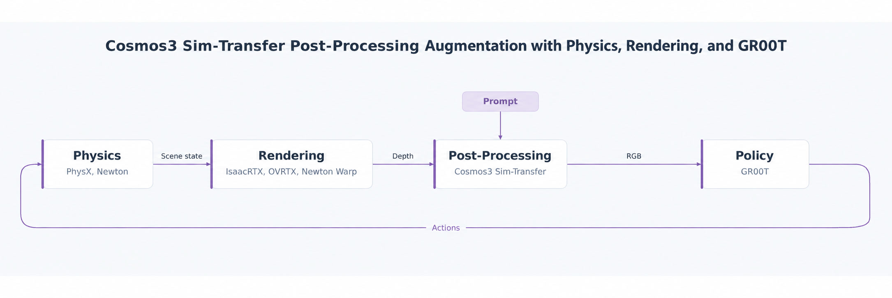
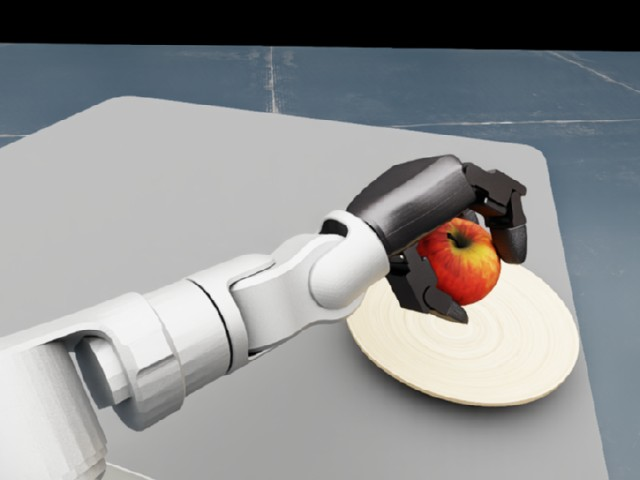
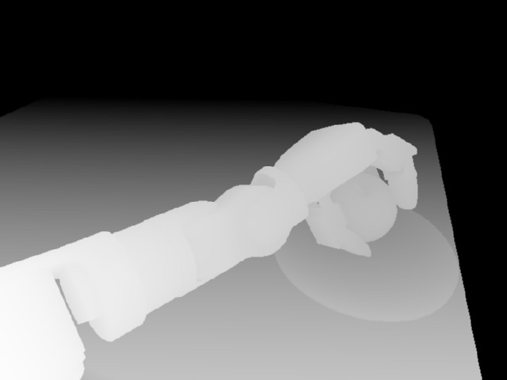
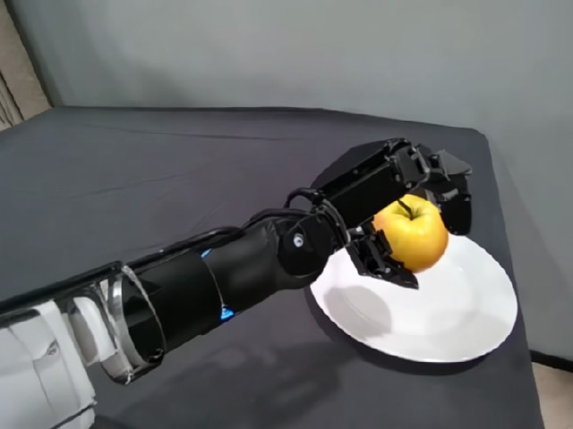

# Cosmos Transfer apple pick-and-place demo

Run a GR00T N1.7 policy on a Unitree G1 with Dex3 hands that picks an apple and places it
on a plate, with Cosmos3-Nano-Sim-Transfer turning the head camera's depth into the
realistic image the policy was trained on.



Each step, Isaac Lab simulates the scene and renders the head camera's depth. The Cosmos
service generates an RGB image from that depth and a prompt, the GR00T server predicts the
next 16 actions from the image and the robot's joint positions, and Isaac Lab plays them.

The task is `IsaacContrib-PickPlace-Apple-G1-Dex3`. Its scene, start states, prompt and
controller settings follow an earlier Isaac Sim evaluation of this policy. It uses the rendered camera
image; `IsaacContrib-PickPlace-Apple-G1-Dex3-Cosmos` is the same task with the image Cosmos generates.

| Rendered (OVRTX) | Depth sent to Cosmos | Generated by Cosmos |
| --- | --- | --- |
|  |  |  |

The three images show the same moment of one run, with the hand holding the apple over the
plate.

This demo runs three processes: the GR00T policy server, the Cosmos service and the Isaac Lab
run. Cosmos needs **48 GB of VRAM for one environment**, with approximately **8 GB more for
each additional environment**. Give the GR00T server a GPU too; the examples put it on GPU 1.
Use **uv 0.11.29** for the Cosmos Framework environment.

For service options and camera configuration, see [Serving Cosmos](cosmos_service.md)
and [Cosmos camera integration](cosmos.md).

## 1. Set paths

Start in a parent directory that will contain `IsaacLab`, `cosmos-framework`,
`gr00t-leapp-export`, and the two model directories. Set these variables before cloning:

```bash
export ISAAC_LAB="${PWD}/IsaacLab"
export COSMOS_FRAMEWORK="${PWD}/cosmos-framework"
export COSMOS_CHECKPOINT="${PWD}/cosmos-model"
export GR00T_ROOT="${PWD}/gr00t-leapp-export"
export GR00T_CHECKPOINT="${PWD}/apple-policy"
```

In each new terminal, set the same variables to those absolute paths before changing
directories.

## 2. Clone the repositories

Clone Isaac Lab, Cosmos Framework, and the GR00T runtime at the revision the policy was
tested with. GR00T uses git submodules:

```bash
git clone https://github.com/isaac-sim/IsaacLab.git "$ISAAC_LAB"
git clone https://github.com/NVIDIA/cosmos-framework.git "$COSMOS_FRAMEWORK"
git clone --recurse-submodules https://github.com/nvidia-isaac/gr00t-leapp-export "$GR00T_ROOT"
git -C "$GR00T_ROOT" checkout 072c98dcdc5acf471aabb0e4df1b256da8608831
git -C "$GR00T_ROOT" submodule update --init --recursive
```

## 3. Install dependencies and download the checkpoints

From the Cosmos Framework checkout, create its environment, install Isaac Lab's Cosmos worker
into it and download the Cosmos checkpoint:

```bash
cd "$COSMOS_FRAMEWORK"
uv sync --locked --all-extras --group=cu130-train
uv run --no-sync uv pip install -e \
  "$ISAAC_LAB/source/isaaclab_experimental/isaaclab_experimental/cosmos"
uv run --no-sync hf download nvidia/Cosmos3-Nano-Sim-Transfer \
  --local-dir "$COSMOS_CHECKPOINT"
```

Keep `--no-sync` on later Framework commands to preserve the separately installed worker. If
you run `uv sync` again, repeat the worker installation.

Install the GR00T environment, which needs Python 3.10, and download the apple policy:

```bash
cd "$GR00T_ROOT"
uv sync --python 3.10 --frozen
uv run --frozen hf download nvidia/GR00T-N1.7-AppleToPlate-cosine40k-checkpoint-15000 \
  --local-dir "$GR00T_CHECKPOINT"
```

The policy is built on [nvidia/Cosmos-Reason2-2B](https://huggingface.co/nvidia/Cosmos-Reason2-2B), which the
GR00T server downloads when it starts. That model is gated: accept its license on its Hugging Face page, then log
in once with the same account, using a read token:

```bash
cd "$GR00T_ROOT"
uv run --frozen hf auth login
```

Without access, the server stops at startup with a 401 error from Hugging Face.

Keep the GR00T and Isaac Lab environments separate: the simulator never imports GR00T.

## 4. Start the GR00T policy server in terminal 1

```bash
cd "$GR00T_ROOT"
uv run --frozen python gr00t/eval/run_gr00t_server.py \
  --embodiment-tag NEW_EMBODIMENT \
  --model-path "$GR00T_CHECKPOINT" \
  --device cuda:1 \
  --port 5555
```

Wait until the server reports that it is ready. Leave this terminal running.

## 5. Run the task in terminal 2

Run the task with the rendered camera image first. It needs only the GR00T server.
`physics=newton_mjwarp` and `renderer=newton_renderer` select Newton physics and the Newton
Warp renderer, which the default Isaac Lab install includes. The two `--with` options add the
messaging libraries the client uses. No window opens unless you select a visualizer with `--viz`:

```bash
cd "$ISAAC_LAB"
uv run --with msgpack==1.2.3 --with pyzmq==27.2.0 \
  python scripts/imitation_learning/gr00t/play_apple_pick_place.py \
  physics=newton_mjwarp renderer=newton_renderer
```

The run stops after 4 episodes; `--num_episodes` changes that. Each finished episode prints
`[INFO] Episodes: N, successes: K`. An episode succeeds when the
apple rests on the plate and the hands have let go, and ends after 20 seconds otherwise.
Add `env.scene.num_envs=16` to run the 16 saved starts in parallel.

### Other physics and rendering backends

The Newton renderer draws no shadows and a plain background. For PhysX and RTX rendering
without Isaac Sim, `--extra ov` installs OvPhysX and the OVRTX renderer:

```bash
uv run --extra ov --with msgpack==1.2.3 --with pyzmq==27.2.0 \
  python scripts/imitation_learning/gr00t/play_apple_pick_place.py \
  physics=ovphysx renderer=ovrtx
```

Without `physics=...` and `renderer=...` the task uses Isaac Sim PhysX and the Isaac RTX
renderer, so `--extra isaacsim` installs Isaac Sim. Isaac Sim requires you to accept its
[license agreement](https://docs.omniverse.nvidia.com/platform/latest/common/NVIDIA_Omniverse_License_Agreement.html)
before a headless launch; after reviewing it, set `OMNI_KIT_ACCEPT_EULA=YES`. On a host
without a screen, run `unset DISPLAY` first, or the launch can fail with `GLXBadFBConfig`:

```bash
unset DISPLAY
export OMNI_KIT_ACCEPT_EULA=YES
uv run --extra isaacsim --with msgpack==1.2.3 --with pyzmq==27.2.0 \
  python scripts/imitation_learning/gr00t/play_apple_pick_place.py
```

On Newton, the apple and plate collide as convex hulls and the robot's links do not collide
with each other, because Newton would otherwise decompose the meshes at startup for minutes
and its self-collisions push the legs apart at the hips.

## 6. Run with Cosmos

Start the Cosmos service in terminal 3, with the path variables set:

```bash
cd "$COSMOS_FRAMEWORK"
export LD_LIBRARY_PATH=
export PYTHONFAULTHANDLER=1
uv run --no-sync isaaclab-cosmos-server --checkpoint "$COSMOS_CHECKPOINT" 2>&1 | tee server.log
```

Wait for `Cosmos ready at ...` and leave this terminal running. Then, in terminal 2, select the
Cosmos task:

```bash
cd "$ISAAC_LAB"
uv run python -m isaaclab_experimental.cosmos.client.cli status
uv run --with msgpack==1.2.3 --with pyzmq==27.2.0 \
  python scripts/imitation_learning/gr00t/play_apple_pick_place.py \
  --task IsaacContrib-PickPlace-Apple-G1-Dex3-Cosmos \
  physics=newton_mjwarp renderer=newton_renderer
```

Cosmos generates the image from depth alone, so the renderer's shading does not change it.
The Cosmos task works with the other backends too.

Check for `"ready": true` and `"session_active": false` first. The task sends the head
camera's depth to the service with the prompt in
`isaaclab_experimental/cosmos/tasks/prompts/apple_pick_place.json`, and the policy
reads the generated image. Edit that file to change the appearance of the scene.

## 7. Optional: save the camera images

Add `--save_frames DIR` to save the head camera image the policy sees as PNG files, one at the
start and then once a second of simulation:

```bash
uv run --with msgpack==1.2.3 --with pyzmq==27.2.0 \
  python scripts/imitation_learning/gr00t/play_apple_pick_place.py \
  --task IsaacContrib-PickPlace-Apple-G1-Dex3-Cosmos \
  --num_episodes 1 --save_frames outputs/apple_cosmos \
  physics=newton_mjwarp renderer=newton_renderer
```

Press Ctrl+C in the Cosmos terminal and the GR00T terminal when finished.
