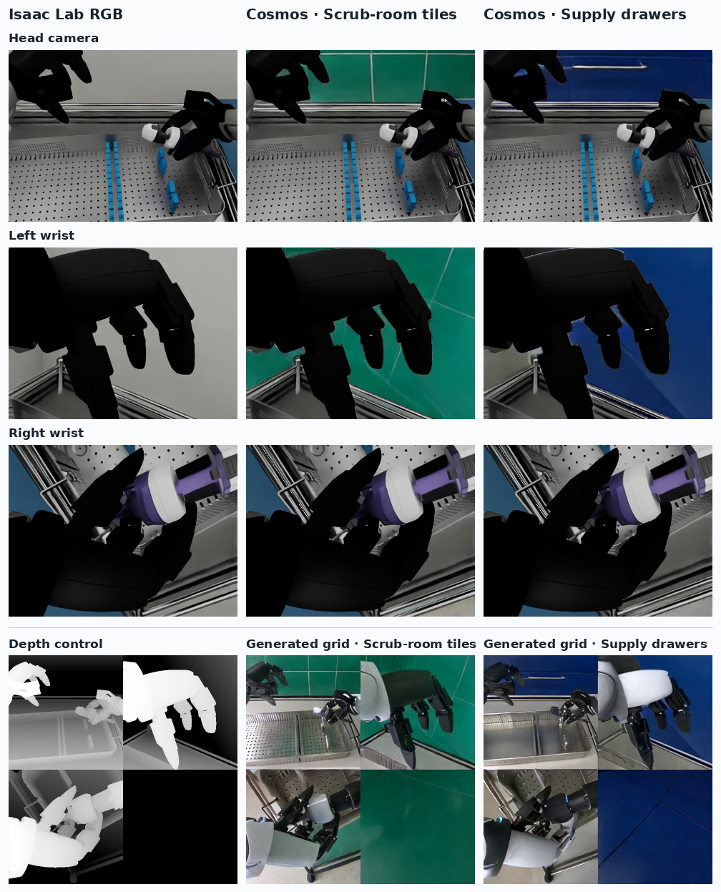
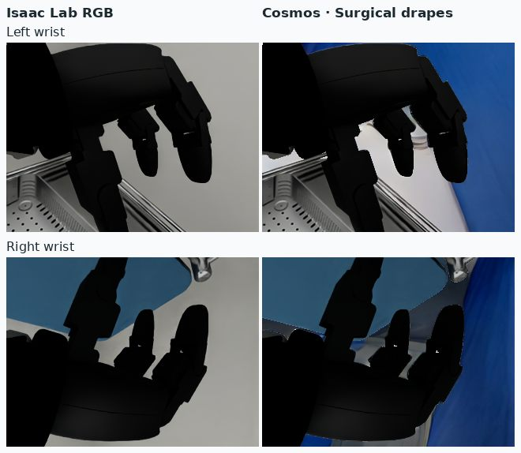

# Cosmos Transfer assemble-trocar demo

A Unitree G1 assembles a surgical trocar using its head camera and two wrist cameras. The Cosmos
task generates an operating-room background from all three depth views and restores the rendered
foreground before publishing the RGB images to the policy.



Each row shows the full 320 × 240 policy view at frame 503 of a successful rollout. In the middle
column, the head camera sees green scrub-room tiles just above the tray. The grout lines run at an
angle behind the left fingers. On the right, the head camera shows a metal handle on a
blue supply drawer. The left wrist sees the blue front, and the right wrist looks into the gripper.
Fine details such as the handle can appear in only one view.

The bottom row shows the shared 640 × 640 depth input and each complete Cosmos output before cropping
and foreground restoration. The head and left wrist occupy the top two tiles. The right wrist is
at bottom left. The fourth input tile is black. Closer surfaces appear lighter in the depth grid.

<details>
<summary>See both wrists looking past the tray</summary>

By frame 540, the right hand has opened and both wrist cameras can see the blue drape beyond the tray.
Each row shows the complete 320 × 240 policy view.



</details>

## 1. Start the Cosmos service

Follow [Serve Cosmos](cosmos_transfer.md#serve-cosmos) to install Cosmos Framework, download
`nvidia/Cosmos3-Nano-Sim-Transfer` and start the service. One service handles all three cameras.
Leave it running and open a second terminal in the Isaac Lab checkout.

Extract `assemble-trocar-assets.zip` into `/workspace/assets`. To use a different location,
set `ASSET_LOCAL` to the directory or HTTPS URL containing `Robots/` and `Props/`.

## 2. Record a video (optional)

### Preview a camera without a policy

Record 64 steps from the head camera using zero actions. The two Cosmos overrides generate a new
background on every capture so you can inspect the transfer.

```bash
uv run --extra isaacsim --extra video isaaclab zero_agent \
  --task IsaacContrib-Assemble-Trocar-G129-Dex3-Cosmos-Eval \
  --num_envs 1 --video sensor:front_camera:rgb --video_length 64 \
  physics=isaacsim_physx renderer=isaacsim_rtx \
  env.cosmos.decision_interval=1 env.cosmos.augmentation_probability=1
```

The command exits after the clip and prints the output directory. The first clip is
`logs/zero_agent/IsaacContrib-Assemble-Trocar-G129-Dex3-Cosmos-Eval/videos/play/clip_0000.mp4`.
Use `sensor:left_wrist_camera:rgb` or `sensor:right_wrist_camera:rgb` to record a wrist.
For the task's default cadence, omit both Cosmos overrides. All three views then share a 50% chance
of transfer at the first policy observation and every 16 environment steps thereafter.
Between those steps the cameras publish the current rendered RGB.

<details>
<summary>Use the clinical prompts from the figure</summary>

For the scrub-room tiles, save this caption as `room.json` and append
`env.cosmos.prompt_files=/absolute/path/to/room.json` to the preview command.

```json
{
  "scene": "Three synchronized close-up views of robot hands assembling a trocar over a metal tray. A two-by-two camera grid: head upper left, left wrist upper right, right wrist lower left, black lower right.",
  "environment": "Emerald green glossy ceramic wall tiles with bright white grout fill the background behind the tray and behind the left fingers. The square tiles appear tilted in the wrist view.",
  "camera": "Close range. The background of all three panels shows the same supply station."
}
```

For the supply drawers, replace the `environment` value with the following text.

> Deep blue hospital drawers fill the background in the head view and continue across the tilted left wrist view. The cabinet has repeated long silver horizontal handles, squared drawer fronts and dark seams between drawers.

</details>

### Record a GR00T rollout

Follow the [RLinf setup and checkpoint instructions](../../../docs/source/experimental-features/rlinf_vla_posttraining.rst)
and set `GR00T_CHECKPOINT` to the local base policy directory. With the Cosmos service running,
record one evaluation episode using the task's default augmentation settings.

```bash
CUDA_VISIBLE_DEVICES=0 uv run --no-sync isaaclab play --rl_library rlinf \
  --task IsaacContrib-Assemble-Trocar-G129-Dex3-Cosmos-Eval \
  --config_name isaaclab_ppo_gr00t_assemble_trocar --model_path "$GR00T_CHECKPOINT" \
  --num_envs 1 --num_episodes 1 --video
```

RLinf prints `Video dir` at startup and saves the MP4s under `logs/rlinf/eval/<run>/videos/`.
To record a PPO checkpoint, append `--checkpoint /path/to/checkpoints/global_step_N/actor/model_state_dict/full_weights.pt`.

## The grid and background

Each environment sends one 640 × 640 depth image to Cosmos. The 2 × 2 grid places the head at
top left, the left wrist at top right and the right wrist at bottom left. The fourth tile is black.
All three views share one prompt and seed. Each camera takes its background from its generated tile,
restores the robot, tray, instruments, cart and mayo table using the semantic mask, and publishes
its 320 × 240 center crop.

The [trocar prompts](../isaaclab_experimental/cosmos/tasks/prompts/assemble_trocar.py) share
24 operating-room descriptions. Single-frame mode selects a room by seed and adds instructions
for the grid layout. To keep the description fixed, set `env.cosmos.prompt` to one grid prompt.
You can also supply your own caption with `env.cosmos.prompt_files=/absolute/path/to/room.json`.

For three independent views with temporal history, set `env.cosmos.generation_mode=autoregressive`
and keep both cadence overrides from the preview command. The same rooms use a single-view camera description.

## Train with RLinf

RLinf can fine-tune the same GR00T policy on the Cosmos camera images using PPO. The
[trocar PPO recipe](../../isaaclab_tasks/isaaclab_tasks/contrib/assemble_trocar/config/isaaclab_ppo_gr00t_assemble_trocar.yaml)
provides the policy and action settings. Keep the Cosmos service running. The command below uses
one RLinf environment worker with a batch of environments on one GPU.

```bash
CUDA_VISIBLE_DEVICES=0 uv run --no-sync isaaclab train --rl_library rlinf \
  --task IsaacContrib-Assemble-Trocar-G129-Dex3-Cosmos \
  --config_name isaaclab_ppo_gr00t_assemble_trocar --model_path "$GR00T_CHECKPOINT"
```

Omit `--task` to use the recipe's rendered-camera training and evaluation environments.

Single-frame training keeps Cosmos on the GPU throughout rollout collection and moves it to CPU
before each PPO update. Set `env.cosmos_offload_during_update=false` when the service has a dedicated
GPU. Autoregressive sessions and training configurations that overlap simulation with optimization
keep their models resident.

Each service processes up to 16 environment grids per request. For a smaller inference batch,
append `env.cosmos.max_batch_chunk=4`. For two RLinf environment workers, for example, append
`'env.cosmos.endpoint=["tcp://gpu0:5555","tcp://gpu1:5555"]'`. List one endpoint per worker, in
rank order, using addresses reachable from both the training driver and the assigned worker.
