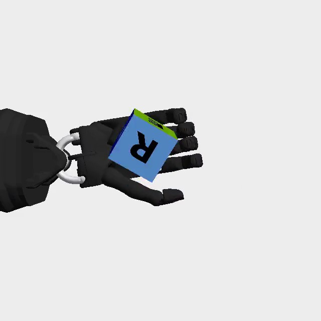
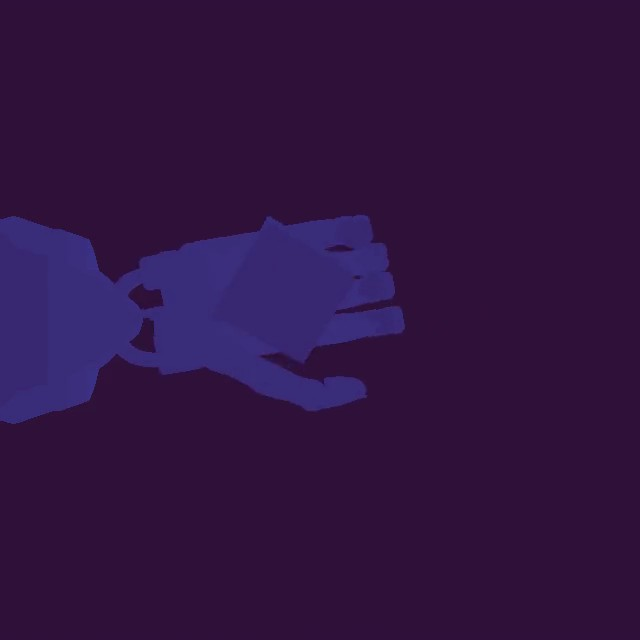
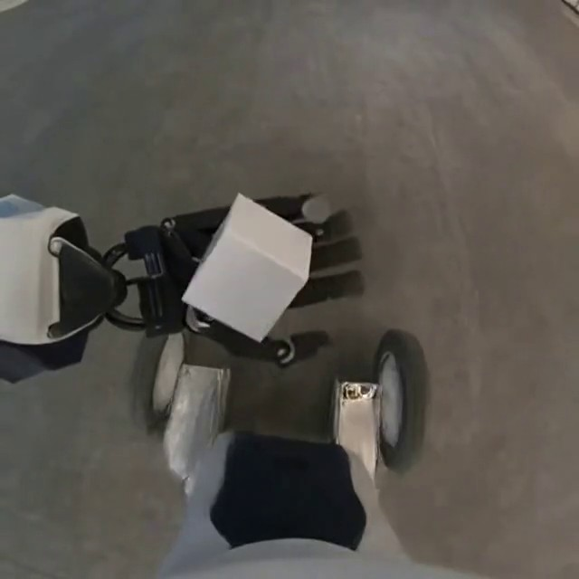

# Cosmos Transfer Shadow Hand demo

Train the Shadow Hand camera task on images that Cosmos3-Nano-Sim-Transfer generates from the camera's depth.
It uses the public [Cosmos Framework](https://github.com/NVIDIA/cosmos-framework) and the
public [nvidia/Cosmos3-Nano-Sim-Transfer](https://huggingface.co/nvidia/Cosmos3-Nano-Sim-Transfer)
checkpoint.

| Rendered (Newton) | Depth sent to Cosmos | Generated by Cosmos |
| --- | --- | --- |
|  |  |  |

The rendered image and depth come from one run and the Cosmos image from another, at the same
step, so the cube's pose differs between them. The depth is shown as Cosmos receives it: white at
0.1 m, black at 1.5 m and beyond.

Use **uv 0.11.29** for the Framework environment. Keep the Cosmos Framework and
Isaac Lab environments separate. The Cosmos service needs about **47 GB of VRAM for one
environment**, with about **9 GB more for each additional environment**, and the Isaac Lab
training process needs its own memory on top. Choose hardware with enough VRAM before
increasing `--num_envs`.

This demo applies the [Cosmos Transfer camera integration](cosmos_transfer.md) to the Shadow Hand camera task.
Steps 1 to 4 install and start the service described in [Serve Cosmos](cosmos_transfer.md#serve-cosmos), and the
task replaces its camera with `cosmos_camera`, as in
[Put Cosmos on a camera task](cosmos_transfer.md#put-cosmos-on-a-camera-task). Use that guide to put Cosmos on
another task or to change the service's options.

## 1. Set paths

Start in a parent directory that will contain `IsaacLab`, `cosmos-framework`, and
`model`. Set these variables before cloning:

```bash
export ISAAC_LAB="${PWD}/IsaacLab"
export COSMOS_FRAMEWORK="${PWD}/cosmos-framework"
export COSMOS_CHECKPOINT="${PWD}/model"
```

In each new terminal, set the same three variables to those absolute paths before
changing directories. Repeating the block from a different directory would select
different paths.

## 2. Clone the repositories

Clone Isaac Lab:

```bash
git clone https://github.com/isaac-sim/IsaacLab.git "$ISAAC_LAB"
```

Clone Cosmos Framework at the commit this demo was tested with:

```bash
git clone https://github.com/NVIDIA/cosmos-framework.git "$COSMOS_FRAMEWORK"
git -C "$COSMOS_FRAMEWORK" checkout 001fe1835d3b9a987bd29c521a4bd2fa6b454066
```

## 3. Install dependencies and download the checkpoint

From the Framework checkout, create its environment and install Isaac Lab's Cosmos
worker into it:

```bash
cd "$COSMOS_FRAMEWORK"
uv sync --locked --all-extras --group=cu130-train
uv run --no-sync uv pip install -e \
  "$ISAAC_LAB/source/isaaclab_experimental/isaaclab_experimental/cosmos"
```

Download the complete checkpoint with the Framework environment's Hugging Face CLI:

```bash
uv run --no-sync hf download nvidia/Cosmos3-Nano-Sim-Transfer \
  --local-dir "$COSMOS_CHECKPOINT"
```

Keep `--no-sync` on subsequent Framework commands to preserve the separately
installed worker. If you run `uv sync` again, repeat the worker installation.

## 4. Start the Cosmos service in terminal 1

With the path variables set:

```bash
cd "$COSMOS_FRAMEWORK"
export LD_LIBRARY_PATH=
export PYTHONFAULTHANDLER=1
uv run --no-sync isaaclab-cosmos-server --checkpoint "$COSMOS_CHECKPOINT" 2>&1 | tee server.log
```

Wait for `Cosmos ready at ...` before starting training. Leave this terminal
running; its output is also saved in `server.log` in the Framework checkout.

## 5. Train in terminal 2

Set the path variables to the same absolute paths as in terminal 1, then run:

```bash
cd "$ISAAC_LAB"
uv run python -m isaaclab_experimental.cosmos.client.cli status
```

Check for `"ready": true` and `"session_active": false`, then start the demo:

```bash
uv run isaaclab train \
  --task Isaac-Reorient-Cube-Shadow-Camera-Cosmos-Direct \
  --rl_library rsl_rl \
  --max_iterations 20 \
  --num_envs 1
```

The Cosmos task sends camera depth to the service and uses the generated RGB
images for training. This command runs 20 training iterations with one environment; use
`--max_iterations 1` for a short smoke run. With more environments, `env.cosmos.prompt` takes one prompt per
environment; see [Several environments](cosmos_transfer.md#several-environments).

## 6. Play a trained policy

The task trains its feature extractor from the generated images, so published feature-extractor checkpoints for
the default `120 x 120`, seven-channel camera do not fit its `640 x 640`, three-channel input, and the task does not
fall back to them. Play a policy checkpoint from a Cosmos training run, with its `cnn_*.pth` feature-extractor
checkpoint kept in the run's log directory:

```bash
uv run isaaclab play \
  --task Isaac-Reorient-Cube-Shadow-Camera-Cosmos-Direct \
  --rl_library rsl_rl \
  --checkpoint /path/to/cosmos-run/model_99.pt \
  --num_envs 1
```

## 7. Optional: record a video

After the previous process exits, run this command in the Isaac Lab terminal to train again while
recording 300 steps of the Newton GL streaming view:

```bash
cd "$ISAAC_LAB"
uv run --extra video isaaclab train \
  --task Isaac-Reorient-Cube-Shadow-Camera-Cosmos-Direct \
  --rl_library rsl_rl \
  --max_iterations 20 \
  --num_envs 1 \
  --viz newton_gl \
  --video viz:newton_gl:streaming_view \
  --video_length 300
```

Without a screen, run `unset DISPLAY` before the recording command. The training
process prints the recording's output directory. To record the camera image the policy sees instead, use
`--video sensor:tiled_camera:rgb`: it records environment 0, including the held frames between Cosmos updates. To
record several environments side by side, see
[Record several environments](cosmos_transfer.md#record-several-environments).
Press Ctrl+C in terminal 1 when finished to stop the Cosmos service and release the model.

## The task

`Isaac-Reorient-Cube-Shadow-Camera-Cosmos-Direct` and `Isaac-Reorient-Cube-Shadow-Camera-Cosmos` are the Direct
task `Isaac-Reorient-Cube-Shadow-Camera-Direct` and the Manager-based task `Isaac-Reorient-Cube-Shadow-Camera`
with the same Cosmos camera. They live in `isaaclab_experimental.cosmos.tasks` and reuse the core tasks, which do
not import Cosmos and keep their existing camera. The package registers them through the `isaaclab.tasks` entry
point, so `isaaclab train` and `isaaclab play` find them by name; reinstall the environment (`uv sync`) once if the
names are not found. Both use one environment unless `--num_envs` sets more.

- **Camera:** a `640 x 640` RGB camera with depth controls covering `0.1` to `1.5` meters, a prompt describing a
  Shadow Hand manipulating a cube, and the default endpoint.
- **Timing:** like the task's other cameras, it captures every environment step, 60 times per second of simulation
  time. After the initial generated frame, Cosmos updates every four captures, so fresh images arrive at 15 Hz of
  simulation time; generation latency sets how long those captures take. The 10-second episode requests 601
  frames: one capture per step, plus the initial capture (see
  [Episode frame budget](cosmos_transfer.md#episode-frame-budget)).
- **Capturing less often:** with one environment, `env.scene.tiled_camera.update_period=0.1` captures at 10 Hz
  (101 frames), with fewer Cosmos requests and images that change less often. Several environments need a capture
  every step: environments that reset at different times would otherwise capture on different steps, and the
  feature extractor pairs each new image with the current cube pose.
- **Rendering:** the task requires `scene.lazy_sensor_update=True` and synchronous rendering so each image stays
  aligned with its simulation state. With OVRTX, set `env.scene.tiled_camera.renderer_cfg.async_rendering=False`.
- **Supervision:** while an image is held, its supervised cube-pose target is held too: each environment's target
  is the cube pose of the step its image appeared, kept until that image changes. An environment showing black
  after a reset is left out of the loss until its next image.

The task's Cosmos settings are `env.cosmos`, the camera's own `CosmosModelCfg`, set with ordinary Isaac Lab
overrides:

| Option | Override |
|---|---|
| Prompt | `env.cosmos.prompt=<text>` |
| Prompt per environment | `env.cosmos.prompt="['<text>', '<text>']"` |
| Prompt files | `env.cosmos.prompt_files="['prompts/*.json']"` |
| Service endpoint | `env.cosmos.endpoint=<url>` |
| Transport | `env.cosmos.transport=socket` |

For example, `isaaclab train --task Isaac-Reorient-Cube-Shadow-Camera-Cosmos-Direct
env.cosmos.prompt="A Shadow Hand turning a red cube."`. Omitted options keep the task's values, and the overrides
keep its image size, tensor processors, and feature-extractor supervision. For prompt lists and files, see
[A different prompt per episode](cosmos_transfer.md#a-different-prompt-per-episode); for endpoints and transports,
see [Endpoints and transports](cosmos_transfer.md#endpoints-and-transports).
