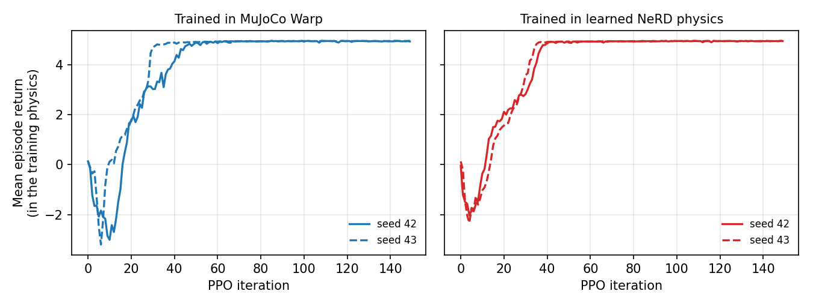
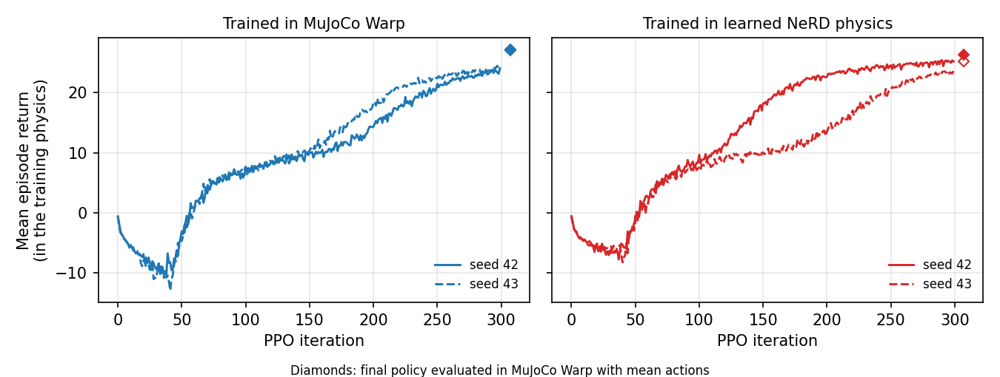

# Isaac Lab PhysicsNeMo

This extension connects Isaac Lab Newton environments to
[PhysicsNeMo Robotics](https://github.com/NVIDIA/physicsnemo-robotics) learned dynamics. It
records environment episodes as PhysicsNeMo trajectory datasets, trains a control-conditioned
Neural Robot Dynamics model on them (NeRD, or the FlashNeRD `ParallelNeRD`), and runs the
resulting dynamics artifact as the Newton solver of the same environment through an ordinary `NewtonCfg`.

```text
teacher env (MuJoCo Warp) ──record──▶ Zarr dataset ──train──▶ DynamicsArtifact ──deploy──▶ learned env
        TrajectoryDatasetRecorder     train_dynamics_artifact      PhysicsNeMoSolverCfg
```

## Status

The extension is experimental and depends on an unreleased PhysicsNeMo Robotics.

| Area | State |
| --- | --- |
| Integration (manager, preflight, model identity, recording, training, deployment) | Complete for whole-scene learned physics of joint-backed robots; covered by CPU tests and CUDA tests of the data semantics |
| Cartpole | Usable: a PPO policy trained only in learned physics transfers to MuJoCo Warp with the same return |
| FlashNeRD CartPole benchmark | Reproduced: on the study's own teacher the recipe improves on every horizon of the paper's Table I |
| ANYmal-C locomotion with target control | Usable: PPO policies trained only in learned physics reach 97 and 93 % of the MuJoCo Warp policies' return in MuJoCo Warp (two seeds), see below |
| Variable contact tokens, hybrid learned/Newton coupling | Not supported |

Known limitations:

- PhysicsNeMo Robotics is not on a package index and pins older Newton, Warp, and Torch releases, so it is
  installed next to Isaac Lab without its pins, and this package is not part of the repository `uv.lock`
  or the Sphinx documentation.
- Training keeps every normalized window on the device, so the training windows must fit in GPU memory
  (ten million 13-frame ANYmal-C windows take about 30 GB in FP16).
- The manager, binding, and preflight read private `NewtonManager` attributes; public accessors in
  `isaaclab_newton` would remove them.
- Floating-base artifacts deploy with `continuity="off"`, and the external-wrench check aborts the CUDA
  context instead of raising a Python exception.
- Recording cannot detect external wrenches, because the teacher clears `State.body_f` after each step;
  deployment rejects them.
- Visual-only shapes and `isaaclab:` rendering attributes enter the Newton model identity. Newton imports
  them whenever a viewer, an `rgb_array` capture, or a display is active, so a learned scene there needs
  `NewtonCfg(load_visual_shapes=False)` and cannot be rendered by the Newton GL visualizer; the clips below
  replay learned rollouts in the MuJoCo Warp scene.
- An ANYmal-C artifact trained in the OSMO container (L40S) fails the identity check on a local RTX PRO
  5000 workstation with the same topology but a different static fingerprint; the differing attribute is
  not yet identified.

## Package layout

```text
isaaclab_physicsnemo/         core interface, independent of any task
  physics/                    PhysicsNeMoSolverCfg, NewtonPhysicsNeMoManager, state-ownership checks
  recording.py                TrajectoryDatasetRecorder
  datasets.py                 parallel and cached loading of recorded datasets
  training.py                 train_dynamics_artifact, TrainingSettings
  resident_training.py        device-resident windows and training loop (FP16, data-parallel, resumable)
  deployment.py               apply_learned_physics
  preflight.py                preflight_learned_physics
  evaluation.py               rollout comparison and the FlashNeRD E_H metric
  exploration.py              random action sources for data collection
  heading.py                  heading-frame state codec and base-frame gravity encoder
  signature.py                Isaac Lab model identity
  binding.py                  live Newton buffers and execution identity
examples/
  cartpole/                   cartpole_env_cfg.py, record, train, deploy, PPO, FlashNeRD benchmark
  anymal_c/                   anymal_c_env_cfg.py, record, train, deploy, PPO
```

Task scenes and model inputs live next to the example scripts that use them; the scripts import them from
their own directory.

## Architecture

The extension owns the Isaac Lab integration and uses PhysicsNeMo Robotics only as a learned-dynamics
library. It does not use the `physicsnemo_robotics.isaaclab` adapter, and it changes neither project.

| Layer | Owner | Contents |
| --- | --- | --- |
| Isaac Lab integration | this extension | `physics.PhysicsNeMoSolverCfg`, `physics.NewtonPhysicsNeMoManager`, state ownership validation, `NewtonBinding`, `preflight_learned_physics`, recording, training recipe |
| Learned dynamics | PhysicsNeMo Robotics | `DynamicsArtifact`, `LearnedDynamicsSolver`, state codecs, feature encoders, trajectory schemas and datasets, NeRD models, training harness |

`NewtonPhysicsNeMoManager` follows the Isaac Lab
[Newton solver extension contract](../../../docs/source/developer-tools/extending_newton_solvers.rst):
`PhysicsNeMoSolverCfg.class_type` selects it through `NewtonCfg.solver_cfg`, and its `_build_solver`
publishes the learned solver with single-state stepping, no external body forces, and a collision
pipeline only when the artifact consumes contacts. Before the first step it checks the artifact
frame duration, the canonical frame, the solver-independent model identity, that the codec owns
every dynamic Newton state row, and that no implicit position drive acts on targets the model does not
see. Environment resets reach the solver through the inherited reset hook, CUDA graph capture is disabled,
contact sensors are rejected, and a step with an external body wrench fails on the device.

## Installation

PhysicsNeMo Robotics is not published on a package index and pins older Newton, Warp, and Torch
releases than Isaac Lab. Check out the validated tag, install it into the Isaac Lab environment
without its dependency pins, then add its remaining dependencies. Isaac Lab keeps its own Newton, Warp,
and Torch versions, and its locked environment already includes RSL-RL for the PPO examples.

```bash
git clone https://gitlab-master.nvidia.com/mataei/physicsnemo-robotics.git /absolute/path/to/physicsnemo-robotics
git -C /absolute/path/to/physicsnemo-robotics fetch origin tag mnabian/flashnerd-benchmark-v1
git -C /absolute/path/to/physicsnemo-robotics checkout mnabian/flashnerd-benchmark-v1
export ROBOTICS_ROOT=/absolute/path/to/physicsnemo-robotics

uv sync --frozen --extra test
uv pip install --python .venv/bin/python --no-deps -e "$ROBOTICS_ROOT"
uv pip install --python .venv/bin/python \
  "nvidia-physicsnemo==2.1.1" "jaxtyping>=0.3.3" "tensordict>=0.11,<0.12" "zarr>=3,<4"
uv pip install --python .venv/bin/python --no-deps -e source/isaaclab_physicsnemo
```

Run Python from `.venv/bin/python`, or use `uv run --no-sync`. The `test` extra provides pytest for the
tests below. A later `uv sync` restores the locked environment and removes the packages installed after it,
so install them again after every sync. `TrainingSettings(compile=True)`, which the benchmark and
ANYmal-C training use, needs a C compiler and the Python headers for `torch.compile` (`gcc` and
`python3.12-dev` on Ubuntu, as the container installs).

The integration was validated with PhysicsNeMo Robotics tag `mnabian/flashnerd-benchmark-v1`
(`a81160e`), Newton 1.6.1, Warp 1.17.0, Torch 2.12 (CUDA 13), PhysicsNeMo 2.1.1, and RSL-RL 5.5.1, on one
NVIDIA RTX PRO 5000 Blackwell GPU and in the container on two NVIDIA L40S GPUs. The tag adds the FlashNeRD
benchmark tooling and the ParallelNeRD FP16 safeguards to `mataei/icra` at `4e4be69`; its library sources
otherwise equal that commit. All results below were measured with the tag.

## Examples

Run the scripts from the repository root. Default settings complete in minutes per stage on one GPU and
only demonstrate the workflow; the commands with results below are the full-scale runs.

- `record.py` steps the exploration scene with random actions and writes every episode, including
  asynchronous per-environment resets.
- `train.py` trains for a fixed number of updates and packages a hash-verified artifact. It prints the
  held-out one-step error and, for effort-only Cartpole models, the prefix-pooled recursive-rollout error
  `E_H` of the FlashNeRD evaluation (`evaluate_rollout_nrmse`).
- `deploy.py` runs a MuJoCo Warp rollout and a learned rollout from the same seed and actions, checks the
  learned environment with `preflight_learned_physics`, and prints the open-loop error.
- `train_policy.py` trains the task's RSL-RL PPO policy with MuJoCo Warp or, with `--artifact`, in learned
  physics, and evaluates it with MuJoCo Warp. The ANYmal-C script also evaluates in learned physics with
  `--eval-artifact` and evaluates an existing policy without training with `--checkpoint`.

### Cartpole

```bash
E=source/isaaclab_physicsnemo/examples/cartpole
python $E/record.py --output /tmp/cartpole-data --num-envs 1024 --steps 1500
python $E/train.py --dataset /tmp/cartpole-data --output /tmp/cartpole-train --max-updates 30000 --batch-size 1024
python $E/deploy.py --artifact /tmp/cartpole-train/artifact
for seed in 42 43; do
  python $E/train_policy.py --output /tmp/ppo-cartpole-mjwarp-$seed --seed $seed
  python $E/train_policy.py --output /tmp/ppo-cartpole-learned-$seed --seed $seed --artifact /tmp/cartpole-train/artifact
done
```

The recording follows the task-independent data of NeRD and FlashNeRD (`CartpoleExplorationEnvCfg`):
episodes start anywhere on the track, at every pole angle, and with large velocities, and each episode draws
its own action scale, so the data covers the command range that controllers use. The dataset holds about
10,800 episodes and 1.5 million frames. On one RTX PRO 5000 GPU, recording takes 10 minutes, training 13
minutes, and each PPO run under 3 minutes. Held-out results of this model after 30,000 updates (1/120 s
frames; each horizon uses the episodes long enough for it, from 1,069 at E1 to 373 at E200):

| E1 | E15 | E100 | E200 |
| --- | --- | --- | --- |
| 2.1e-4 | 9.7e-4 | 7.7e-3 | 0.060 |

These frames are half as long as the FlashNeRD study's, so the values are not comparable with the paper;
the benchmark below repeats the study's configuration.

The deployed model stays within 0.007 m or rad of MuJoCo Warp joint positions after 0.5 s of open-loop
random actions. PPO policies trained only in the learned environment balance the MuJoCo Warp Cartpole in
99.8 and 100 % of 1,536 evaluation episodes, with returns of 4.93 and 4.95 against 4.94 and 4.95 for
policies trained in MuJoCo Warp (seeds 42 and 43). In an earlier ablation with `4e4be69` and a fixed action
scale of 0.5 (about 50 N), the model reached a lower E200 of 0.023, but the PPO policy exploited its errors
at larger efforts and succeeded in only 55 % of MuJoCo Warp episodes.

PPO training curves of these runs. Each return is measured in the physics the policy trains in, MuJoCo Warp
on the left and the learned model on the right. All four runs pass a return of 4.8 between iterations 32
and 47 and end between 4.93 and 4.96.



The seed-42 policy trained only in learned physics, deployed in the MuJoCo Warp Cartpole for one 5 s
episode from random initial pole angles and velocities, recorded with the Newton GL visualizer
([mp4](media/cartpole_learned_policy_mjwarp.mp4)):


### FlashNeRD CartPole benchmark

`examples/cartpole/flashnerd_benchmark.py` repeats the CartPole configuration of the FlashNeRD
main-results study (PhysicsNeMo Robotics tag `mnabian/flashnerd-benchmark-v1`) on the Isaac Lab Cartpole:

```bash
B=source/isaaclab_physicsnemo/examples/cartpole/flashnerd_benchmark.py
# Isaac Lab Cartpole
python $B --output /tmp/fnb-isaaclab --stages data
torchrun --standalone --nproc-per-node 2 $B --output /tmp/fnb-isaaclab --stages train evaluate \
  --max-updates 5000000 --checkpoint-every 250000
# the study's own Cartpole, generated by the PhysicsNeMo Robotics checkout
python $B --output /tmp/fnb-physicsnemo --stages data --teacher physicsnemo --physicsnemo-root "$ROBOTICS_ROOT"
torchrun --standalone --nproc-per-node 2 $B --output /tmp/fnb-physicsnemo --stages train evaluate \
  --teacher physicsnemo --physicsnemo-root "$ROBOTICS_ROOT" --max-updates 5000000 --checkpoint-every 250000
```

The `data` stage runs in one process (about ten minutes for either teacher); the `train` stage runs under
`torchrun` for the study's two data-parallel ranks, or as a single process with the same global batch. Training uses FP16 autocast,
appends the held-out `E_H` of every checkpoint to `rollout_nrmse.jsonl`, prints the final table next to the
paper's values, and resumes from its last checkpoint when rerun with the same arguments. The
study's own teacher separates the training recipe from the difference in teacher systems. Five million
updates take about ten hours on two L40S GPUs (135 updates per second). `--max-updates 50000
--checkpoint-every 25000` checks a setup in about 16 minutes on one RTX PRO 5000 GPU (93 updates per second)
and gives E1 = 9.9e-5 and E200 = 0.11 on the study's teacher, and E1 = 1.6e-4 and E200 = 0.020 on the Isaac
Lab teacher.

| Setting | Study | This benchmark |
| --- | --- | --- |
| Teacher | Its own Cartpole URDF, Newton Featherstone, 1/60 s frames | Isaac Lab Cartpole, MuJoCo Warp, 1/60 s frames (`CartpoleFlashNeRDBenchmarkEnvCfg`) |
| Data | 10,000 x 100 training and 2,048 x 509 held-out transitions; uniform initial states (cart 1 m, pole full turn, velocities 1) and per-frame uniform forces up to 1500 N on 52.5 kg; no termination | Same, with forces up to 57 N on the 2 kg Isaac Lab cart and pole, the same cart acceleration |
| Model | ParallelNeRD H256, 4 heads x 64, FFN 640, head 256, spans (4, 3, 3, 3), inputs padded to 64 | Same geometry without padding (`CARTPOLE_FLASHNERD_MODEL_CONFIG`, 2.69M parameters) |
| Optimization | Global batch 4,096, 1e-3 to 1e-4, 5,000,000 updates, FP16 autocast, two ranks | Same, with `--max-updates` updates and `torch.compile` |
| Metric | Prefix-pooled `E_H` on the finite held-out cohort, training-state scale | Same (`evaluate_rollout_nrmse`) |

Results after the study's 5,000,000 updates on two L40S GPUs (about ten hours each), on all 2,048 held-out
trajectories, none non-finite:

| E_H | E1 | E15 | E50 | E100 | E200 | E500 |
| --- | --- | --- | --- | --- | --- | --- |
| Study teacher (`--teacher physicsnemo`) | 1.8e-5 | 8.7e-5 | 2.6e-4 | 1.8e-3 | 0.048 | 0.92 |
| Isaac Lab teacher | 7.0e-5 | 2.5e-4 | 8.5e-4 | 4.2e-3 | 0.012 | 0.025 |
| FlashNeRD paper | 4.4e-5 | 1.7e-4 | - | 3.2e-3 | 0.060 | - |

On the study's own teacher, the recipe reproduces Table I of the paper and improves on every reported horizon.
On the Isaac Lab Cartpole, short horizons are within 1.6 times the paper and long horizons are five times
better, because its cart is damped and rarely reaches the track limits. With forces up to the 400 N actuator
limit instead, the cart accelerates ten times harder than the study's and a third of the trajectories hit the
track limits; E100 then stays near 0.07, twenty times the paper.

### ANYmal-C locomotion

`examples/anymal_c` follows the FlashNeRD locomotion experiment: the model steps one 20 ms control period,
receives joint-position targets, and learns the ANYdrive actuator response, which the teacher computes with
its actuator network every 5 ms physics step. Its inputs follow the PhysicsNeMo Robotics G1 application:
`HeadingJointStateCodec` expresses the joint state in the base heading frame, `RootGravityEncoder` adds the
base-frame gravity direction, and four fixed foot-sphere probes (`anymal_foot_contacts`) query a ground plane
that every environment owns. The manager rebuilds the codec and the gravity encoder from the artifact.

```bash
E=source/isaaclab_physicsnemo/examples/anymal_c
python $E/record.py --output /tmp/anymal-c/data --num-envs 4096 --steps 600
torchrun --standalone --nproc-per-node 2 $E/train.py --dataset /tmp/anymal-c/data --output /tmp/anymal-c/train
python $E/deploy.py --artifact /tmp/anymal-c/train/artifact
python $E/train_policy.py --output /tmp/anymal-c/ppo-learned --artifact /tmp/anymal-c/train/artifact
python $E/train_policy.py --output /tmp/anymal-c/ppo-mjwarp
python $E/train_policy.py --output /tmp/anymal-c/eval-mjwarp --checkpoint /tmp/anymal-c/ppo-mjwarp/model_299.pt \
  --eval-artifact /tmp/anymal-c/train/artifact
```

For ten million transitions, record with several processes per GPU, each with its own seed and with
bounded shards, and train on all of them for 200,000 updates; FP16 projections halve the cost of each learned
step:

```bash
for seed in 7 8 9 10; do
  python $E/record.py --output /tmp/anymal-c/data/seed-$seed --num-envs 2048 --steps 618 --seed $seed \
    --shard-episodes 4000 &
done
wait
torchrun --standalone --nproc-per-node 2 $E/train.py --dataset /tmp/anymal-c/data/seed-* --output /tmp/anymal-c/train \
  --normalizer-windows 2000000 --max-updates 200000
python $E/train_policy.py --output /tmp/anymal-c/ppo-learned --artifact /tmp/anymal-c/train/artifact \
  --inference-dtype float16
```

| Stage | Cost and remedy |
| --- | --- |
| Recording | PhysicsNeMo Robotics rewrites a dataset's whole manifest after every episode, and writing is single-threaded. With 2 processes of 8,192 environments, ten million transitions took over six hours; with 8 processes of 2,048 environments and shards of 4,000 episodes (`shard_episodes`), 14 minutes on two L40S GPUs |
| Loading | Every trajectory is a Zarr group. Worker processes read them in parallel (`TrainingSettings.read_workers`, 5.6 times faster for 16,384 trajectories), data-parallel ranks share one read through a cache file, and `cache_dataset` keeps it for later runs (16,384 trajectories in 1.2 s) |
| Normalization | `normalizer_windows` fits the statistics on a spread subset (2,000,000 of 9.5 million windows) |
| Windows | Gathered in batches on the GPU from the stacked trajectories; 1.6 million ANYmal-C windows take 1.6 s instead of 140 s with the PhysicsNeMo Robotics loader, with identical values |
| Learned PPO | `inference_dtype="float16"` halves a learned step at 16,384 environments (118 against 240 ms); joint positions differ by 0.001 rad on average after 40 steps |

| Setting | FlashNeRD | This example |
| --- | --- | --- |
| Robot and teacher | ANYmal-C, MJWarp | ANYmal-C, MJWarp, ANYdrive LSTM actuator network at 5 ms (`AnymalCFlatTeacherEnvCfg`) |
| Frame and control | 20 ms, joint-position targets | Same: `TrajectoryDatasetRecorder(control_targets=...)` records Newton `joint_target_q`, and the learned scene (`AnymalCTargetControlEnvCfg`) forwards targets through zero-gain implicit actuators, which leaves the Newton model identical |
| Data | Randomized base poses, velocities, joints; targets within 0.75 rad every 20 ms; up to 100 steps; falls kept | Same (`AnymalCExplorationEnvCfg`), 8 x 2,048 x 618 control periods (ten million transitions) |
| Contact and inputs | Four fixed foot-sphere probes | Same, with heading-frame state and base-frame gravity |
| Model | FlashNeRD 8.88M, 13-frame receptive field, 60,000 updates, 5 % validation | ParallelNeRD with the study's G1 geometry and spans (4, 4, 4, 4), 10.7M parameters, 13 frames, 200,000 updates of 4,096 windows, 5 % validation |
| PPO | 16,384 environments, 300 iterations, reward not published | Same, with the Isaac Lab ANYmal-D flat reward: the joint-torque penalty is removed, because target control does not expose torques, and the joint-acceleration penalty is differenced over the control period (`control_period_joint_acc_l2`) |

The recorded targets equal what the learned scene hands the model, element for element
(`test_target_control.py`).

Data. With 2.46 million transitions (4,096 x 600 control periods) the model overfits: from 10,000 to 60,000
updates the training RMSE of the normalized one-step prediction falls from 0.24 to 0.11 while the validation
RMSE rises from 0.281 to 0.286. With ten million transitions (8 x 2,048 x 618, the commands above) the
validation RMSE keeps falling, to 0.213 after 60,000 updates. On a second recording with the same settings,
200,000 updates (94 minutes on two L40S GPUs) end at 0.217, flat after 120,000 updates while the training RMSE
falls to 0.13, but lower the open-loop error of 64 random-target rollouts after 2 s from 0.114 to 0.103 rad in joint positions and from
0.023 to 0.018 m in base height. The results below use the 200,000-update model.

Reward. Isaac Lab differences joint velocities over every physics step for `joint_acc`, 5 ms in MuJoCo
Warp but 20 ms in the learned model, so the ANYmal-D `dof_acc_l2` penalty measures different quantities in
the two physics. With it and the 60,000-update model, the same MuJoCo Warp policy loses 0.057 per step to the penalty in MuJoCo Warp and
0.010 in learned physics, and PPO in learned physics found a crouched, fast-stepping gait whose 5 ms
accelerations cost 0.95 per step in MuJoCo Warp: its policies scored 28 in learned physics and 8.2 and
-1.7 in MuJoCo Warp, while tracking velocity better than the MuJoCo Warp policies. `control_period_joint_acc_l2`
differences over the 20 ms environment step in both physics, with the weight scaled by 4.8, the ratio of a
walking gait's squared accelerations at the two intervals; the same MuJoCo Warp policy then loses 0.056 and
0.050 per step.

With this reward, every result over 256 environments and 1,000 steps with mean actions; each seed's two PPO
runs took 40 minutes in parallel on two L40S GPUs:

| Policy, seed | Return in MuJoCo Warp | Velocity tracking error | Fall rate | Return in learned physics |
| --- | --- | --- | --- | --- |
| Trained in MuJoCo Warp, 42 / 43 | 27.15 / 27.09 | 0.086 / 0.083 m/s | 0 / 0.4 % | 27.01 / 27.14 |
| Trained in learned physics, 42 / 43 | 26.28 / 25.26 | 0.089 / 0.108 m/s | 1.6 / 1.6 % | 27.54 / 26.97 |

The learned environment reproduces the MuJoCo Warp policies within 0.15, and the policies trained only in
learned physics keep 97 and 93 % of the MuJoCo Warp return when they run in MuJoCo Warp, against parity (28.0
and 27.8) in the FlashNeRD paper. The longer-trained model matters: with the 60,000-update model, the seed-42
policy kept 89 % (24.05 against 27.05). For the seed-42 policy, the loss in MuJoCo Warp shrinks from 0.15 to
0.05 per step, of which the acceleration penalty is 0.02: for its lower gait (base 0.41 m high against 0.50 m)
the model predicts 1.5 times smaller control-period accelerations than MuJoCo Warp produces, against 2.6 times
with the 60,000-update model.

PPO training curves of these runs, each measured in the physics the policy trains in; diamonds are the final
policies' returns in MuJoCo Warp:



The three evaluations of seed 42 side by side, recorded with the Newton GL visualizer over a visual-only
floor: the MuJoCo Warp policy in MuJoCo Warp, the learned-physics policy in learned physics (replayed in the
MuJoCo Warp scene), and the learned-physics policy in MuJoCo Warp ([mp4](media/anymal_c_policies_side_by_side.mp4)):


## Container

`docker/Dockerfile` adds PhysicsNeMo Robotics and this extension to the kit-less Isaac Lab image, for
cluster jobs that record, train, and evaluate without Isaac Sim:

```bash
docker build -f docker/Dockerfile.kitless -t isaac-lab-kitless .
docker build -f source/isaaclab_physicsnemo/docker/Dockerfile --build-arg BASE_IMAGE=isaac-lab-kitless \
  --build-context physicsnemo=/absolute/path/to/physicsnemo-robotics -t isaaclab-physicsnemo .
docker run --rm --gpus all --entrypoint bash isaaclab-physicsnemo \
  -c "python -m pytest source/isaaclab_physicsnemo/test"
```

The image contains PhysicsNeMo Robotics sources, so publish it only to a private registry.

## Library

| API | Purpose |
| --- | --- |
| `physics.PhysicsNeMoSolverCfg`, `physics.NewtonPhysicsNeMoManager` | Newton solver configuration and manager that run an artifact, optionally with FP16 projections (`inference_dtype`) |
| `physics.validate_state_ownership` | Check that a codec owns every dynamic Newton state row |
| `physics.validate_effort_control` | Check that no implicit position drive acts on targets the model does not see |
| `TrajectoryDatasetRecorder`, `RecordedFeature` | Write the episodes of a running environment to a Zarr dataset, in shards with `shard_episodes`, with joint efforts or, with `control_targets`, joint-position targets, and additional inputs such as fixed contact probes |
| `datasets.load_trajectory_datasets`, `datasets.expand_dataset_paths` | Read recorded datasets and their shards into memory with worker processes and an optional cache |
| `SmoothRandomActions`, `UniformRandomActions` | Temporally correlated or independent uniform exploration actions |
| `HeadingJointStateCodec`, `RootGravityEncoder` | Heading-frame free-root state and base-frame gravity |
| `train_dynamics_artifact`, `TrainingSettings`, `PARALLEL_NERD_CONFIG` | Train and package a NeRD or ParallelNeRD artifact |
| `apply_learned_physics` | Replace the teacher solver of a configuration with an artifact |
| `preflight_learned_physics` | Check a live environment against the deployment contract |
| `NewtonBinding`, `execution_spec_from_manager` | Simulation identity and live buffers of an environment |
| `record_joint_rollout`, `compare_rollouts` | Measure the open-loop error of a learned rollout |
| `evaluate_rollout_nrmse`, `HorizonError` | Prefix-pooled recursive-rollout error on recorded trajectories |
| `heading.artifact_codec_factory`, `heading.artifact_feature_factory` | Default factories that rebuild this extension's codec and features from an artifact |
| `isaaclab_model_signature`, `isaaclab_canonical_view` | Solver- and environment-count-independent model identity |

Deploy a recorded task with the same configuration it was recorded with:

```python
from cartpole_env_cfg import CartpoleTeacherEnvCfg  # with examples/cartpole on the Python path

from isaaclab_physicsnemo import apply_learned_physics, preflight_learned_physics

from isaaclab_tasks.core.cartpole.cartpole_direct_env import CartpoleEnv

cfg = CartpoleTeacherEnvCfg()
artifact = apply_learned_physics(cfg, "/tmp/cartpole-train/artifact")
env = CartpoleEnv(cfg=cfg)
env.reset()
assert preflight_learned_physics(env.sim.physics_manager, artifact).passed
```

`apply_learned_physics` only fills the solver configuration. The equivalent explicit configuration is:

```python
from isaaclab_newton.physics import NewtonCfg

from isaaclab_physicsnemo.physics import PhysicsNeMoSolverCfg

cfg.sim.dt = artifact_frame_dt
cfg.sim.physics = NewtonCfg(
    solver_cfg=PhysicsNeMoSolverCfg(artifact_path="/tmp/cartpole-train/artifact"),
    num_substeps=1,
    use_cuda_graph=False,
    default_shape_cfg=...,  # the teacher's shape settings, which are part of the model identity
)
```

## Adapting a task

A teacher configuration must satisfy the learned solver contract:

- The learned solver advances one physics step, so `sim.dt` is the artifact frame. An effort recording
  needs one environment step per physics step (`decimation = 1`) and a physics step at the rate that
  explicit actuator models are evaluated at; the teacher solver may use substeps. A target recording
  (`control_targets`) stores one frame per environment step, and its learned scene steps physics once per
  control period through zero-gain implicit actuators, as `AnymalCTargetControlEnvCfg` does.
- The scene has no contact-force sensor, IMU acceleration, or joint-wrench output, and no reward or
  termination reads them.
- No event changes model properties (material, mass, inertia, center of mass, joint parameters) or
  applies external wrenches. State resets and velocity writes are supported.
- The recorded control is the only actuation: no implicit position drives (`joint_target_ke` must be
  zero), so effort recordings use explicit actuators or effort control. Implicit joint damping with zero
  velocity targets is allowed because it depends only on the state.
- Every environment replicates the same robot, and the teacher solver uses its internal contacts
  or no contacts, so no Newton collision pipeline is part of the recorded execution.
- Articulations are trees that Newton forward kinematics rebuilds: one root, enabled joints, no
  loop-closing or cable joints, and identity anchors on free roots.
- Floating-base robots pass a `HeadingJointStateCodec` (or `remove_root_translation="planar"`) to both
  recording and training, so the per-environment origin does not reach the model.
- Fixed contact probes query per-world surfaces, so every environment needs its own ground plane, as
  in `AnymalCFlatTeacherEnvCfg`.

Recording and deployment may use different environment counts.

## Behavior the integration provides

These behaviors make current Isaac Lab scenes deployable with PhysicsNeMo Robotics artifacts. Handling of
PhysicsNeMo Robotics behavior, and the private PhysicsNeMo Robotics functions it replaces, can be removed
when that behavior changes upstream.

| Isaac Lab or PhysicsNeMo Robotics behavior | Handling |
| --- | --- |
| Isaac Lab labels replicated entities with `/World/envs/env_<i>/...` prim paths, while PhysicsNeMo Robotics removes only a leading `env_<i>/` | `isaaclab_model_signature` fingerprints a canonical view with the prefix rewritten |
| The MuJoCo Warp teacher registers `mujoco:*` custom attributes that the learned manager does not | The signature ignores solver-private attribute namespaces |
| USD-derived local transforms differ in their last bits with the environment grid | The signature rounds transform attributes to `SIGNATURE_SIGNIFICANT_DIGITS` (6) significant digits and flushes values below `SIGNATURE_ZERO_TOLERANCE` (1e-8) times the largest magnitude of the same attribute to zero. Other floating attributes stay exact, because PhysicsNeMo Robotics derives semantics such as continuous joints from exact thresholds |
| A ground plane replicated into every environment sits at a different origin in every world | The signature places every static plane at its point closest to the world origin |
| PhysicsNeMo Robotics fixed-probe geometry fingerprints use the raw model arrays | Probes are built, and artifacts rebuilt by the manager, inside `isaaclab_canonical_view` |
| Isaac Lab notifies the solver with `JOINT_PROPERTIES` after every fixed-root pose write ([#7777](https://github.com/isaac-sim/IsaacLab/pull/7777)) | The manager drops the notification while the joint anchors `joint_X_p` and `joint_X_c` are unchanged and rejects every other model change |
| Isaac Lab applies external body wrenches through `State.body_f`, which the learned model has no input for | The manager fails a step that carries an external body wrench instead of silently ignoring it |
| Implicit position drives act on targets that never appear in `control.joint_f` | Recording and deployment reject nonzero `joint_target_ke` |
| A deployed solver starts each episode with a repeated first frame as history | Training includes these cold-start windows |
| The PhysicsNeMo Robotics joint codec normalizes a free-root quaternion again when writing a prediction, so `continuity="verify"` rejects the solver's own output by one floating-point unit | Floating-base tasks deploy with `continuity="off"` (`ANYMAL_CONTINUITY`); Isaac Lab still reports every reset through the solver reset mask |
| PhysicsNeMo Robotics compares model fingerprints bit for bit | The manager passes the rounded Isaac Lab signature to `DynamicsArtifact.as_solver` |
| PhysicsNeMo Robotics scans every world for each world's shape pairs, labels, and entity counts, which takes over an hour for 16,384 environments | `isaaclab_canonical_view` replaces these private canonicalizers with single-pass equivalents that produce the same fingerprint |
| FP16 attention scores of `ParallelNeRD` overflow to `nan` in mixed-precision training on some GPUs | Mixed-precision training computes the attention scores in FP32 and keeps the projections in FP16 |

## Tests

```bash
.venv/bin/python -m pytest source/isaaclab_physicsnemo/test
```

Tests skip when PhysicsNeMo Robotics is not installed. The CPU tests cover model identity, state
ownership, effort control, rollout comparison, exploration, resident training, and the heading codec and
gravity encoder. The CUDA tests import the example scenes and check that every stage keeps the data
semantics, independently of model accuracy:

| Test | Contract |
| --- | --- |
| `test_learned_cartpole_round_trip` | Record, train, and deploy through `NewtonCfg` with a different environment count; preflight passes; a mismatched physics step is rejected |
| `test_recorded_transitions_replay_on_the_teacher` | A recorded state and effort stepped by MuJoCo Warp reproduce the recorded next state, which pins the recording time alignment |
| `test_deployed_solver_matches_the_offline_operator` | Every deployed learned step equals the offline artifact operator on the same states, efforts, and resets, which pins state, effort, history, and reset handling |
| `test_memorized_trajectories_track_the_teacher` | A model fitted to a few episodes tracks them after deployment, which pins how training pairs states with efforts |
| `test_recorded_targets_match_the_deployed_control` | ANYmal-C joint-position targets recorded by the teacher equal the targets the learned scene hands the model |

The whole suite takes under a minute on one GPU.
