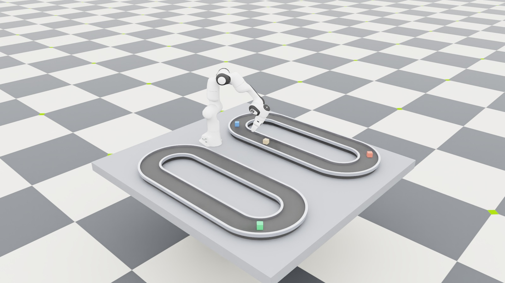
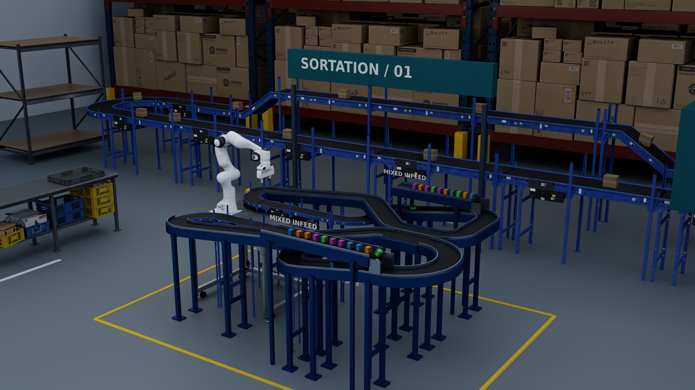

# Conveyor gripper transfer and warehouse sorting

A Franka continuously transfers four numbered 40 mm cubes between two counter-rotating
racetrack conveyors. The trained policy uses 123 observations and eight actions at 60 Hz,
with 120 Hz physics and a 0.35 m/s belt speed.



Newton traction uses the upstream `ConveyorForceModel`, including its MuJoCo contact
reporting. `isaaclab_contrib.conveyors.newton` adapts replicated surfaces, parcel selection,
configured belt speeds, and reset lifecycle; the task owns its geometry, commands, and reset recipes.

## Run

Newton is kitless and supports the lightweight GL viewer:

```bash
DISPLAY=:1 uv run isaaclab play --rl_library rsl_rl \
  --task IsaacContrib-Conveyor-Racetrack-Transfer-v0 \
  --checkpoint pretrained \
  --num_envs 8 --device cuda:0 --viz newton_gl --real-time
```

The `pretrained` selector downloads the RSL-RL policy published specifically for the Newton MJWarp
backend through Isaac Lab's standard published-checkpoint resolver.

Training uses the same task ID and defaults to 256 environments:

```bash
uv run isaaclab train --rl_library rsl_rl \
  --task IsaacContrib-Conveyor-Racetrack-Transfer-v0 \
  --num_envs 256 --device cuda:0
```

### Curriculum and evaluation

Racetrack training uses the shared [reset-buffer API](../../../../../docs/source/how-to/reset_state_buffers.rst)
from [#8872](https://github.com/isaac-sim/IsaacLab/pull/8872). `ResetStateBuffer` constructs and
stores the calibrated procedural recipes once, rejecting non-finite or out-of-limit joint states.
Task reset events restore their robot, cube and command state through normal asset APIs.
`ResetStateSampler` and `SuccessMonitor` favor rows near 50% transfer success while retaining
uniform coverage. Outcomes credit the previous reset row before a replacement is selected.
The buffer contains procedural recipes; it does not turn them into physically generated grasps.

Training uses standard PPO with the existing arm-and-gripper action distribution. Checkpoints
save policy and optimizer state; sampling history starts fresh when the environment is recreated,
including when resuming training. Playback disables adaptive sampling. Evaluate from moving-belt
starts to measure pickup and transfer ability independently of the easier training resets.

Playback uses home starts on moving belts. Check the native transfer and failure metrics,
and repeat with fixed seeds when comparing policies; easier reset-state training reward is not
an end-to-end pickup measure. The task uses the standard Isaac Lab play command and visualizers.

## Warehouse sorting

`IsaacContrib-Conveyor-Warehouse-Sorting-v0` adds the authored warehouse, shelving,
lighting, asymmetric conveyor returns and four-color parcel inventory. It reuses the
same 123-observation, eight-action gripper interface and preserves the manipulation
straights and adjoining bends. Suction sorting is a separate task documented
[here](../conveyor_suction/README.md).



The warehouse has 24 physical 40 mm parcels. Blue and green belong on one circulating
conveyor; orange and purple belong on the other. Four policy slots select from that
inventory without moving parcels when assignments change. Class dispatch uses metadata;
the state-based policy does not recognize color. Remote parcels use canonical waiting-slot
observations while local parcel states remain physical.

Use Kit for the USD materials and animated background inventory. Background parcels
are visual dressing and do not add collision bodies or policy observations.

```bash
DISPLAY=:1 uv run --extra isaacsim isaaclab play --rl_library rsl_rl \
  --task IsaacContrib-Conveyor-Warehouse-Sorting-v0 \
  --checkpoint /path/to/racetrack-policy.pt --num_envs 1 --device cuda:0 \
  --viz kit --real-time --kit_args=--/UJITSO/geometry=false
```

For a static GL approximation, use `--viz newton_gl` and
`env.sim.physics.load_visual_shapes=True`. External assets download on first use.
Compatible policy shapes do not establish successful warehouse sorting; evaluate
physical transfers and `batch_complete` separately. Training starts at home on the
actual feeds, with the racetrack reset curriculum disabled. Playback parks the arm
between assignments.

The task-owned USDA layers define routes, supports, parcel color bands and presentation.
NVIDIA geometry and textures remain references to their original remote assets under
their original licenses. `assets/conveyor_routes.usda` owns route centerlines and feed
positions; `assets/warehouse.usda` owns dressing, cameras, lights and animation. Resetting
a batch clears its slot assignments and parcel counters together.
