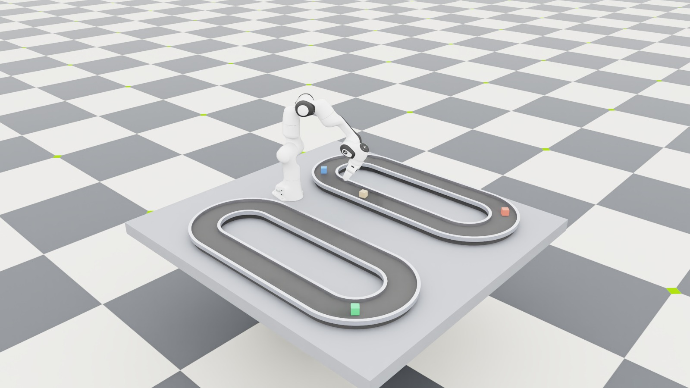

# Conveyor racetrack transfer

A Franka continuously transfers four numbered 40 mm cubes between two counter-rotating
racetrack conveyors. The trained policy uses 123 observations and eight actions at 60 Hz,
with 120 Hz physics and a 0.35 m/s belt speed.



Newton traction uses the upstream `ConveyorForceModel`, including its MuJoCo contact
reporting. `isaaclab_contrib.conveyors.newton` adapts replicated surfaces, parcel selection,
configured belt speeds, and reset lifecycle; the task owns its geometry, commands, and reset recipes.

## Run

Newton is kitless and supports the lightweight GL viewer:

```bash
DISPLAY=:1 uv run isaaclab play --rl_library rsl_rl \
  --task IsaacContrib-Conveyor-Racetrack-Transfer-v0 \
  --checkpoint pretrained \
  --num_envs 8 --device cuda:0 --viz newton_gl --real-time
```

The `pretrained` selector downloads the RSL-RL policy published specifically for the Newton MJWarp
backend. The Newton checkpoint is published on Isaac Dev. While the public mirror is syncing,
use a local checkpoint path if the download is unavailable.

Training uses the same task ID and defaults to 256 environments:

```bash
uv run isaaclab train --rl_library rsl_rl \
  --task IsaacContrib-Conveyor-Racetrack-Transfer-v0 \
  --num_envs 256 --device cuda:0
```

### Curriculum and evaluation

Racetrack training samples physically calibrated resets from release through moving-belt pickup.
The shared `SuccessMonitor` records whether each episode completed a stable transfer from its
sampled reset row. NIST's reusable `Sampler` mixes uniform coverage with a Beta-shaped score
centered at 50% transfer success, giving partly learned rows more practice while keeping every
row eligible. Reset recipes generate the robot and cube states directly; the task needs no
cached physical-state bank or assembly-variant machinery.

Training uses standard PPO with the existing arm-and-gripper action distribution. Checkpoints
save policy and optimizer state; sampling history starts fresh when the environment is recreated,
including when resuming training. Playback disables adaptive sampling. Evaluate from moving-belt
starts to measure pickup and transfer ability independently of the easier training resets.

Evaluate from home on moving belts, with fixed reset settings and a chosen seed:

```bash
uv run python -m isaaclab_tasks.contrib.conveyor_franka.evaluate \
  --checkpoint /path/to/model.pt --num_envs 8 --device cuda:0 \
  --steps 3600 --seed 0 --output /tmp/conveyor-evaluation.json
```

The report counts completed transfers in both directions, safety failures, non-finite observations,
and transfers per simulated environment minute. Repeat with different seeds when comparing policies;
intermediate-reset training reward alone does not establish deployment reliability.

## CPU PhysX playback

The optional PhysX task keeps the same policy inputs, actions, and reset recipes. It uses native
surface velocity on CPU; enabled surface-velocity contacts are unsupported with GPU dynamics.
Use an explicit local checkpoint and evaluate transferred policies on this backend:

```bash
DISPLAY=:1 uv run --extra isaacsim isaaclab play --rl_library rsl_rl \
  --task IsaacContrib-Conveyor-Racetrack-Transfer-PhysX-CPU-v0 \
  --checkpoint /path/to/model.pt --num_envs 1 --device cpu --viz kit --real-time \
  agent.device=cpu
```
