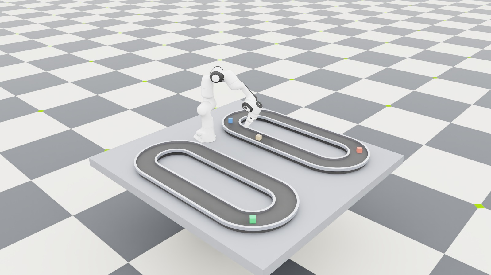
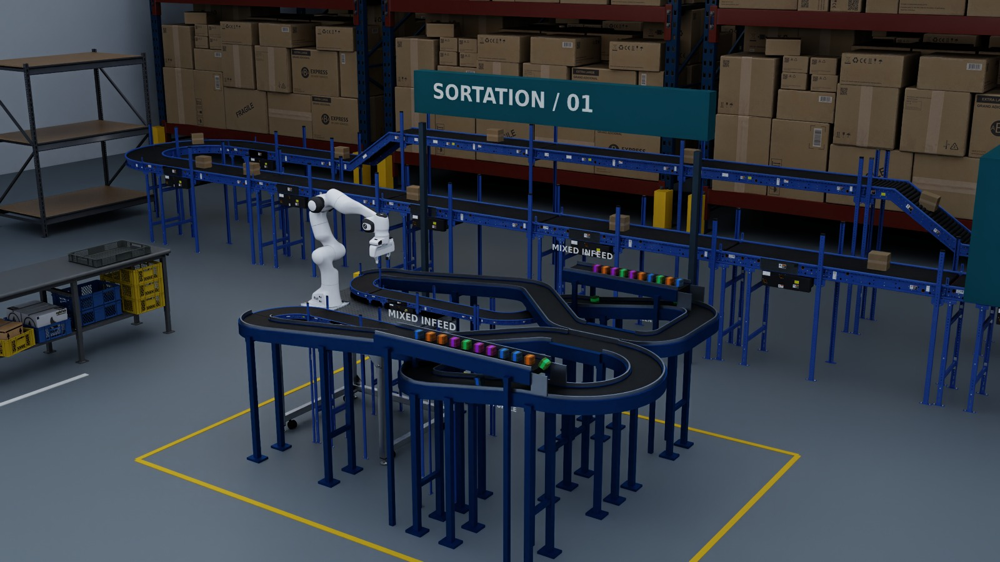

# Conveyor gripper transfer and warehouse sorting

A Franka continuously transfers four numbered 40 mm cubes between two counter-rotating
racetrack conveyors. The trained policy uses 123 observations and eight actions at 60 Hz,
with 120 Hz physics and a 0.35 m/s belt speed.



Traction uses a pinned extraction of Newton's force model and MJWarp contact reporting.
The public `isaaclab.controllers.Conveyor` API handles batched speed commands and
reset lifecycle; the task owns its geometry, transfer commands, and reset recipes.
`assets/racetracks.usda` contains the fixed decks and rails, exported from the original
procedural scene with its collision materials and section names. `env.conveyor` uses the
public `ConveyorCfg`, and the environment configures traction on the named USD sections.

## Run

Newton is kitless and supports the lightweight GL viewer:

```bash
DISPLAY=:1 uv run isaaclab play --rl_library rsl_rl \
  --task IsaacContrib-Conveyor-Racetrack-Transfer-v0 \
  --checkpoint pretrained \
  --num_envs 8 --device cuda:0 --viz newton_gl --real-time
```

The `pretrained` selector downloads the RSL-RL policy published specifically for the Newton MJWarp
backend through Isaac Lab's standard published-checkpoint resolver.

Training uses the same task ID and defaults to 256 environments:

```bash
uv run isaaclab train --rl_library rsl_rl \
  --task IsaacContrib-Conveyor-Racetrack-Transfer-v0 \
  --num_envs 256 --device cuda:0
```

### Curriculum and evaluation

Racetrack training uses Isaac Lab's [reset-buffer API](../../../../../docs/source/how-to/reset_state_buffers.rst).
`ResetStateBuffer` stores task-prepared procedural recipes. The reset event constructs and validates
those recipes once, then restores robot, cube and command state through public mask writers.
The core `ResetStateSampler` favors entries near 50% transfer success while retaining
uniform coverage. Completed outcomes credit the previous assignment before selecting its replacement;
unfinished manual resets do not count as failures.
The buffer contains procedural recipes; it does not turn them into physically generated grasps.

Training uses standard PPO with the existing arm-and-gripper action distribution. Checkpoints
save policy and optimizer state; sampling history starts fresh when the environment is recreated,
including when resuming training. Playback disables adaptive sampling. Evaluate from moving-belt
starts to measure pickup and transfer ability independently of the easier training resets.

Playback uses home starts on moving belts. Check the native transfer and failure metrics,
and repeat with fixed seeds when comparing policies; easier reset-state training reward is not
an end-to-end pickup measure. The task uses the standard Isaac Lab play command and visualizers.

## Warehouse sorting

`IsaacContrib-Conveyor-Warehouse-Sorting-v0` adds the authored warehouse, shelving,
lighting, asymmetric conveyor returns and four-color parcel inventory. It reuses the
same 123-observation, eight-action gripper interface and preserves the manipulation
straights and adjoining bends. Suction sorting is a separate task documented
[here](../conveyor_suction/README.md).



The warehouse has 24 physical 40 mm parcels. Blue and green belong on one circulating
conveyor; orange and purple belong on the other. Four policy slots select from that
inventory without moving parcels when assignments change. Class dispatch uses metadata;
the state-based policy does not recognize color. Remote parcels use canonical waiting-slot
observations while local parcel states remain physical.

Use Kit for the USD materials and animated background inventory. Background parcels
are visual dressing and do not add collision bodies or policy observations.

```bash
DISPLAY=:1 uv run --extra isaacsim isaaclab play --rl_library rsl_rl \
  --task IsaacContrib-Conveyor-Warehouse-Sorting-v0 \
  --checkpoint /path/to/racetrack-policy.pt --num_envs 1 --device cuda:0 \
  --viz kit --real-time --kit_args=--/UJITSO/geometry=false
```

For a static GL approximation, use `--viz newton_gl` and
`env.sim.physics.load_visual_shapes=True`. The warehouse composes its USD assets during scene
construction, including when Newton's visual shape import is disabled. External assets download on first use.
Compatible policy shapes do not establish successful warehouse sorting; evaluate
physical transfers and `batch_complete` separately. One direct reset restores the home robot
and all 24 parcels on the actual feeds; warehouse sorting builds no racetrack reset bank.
Playback parks the arm between assignments.

`assets/workcell.usda` composes the table, straight conveyor models and warehouse dressing in the
policy workspace. `assets/warehouse.usda` owns the cameras, lights and background animation.
`assets/parcel.usda` owns the carton color variants. NVIDIA geometry and textures remain references
to their original remote assets under their original licenses. The task derives traction geometry
and feed positions from `assets/conveyor_routes.usda` and resets batch inventory and counters together.

## Support and evaluation

Maximilian Krause ([@maxkra15](https://github.com/maxkra15)) maintains these Contrib examples
and the [suction variant](../conveyor_suction/README.md). Racetrack transfer is the small reference
for the public conveyor API; warehouse sorting demonstrates the same policy interface with a larger
physical inventory and authored scenery. Suction adds native acquisition and goal-conditioned placement.
Evaluate physical transfer/receipt success from full starts separately from curriculum outcomes,
and retain the focused API and reset-isolation checks. Promotion out of Contrib requires documented
policy evaluation and supported runtime coverage; application-specific scenery can remain an external
example. Remove or relocate an example if its owner can no longer maintain that coverage.
