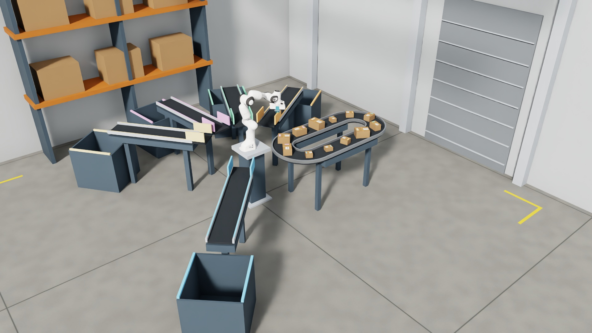

<!--
Copyright (c) 2022-2026, The Isaac Lab Project Developers (https://github.com/isaac-sim/IsaacLab/blob/main/CONTRIBUTORS.md).
All rights reserved.

SPDX-License-Identifier: BSD-3-Clause
-->

# Franka suction parcel sorting

`IsaacContrib-Conveyor-Suction-Sorting` uses a four-cup suction tool to sort parcels
from one circulating racetrack onto five or six receiving conveyors and into physical bins.
Every full episode starts with all parcels spaced around the racetrack; there is no elevated feeder.



## Setup

Use the standard repository environment (`uv sync`). The pinned upstream Newton revision
provides both conveyor forces and the
[surface-gripper model](https://github.com/newton-physics/newton/pull/3974).

## Train and play

Defaults use 512 environments, five parcels, 120-second continuous episodes and sparse reward:
**+10 for each qualified correct-bin receipt**. There are no reaching, lifting or motion rewards.
A delivery selects the next incoming parcel without resetting the robot. The batch ends when all
parcels arrive, an unsorted parcel is lost, the robot collides, or the episode times out.

```bash
uv run isaaclab train --task IsaacContrib-Conveyor-Suction-Sorting \
  --rl_library rsl_rl --num_envs 512 --device cuda:0

uv run isaaclab play --task IsaacContrib-Conveyor-Suction-Sorting \
  --rl_library rsl_rl --checkpoint /path/to/model.pt \
  --num_envs 1 --device cuda:0 --viz newton_gl --real-time
```

Use `--viz kit` in an Isaac Sim environment. `env.parcel_count` supports up to twelve fixed
parcel assets across five size classes. The default routes each class to its outlet;
`env.commands.sort.randomize_destination=true` instead samples independent target outlets.
Suction training remains experimental; a policy that solves full-start sorting has not been validated.

## Policy and reset sampling

The policy has **312 observations and four actions**. Observations contain robot/tool state,
selected-parcel pose, velocity and dimensions, an explicit parcel-center placement goal in the
robot frame, pickup/placement history, and a 64-ray collision point cloud with validity bits.
Actions are three Cartesian increments plus binary vacuum. Differential IK maintains a downward
tool orientation. Preserve the checkpoint's observation scales and mixed action distribution.

Training builds its procedural recipe buffer with the shared
[`ResetStateBuffer` API](../../../../../docs/source/how-to/reset_state_buffers.rst) from
[#8872](https://github.com/isaac-sim/IsaacLab/pull/8872). Collection validates finite recipe tensors,
joint limits and the existing IK residual; native reset hooks restore controller targets and seals.
These are procedural starts, rather than captured scripted grasp rollouts.
`ResetStateSampler` and `SuccessMonitor` track 64 progress levels each for controlled descent,
held transport, approach and empty-tool return, plus a full-home bucket. These 257 histories
are shared across the buffer's parcel, fixture and destination combinations.
Beta sampling favors intermediate success while retaining uniform coverage. Only the parcel
selected by the original reset updates that reset bucket; every later receipt still earns reward.
Held resets restore native suction seals, and no reset seeds delivery credit. Playback uses full
starts with an empty tool. Sampling histories are local to each worker and restart on recreation.

A release must be upright, near its goal, low above the receiving deck and moving slowly.
Only a qualified release followed by a settled receipt in the commanded bin counts; throwing a
parcel directly into the bin cannot satisfy the task. `full_start_success_rate` measures the
original full-start assignment; `full_batch_success_rate` measures all configured parcels.

Training uses 32 fixed fixture variants with coherent lane angles, heights and goal/bin frames.
Reset events vary parcel yaw and placement offsets; startup events vary mass/inertia and friction.
Use `make_logistics_layouts` with a separate seed and set
`scene.outfeeds.spawn.assets_cfg` before spawning to evaluate other layouts. Reserved angular
bands are available through `held_out=True`. A sixth lane is tested only when it is actually
commanded. Report full-start and full-batch results separately from curriculum success.

The 24 cm ray spacing can miss thin or occluded obstacles, and goals stay within supported,
reachable receiving areas. This example does not establish arbitrary-facility generalization.
The reset curriculum follows [Success Guided Sampling](https://arxiv.org/abs/2610.12465), pooling
progress outcomes across parcels and layouts instead of maintaining a history for every state.
