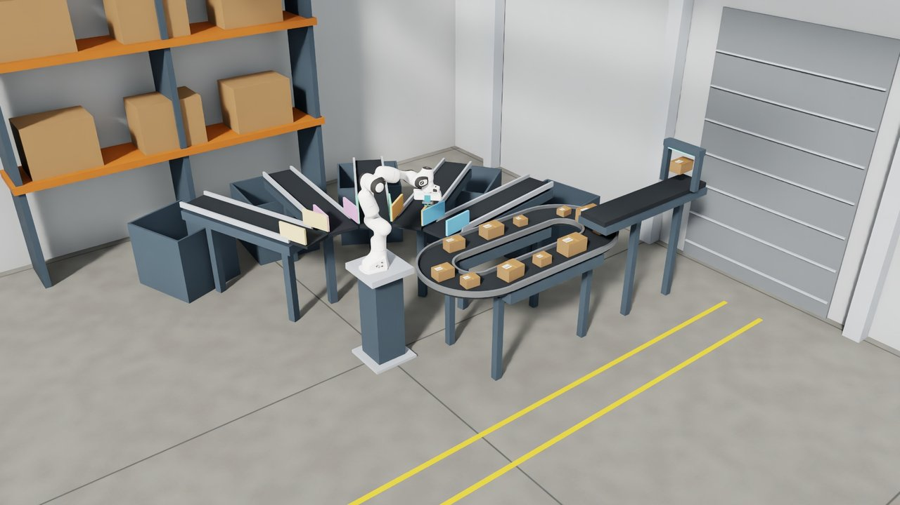

<!--
Copyright (c) 2022-2026, The Isaac Lab Project Developers (https://github.com/isaac-sim/IsaacLab/blob/main/CONTRIBUTORS.md).
All rights reserved.

SPDX-License-Identifier: BSD-3-Clause
-->

# Franka suction parcel sorting

`IsaacContrib-Conveyor-Suction-Sorting` demonstrates replicated force-based Newton suction
and shared success-guided reset sampling. Twelve differently sized parcels circulate through
a compact workcell with a gravity-drop feeder. A Franka places parcels onto five size-coded
outlets, whose powered belts deliver them into physical bins. The policy controls the arm
and vacuum; belts run continuously.



The tool has four suction cups of 4 mm radius on the existing Panda hand. Suction requires a nearby,
aligned parcel face and applies the upstream Newton prototype's compliant, capped forces.
It does not move parcels by writing their poses. The original fingers are visually hidden
and their collisions disabled. Existing finger-gripper policies require retraining.

## Experimental dependency

Newton's [surface-gripper prototype](https://github.com/newton-physics/newton/pull/3974)
is not merged. This branch pins an experimental public extraction of that implementation
and its matching MuJoCo dependencies in `pyproject.toml` and `uv.lock`; it does not vendor
the seal implementation into Isaac Lab. Stock Newton releases do not provide this API yet.

## Training and playback

The default from-scratch configuration uses 512 environments and 6,000 PPO updates.
It is a starting configuration; reliable twelve-parcel completion has not been established.

```bash
uv run isaaclab train --task IsaacContrib-Conveyor-Suction-Sorting \
  --rl_library rsl_rl --num_envs 512 --device cuda:0

uv run isaaclab play --task IsaacContrib-Conveyor-Suction-Sorting \
  --rl_library rsl_rl --checkpoint /path/to/model.pt \
  --num_envs 1 --device cuda:0 --viz newton_gl --real-time
```

With Isaac Sim installed, use `--viz kit` for RTX visualization.

The policy outputs three Cartesian target increments and one binary vacuum command. Standard
differential IK maintains a downward tool orientation. State observations include the
selected parcel's pose, velocity and dimensions, robot and tool states, and suction state.
Parcel dimensions vary across twelve fixed cuboid assets spanning five size classes.
The correct destination is determined by package dimensions; a destination command or
size-class label is not supplied to the actor. Colors make the scene readable without
becoming policy inputs.

## Reset distribution and success

The public `isaaclab_tasks.utils.ResetStateSampler` tracks recent outcomes and chooses
reset rows. Task-local generators produce belt, approach/grasp, carry and near-release states;
ordinary scene/asset writers restore them. Other parcels are shuffled among the remaining
belt and feeder slots to vary the order of subsequent pickups. The same sampler is used by the original
conveyor curriculum and can select procedurally generated or cached reset states.
It does not add another environment manager or a second scene-state serializer.

Training starts receive more practice when the policy has intermediate success, while
every reset row remains eligible. Sampling history is local to each worker and restarts
when the environment is recreated. Training success from an easier reset is not an
end-to-end pickup result. Evaluate separately from full belt starts and report correct-bin
deliveries by size class, wrong-bin deliveries, drops, and complete twelve-parcel batches.

Default training episodes require two deliveries within 30 seconds. Playback uses full belt
starts and requires all twelve within 240 seconds. `commands.sort.deliveries_per_episode`
defines the success criterion for termination, reset sampling and `full_start_success_rate`;
`full_batch_success_rate` separately requires all twelve receipts from a full start. Set the receipt goal to
one for isolated pick-and-transfer evaluation. Losing an unsorted parcel ends the episode.

For the twelve-parcel objective, the same four reset phases begin with eleven, eight, four,
or zero parcels already sorted into their physical bins. This provides shorter remaining-batch
problems without expanding the reset catalog. Pre-sorted inventory earns no receipt reward and
is excluded from `correct_deliveries`; full-start metrics exclude these partial batches.
Goals below twelve retain the original all-unsorted inventory. Full-start playback is unchanged.

Development runs continued compatible checkpoints through a three-receipt/120-second stage
before twelve-receipt/240-second fine-tuning. Use `--checkpoint /path/to/model.pt` to resume,
with `env.commands.sort.deliveries_per_episode` and `env.episode_length_s` overrides as needed.
Resuming retains optimizer state by default; these staged runs do not validate the default
from-scratch command as a recipe for complete batches.

## Facility references

The induction-loop/offload layout follows ordinary distribution-center organization,
including [Dematic's crossbelt sorter layouts](https://www.dematic.com/content/dam/dematic/downloads/brochures/NA_BR_1056_Crossbelt_Sorter.pdf).
The scene uses native primitives with physical decks, guards and bins; decorative
supports remain visual only.

Support owner: Maximilian Krause. This example incubates the Newton suction integration;
the adapter should follow the public upstream API once it stabilizes, and the task can be
relocated if this capability is covered by a smaller maintained example.
