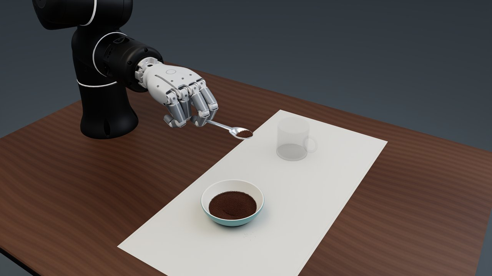

# Rizon–Sharpa coffee scooping

`IsaacContrib-Rizon-Sharpa-Coffee` is a manager-based tool-use environment with a
Rizon4s arm, a 22-joint right Sharpa Wave hand, a shallow steel spoon, an open
coffee bowl and a ceramic cup. Newton MPM simulates the coffee and optional
water; MJWarp simulates the robot. A scripted IK controller performs one scoop
and pour, followed by stirring when water is enabled. Apple Vision Pro input
uses the same action interface.



The image illustrates the setup; the current motion enters steeply, advances
about 15 mm while rotating flat **inside** the pile, then lifts level. The original
50 × 32 × 10 mm spoon and
1.8 mm shell are retained. A delivered dose of 8–10 g per scoop has not been
established with this spoon.

## Task and demo

The Gym registration points to `CoffeeEnv`, a `ManagerBasedRLEnv`, and
`CoffeeEnvCfg`. The task owns the action interface, observations, rewards,
terminations, scene resets and coupled physics. `mdp.py` defines its manager
terms; `dissolution.py` performs physical material conversion independently of
rendering. A registered RSL-RL PPO configuration uses this same environment.

`examples/demos/rizon_sharpa_coffee.py` is the demonstration runner, launched with
`uv run isaaclab demo rizon-sharpa-coffee`. It selects
scripted IK or AVP input, configures optional presentation, follows the spoon
with a camera and records video. Both controllers send actions through the same
task interface. Grain rendering, colour transport and surface reconstruction
are optional presentation resources; learning can run with no visualizer and
`grains_per_particle = 0`.

## Requirements and assets

Use the repository's uv-managed environment with Newton and a CUDA-capable
NVIDIA GPU. Install the `ovrtx` extra for standalone RTX rendering, an Isaac Sim
runtime for Kit, and the `teleop` extra for live hand tracking. The commands below
use `--no-sync` to preserve an already prepared simulation environment.

The robot reuses the licensed NVIDIA Fabrics-Sim USD and textures from the
workstation's RJ45 insertion task. They are not distributed in this repository.
On another workstation, set `ISAACLAB_FABRICS_SIM_RIZON_SHARPA_ROOT` to the complete
asset directory. `robot.py` declares the default cache location and validates
the USD-plus-texture bundle's SHA-256. A cached USD override repairs malformed
visual normals without modifying the source asset. The procedural tableware
is generated locally. Retargeting asset provenance and licenses are in
[assets/NOTICE](assets/NOTICE).

Kit presentation defaults to NVIDIA's public L-shaped kitchen sample from
`Isaac/Environments/replicator_kitchen/kitchen_l_island.usda`. The enclosed room,
SimReady appliances, cabinetry, windows and pendant lights are referenced only
after Newton constructs the physics model. Authored room collisions and rigid
bodies are disabled; the sample island, apple and decorative coffee cups are
excluded so the original worktable and task geometry remain usable. Matte sage
cabinets, warm plaster and brass accents complement the tableware. Rendering adds geometry and texture memory,
but no solver bodies, contacts or particles. Headless learning does not load it.
Use `--visualizer kit --backdrop kitchen` for this presentation, or
`--backdrop studio` to keep the previous studio and avoid the public asset download.

Live headset operation additionally requires IsaacTeleop, CloudXR and a
configured headset connection. Follow the maintained
[CloudXR guide](../../../../../docs/source/how-to/cloudxr_teleoperation.rst).
Physics, rendering and headset transport are separate runtime requirements.

For AVP finger retargeting, obtain the pinned official Sharpa URDF separately,
as in [IsaacTeleop's model setup](https://github.com/NVIDIA/IsaacTeleop/blob/c5fe6624cc4dff456485d2e786922c8e41100f83/examples/teleop_ros2/assets/urdf/sharpa_standalone/README.md):

```bash
coffee_urdf_dir="$HOME/.cache/isaaclab/sharpa/3e953f588ba9954cebaa720aaa4cee06a43a068e"
mkdir -p "$coffee_urdf_dir"
curl --fail --location \
    https://raw.githubusercontent.com/sharpa-robotics/sharpa-urdf-usd-xml/3e953f588ba9954cebaa720aaa4cee06a43a068e/wave_01/right_sharpa_wave/right_sharpa_wave.urdf \
    --output "$coffee_urdf_dir/right_sharpa_wave.urdf"
```

The teleoperation pipeline verifies the upstream SHA-256 before using the model.
It caches the same kinematics with unused visual and collision elements removed,
so DexPilot does not try to resolve the upstream STL bundle.
Set `ISAACLAB_SHARPA_RIGHT_URDF` for a different local path to the same file.
Scripted operation and PPO require only the robot USD bundle.

## Run and record

List available demos with `uv run --no-sync isaaclab demo list`. The earlier
`python scripts/demos/rizon_sharpa_coffee.py` invocation remains supported.

Start the dry Newton GL preview with five visual grains per physical particle:

```bash
uv run --no-sync isaaclab demo rizon-sharpa-coffee --keep_open
```

For the wet Kit demonstration and a video, use the following liquid pressure profile:

```bash
uv run --no-sync isaaclab demo rizon-sharpa-coffee \
    --mode scripted --water --visualizer kit --headless --video \
    --voxel_size 0.004 --physics_hz 400 --mpm_iterations 500 \
    --mpm_grid_capacity 49152 --grains_per_particle 5 \
    --spoon_margin 0.0036 --spoon_rim_margin_scale 0 \
    --render_samples 4 --width 1280 --height 720 \
    --output_dir logs/coffee_video
```

For an experimental coarse Newton GL recording, keep the tool margin independent
of the larger grid and use finer visual grains:

```bash
uv run --no-sync isaaclab demo rizon-sharpa-coffee \
    --water --visualizer newton_gl --headless --video \
    --voxel_size 0.010 --physics_hz 100 --rigid_hz 400 \
    --mpm_iterations 150 --mpm_grid_capacity 1536 --spoon_margin 0.0036 \
    --grains_per_particle 128 --width 1280 --height 720 \
    --output_dir logs/coffee_video_coarse
```

This profile seeds 4,530 physical particles at 5 mm spacing and displays coffee
grains with approximately 0.45 mm radius. On an RTX 4090 it measured approximately
0.42 times real time headlessly and 0.27 with GL rendering and 720p CRF 18 recording.
Using 125 iterations and 64 visual grains reached 0.47 headlessly, but its
liquid-level check had little headroom. The full 150-iteration demo retained the
water with about 2 mm of surface-height loss after stirring. This is a speed experiment:
fine rendering grains do not restore physical scoop resolution, and resampling
reduces the seeded coffee and water mass near vessel boundaries. The finer
profile remains the reference for liquid level and tool contact fidelity.

`--video` defaults to Newton RTX unless `--visualizer` is explicit. It requires
FFmpeg and writes `coffee.mp4`, phase images, `run.json`, `metrics.json` and
`spoon_poses.jsonl` to the output directory. The MP4 uses H.264, CRF 14, the
`slow` preset, grain-preserving encoding and `yuv420p`. Its default 25 fps
timebase plays at simulation speed, independently of the wall time required to
render. `--video_fps 50` or `100` increases capture cadence; `--video_crf` selects
compression quality, with lower values retaining more detail. Set
`--width 1920 --height 1080 --video_render_scale 2` to render at 4K and downsample
to 1080p with Lanczos filtering. Failed runs finalize the partial video. Do not
reuse an output directory whose recording needs to be retained.

`run.json` stores the resolved simulation configuration under `simulation` and
the CLI options under `arguments` (metadata schema 2). Particle counts, fill
heights, spoon margins and video timing remain explicit. The recorder streams
frames to FFmpeg and flushes video and rollout logs when a run ends or fails.

Kit requires its own USD libraries. When a separately installed USD SDK takes
precedence, run with the Kit USD directory first on `PYTHONPATH` and its `bin`
directory plus the Kit runtime directory first on `LD_LIBRARY_PATH`:

```bash
COFFEE_KIT_ROOT="$(uv run --no-sync python -c 'from importlib.metadata import distribution; print(distribution("isaacsim").locate_file("isaacsim").resolve())')"
COFFEE_KIT_USD="$(uv run --no-sync python -c 'from pathlib import Path; from importlib.metadata import distribution; print(next(distribution("isaacsim").locate_file("isaacsim/extscache").glob("omni.usd.libs-*.cp312")))')"
env OMNI_KIT_ACCEPT_EULA=YES \
    PYTHONPATH="$COFFEE_KIT_USD${PYTHONPATH:+:$PYTHONPATH}" \
    LD_LIBRARY_PATH="$COFFEE_KIT_USD/bin:$COFFEE_KIT_ROOT/kit${LD_LIBRARY_PATH:+:$LD_LIBRARY_PATH}" \
    uv run --no-sync isaaclab demo rizon-sharpa-coffee \
    --water --visualizer kit --headless --video --output_dir logs/coffee_video
```

The desktop **Reset** control restarts the entire episode and script. With
`--keep_open`, the viewer remains open after completion. `--camera fixed` holds
the initial view. The following camera smoothly eases its target, angle and
distance, raises the view into the cup for pouring, and moves right into a close
front view of the fingers, spoon and liquid for stirring. It holds the cup framing
while the hand withdraws. `--max_steps 8000` gives
80 simulated seconds at the 100 Hz control rate.

The scripted demo pours 30 mm above the cup mouth and centres the releasing lip
over the liquid. Its default 20 ms wetting delay converts contacted coffee into
liquid within one frame at the default 25 fps; the task's configurable 120 ms default remains
available for learning experiments.

## Physics and collision settings

The demo defaults to a 4 mm grid for visual quality. The environment
configuration defaults to a 2 mm grid and 800 Hz physics. The
demo selects 400 Hz for a dry mounted scripted run at 2 mm or a wet mounted
script at 3 mm and above; other runs default to 800 Hz. `--physics_hz` selects
100, 120, 200, 400 or 800 Hz, and `--mpm_substeps` multiplies the material step rate.
At 120 Hz, control runs at 60 Hz and mounted robot integration defaults to
840 Hz (seven rigid steps per physics tick). The spoon collider is updated at
each material step; use one MPM substep for this profile. Videos default to
30 fps at this rate. Other profiles use 100 Hz control and 25 fps recording.
Mounted robot integration otherwise defaults to 800 Hz;
`--rigid_hz 400` reduces it independently when the coupling rate is at most
400 Hz. Contact grasping keeps its 1,600 Hz solver-entry profile.

The 120 Hz mounted profile can be selected with `--physics_hz 120`. The
4 mm experiment uses `--mpm_iterations 150 --mpm_grid_capacity 16384`;
check sparse-grid overflow, liquid containment and settled liquid level when
changing the fill or motion. A complete 120 Hz run at 250 iterations contained
all water but reduced its settled surface height by about 8 mm after stirring.
The conservative wet defaults remain 400 Hz and 500 iterations.

The MPM profile uses sparse CUDA graph capture, `P1d` strain interpolation,
`pic27` particle-sampled contacts, `backward` collider velocities and native
background-air regularization. Hard particle projection is disabled. The
default iteration cap is 100 for dry runs and 500 with water, which uses Newton's
standard `gs` solver. `--mpm_iterations` and `--mpm_grid_capacity` permit
explicit overrides; zero grid capacity requests automatic sizing. Grid overflow
must be checked when changing the fill, resolution or motion.

Broad spoon faces use a margin of 1.2 physics voxels; container margins are
0.3 voxels. The spoon's bowl margin tapers over its outer 15% to **zero at the
rim**, keeping the contact lip at the actual mesh rather than supporting coffee
beyond its edge. Broad faces retain their clearance against tunneling.
Native per-face collider materials implement the taper before graph capture;
the closed shell and handle retain their geometry. `CoffeeEnvCfg.spoon_margin_voxels`
and `--spoon_rim_margin_scale` control these values. `--spoon_margin` overrides the
broad margin in metres, preserving a useful tool clearance on larger grids.
Reducing the timestep rate or margin requires checking loaded-tool containment
as well as the complete path.
Negative rim margins are not supported: they erode the thin collision shell.
Particle speed is capped at half a physics voxel per MPM substep, up to 4 m/s.
This keeps coarse-step advection within the native collider query band and
limits fast pressure-driven outliers without projecting particles out of walls.

At 2 mm, the default source contains 456,836 physical particles at 1 mm spacing,
with 205.5762 g total mass and density 450 kg/m³. Supported grids span 1–10 mm.
Coarser grids resample the fill at half-voxel spacing while retaining density.
Grain rendering only decorates
those physical particles. `--grains_per_particle 0` disables presentation for
learning; factors 1, 3, 5, 10, 20, 64 and 128 change visual sampling without increasing
physical contact resolution.
The visible grains are passive samples of each deformed physical particle, not
independently colliding bodies. Some visual overhang can therefore remain even
with zero rim margin; a smaller rim offset does not guarantee that every rendered
grain stays within the lip.

## Water, dissolution and surface reconstruction

`--water` initializes a fuller cup with a 75 mm seed height and a 37 mm seed
radius. The free surface settles below the seed height within the cup's 39 mm
interior radius; headroom remains for pouring and stirring.
Construct `CoffeeEnvCfg(water_enabled=True)` to select the liquid pressure profile.
The wet 3 mm demo uses 400 Hz MPM and eight physical particles per cell. A 200 Hz
step with a small iteration budget can lose visible liquid volume during stirring
despite conserving mass. Smaller voxels or more particles alone do not correct an
underconverged pressure solve. Check the settled level after withdrawing the spoon,
along with containment and mass, when changing these settings.
The task keeps the standard Gauss-Seidel solver for mixed powder and liquid runs.
Cup-only tests with the reordered SoA solver were promising, but complete scene
validation scattered dry coffee during settling. The liquid profile requires no
changes to the pinned Newton dependency.
`--water_fill_height` overrides the task default within 12–79 mm. For example,
`--water_fill_height 0.060` reduces the initial fill. The procedural cup handle
has upper and lower wall attachments and remains visual decoration.

Soluble coffee accumulates wet contact time and converts after 0.12 s into the
contacted liquid's MPM material.
Conversion retains mass, position, velocity and particle identity, sets the
reference volume from liquid density, and clears granular stress. The physical
conversion runs inside captured MPM stepping even when presentation is absent.
World-local resets restore the original material and wetting history. The
installed Warp build needs distinct wetting and rendering hash-grid descriptor
types to keep rendering-grid updates from interfering with captured wet queries;
the graph-replay regression covers that dependency behavior.

Converted coffee joins the reconstructed liquid surface and stops rendering as
dry grains. Its mass initializes a colour tracer on the new liquid carriers.
Particle motion advects the tracer; symmetric, bounded neighbour exchanges at
25 Hz conserve its mass while mixing it. This is phenomenological optical
mixing, not calibrated molecular diffusion or a solver for arbitrary material
property diffusion.

Surface reconstruction uses Newton's native `ParticleSurface` density field,
anisotropic kernels, spatial field smoothing and mesh smoothing at 0.3 times
the physics voxel size, capped at 1.5 mm for coarser physics grids. A task-local
**60 ms exponential filter** blends density at fixed spatial voxel coordinates
before marching cubes. It does not blend
vertex indices, which change between meshes. New voxels use the current field;
reset discards history. `--surface_smoothing_time 0` disables temporal filtering.
The setting affects rendering only and introduces a short visual response lag.

Geometry is reconstructed once per physics state and reused by repeated viewer
and capture calls. Kit and RTX use shared mesh vertices with interpolated local
colours and normals; GL uses the viewer's texture atlas. Kit's water material
uses the tracer colour for optical absorption. The render field uses exact
allocation to handle dispersed droplets, independently of the bounded captured
physics grid. No Newton source modification is required.

## Teleoperation and grasp resets

```bash
uv run --no-sync isaaclab demo rizon-sharpa-coffee \
    --mode avp --water --visualizer newton_rtx \
    --cloudxr_env /path/to/cloudxr.env --keep_open
```

The calibrated OpenXR wrist controls the palm. Its first valid sample anchors
to the measured simulated pose; reset re-clutches. Translation is bounded to
0.25 m/s and rotation to 1.2 rad/s. DexPilot retargets the raw right-hand skeleton
to the 22 named Sharpa joints using pinned geometry and limits. The XR anchor is
applied to wrist control once; it is not reapplied to finger retargeting. Missing
wrist tracking holds the previous arm target, and missing finger tracking holds
the last complete hand command. A desktop rollout does not validate live headset
transport.

The default spoon follows the **measured** palm through a graph-safe kinematic
attachment at every physics tick, with the correct centre-of-mass twist. It
does not apply reaction force to the hand. The task accepts 28 actions: three
robot-base translation increments, three axis-angle rotation increments and
22 named finger controls. At the default 100 Hz policy rate, unit arm actions
represent 5 mm or 0.03 rad. Finger actions in `[-1, 1]` map to the authored joint
limits. IK targets remain within the articulation's soft joint limits.

The scripted and AVP controllers produce absolute palm XYZ/XYZW and finger
angle targets. The runner calls `env.actions_from_targets()` before each step
to encode them into the task interface. This preserves the existing pose
trajectories. PPO clips exploration to `[-1, 1]`; absolute demonstration targets
retain their full pose error.

Author a named grasp candidate with independent initial positions and motor
preload targets:

```bash
uv run --no-sync python scripts/tools/create_coffee_grasp_reset.py \
    --output /tmp/coffee_grasp.json
uv run --no-sync python scripts/tools/create_coffee_grasp_reset.py \
    --input /tmp/coffee_grasp.json --output /tmp/coffee_grasp.json --validate
uv run --no-sync isaaclab demo rizon-sharpa-coffee \
    --grasp_reset /tmp/coffee_grasp.json
```

The optional validator screens a free 25 g spoon under gravity with the imported
collision meshes and MuJoCo CPU physics. A stationary screen does not certify
grasp acquisition or moving MPM scooping. `--grasp_mode contact` is experimental:
it removes the mount, loads an authored contact candidate and uses two-way MPM
proxy coupling with finite proxy inertia. Moving grasp retention and hand/bowl
clearance remain limitations of that mode; the mounted script is the supported
demonstration.

## Learning and validation

The task provides observation, reward, action, reset and termination managers
and a state-based RSL-RL PPO baseline. It does not bundle a trained policy. The
110 policy observations include joints, palm and spoon poses, vectors to the
source and cup, coffee fractions and the previous action. Success requires the
configured coffee fraction in the cup for a dwell period. A small approach reward
guides an empty spoon to the source and a loaded spoon to the cup, using measured
contents rather than scripted phases. Other rewards use delivery, retention,
spill, action changes and success. Dose reporting is independent of the success
threshold. The demo disables success termination so it can complete
both scoops and stirring; PPO retains success, invalid-state and timeout resets.

Train the dry mounted task without presentation resources:

```bash
uv run --no-sync isaaclab train --rl_library rsl_rl \
    --task IsaacContrib-Rizon-Sharpa-Coffee --num_envs 4 --visualizer none
```

The baseline uses normalized actor and critic observations, a 28-action Gaussian
policy, and the native PPO runner and vector wrapper. `agents/rsl_rl_ppo_cfg.py`
defines its hyperparameters. They are a starting point; successful learning
and a target delivered dose have not been established. Keep environment counts
small initially because each world owns a fine MPM grid. Larger voxel sizes can
reduce training cost but change spoon containment and must be validated before
using them for policy development. Optional water conversion is enabled with
`env.water_enabled=True`; the dry task is the default learning configuration.

The current workstation also uses pinned Newton main and Warp nightly builds
for MPM optimizations. Their revisions are declared in the root `pyproject.toml`
and `uv.lock`. Include that dependency update in review or land it as a
prerequisite; the captured material-conversion regression does not pass on the
repository's earlier Newton 1.6.0 / Warp 1.17.0 combination. The task does not
patch Newton itself.

Play a saved policy with the standard runner:

```bash
uv run --no-sync isaaclab play --rl_library rsl_rl \
    --task IsaacContrib-Rizon-Sharpa-Coffee --num_envs 1 \
    --checkpoint /path/to/model.pt --visualizer newton
```

Focused tests are in `source/isaaclab_tasks/test/contrib/test_rizon_sharpa_coffee_*.py`.
They cover asset geometry and clearance, native loaded-spoon containment,
batched mounted dynamics, action encoding, PPO timeout resets, contact hold/release, physical
dissolution during graph replay, conservative colour transport, spatial surface
history, GL texture upload and retargeting conventions. Robot integration tests
require the licensed asset bundle; the other contracts use generated fixtures.
Run each file in a separate process with `uv run --no-sync python -m pytest`.

For complete recordings, check finite particle state, unchanged total mass,
converted-particle material and volume, colour conservation, physics and render
grid status, actual delivered grams, spill and the complete decoded MP4.
Loaded-spoon watch regions measure only their enrolled particles and cannot
establish an exhaustive no-spill guarantee. Rendering cost, physics throughput
and combined recording real-time factor are different measurements; use a
controlled GPU workload when comparing performance.
